### PART F2-7

### MERRYLANDS NEIL

### STREET PRECINCT

This page has been left intentionally blank.

## 1. Introduction

### 1.1 Land to which this Part applies

This Part provides development controls to guide the future development in the Neil Street

Precinct. This Part specifies the built form controls for all development with the Precinct, and

sets in place urban design guidelines to achieve the vision for Neil Street Precinct as stated

under Section 2. The provisions of this Part apply to Merrylands Neil Street Precinct, shown edged in heavy

black on Figure 1.

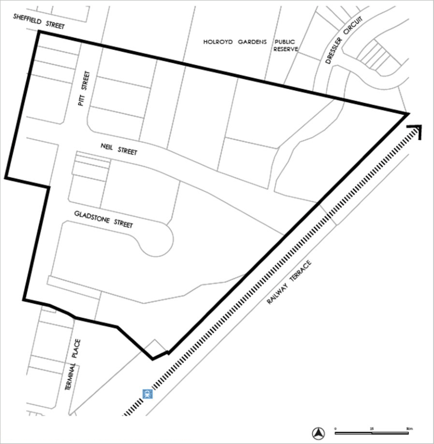

> [Picture on page 102: a picture, saved as a picture (images/part-f2-business-site-specific-page-102-9.gif, 150 dpi).]

Figure 1 – Merrylands Neil Street Precinct Boundary

In the event of any inconsistencies between these controls and any other provisions of the DCP,

the provisions in this section prevail in so far as the extent of the inconsistency.

## 2. Vision

The purpose of this Part is to provide objectives, controls and design criteria to achieve desirable

development outcomes consistent with Council’s vision for the Neil Street Precinct (the Precinct). This

Part also includes Block specific objectives where applicable for the developments sites identified within

the Precinct. Where objectives are not specified for a Block, the overall objectives for the Precinct

should be followed. The Precinct is envisioned to be characterised by a high-quality, well designed, safe and liveable

environment within walking distance to Merrylands Railway Station, which is the main transport hub for

the area. Properties along Pitt Street and the future development along New Road 1 will support a mix

of retail, commercial office/business and residential functions.

## 3. Objectives and controls

### 3.1 General

#### Objectives

Ensure the Precinct will be characterised by a high-quality, well-designed and safe

environment.

Create an urban structure that will:

• promote a balance of residential and commercial uses within the Precinct; and

• provide a transition from the more intense development near the Train Station to

peripheral areas along the Holroyd Gardens. Create an access network that will:

• provide a safe and convenient pedestrian environment that will encourage social

interaction and encourage public transport use;

• promote greater connectivity and integration between land uses and the Train

Station; and

• create additional Streets that will:

- reduce pressure on Pitt Street.

- provide new opportunities for business. Create an open space network that will:

• include a network of diverse active and passive recreational spaces to support the

residential and working population of the Precinct; and

• provide safe, accessible, sustainable, well-used and designed open-space network.

### 3.2 Urban design

#### Objectives

Enhance connectivity within the Neil Street Precinct and with the surrounds.

Maintain and develop spaces that encourage social interaction for all people, which will

contribute to people’s sense of place.

Integrate the management of stormwater and floodwater into the design of public open

space to establish an adaptable public domain capable of accommodating a broad

range of uses, experiences and activities, while still maintaining its primary function of

overland stormwater drainage.

Promote the “green and leafy” character associated with established trees within

Holroyd Gardens.

Maintain the sense of spaciousness created by the lower density built form and Holroyd

Gardens to the north through the extensive network of private and public open space

areas.

Provide appropriate interfaces to surrounding residential and open space areas.

Improve the visual quality of the Sydney Water Concrete Culvert by incorporating

landscaping to soften the appearance which will not only provide a sustainable drainage

system but also enhance the recreational value of the Precinct.

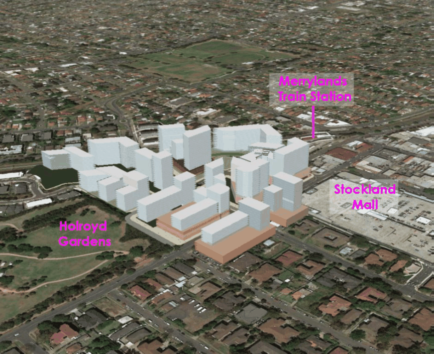

> [Picture on page 104: a picture, saved as a picture (images/part-f2-business-site-specific-page-104-12.gif, 150 dpi).]

Figure 2: Neil Street Precinct Vision

### 3.3 The Structure Plan

#### 3.3.1 Desired future character

Neil Street Precinct Character Statement Neil Street is characterised by accessibility to the Holroyd Gardens to the north, Merrylands

Centre to the west, Merrylands Train Station to the south, the Neil Street Park and the overland

flow path recreational open space. The accessibility of Precinct is enhanced by the proposed

extension of Sheffield Street to the north, proposed New Road 1 and New Road 2 and the

various potential mid-block connections creating a high level of pedestrian permeability away

from the main streets. Pitt Street, which is a regional road, is a significant link between

Merrylands and Parramatta. Given the street hierarchy of Pitt Street, it provides an opportunity

for it be established as a built form spine with ground level activity to be focused along Pitt

Street. Neil Street is the only entry from the west for the Precinct. Given the street hierarchy, Neil Street

provides an opportunity for it to be established as a secondary built form spine where taller

buildings can be located. In addition to residential uses, the Neil Street Precinct is expected to accommodate commercial/

retail uses that support and enhance the liveability of the place. Active uses will be located

facing Pitt Street, and New Road 1 enhancing the vibrancy of the public domain. The visual character of certain locations within the Precinct such as the intersection of Neil

Street and New Road 1, the intersection of Pitt and Neil Streets, the intersection of Neil Street

and the Neil Street Bridge are significant as they provide opportunities to position locational

buildings, which will enhance the skyline of the Precinct within the broader Merrylands Centre

context (Refer Figure 2).

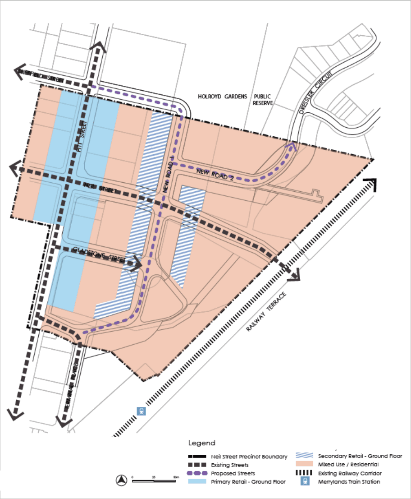

> [Picture on page 106: a picture, saved as a picture (images/part-f2-business-site-specific-page-106-1.gif, 150 dpi).]

Figure 3: Existing site

#### 3.3.2 Urban Structure Plan

The Structure Plan sets out the broad framework for development within the Neil Street

Precinct. It underpins the development controls for the Precinct. The Structure Plan reflects and

builds on the existing land uses and functions within the broader Merrylands Centre to

implement the vision for Neil Street as a high-quality, well designed, safe and liveable

environment (Refer Figure 3). The Neil Street Precinct will predominantly include new residential development, while the

commercial core will be centred on McFarlane Street/Merrylands Road. Intense development

centred within the Merrylands Centre is proposed to transition through Neil Street Precinct to

the lower scaled residential areas adjoining the Neil Street Precinct. The Structure Plan is comprised of three elements:-

• Access Network;

• Public Open Space; and

• Built Form Network. Development in the Neil Street Precinct must occur within the framework of the Structure Plan

objectives and controls, which establishes built form, open spaces and street layout. The

synthesis of these elements will strengthen the desired character and connection within the

broader area and create the public domain environment within which development can occur.

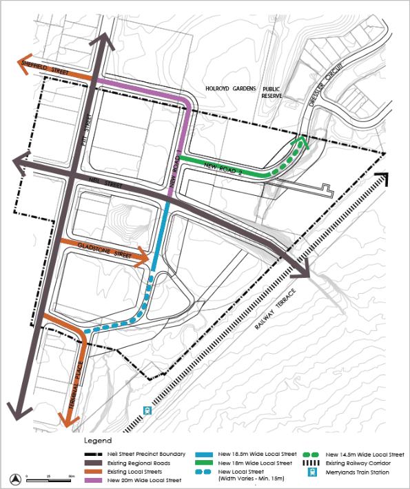

> [Picture on page 107: a picture, saved as a picture (images/part-f2-business-site-specific-page-107-19.gif, 150 dpi).]

Figure 4: Existing and new street network

### 3.4 Access network

#### 3.4.1 Street/access network

The Street Network Structure Plan provides a clear hierarchy of street types, including the

extension of existing streets and new streets. The street network is made up of the following

new streets:

• New Road 1; and

• New Road 2. The new roads maximise connections within the Precinct and to surrounding areas and aims to

substantially improve pedestrian and cycle paths to enable a more permeable public domain.

#### Objectives

Improve pedestrian, cycle and vehicular accessibility within the Precinct and the broader

Merrylands Centre.

Provide a street network that responds to the constraints of drainage, existing

development and future subdivision patterns.

Provide improved access to public open spaces within the Precinct.

Accommodate increased traffic movement within the Precinct and broader Merrylands

Centre.

Provide additional opportunities for on-street parking.

#### Controls

Provide new public streets as shown in Figure 4.

Refer to Section 3.4 for detailed information regarding the required width, design and

location of each street type.

Setbacks along streets are to be provided in accordance with Section 3.8.

The width of footpaths shall be maximised for comfortable pedestrian movement; to

facilitate tree planting and where bike routes exist, to allow cycling off road.

Streets are to be planted with trees appropriate in character to reflect the street

hierarchy and in consultation with Council’s landscape architect

New streets are to be dedicated to Council. New streets are to be maintained by the

landowner until dedicated to Council.

Land owners within the Precinct to consult Council’s engineers for detail infrastructure

works.

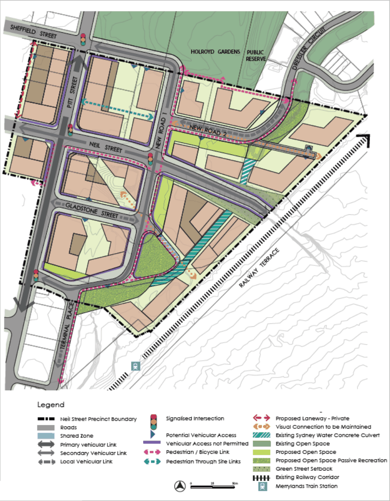

> [Picture on page 109: a picture, saved as a picture (images/part-f2-business-site-specific-page-109-1.gif, 150 dpi).]

Figure 5: Connectivity

#### 3.4.2 Connectivity

Through site links, arcades, visual and pedestrian/cycle connections have been established to

enhance the connectivity and permeability of the Precinct and include the following (Refer

Figure 5):

• a new pedestrian link along the northern boundary of the Precinct providing a direct link

between Dressler Circuit, Holroyd Gardens and Sheffield Street;

• an east-west visual connection from New Road 1 to the Railway Corridor to the east;

• an arcade (pedestrian through site link) linking New Road 1 to Pitt Street;

• a through site link is proposed as an extension of New Road 2 to the west; and

• a north-south through site link connecting Neil Street to Sheffield Street at the Precinct

boundary.

#### Objectives

Ensure pedestrian ways, through-site links and arcades are accessible, continuous, well

lit, safe and supported by active retail uses.

Encourage development that expands and enhances the Merrylands Centre public

domain.

Promote pedestrian activity and contribute to the vitality of the Precinct.

#### Controls

Provide through-site links and pedestrian ways as indicated in Figure 5.

Through-site connection and arcade must:

• provide a clear sight-line from one end to the other for surveillance and accessibility, in

midblock locations;

• have a minimum width of 12m;

• extend and enhance the public domain and have a public domain character; and

• be designed to consider pedestrian safety and the security of adjacent businesses,

particularly at night. Public use of through-site connections should be available at least between the hours

of 7.00am to 7.00pm daily.

Connections through foyers and shops are encouraged.

Consider supplementary arcades and through-site connections, with outdoor areas

such as courtyards or outdoor rooms.

Vehicular entry points are not permitted along Pitt Street, Neil Street and New Road 1

south of New Road 2.

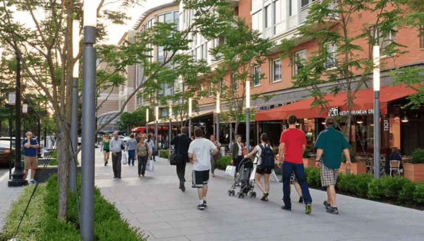

> [Picture on page 111: a picture, saved as a picture (images/part-f2-business-site-specific-page-111-1.gif, 150 dpi).]

Figure 6: Pennsylvania Avenue Washington DC - Desirable active street frontage (Source:

au.pinterest.com)

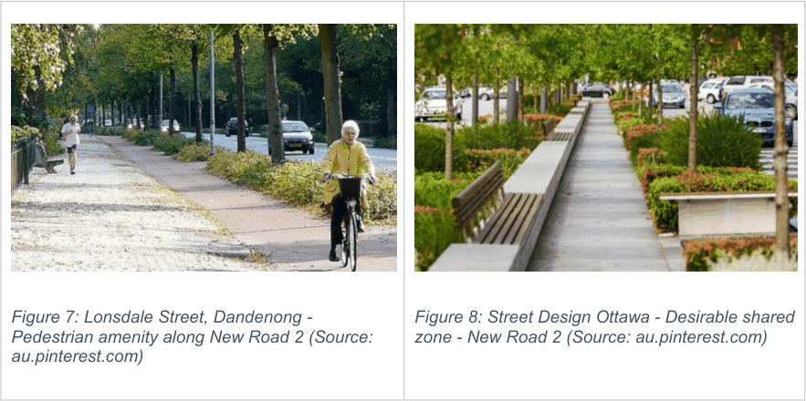

> [Picture on page 111: a picture, saved as a picture (images/part-f2-business-site-specific-page-111-4.gif, 150 dpi).]
> Words printed on the picture (title and legend, copied from the PDF):
> zone - New Road 2 (Source: au.pinterest.com)
> Pedestrian amenity along New Road 2 (Source:
> au.pinterest.com)

Figure 8: Street Design Ottawa - Desirable shared

Figure 7: Lonsdale Street, Dandenong -

#### 3.4.3 Streets

New Road 1 The width of New Road 1 varies between 15m at the Terminal Place intersection to 20m at the

Holroyd Gardens interface. These widths are based on the predominant use and the intensity

of the existing patterns of access, circulation and movement within the Merrylands Centre and

the particular topographic conditions across the Precinct. New Road 1 is intended to ease the traffic pressure from Pitt Street to achieve greater amenity

for pedestrian and cyclist movement in the public domain.

#### Controls

Buildings are required to be setback from streets (Refer Section 3.8 for street setbacks).

Lighting, paving, street furniture, landscaped setbacks and tree planting are to be

provided following consultation with Council’s landscape officers.

New Road 1 is to be provided in accordance with Figures 4, 10, 11 and 12.

New Road 2 The width of New Road 1 varies between 18m at the intersection of New Road 1 to 14.5m at

the Holroyd Gardens interface.

#### Control

New Road 2 is to be provided in accordance with Figures 4, 13 and 14.

Neil Street and Pitt Street

#### Controls

A 3m x 3m splay corner to be provided at the corner of Neil and Pitt Streets (Affected

lot - 185 Pitt Street)

A 0.65 road widening to be provided along Pitt Street at 185 Pitt Street to incorporate a

cycle path.

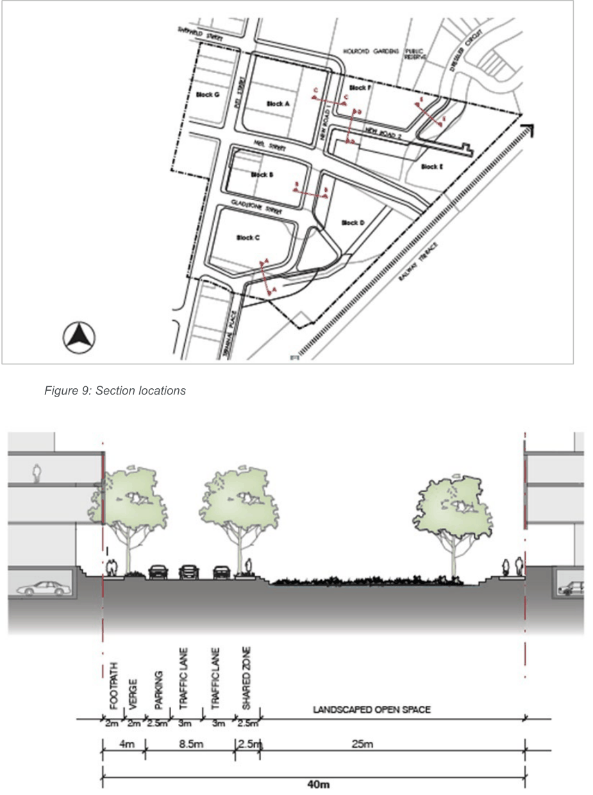

> [Picture on page 113: a picture, saved as a picture (images/part-f2-business-site-specific-page-113-1.gif, 150 dpi).]

Figure 9: Section locations

Figure 10: Section AA

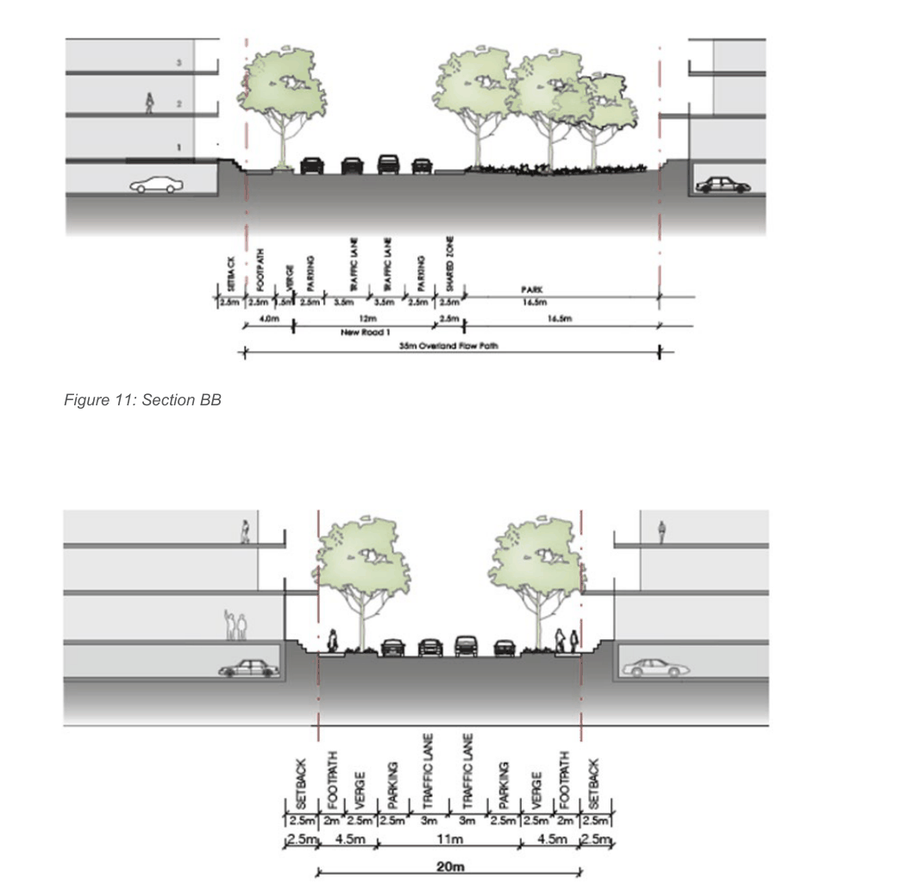

> [Picture on page 114: a picture, saved as a picture (images/part-f2-business-site-specific-page-114-1.gif, 150 dpi).]

Figure 11: Section BB

Figure 12: Section CC

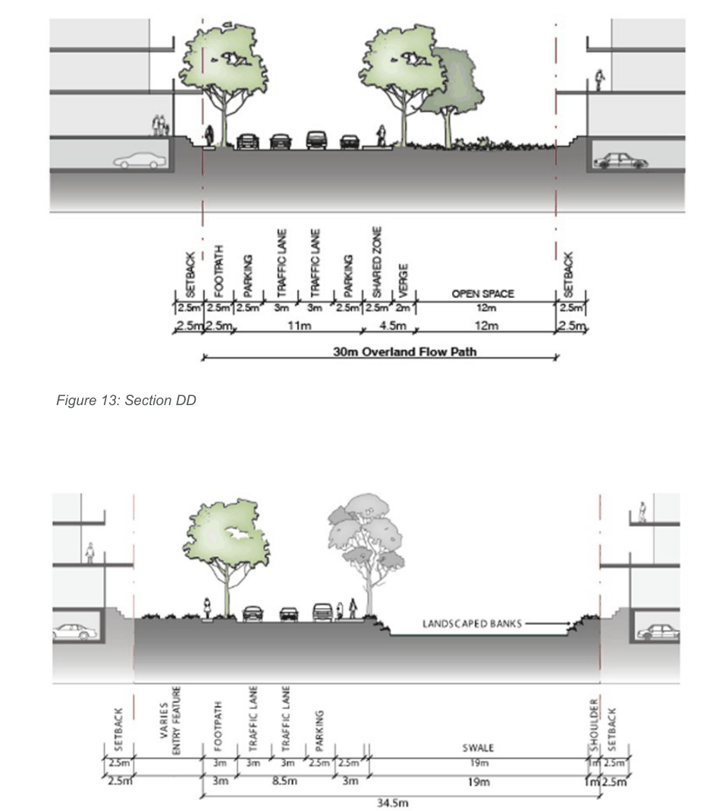

> [Picture on page 115: a picture, saved as a picture (images/part-f2-business-site-specific-page-115-1.gif, 150 dpi).]

Figure 13: Section DD

Figure 14: Section EE

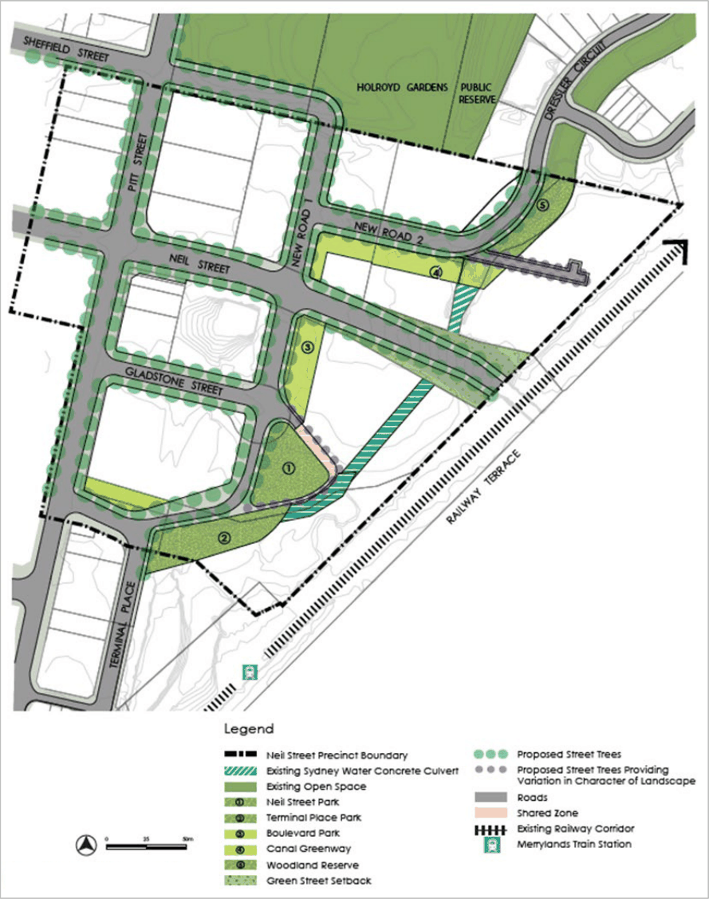

> [Picture on page 116: a picture, saved as a picture (images/part-f2-business-site-specific-page-116-1.gif, 150 dpi).]

Figure 15: Public Domain Plan

### 3.5 Public open space

#### 3.5.1 Open space network

The Public Open Space Structure Plan creates a new open space network that will enhance

the aesthetic and environmental quality of the Precinct (Refer Figure 32). The open space

network contributes to the pedestrian and cycle connections, addresses water quality and

overland flow and provides informal gathering and recreational space.

#### Objectives

Provide additional open space within a network of well connected parks and green

streets.

Provide consolidated open spaces and open space corridors.

Accommodate a range of active and passive recreational uses.

Contribute to stormwater and ecological management.

Maximise the accessibility of public open space, and contribute to the pedestrian and

cycle network.

Provide appropriate amenity, solar access and shelter across a range of uses.

#### Controls

Landscape design Public open space is to contribute to the development of a continuous canopy of native

vegetation to encourage native fauna habitat.

Public open space is to provide for deep soil planting, and shall have no car parking or

access underneath.

Public open spaces should have clear pedestrian movement routes, seating and zones

of activities that are clearly defined and encourage use.

With the exception of Neil Street Park and pathways, the character of the public open

space shall primarily be a soft-landscaped area.

The design, including paving material and furniture, generally should be consistent with

adjacent footpaths and/or Merrylands Centre design.

Landscape design shall be compatible with the flood risk.

Trees and understorey planting to comply with Crime Prevention Through

Environmental Design (CPTED) principles.

Solar access As a general rule, at least 50% of the public open space shall have access to sunlight

between 9.00am and 4.00pm at the winter solstice.

Accessibility and connectivity Public open space is to be accessible from a variety of points within the wider public

domain of Merrylands Centre.

Diversity of uses Buildings with zero setback to open spaces are to contain active uses for the full extent

of the ground floor.

Safety and security All public open space is to be designed to be in accordance with CPTED principles, in

particular with regard to the following:

• open sightlines and landscaping that allow high levels of public surveillance by users

and residents;

• clear distinction between private and public open areas;

• external lighting (in accordance with Australia Standards AS1158 - Road Lighting)

which makes visible potential ‘hiding spots’; and

• entrances to areas of public open space that encourage pedestrian use and provide

visual security through the establishment of clear sightlines.

Provisions

• Neil Street Park

• Terminal Place Park

• Boulevard Park

• Canal Greenway

• Woodland Reserve

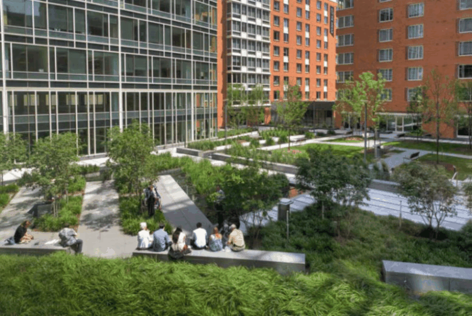

> [Picture on page 118: a picture, saved as a picture (images/part-f2-business-site-specific-page-118-23.gif, 150 dpi).]

Figure 16: Pennsylvania Avenue Park, Washington DC - Public open space defined by built form

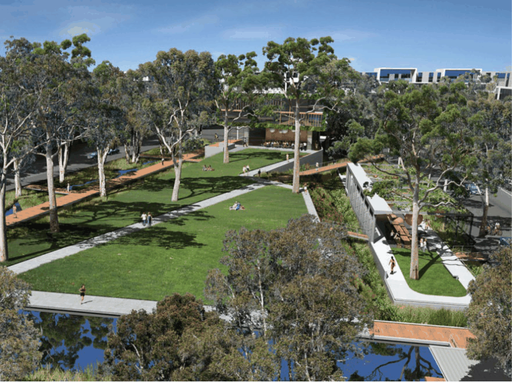

> [Picture on page 119: a picture, saved as a picture (images/part-f2-business-site-specific-page-119-1.gif, 150 dpi).]

Figure 17: Artist impression Sheas Park - Green Square, Sydney. The overland flow path designed as a

space for passive recreation and pedestrian link. (Source: www.landcom.com.au)

#### 3.5.2 Design criteria for public open spaces

#### Neil Street Park

Neil Street Park lies at the southern end of New Road 2. Its principle purpose is to serve as the

major recreation space for the Precinct. It will provide a civic focus for gathering/events and

work-based lunchtime breaks. It will be robust in landscape expression and largely defined by

built form (Refer Figure 16).

#### Objectives

Act as the primary soft landscaped resource for the Precinct.

Use the design of public domain elements and furniture, and the surface materials to

create a distinctive character.

Be adoptable as a performance space with informal seating areas (Refer Figure 20).

Desired character

• Activation of ground floor commercial uses along New Road 2 and development to the

north; and

• create a sense of place (Refer Figure 17).

#### Controls

Provide a minimum 1,500sqm public open space - Neil Street Park as shown in Figure

18.

Neil Street Park is to be in public ownership.

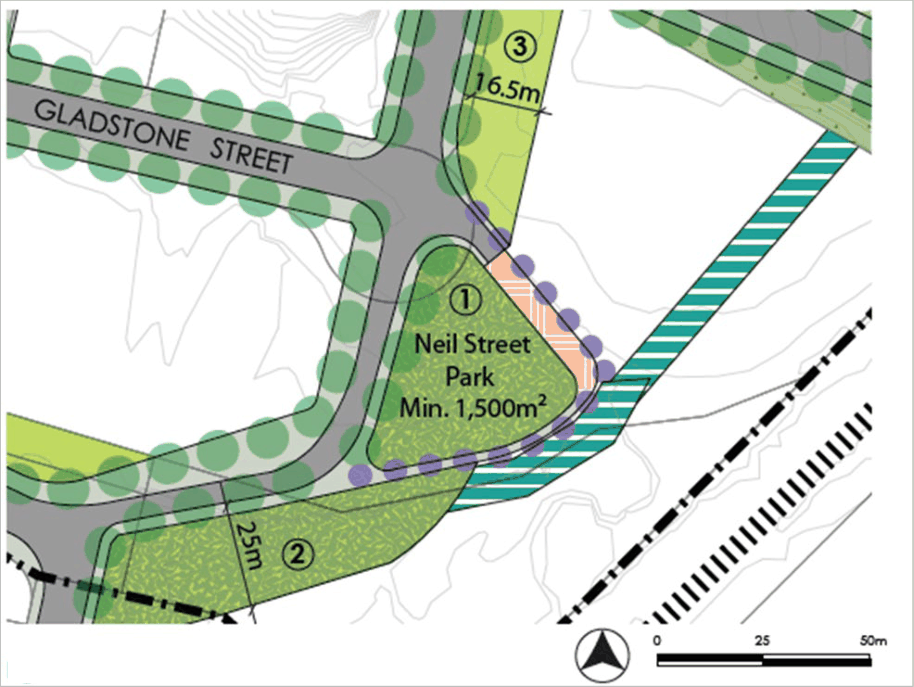

> [Picture on page 120: a picture, saved as a picture (images/part-f2-business-site-specific-page-120-5.gif, 150 dpi).]

Figure 18: Neil Street Park, Canal Park and Boulevard Park

#### Terminal Place Park

Located at the southern end and along New Road 1, Terminal Place Park provides a transition

space between the predominantly residential Precinct and the Merrylands Centre. The principle

aim is to provide seating and shade for passive reaction in the vicinity of the train station (Refer

Figure 19).

#### Objectives

Provide additional resource to the local residents and commuters.

Reinforce a sense of safety for the community by providing appropriate lighting and

directional signage.

Provide sufficient furniture such as bins, seats, lighting and bicycle parking in

appropriate locations.

Desired Character

• Predominantly soft landscape with hardscape elements to accommodate seating and

public art; and

• open lawn areas for passive recreation (Refer Figure 19).

#### Control

Provide a minimum width of 25m as shown in Figure 18.

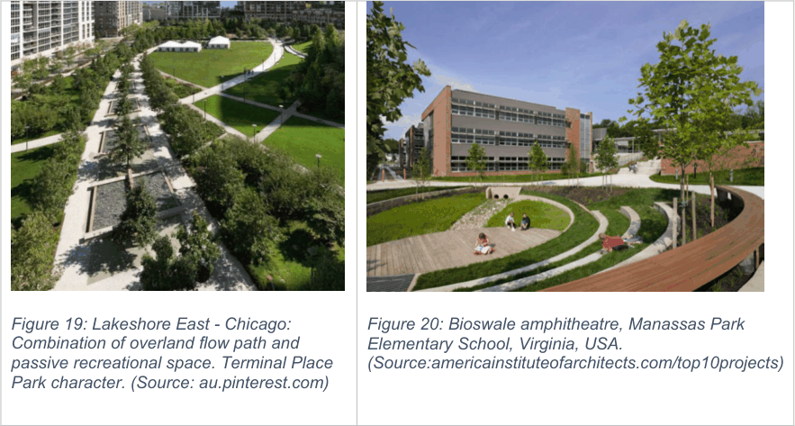

> [Picture on page 121: a picture, saved as a picture (images/part-f2-business-site-specific-page-121-18.gif, 150 dpi).]
> Words printed on the picture (title and legend, copied from the PDF):
> Elementary School, Virginia, USA.
> (Source:americainstituteofarchitects.com/top10projects)
> Combination of overland flow path and
> passive recreational space. Terminal Place
> Park character. (Source: au.pinterest.com)

Figure 20: Bioswale amphitheatre, Manassas Park

Figure 19: Lakeshore East - Chicago:

#### Boulevard Park

Boulevard Park lies along the eastern edge of New Road 2 between Gladstone and Neil Streets.

#### Objective

Provide a passive recreational space for surrounding development.

Desired character

• Activation of ground floor retail/commercial edge to the east and western edge of New

Road 2.

• Design should reflect the desire line to Holroyd Gardens (Refer Figure 21).

#### Control

Provide a minimum width of 16.5m as shown in Figure 23.

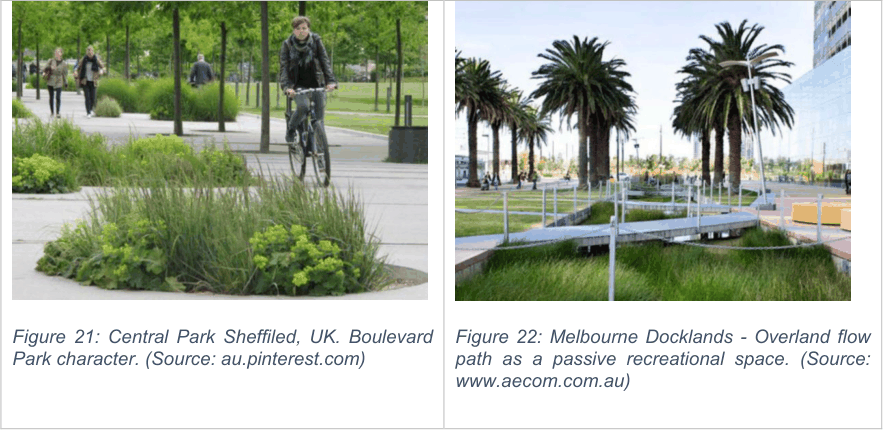

> [Picture on page 122: a picture, saved as a picture (images/part-f2-business-site-specific-page-122-11.gif, 150 dpi).]
> Words printed on the picture (title and legend, copied from the PDF):
> Park character. (Source: au.pinterest.com)
> path as a passive recreational space. (Source:
> www.aecom.com.au)

Figure 21: Central Park Sheffiled, UK. Boulevard

Figure 22: Melbourne Docklands - Overland flow

#### Canal Greenway

Canal Greenway lies along the southern edge of New Road 2 and wraps around the eastern

edge of New Road 1.

#### Objective

Continue the “green link” of the Precinct and prove a leafy setting to the predominantly

residential use of the area north of Neil Street.

Desired character

• Soft landscaping integrating where possible the Sydney Water Canal corridor;

• ability to accommodate passive recreation; and

• planting of endemic and cultural species.

#### Control

Provide minimum widths as shown in Figure 23.

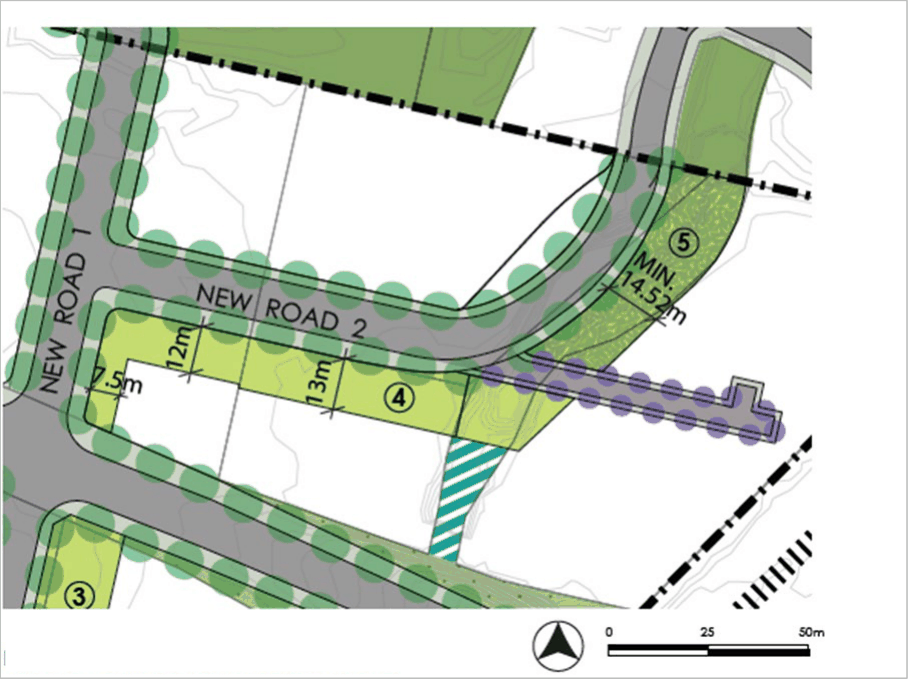

> [Picture on page 123: a picture, saved as a picture (images/part-f2-business-site-specific-page-123-1.gif, 150 dpi).]

Figure 23: Canal Park and Woodland Reserve

#### Woodland Reserve

Canal Park lies along the eastern edge of New Road 2. The principle aim is to provide a

connection both visual and physical, being the location for major cycle and footpath links at the

local level.

#### Objective

Provide a green link to A’Becketts Creek and the riparian corridor to the north and the

new Neil Street Precinct landscape network.

Desired Character

• Accommodate range of experiences and activities including informal walking tracks and

seating (Refer Figure 25);

• continue the natural woodland character of the existing A’Becketts Creek to the north

with planting of indigenous native species; and

• low maintenance, robust plant species and finishes.

#### Control

Provide minimum widths as shown in Figure 23.

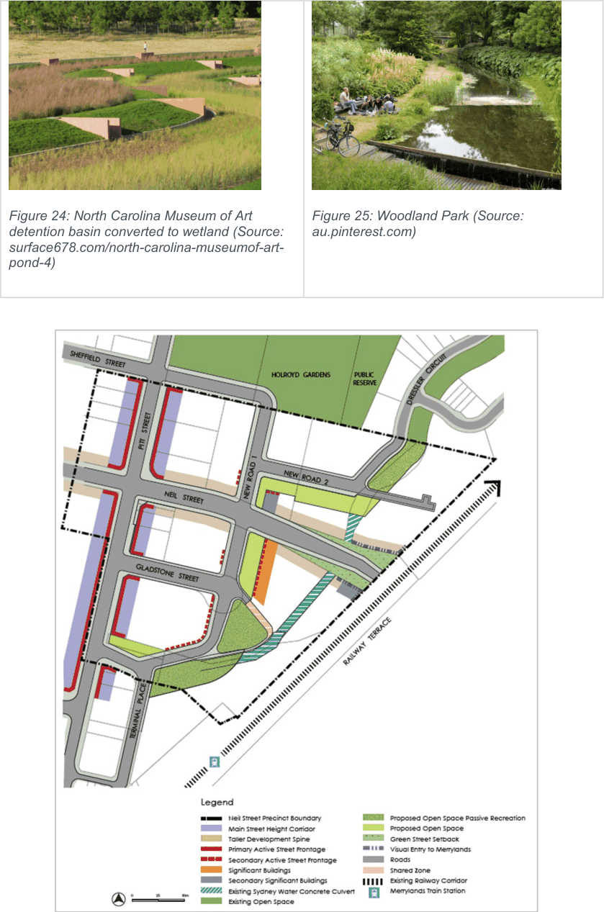

> [Picture on page 124: a picture, saved as a picture (images/part-f2-business-site-specific-page-124-1.gif, 150 dpi).]
> Words printed on the picture (title and legend, copied from the PDF):
> au.pinterest.com)
> detention basin converted to wetland (Source:
> surface678.com/north-carolina-museumof-art-
> pond-4)

Figure 25: Woodland Park (Source:

Figure 24: North Carolina Museum of Art

Figure 26: Built Form Structure Plan Principles

### 3.6 Built Form

#### 3.6.1 Built form network

Built Form Structure Plan Principles One of the principle urban design strategies which guided the built form structure plan for the

Merrylands Centre was to provide height transition from the lower scale residential buildings to

the higher scale buildings on Merrylands Road and McFarlane Street. The Built Form Structure Plan builds on the strategies established for the Merrylands Centre

and focuses on the character and height distribution of built form within the Neil Street Precinct.

This structure supports the density controls contained within the LEP. The taller built elements have been strategically arranged along major streets and adjacent to

the open space network, defining the edge of the overland flow path/green corridor. Opportunities for taller buildings have been identified. These sites spatially locate important

places within the Precinct such as key entry point and parks (Refer Figure 26). The taller

buildings are intended to be distinct from their lower scale surrounding and provide visual

reference and urban legibility. The visual impact of the proposed increase in heights has been

analysed in relation to the broader context of the Merrylands Centre. The principal tower is located adjacent the Neil Street Park and in proximity to the Neil Street

Precinct entry off the Neil Street Bridge. The secondary towers are located on the east-west

development spine at significant locations. The important street corridor of Pitt Street is reinforced by consistent height and street setback.

Within the street network opportunities for active frontages have been identified and controls

provided for the specific relationship between buildings and the street in these locations. Location of active street level uses are identified adjacent to the green link.

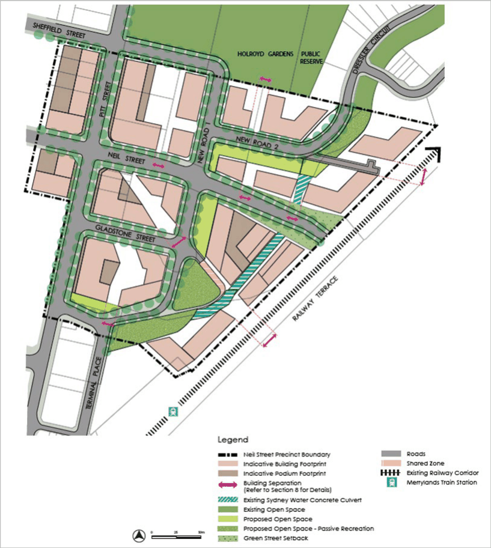

> [Picture on page 126: a picture, saved as a picture (images/part-f2-business-site-specific-page-126-1.gif, 150 dpi).]

Figure 27: Built Form Structure Plan

#### 3.6.2 Built Form Structure Plan

The Built Form Structure Plan is a broad, long term plan to guide changes in built form and

provide clear direction about preferred locations of buildings within developments and building

separations. The building footprints indicated on Figure 27 represent the preferred building

configuration. Buildings are to be designed in accordance with Section 3.8 – Site Specific

Controls.

### 3.7 Site amalgamation

Seven development sites (blocks) within the Precinct have been identified resulting from the

evolving land ownership pattern and road alignment (Refer Figure 28). These blocks are

anticipated to cater to the future increases in population and pedestrian movements, particularly

those arriving via the rail network. In addition, these blocks incorporate significant public spaces

and parks supporting the commercial and residential uses within and around the Precinct. Land

uses have been coordinated with the desired built form outcomes to ensure that the Precinct

functions as a highly attractive, safe and usable urban space.

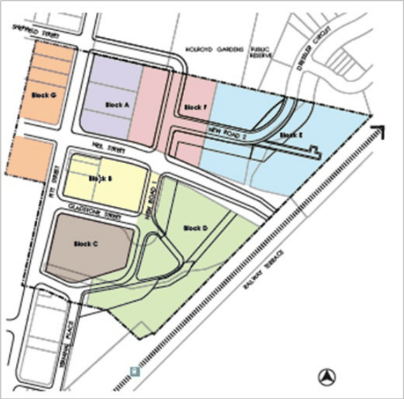

> [Picture on page 127: a picture, saved as a picture (images/part-f2-business-site-specific-page-127-9.gif, 150 dpi).]

Figure 28:  Preferred Site Amalgamation

#### Controls

Amalgamation of lots in accordance with Figure 28 is desired for redevelopment.

Land amalgamation is to increase the width of the street frontage and avoid irregular lot

configuration.

Sites are to be amalgamated to avoid isolating an adjoining site or sites.

The lot shape, orientation and design of amalgamation and subdivision lots is to support

the following:

• protection and enhancement of the amenity, solar access, privacy, open space and

views of the neighbouring lots; and

• incorporation of the principles of water sensitive urban design The block width, dimension, orientation and layout are to consider the existing

subdivision pattern of the locality.

New lot/s created must be such that each lot with street frontage allows for the siting of

a development which will address the street.

### 3.8 Site specific controls

This section provides character statements, objectives and development controls for specific

areas/ blocks within the Precinct as identified under Section 3.7. These blocks will contribute to

the identity, function and character of the Precinct and as such more detailed built form controls

have been provided to ensure high quality outcomes.

#### Controls

General controls applicable to the whole Precinct are as follows:

| Building Envelopes |  |
|---|---|
| Maximum Horizontal Length of Buildings (above any podium) | • 9 to 12 storeys = Max. 75m • 13-20 Storeys = Max. 55m The max. horizontal length of any building without substantial articulation shall not exceed 45m |
| Building Breaks |  |
| Buildings | Please refer to the detailed Block controls (following) for the location of preferred building separation requirements. |
| Solar Access |  |
| Residential Part of Buildings | Min. 2 hours direct sunlight access to 70% of apartments between 9.00am to 4.00pm at the winter solstice (22 June). |
| Public Open Space | Neil Street Park • Min. 2 hours direct sunlight between 12noon to 3.00pm at the winter solstice (22 June) to min. 50% of the area Other Public Open Spaces • Min. 2 hours direct sunlight between 9am and 4.00pm at the winter solstice (22 June) to min. 50% of the area. |
| Street Activation |  |
| Pitt Street and Terminal Place | • Fully activate at least 2 storeys with commercial/retail uses. B4 zone Min. non residential GFA equivalent to 40% of the ground floor building footprint area. B6 Zone Minimum non-residential GFA equivalent to 20% of the ground floor building footprint area except for the site at the southeast corner of Neil Street and new Road 1 where the minimum requirement for street activation is 50% of the ground floor building footprint area. |
| Western Side of New Road 1 | • Area between Terminal Place and Neil Street to be intermittently activated as a secondary active frontage |
| Street Wall Height |  |
| Along Pitt Street | • 3 storey podium with a minimum height of 11m and maximum 14m. |

Parking Parking

Parking must be provided in the basement (underground).

• Underground parking is not permitted to encroach into the setback areas

or under public open space areas.

• Please refer to Part G – Parking and Access

Building Envelope Depth Commercial / retail • Max 25m (unless specified in Section 3.8). (above podium) Residential

• Max 22m (unless specified in Section 3.8).

Public Domain Interface Vehicle Access Vehicle access should not ramp along boundary alignments facing a street

or public open space.

Awning Along Pitt Street Awnings should be provided along Pitt Street. and Eastern Edge of

Boulevard Park

• Min. 3m deep.

• Preferred minimum soffit height of 3.3m.

• Slim vertical fascias/eaves not more than 300mm in height.

• Wrap awnings around corners where a building is sited on a street corner.

Site and Building Design Unless otherwise specified in this DCP, please refer to the NSW Apartment Design Guide (ADG) for

design of apartments/mix use building design, including:

• Building depth

• Building separation

• Deep soil zones

• Visual privacy

• Communal and public open space

• Pedestrian access and entries

• Vehicle access

• Bicycle and car parking

• Building Amenity (Ceiling height, Solar access, Natural ventilation, Private open space and

balconies, Acoustic Privacy, Noise and pollution, Common circulation and spaces)

• Building Configuration (apartment mix, layout and size, storage, roof design, landscape design,

planting on structures, façades, awnings)

• Performance (Energy efficiency, Waste Management, private open space and balconies, Water

management and conservation). Stormwater Management Merrylands Neil Street Precinct is affected by the 1 in 100 year flood. Roads and open space network

have been designed as overland flow path to manage the impact of flooding. To ensure appropriate

flood management:

• Width and location of the overland flow path to be in accordance with Section 3.4 and 3.8.

• Please refer to Part G Stormwater.

• Consult with Council’s engineers prior to submitting a DA.

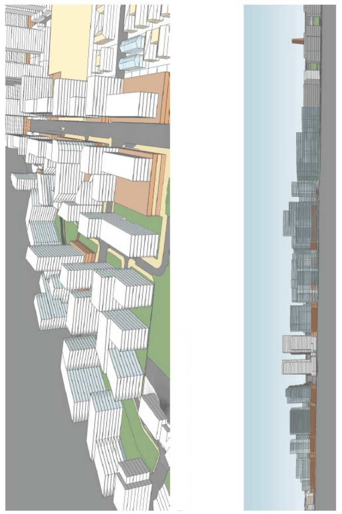

> [Picture on page 130: a picture, saved as a picture (images/part-f2-business-site-specific-page-130-1.gif, 150 dpi).]

a) Looking south

b) looking west from the rail line

Figure 30: Indicative built form

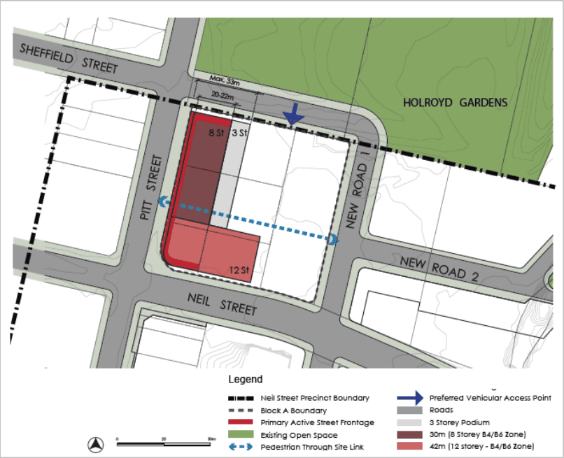

> [Picture on page 131: a picture, saved as a picture (images/part-f2-business-site-specific-page-131-1.gif, 150 dpi).]

Figure 31: Proposed Block A Height and Public Domain Plan

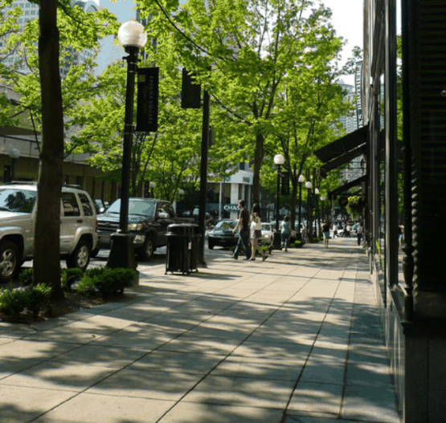

> [Picture on page 131: a picture, saved as a picture (images/part-f2-business-site-specific-page-131-3.gif, 150 dpi).]

Figure 32: Green Street Setbacks - Pitt Street - Green Link to

Holroyd Gardens. (Source: au.pinterest.com)

#### BLOCK A

Block A is bounded by the Holroyd Gardens to the north, Block F to the east, Neil Street to the south

and Pitt Street to the west. The detailed, site specific controls within this section will define the scale and character of development

at the Pitt and Neil Streets intersection, providing development that creates a positive image.

#### Objectives

Ensure the development contributes to the provision of public infrastructure.

Provide a range of uses supporting the predominantly commercial use within the

Merrylands Centre, and generating activity at ground level.

Ensure that the intersection of Pitt and Neil Streets creates a quality identity for the

corner.

Ensure scale and form of development contributes to the public domain and legibility of

Pitt Street.

#### 3.8.1 Site and building design

Public domain The key public domain features of this Block are:

• New Road 1 to the north; and

• Pitt Street to the west New street improvements are to be provided to both the streets.

#### Controls

Primary active frontages are to be provided where shown in Figure 31.

Primary active frontage are to have a civic character.

Awnings to be provided along Pitt Street.

Building heights Refined building heights are provided to determine the extent and location of height distribution

within the Precinct.

#### Control

Development should comply with the Block A Height Plan which indicates the maximum

number of permissible storeys (Refer Figures 31 and 34).

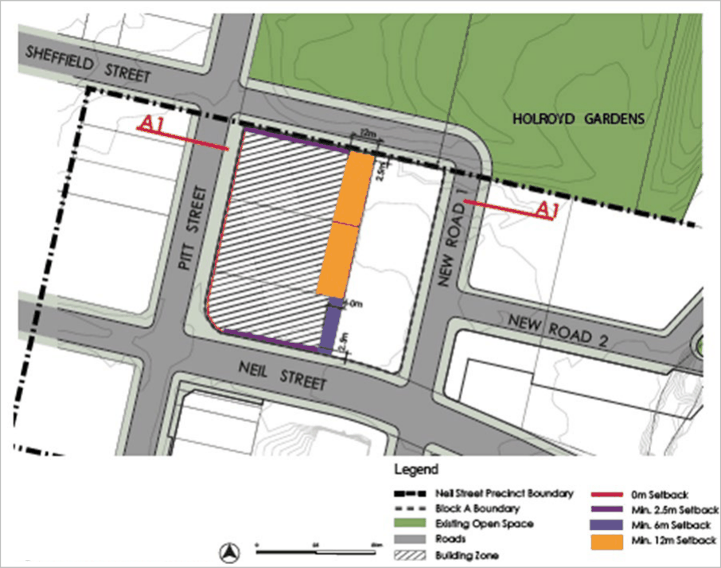

> [Picture on page 133: a picture, saved as a picture (images/part-f2-business-site-specific-page-133-1.gif, 150 dpi).]

Figure 33: Block A Setback Plan

Setbacks To provide some flexibility in the configuration of buildings on site, building zones have been

identified within which buildings can occur on the site. The building zone is determined by the

street, side and rear setbacks. The building zone cannot be totally taken up by buildings. The extent of the building zone that

can be occupied by buildings is calculated by applying all the built form controls the Precinct.

The building configuration indicated in the diagrams is the preferred building configuration.

#### Control

Provide setbacks as shown in Figure 33.

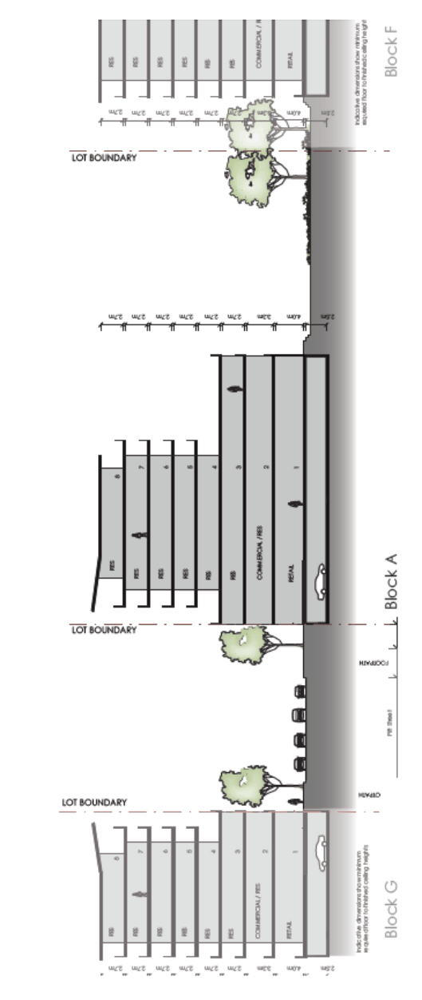

> [Picture on page 134: a picture, saved as a picture (images/part-f2-business-site-specific-page-134-1.gif, 150 dpi).]

Figure 34: Section A1-A1

Public domain interface Specific street frontage treatments are required to achieve consistency within and around the

Precinct, and to reinforce the desired streetscape character. The streetscape character is

determined by the design and consistency of the building edge, and the continuity of the built

form interface relative to driveways and vehicular crossing.

#### Controls

Driveways and vehicular crossings are not permitted along Pitt Street.

Driveways and vehicular crossings are to be provided from New Road 1. Indicative

locations are shown in Figure 48.

| Building Height |  |
|---|---|
| Along Pitt Street | Max 12 storeys (Refer Figure 31) |
| Along Neil Street | Max 12 storeys (Refer Figure 31) |
| Building Use |  |
| B4 Zone – Along Pitt Street | Ground and first floor • Commercial / retail Second floor and above • Commercial or residential |
| B4 Zone – All other buildings | Ground floor • Commercial / retail First Floor and above • Residential / commercial |
| Building Envelope Depth |  |
| Commercial / retail (Above Podium) | Max 25m |
| Residential | Max 22m |

| Setback |  |
|---|---|
| Street setback | Pitt Street – 0m Neil Street - Min 2.5m Sheffield Street Extension - Min 6m and 12m |
| Rear setback | For lots fronting Pitt Street - Min 6m and 12m |
| Street Wall Height |  |
| Along Pitt Street | 3 storey podium with minimum height of 11m and maximum 14m. |
| Awning |  |
| Along Pitt Street | Min. 3m deep |

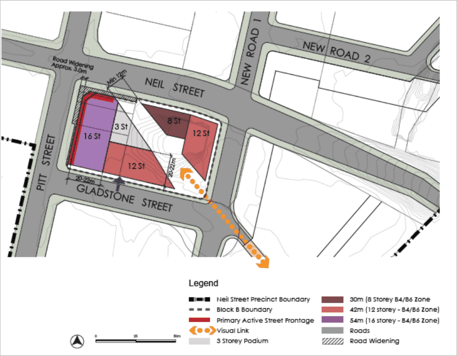

> [Picture on page 136: a picture, saved as a picture (images/part-f2-business-site-specific-page-136-1.gif, 150 dpi).]

Figure 35: Proposed Block B Height and Public Domain Plan

#### BLOCK B

Block B is bounded by Neil Street to the north, New Road 1 to the east, Gladstone Street to the south

and Pitt Street to the west.

#### Objectives

Provide a range of uses supporting the predominantly commercial use within the

Merrylands Centre, and generating activity at ground level

Ensure scale and form of development contributes to the public domain and legibility of

Pitt Street

#### 3.8.2 Site and building design

Public domain The key public domain features of this Block are:

• Neil Street to the north;

• New Road 1 to the east;

• Gladstone Street to the south; and

• Pitt Street to the west.

#### Controls

Primary active frontages are to be provided where shown in Figure 35.

Primary active frontages are vibrant and inviting.

Building heights Refined building heights are provided to determine the extent and location of height distribution

within the Precinct.

#### Control

Development should comply with Block B Height Plan which indicates the maximum

number of permissible storeys (Refer Figure 35 and 36).

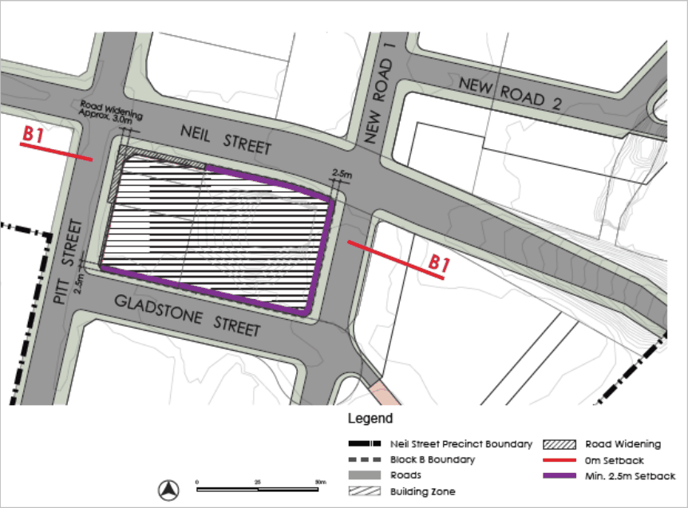

> [Picture on page 138: a picture, saved as a picture (images/part-f2-business-site-specific-page-138-1.gif, 150 dpi).]

Figure 36: Proposed Block B Setback Plan

Setbacks To provide some flexibility in the configuration of buildings, building zones have been identified

within which buildings can occur on the site. The building zone is determined by the street, side

and rear setbacks. The building zone cannot be totally taken up by buildings. The extent of the building zone that

can be occupied by buildings is calculated by applying all the built form controls for the Precinct. The building configuration indicated in the diagrams is the preferred building configuration.

#### Control

Provide setbacks as shown in Figure 36.

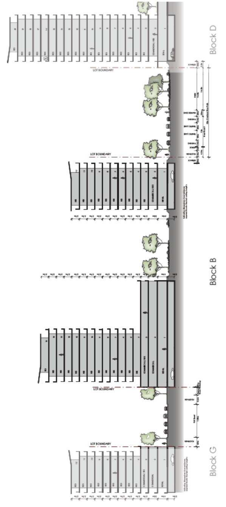

> [Picture on page 139: a picture, saved as a picture (images/part-f2-business-site-specific-page-139-1.gif, 150 dpi).]

Figure 37: Section B1-B1

Public domain interface Specific street frontage treatments are required to achieve consistency within and around the

Precinct, and to reinforce the desired streetscape character. The streetscape character is

determined by the design and consistency of the building edge, and the continuity of the built

form interface relative to driveways and vehicular crossings.

#### Controls

Driveways and vehicular crossings are not permitted along Pitt Street

Driveways and vehicular crossings are to be provided from New Road 1. Indicative

locations are shown in Figure 35.

| Building Height |  |
|---|---|
| Along Pitt Street | Max 16 storeys (Refer Figure 35) |
| Along New Road 1 and Gladstone Street | Max 12 storeys (Refer Figure 35) |
| Along Neil Street | Max 8 storeys |
| Building Use |  |
| B4 Zone – Along Pitt Street | Ground and first floor • Commercial / retail Second floor and above • Commercial or residential |
| B6 Zone – Along New Road 1 | Ground floor • Commercial / retail First Floor and above • Residential / commercial |
| B6 and B4 Zone - Along Neil Street | All floors residential |
| Building Envelope Depth |  |
| Commercial/retail (Above Podium) | Max 25m |
| Residential Setback | Max 22m |
| Street setback Pitt Street | 0m |
| Neil Street, New Road 1 and Gladstone Street | Min 2.5m |

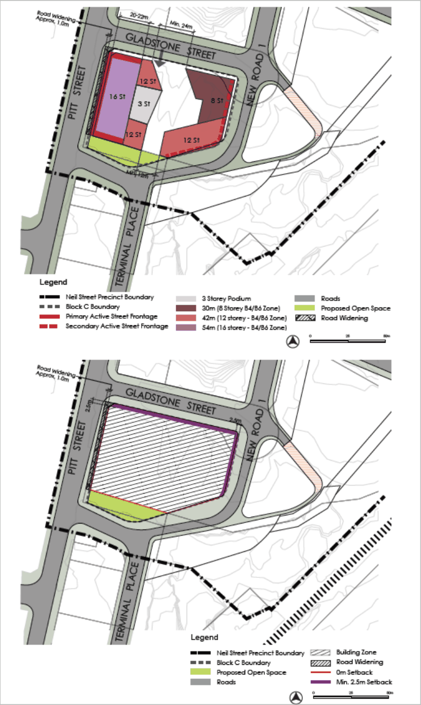

> [Picture on page 141: a picture, saved as a picture (images/part-f2-business-site-specific-page-141-1.gif, 150 dpi).]

Figure 38 (top): Block C height and public domain plan Figure 39 (bottom): Block C setback plan

#### BLOCK C

Block C is bounded by Gladstone Street to the north, New Road 1 to the east, Terminal Place to the

south and Pitt Street to the west. Block C has similar characteristics as Block B.

#### 3.8.3 Site and building design

Public domain The key public domain features of this Block are:

• Gladstone Street to the north

• New Road 1 to the east

• Terminal Place to the south

• Pitt Street to the west

#### Controls

Primary active frontages are to be provided where shown in Figure 38.

Primary active frontages are to be vibrant and inviting.

Building heights Refined building heights are provided to determine the extent and location of height distribution

within the Precinct.

#### Control

Development should comply with Block B Height Plan which indicates the maximum

number of permissible storeys (Refer Figure 38).

Setbacks To provide some flexibility in the configuration of buildings, building zones have been identified

within which buildings can occur on the site. The building zone is determined by the street, side

and rear setbacks. The building zone cannot be totally taken up by buildings. The extent of the building zone that

can be occupied by buildings is calculated by applying all the built form controls for the Precinct.

The building configuration indicated in the diagrams is the preferred building configuration.

#### Controls

Provide setbacks as shown in Figure 39.

Underground parking is not permitted to encroach into the setback areas.

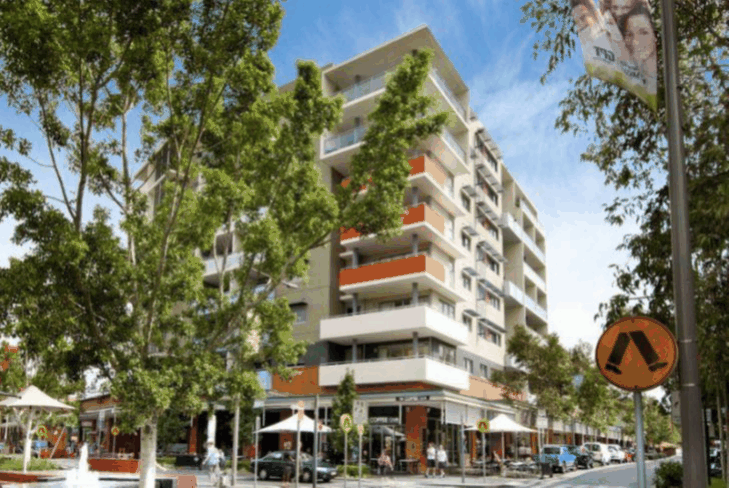

> [Picture on page 143: a picture, saved as a picture (images/part-f2-business-site-specific-page-143-1.gif, 150 dpi).]

Figure 40: Rouse Hill, Sydney. Zero street setback with active street frontage

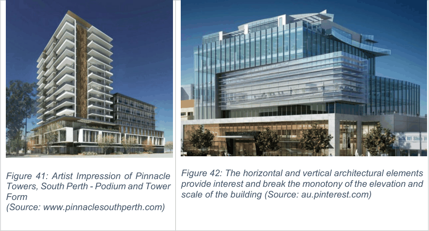

> [Picture on page 143: a picture, saved as a picture (images/part-f2-business-site-specific-page-143-3.gif, 150 dpi).]
> Words printed on the picture (title and legend, copied from the PDF):
> provide interest and break the monotony of the elevation and
> scale of the building (Source: au.pinterest.com)
> Towers, South Perth - Podium and Tower
> Form
> (Source: www.pinnaclesouthperth.com)

Figure 42: The horizontal and vertical architectural elements

Figure 41: Artist Impression of Pinnacle

Public domain interface Specific street frontage treatments are required to achieve consistency within and around the

Precinct, and to reinforce the desired streetscape character. The streetscape character is

determined by the design and consistency of the building edge, and the continuity of the built

form interface relative to driveways and vehicular crossings.

#### Controls

Driveways and vehicular crossings are not permitted along Pitt Street

Driveways and vehicular crossings are to be provided from New Road 1. Indicative

locations are shown in Figure 38.

| Building Height |  |
|---|---|
| Along Pitt Street | Max. 16 storeys (Refer Figure 38) |
| Terminal Place | Max. 12 storeys (Refer Figure 38) |
| Gladstone Street | Max. 8 storeys |
| Building Use |  |
| B4 Zone - Corner of Gladstone Street and New Road 1 | Ground floor and above Residential |
| B4 Zone - Along Pitt Street and Terminal Place | Ground floor and first floor • Commercial / retail Second floor and above • Commercial / retail / Residential |
| B6 Zone - New Road 1 | Ground floor • Commercial / retail All floors above ground floor • Commercial / residential |
| Building Envelope Depth |  |
| Commercial / retail and residential on all floors above podium | Max. 22m |

| Setback |  |
|---|---|
| Street setback | Pitt Street - 0m Gladstone Street - Min. 2.5m Terminal Place - Min. 0m New Road 1 - Min. 2.5m |
| Street Wall Height |  |
| Along Pitt Street | 3 storey podium with minimum height of 11m and maximum 14m |
| Awning |  |
| Along Pitt Street | Min. 3m deep |

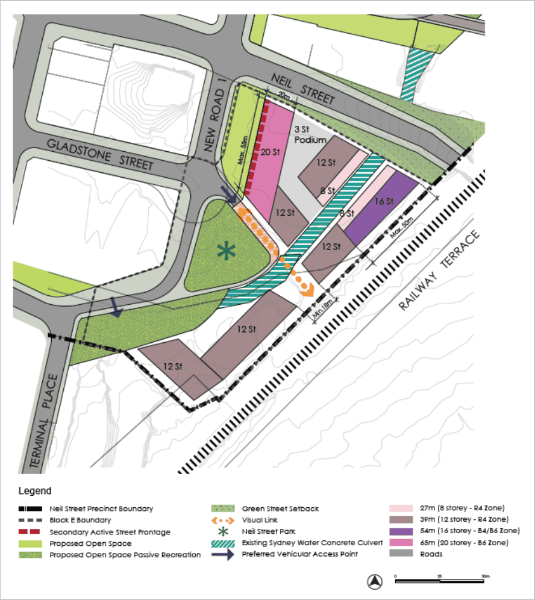

> [Picture on page 145: a picture, saved as a picture (images/part-f2-business-site-specific-page-145-1.gif, 150 dpi).]

Figure 43: Block D Height and Public Domain Plan

#### BLOCK D

Block D is bounded by Neil Street to the north, the railway corridor (which runs northeast to southwest)

to the east and south, Merrylands Train Station to the southwest and New Road 1 to the west with the

overland flow path located to the east of New Road 1. Although the accessibility of Block D is enhanced by the proposed Road 1, it is also constrained by the

existing Sydney water culvert which runs through the site. The flood flow path which is envisioned to

form part of the public open network provides an opportunity for Block D to enhance the public domain

of the area by incorporating a centrally located space - Neil Street Park for recreational purposes. Given the landscape setting, this Block is expected to accommodate secondary active uses (e.g.

gymnasium, childcare centre, corner shop, café) that support and enhance the liveability of the Precinct.

The ground level activity within Block D will be focused along New Road 1. The detailed, site specific controls within this section will define the scale and character of development

at the Pitt and Neil Streets intersection, providing development that create a positive image.

#### Objectives

Ensure the development contributes to the provision of public infrastructure.

Ensure that the intersection of New Road 1 and Neil Streets is reinforced with greater

height and create a distinct identity for the corner.

Reinforce the open space through built form.

Ensure scale and form of development contributes to the public domain and legibility of

New Road 1 and Neil Street.

#### 3.8.4 Site and building design

Public domain The key public domain features of this Block are:

• New Road 1 to the west;

• Overland flow path and Neil Street Park to the west; and

• Neil Street to the north.

#### Controls

Secondary active frontage is to be provided where shown in Figure 43 (gymnasium,

child care centre, corner shop, café).

Secondary active frontage is to have a civic character, providing colonnades for the

building at the intersection of Neil Street and New Road 1.

Refer to Section 3.5 for the future desired character of Neil Street Park.

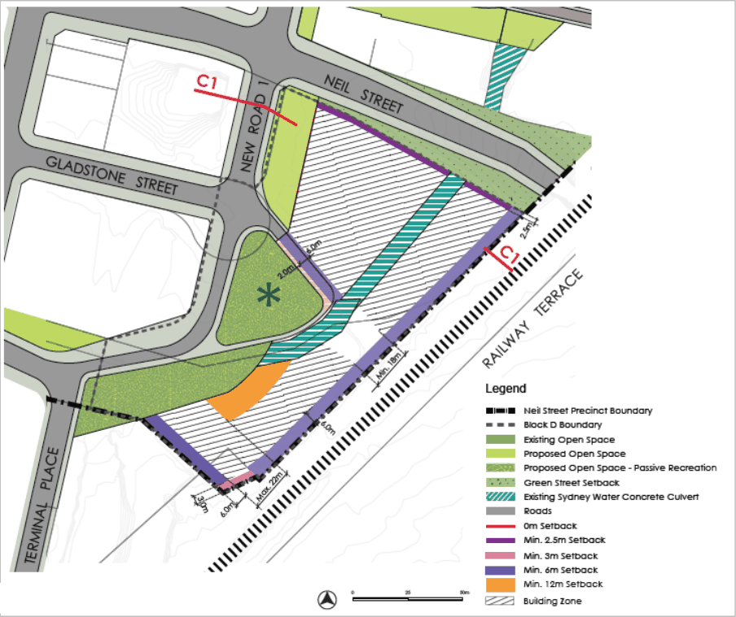

> [Picture on page 147: a picture, saved as a picture (images/part-f2-business-site-specific-page-147-1.gif, 150 dpi).]

Figure 44: Block D Setback Plan

Building heights Refined building heights are provided to determine the extent and location of height distribution

within the Precinct.

#### Control

Development should comply with Block D Height Plan which indicates the maximum

number of permissible storeys (Refer Figure 43 and 45).

Setbacks To provide some flexibility in the configuration of buildings on site, building zones have been

identified within which buildings can occur on the site. The building zone is determined by the

street, side and rear setbacks. The building zone cannot be totally taken up by buildings. The

extent of the building zone that can be occupied by buildings is calculated by applying all the

built form controls for the Precinct. The building configuration indicated in the diagrams is the

preferred building configuration.

#### Control

Provide setbacks as shown in Figure 44.

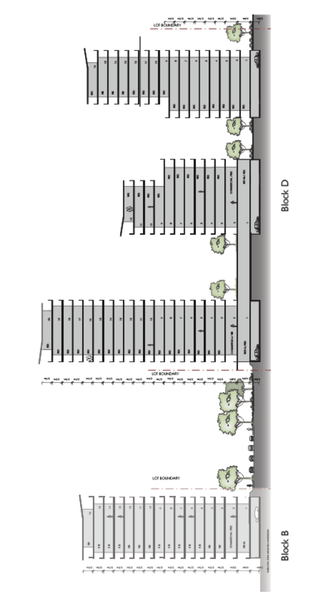

> [Picture on page 148: a picture, saved as a picture (images/part-f2-business-site-specific-page-148-1.gif, 150 dpi).]

Figure 45: Section C1-C1

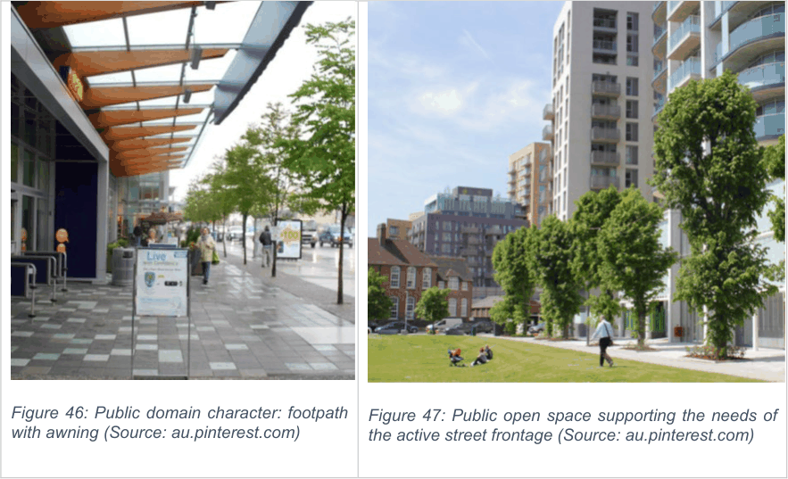

> [Picture on page 149: a picture, saved as a picture (images/part-f2-business-site-specific-page-149-1.gif, 150 dpi).]
> Words printed on the picture (title and legend, copied from the PDF):
> with awning (Source: au.pinterest.com)
> the active street frontage (Source: au.pinterest.com)

Figure 46: Public domain character: footpath

Figure 47: Public open space supporting the needs of

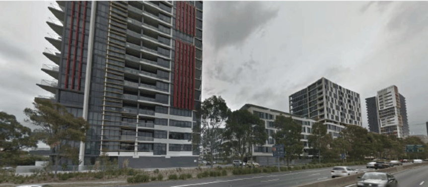

> [Picture on page 149: a picture, saved as a picture (images/part-f2-business-site-specific-page-149-2.gif, 150 dpi).]

Figure 48: Building separation providing visual relief and minimise the impact of built form Source:

au.pinterest.com)

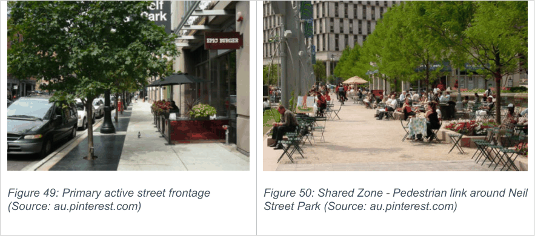

> [Picture on page 150: a picture, saved as a picture (images/part-f2-business-site-specific-page-150-1.gif, 150 dpi).]
> Words printed on the picture (title and legend, copied from the PDF):
> (Source: au.pinterest.com)
> Street Park (Source: au.pinterest.com)

Figure 49: Primary active street frontage

Figure 50: Shared Zone - Pedestrian link around Neil

Public domain interface Specific street frontage treatments are required to achieve consistency within and around the

Precinct, and to reinforce the desired streetscape character. The streetscape character is

determined by the design and consistency of the building edge, and the continuity of the built

form interface relative to driveways and vehicular crossing.

#### Controls

Driveways and vehicular crossings are not permitted along Neil Street

Driveways and vehicular crossings are to be provided from New Road 1. Indicative

locations are shown in Figure 43.

| Building Height |  |
|---|---|
| Corner of Neil Street and New Road 1 | Max. 20 storeys (Refer Figure 43) |
| Corner of Neil Street and Railway Line | Max. 16 storeys (Refer Figure 43) |
| All other buildings | Max. 12 storeys (Refer Figure 43) |
| Building Use |  |
| B6 Zone – Ground and first floor of 20 storey building | Commercial/retail/residential |
| All other buildings + All floors above first floor of B6 Zone | Residential |
| Building Envelope Depth |  |
| All buildings except for the 20 storey tower | Max. 22m |
| 20 Storey Tower | Max. 20m |

| Setback |  |
|---|---|
| Street setback | From Neil Street - Min. 2.5m |
| Open Space setbacks | All other lots - comply with Figure 44 |
| Rear setbacks | From the Railway Corridor • Min. 6m (Min. 3m in the southern corner) From Merrylands Transit Interchange • Min. 6m |
| Awning | Along Boulevard Park - Min. 3m deep |

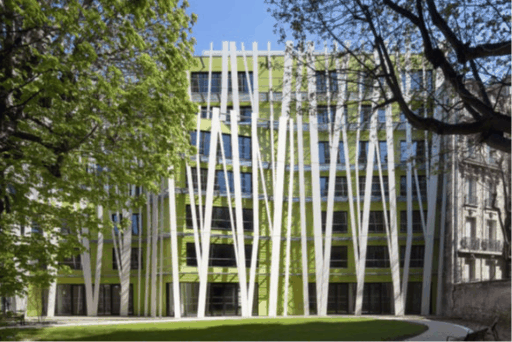

> [Picture on page 151: a picture, saved as a picture (images/part-f2-business-site-specific-page-151-2.gif, 150 dpi).]

Figure 51: Interesting facades providing a visual entry to the

Precinct (Source: au.pinterest.com)

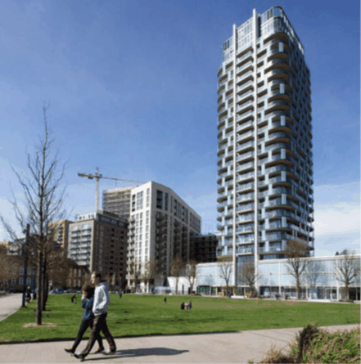

> [Picture on page 151: a picture, saved as a picture (images/part-f2-business-site-specific-page-151-5.gif, 150 dpi).]

Figure 52: London Renaissance. Taller Building providing

visual reference (Source: au.pinterest.com).

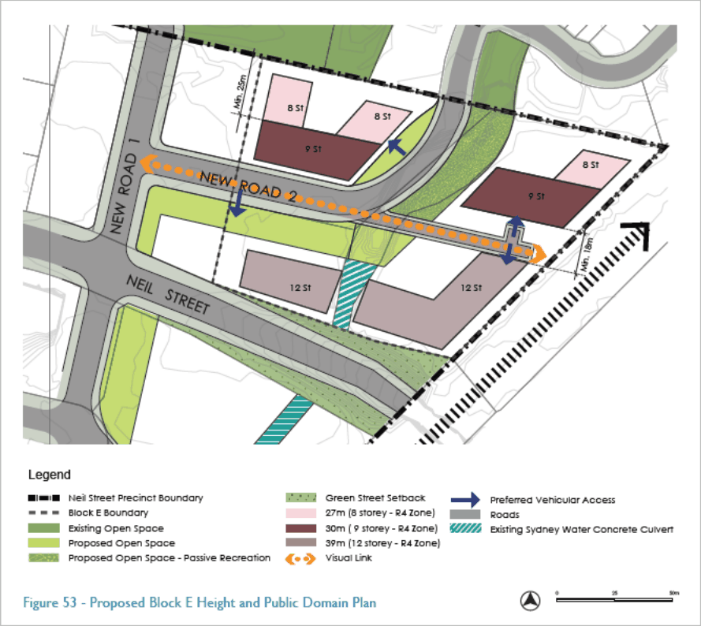

> [Picture on page 152: a picture, saved as a picture (images/part-f2-business-site-specific-page-152-1.gif, 150 dpi).]

Figure 53: Proposed Block E height and public domain plan

#### BLOCK E

Block E is bounded by the old brickworks site and the Holroyd Gardens to the north, the railway corridor

(which runs northeast to southwest) to the east and southwest, Neil Street to the south and Block F (13-

15 Neil Street) to the west.

#### Objectives

Ensure the development contributes to the provision of public infrastructure

Ensure scale and form of development contributes to the public domain and is

sympathetic to the residential development to the north.

#### 3.8.5 Site and building design

Public domain The key public domain features of this Block are:

• New Road 2;

• Neil Street to the south; and

• Overland flow path.

#### Control

Proposed built form should reinforce and address the overland flow path.

Building heights

#### Control

Development should comply with Block A Height Plan which indicates the maximum

number of permissible storeys (Refer Figure 53).

Setbacks

#### Control

Provide setbacks as shown in Figure 54.

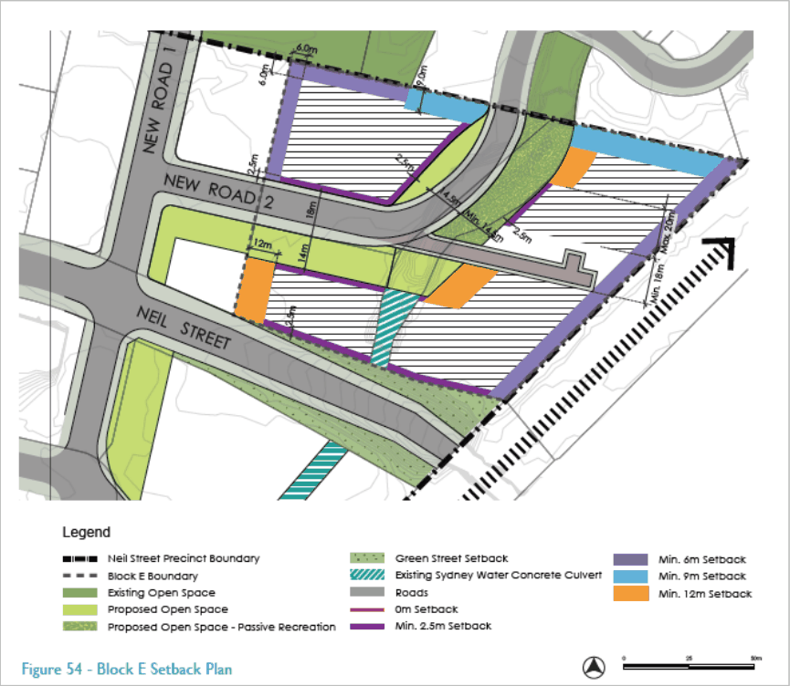

> [Picture on page 154: a picture, saved as a picture (images/part-f2-business-site-specific-page-154-1.gif, 150 dpi).]

Figure 54: Block E setback plan

Public domain interface

#### Controls

Driveways and vehicular crossings are not permitted along Neil Street.

Driveways and vehicular crossings are to be provided from New Road 2. Indicative

locations are shown in Figure 53.

Provide a landscape setback along Neil Street and New Road 2 in accordance with

Figures 53 and 54.

| Building Height |  |
|---|---|
| Building along the northern Boundary | Max. 8 storeys (Refer Figure 70) |
| Parts of buildings north of New Road 2 | Max. 9 storeys (Refer Figure 70) |
| Along Neil Street and the railway corridor | Max. 12 storeys (Refer Figure 70 |
| Building Use |  |
| R4 Zone - All floors | Residential |
| Building Envelope Depth |  |
| All buildings | Max. 22m |
| Setback |  |
| Street setback | North and West of New Road 2 • Min. 2.5m From Neil Street • Min. 2.5m |
| Other setbacks | From the boundary parallel to the railway line • Min. 6m From western boundary • Min. 12m (south of New Road 2 - comply with minimum separation controls) • Min. 6m (north of New Road 2) From Holroyd Gardens to the north • Min. 6m On other lots • Min. 9m From the southern boundary of overland flow path • Min. 2.5m Eastern boundary of overland flow path • Min. 12m and 2.5m |

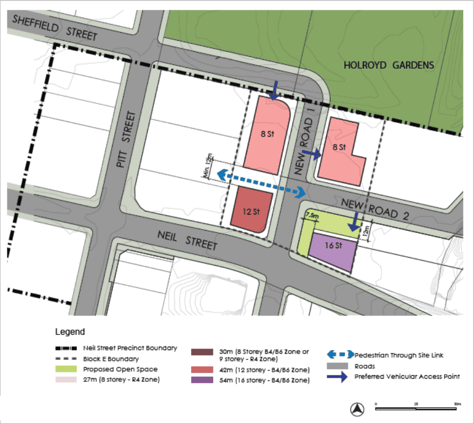

> [Picture on page 156: a picture, saved as a picture (images/part-f2-business-site-specific-page-156-1.gif, 150 dpi).]

Figure 55: Block F Height and Public Domain Plan

#### BLOCK F

Block F is bounded by the Holroyd Gardens to the north, Block E to the east, Neil Street to the south

and Block A to the west. The New Road 1 and New Road 2 form a ‘T’ intersection within Block E. The accessibility of Block F although is enhanced by the proposed New Road 1 and New Road 2, it

also divides the site into 3 lots impacting on its development potential and functionality. A potential mid-

block connection, an extension of New Road 2, will enhance pedestrian permeability within the Precinct

and with the surrounding development.

#### Objectives

Ensure the development contributes to the provision of public infrastructure.

Ensure that the intersection of Neil Street and New Road 1 create a quality identity for

the corner.

#### 3.8.6 Site and building design

Public domain The key public domain features of this Block are:

• New Road 1;

• New Road 2;

• Neil Street to the south; and

• Overland flow path. Building heights

#### Control

Development should comply with Block F Height Plan (Refer Figure 55).

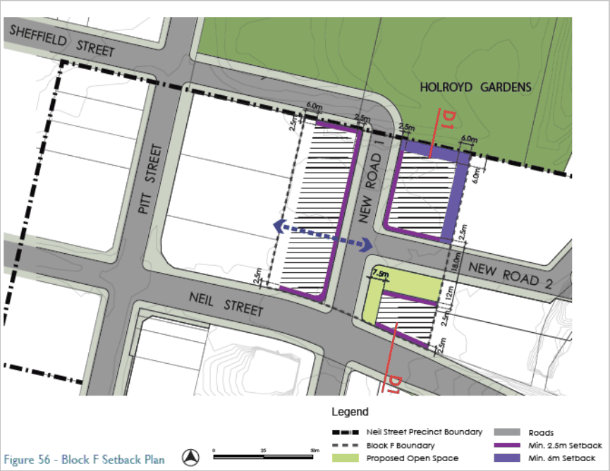

> [Picture on page 158: a picture, saved as a picture (images/part-f2-business-site-specific-page-158-1.gif, 150 dpi).]

Figure 56: Block F Setback Plan

Setbacks

#### Control

Provide setbacks as shown in Figure 56.

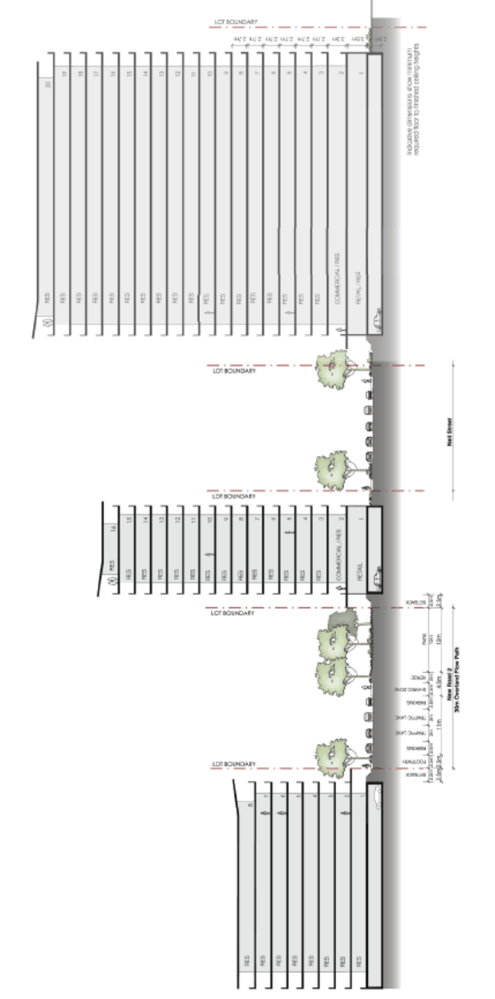

> [Picture on page 159: a picture, saved as a picture (images/part-f2-business-site-specific-page-159-1.gif, 150 dpi).]

Figure 57: Section D1-D1

Public domain interface

#### Controls

Driveways and vehicular crossings are not permitted along Neil Street.

Driveways and vehicular crossings are to be provided from New Road 1 and New Road

2\. Indicative locations are shown in Figure 55.

| Building Height |  |
|---|---|
| North of New Road 2 | Max. 8 storeys (Refer Figure 55) |
| Northwest corner of Neil Street and New Road 1 | Max. 12 storeys (Refer Figure 55) |
| Northeast corner of Neil Street and New Road 1 | Max. 16 storeys (Refer Figure 55) |
| Building Use |  |
| B6 Zone - Ground Floor of 12 and16 Storey Building | Commercial/retail/residential |
| All floors above First Floor | Residential |
| All other buildings | Residential |
| Building Envelope Depth |  |
| All buildings | Max. 22m |
| Setback |  |
| Street setback | New Road 1 (North of New Road 2) • Min. 2.5m From New Road 2 (North) • Min. 2.5m From the southern boundary of public open space • Min. 2.5m From Neil Street • Min. 2.5m From Sheffield Street Extension • Min. 2.5m |
| Other setback | From Holroyd Gardens to the north • Min. 6m From the eastern boundary • Min. 6m |

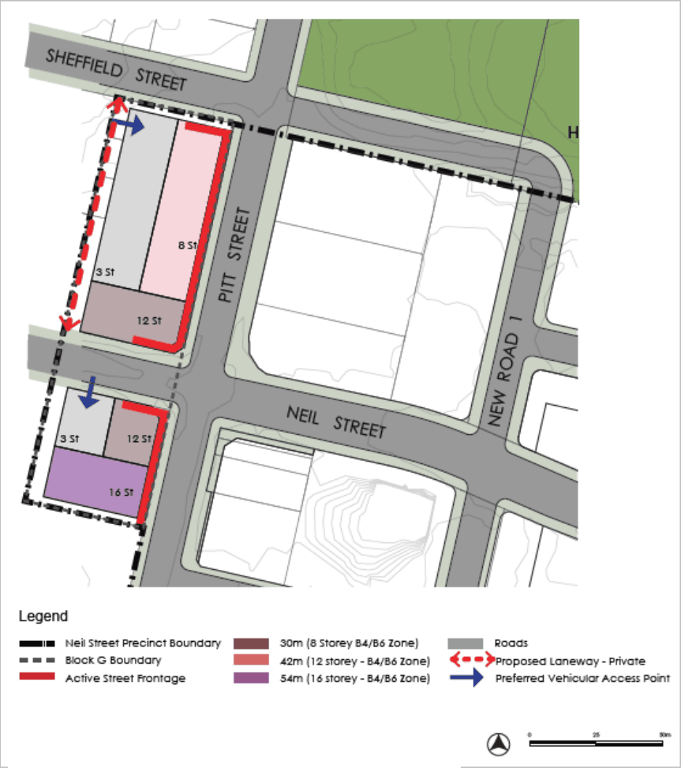

> [Picture on page 161: a picture, saved as a picture (images/part-f2-business-site-specific-page-161-1.gif, 150 dpi).]

Figure 58: Proposed Block G Height and Public Domain Plan

#### BLOCK G

Block G is bounded by Sheffield Street to the north, Pitt Street to the east, the Stockland Mall to the

south and residential development to the west.

#### Objectives

Provide a range of uses supporting the predominantly commercial use within the

Merrylands Centre, and generating activity at ground level.

Ensure that the intersection of Neil Street and Pitt Street create a quality identity for the

corner.

#### 3.8.7 Site and building design

Public domain The key public domain features of this Block are:

• Pitt Street; and

• Neil Street.

#### Controls

Primary active frontages are to be provided where shown in Figure 58.

Primary active frontage are to have a civic character, providing an awning along the

edge of Pitt Street.

Building heights

#### Control

Development should comply with Block G Height Plan (Refer Figure 58).

Setbacks

#### Control

Provide setbacks as shown in Figure 59.

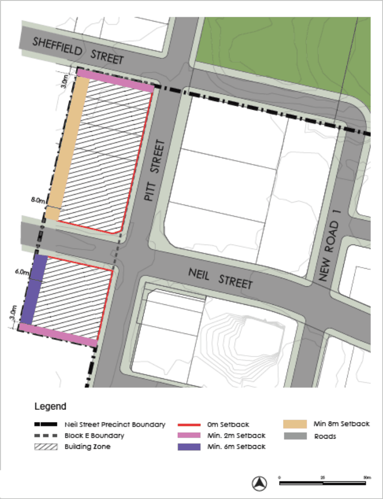

> [Picture on page 163: a picture, saved as a picture (images/part-f2-business-site-specific-page-163-1.gif, 150 dpi).]

Figure 59: Proposed Block G Setback Plan

Public domain interface

#### Control

Driveways and vehicular crossings are not permitted along Pitt Street.

Driveways and vehicular crossings are to be provided from Sheffield Street and Neil

Street. Indicative locations are shown in Figure 58.

| Building Height |  |
|---|---|
| B4 Zone - Northwest and southwest corner of Neil Street and Pitt Street | Max. 12 storeys (Refer Figure 75) |
| B4 Zone - Buildings along Pitt Street | Max. 16 storeys (Refer Figure 75) |
| B4 Zone - Other buildings north of Neil Street | Max. 8 storeys (Refer Figure 75) |
| Building Use |  |
| All buildings | Ground and first Floor • Commercial / retail First floor and above • Residential / commercial |
| Building Envelope Depth |  |
| All buildings | Max. 22m |
| Setback |  |
| Street setback | From Pitt Street - 0m From Neil Street - 0m From Sheffield Street - Min. 3.0m |
| Rear setback | North of Neil Street From the western boundary -min. 8.0m Rear setback - South of Neil Street From the western boundary - Min. 6.0m |
| Side setback | South of Neil Street From the southern boundary - Min. 3.0m |
| Street Wall Height |  |
| Along Pitt Street | 3 storey podium with minimum height of 11m and maximum 14m. |
| Awning |  |
| Along Pitt Street | Min. 3m deep |

This page has been left intentionally blank.

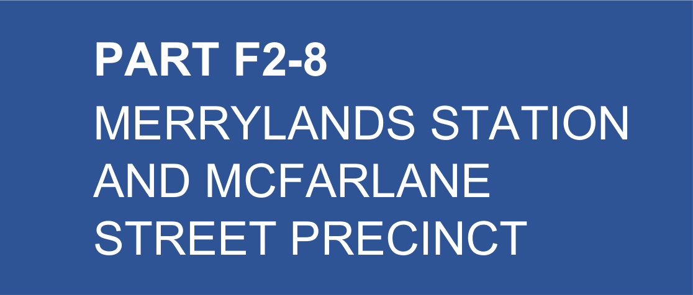

> [Picture on page 166: a picture, saved as a picture (images/part-f2-business-site-specific-page-166-1.gif, 150 dpi).]
