### PART F2-8

### MERRYLANDS STATION

### AND MCFARLANE

### STREET PRECINCT

This page has been left intentionally blank.

## 1. Introduction

The Merrylands Station and McFarlane Street Precinct is one of Cumberland City Council’s largest

commercial retail precincts. To assist in developing strategies that will guide the future development of the Precinct over the next

20 years, Council has prepared a strategic vision to cater for the increasing needs of the local

community and that of the wider regional catchment of Western Sydney. The strategic vision for Merrylands is a Centre that is vibrant and creates a series of active and liveable

spaces that are efficiently designed with integrated transport linkages providing an appropriate mix of

land uses, leisure facilities and infrastructure. Following the introduction of the (then) Holroyd LEP 2013, Council resolved to review the building height

controls in the Merrylands Centre as a means of providing greater flexibility in achieving the current

floor space potential and improve building design. SJB Architects were appointed to undertake this review and subsequently produced the Building

Heights Review Study (BHRS) in February 2016.

### 1.1 Land to which this Part applies

This Part applies to development on land bounded by McFarlane Street, Merrylands Road,

Treves Street and the Railway corridor – hereby referred to as the ‘Precinct’ and described in

Figure 1.

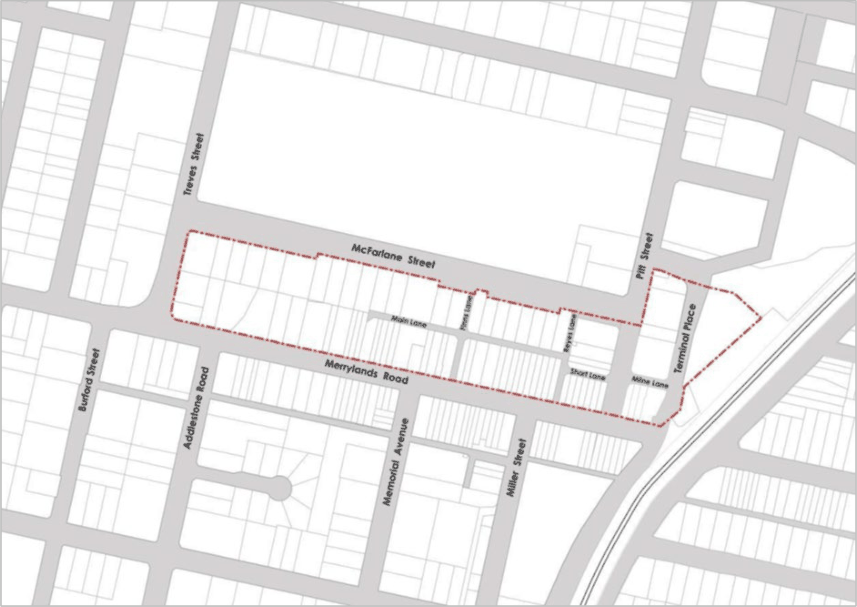

> [Picture on page 168: a picture, saved as a picture (images/part-f2-business-site-specific-page-168-19.gif, 150 dpi).]

Figure 1: Merrylands Station and McFarlane Street Precinct boundary

The Building Heights Review Study 2016 (BHRS) recommended a number of built form controls

be introduced for the Precinct as a means of achieving Council’s strategic vision. The controls

relate to:

• site amalgamation;

• building heights;

• design excellence;

• primary frontage requirements;

• building setbacks;

• street wall heights;

• upper level street setbacks;

• solar access to Civic Square; and

• floor plates. Where there is an inconsistency between this document and provisions contained elsewhere

in Cumberland DCP 2021 the Precinct Controls contained in this document shall apply to the

extent of the inconsistency.

## 2. Objectives and controls

### 2.1 General

#### Objectives

Develop a strong identity for the Merrylands Centre through a vibrant mix of retail,

commercial and residential development.

Achieve urban design strategies that acknowledge the role of Merrylands within the

Cumberland City subregion.

Strengthen the economic and employment status of Merrylands Centre and provide

increased growth capacity within Merrylands.

Renew and revitalise the Merrylands Centre catering for a diverse community.

Ensure buildings are designed to maximise appropriate amenity outcomes for the

Precinct.

Create a centralised public domain and open space area as a focal point for the Precinct.

Improve pedestrian and vehicular traffic movement throughout the Centre.

Encourage a more pedestrian friendly streetscape on McFarlane Street and Merrylands

Road.

### 2.2 Urban context analysis

Four (4) strategic principles were prepared in the Building Heights Review Study, which

collectively govern the location and built form of future development in the Precinct. The

principles are:

• movement;

• open space;

• land use and activity; and

• height and density.

#### 2.2.1 Movement

#### Objectives

Encourage the primary movement corridors around the Centre along Merrylands Road,

Treves Street, Neil Street and Pitt Street with Merrylands Road to be a primary

pedestrian route.

Establish a pedestrian focus along McFarlane Street with particular emphasis on the

proposed new Civic Square.

Create secondary connection points extending south from Merrylands Road through the

Centre to neighbouring residential areas.

Extend the existing laneway network in the Centre and around the proposed Civic

Square to improve permeability through the Centre. Refer Figure 2.

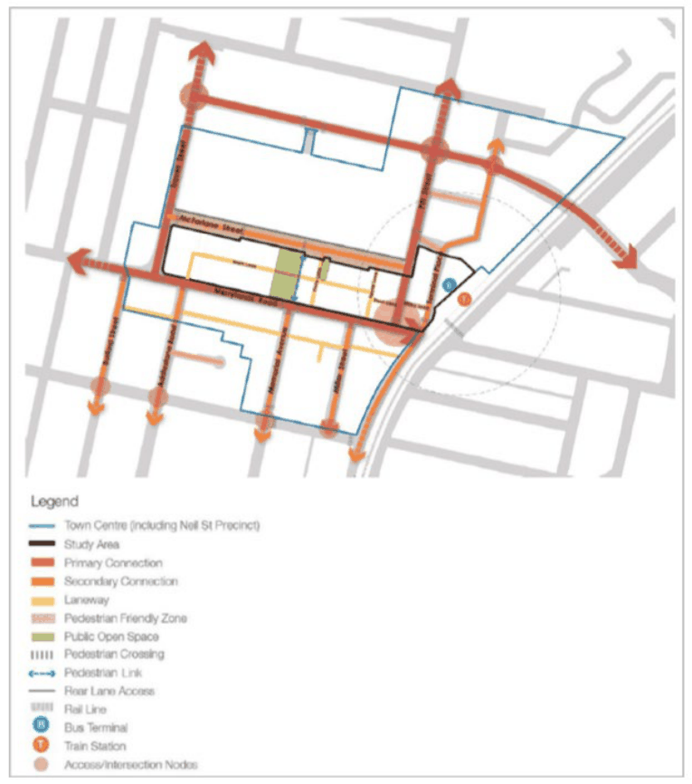

> [Picture on page 170: a picture, saved as a picture (images/part-f2-business-site-specific-page-170-12.gif, 150 dpi).]

Figure 2: Movement principles

#### 2.2.2 Open space

#### Objectives

Create a new Civic Square as the primary public open space for the Centre.

Reinforce the green streetscape character of McFarlane Street, Merrylands Road,

Memorial Avenue, Pitt Street, and Neil Street.

Establish a secondary green link through north-south laneways, between Merrylands

Road and MacFarlane Street. Refer Figure 3.

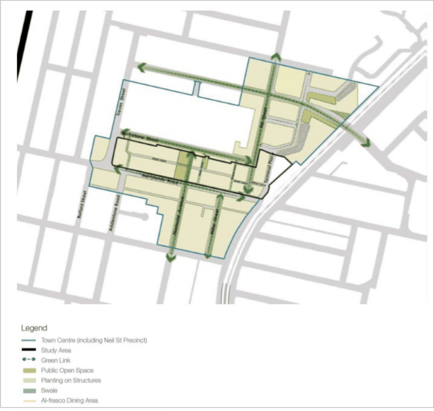

> [Picture on page 171: a picture, saved as a picture (images/part-f2-business-site-specific-page-171-8.gif, 150 dpi).]

Figure 3: Open space principles

#### 2.2.3 Land use and activity

#### Objectives

Merrylands Road to remain the primary retail street of the Centre.

McFarlane Street to become the ‘Eat Street’ of Merrylands, reinforced by a pedestrian-

friendly character, interface with the Stockland Mall and linking Merrylands Road via the

proposed Civic Square and laneway network.

Treves Street and Pitt Street to serve as the secondary retail streets, intersecting with

Merrylands Road and McFarlane Street. Refer Figure 4.

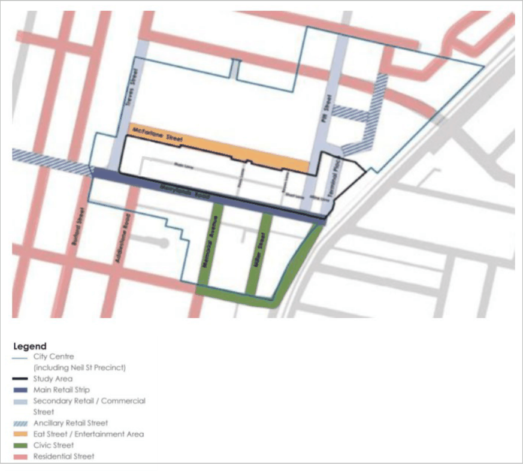

> [Picture on page 172: a picture, saved as a picture (images/part-f2-business-site-specific-page-172-9.gif, 150 dpi).]

Figure 4: Land use and activity principles

#### 2.2.4 Height and density

#### Objectives

Maintain a transition of height from the Precinct to the surrounding residential

neighbourhoods; and

Focus height and density around strategic sites such as Merrylands Road/Pitt Street

location and the landmark Civic Square. Refer Figure 5.

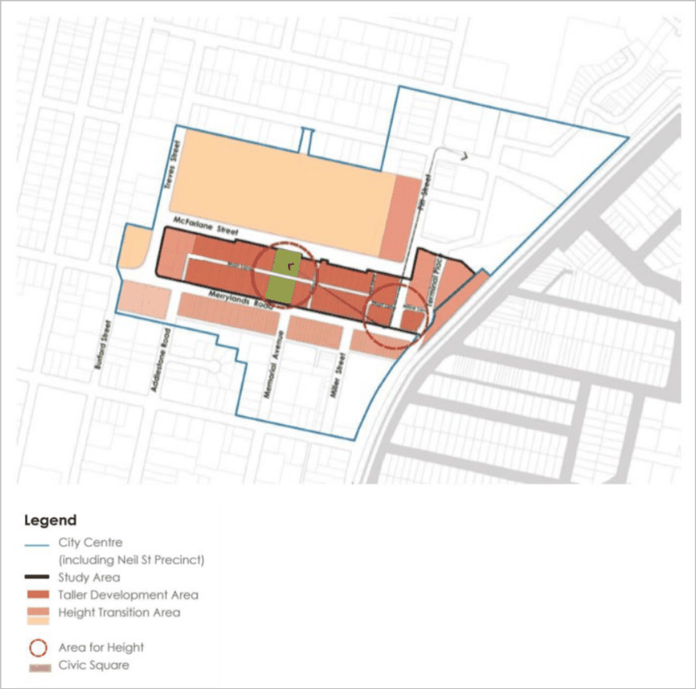

> [Picture on page 173: a picture, saved as a picture (images/part-f2-business-site-specific-page-173-7.gif, 150 dpi).]

Figure 5: Height and density principles

### 2.3 Access network

#### 2.3.1 Street network

To enhance connectivity, enable greater pedestrian amenity and restrict vehicular access on

McFarlane Street and Merrylands Road; following is proposed (Refer Figure 6-8):

• new Laneway 1 - North-south between McFarlane Street and Merrylands Road;

• extension of existing Main Lane to the west terminating at Laneway 1;

• widening of existing Main Lane, Finns Lane, Reyes Lane and Short Lane; and

• widening of Merrylands Road.

#### Objectives

Maintain and improve the Centre’s lane way network and encourage the creation of new

lanes and connections.

Enhance the climatic conditions and amenity of the laneway to encourage more

intensive pedestrian use and social activity.

Encourage activity, vitality and interaction between public laneways and adjacent uses.

Protect and where possible create views along lanes that provide a visual link to other

streets and lanes in the pedestrian network, or which terminate at notable buildings or

landmarks.

Recognise lanes that provide for essential servicing and vehicular access and to ensure

that new development does not adversely affect or impede the operation of these

functions.

#### Controls

Provide new laneways in accordance with Figure 6.

Existing laneways are to be widened in accordance with Figure 6.

Vehicular access to buildings fronting Merrylands Road and McFarlane Street must be

provided via laneways (Refer Figure 7).

Lanes are not to be covered, but awnings may be permitted on buildings facing lanes

up to a maximum of 30% of each frontage.

Widening of Merrylands Road – 0.5m on either side.

#### 2.3.2 Connectivity

Arcades have been established to enhance the connectivity and permeability of the Precinct

and include the following:

• Arcade between Pitt Street and Terminal Place.

#### Objectives

Provide safe, direct, accessible and attractive through block pedestrian routes that

improve the legibility of the Centre.

Ensure arcades are accessible, continuous, well lit, safe and supported by active retail

uses.

#### Controls

Provide new arcade (between Pitt Street and Terminal Place) in accordance with Figure

6.

The arcade must:

• have a minimum width of 15m and height of 4m;

• provide a clear sight-line from one end to the other for surveillance and accessibility,

in mid-block locations; and

• be designed to consider pedestrian safety and the security of adjacent businesses,

particularly at night. Public use of through-site connection should be available at least between 7.00am to

7.00pm daily.

Connections through foyers and shops are encouraged.

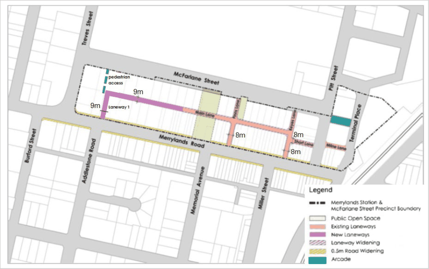

> [Picture on page 175: a picture, saved as a picture (images/part-f2-business-site-specific-page-175-13.gif, 150 dpi).]

Figure 6: Laneways

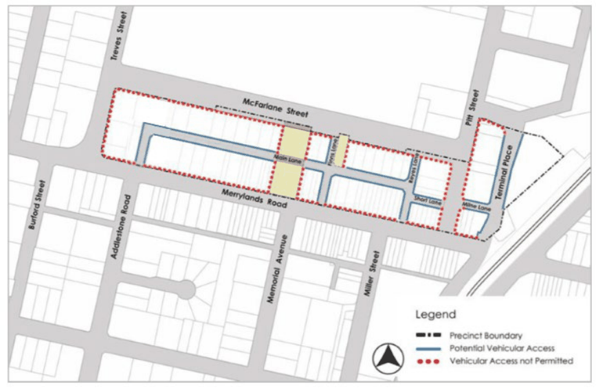

> [Picture on page 176: a picture, saved as a picture (images/part-f2-business-site-specific-page-176-1.gif, 150 dpi).]

Figure 7: Vehicular access

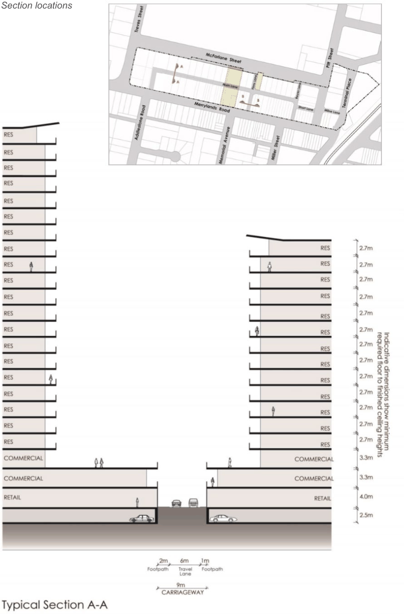

> [Picture on page 177: a picture, saved as a picture (images/part-f2-business-site-specific-page-177-1.gif, 150 dpi).]
> Words printed on the picture (title and legend, copied from the PDF):
> Section locations

Figure 8A: Typical section A-A

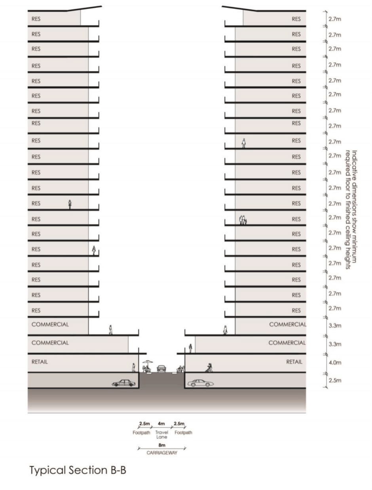

> [Picture on page 178: a picture, saved as a picture (images/part-f2-business-site-specific-page-178-1.gif, 150 dpi).]

Figure 8B: Typical section B-B

### 2.4 Site amalgamation

#### Objectives

Deliver the preferred built form option for the Precinct.

Provide workable building footprints that encourages future development to meet the

objectives for this Precinct.

Ensure site dimensions allow for the achievement of appropriate building setbacks,

separation and built form that meet the objectives for the Precinct.

Prevent sites from becoming isolated and unable to be reasonably developed in

accordance with the objectives of the applicable LEP and DCP.

#### Controls

Site amalgamation for the purposes of development shall be determined in accordance

with Figure 9 and Table 1.

Sites must not be created that are physically unable to reasonably develop a building

that achieves the maximum building height controls contained in Cumberland LEP 2021.

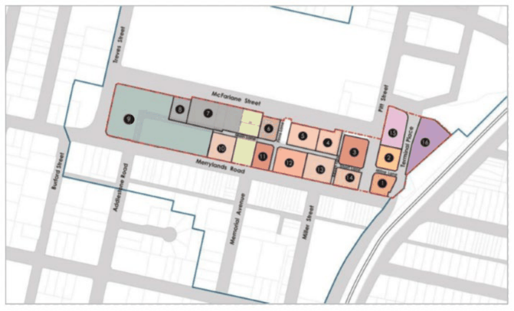

> [Picture on page 179: a picture, saved as a picture (images/part-f2-business-site-specific-page-179-15.gif, 150 dpi).]

Figure 9: Preferred site Amalgamation Plan

[Refer Table 6 for Property Descriptions Sites 1-16]

### 2.5 Built form

The preferred built form is for taller buildings to be focused at key gateway locations close to

the Merrylands Rail Station and the transitioning of heights downward towards adjoining

residential precincts, namely Treves Street to the west and Merrylands Road to the south as

illustrated in Figure 10.

#### Objectives

Ensure building heights are rationalised by clustering buildings of a similar height.

Ensure height limits enable the realisation of the maximum allowable floor space within

a tall slender building form.

Maintain solar access to the Civic Square during core hours of use.

Ensure that sites to be developed maintain an adequate frontage.

Ensure that the built form exhibits modulation and articulation.

Introduce design excellence provisions to facilitate high quality design outcomes.

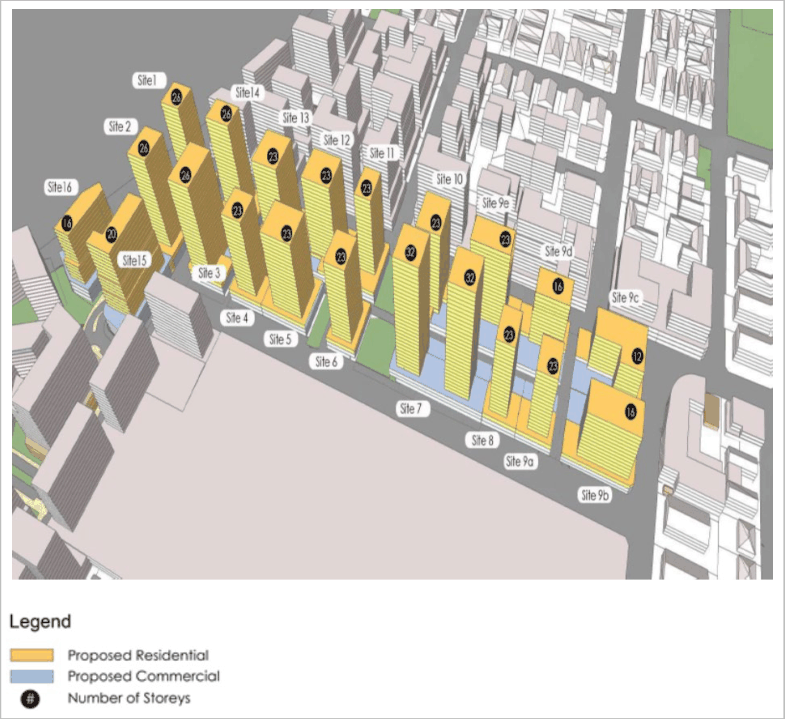

> [Picture on page 180: a picture, saved as a picture (images/part-f2-business-site-specific-page-180-14.gif, 150 dpi).]

Figure 10: Built Form

### 2.6 Built form controls

The following controls have been informed by the Building Height Review Study (BHRS) 2016

and apply to all developments on sites in the Merrylands Station and McFarlane Street Precinct.

This Section should be read in conjunction with the objectives and provisions of Cumberland

Development Control Plan (DCP) 2021. Part C and Part G of the DCP in particular contain

planning controls that are applicable to development in this Precinct, with the exception of the

development standards outlined below. Where there is an inconsistency between this

document and provisions contained elsewhere in Cumberland DCP 2021, this Section applies

to the extent of the inconsistency.

#### 2.6.1 Building height

#### Objectives

Deliver a built form that provides a height transition from lower scale on the edges of

the Precinct to higher scale in the Precinct core and clustering buildings of similar height.

Ensure the scale of the built form provides for a legible centre.

Enable the realisation of the maximum allowable floor space ratio.

Achieve appropriate management of overshadowing, access to sunlight and privacy.

#### Controls

Sites with the following maximum building height under Clause 4.3 of Cumberland LEP

2021 should comply with the maximum number of storeys in Figure 10 and Table 1

(excluding basement car parking).

Each storey shall comprise a minimum floor to ceiling height as defined in the NSW

Apartment Design Guidelines (July 2015).

Table 1: Amalgamated Site Descriptions and Maximum Height Control

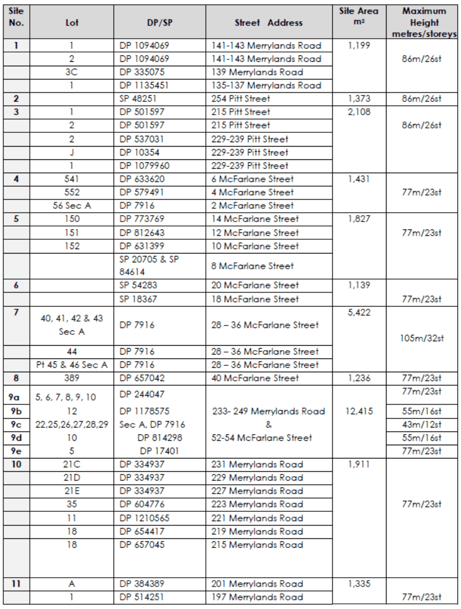

> [Picture on page 182: a picture, saved as a picture (images/part-f2-business-site-specific-page-182-2.gif, 150 dpi).]

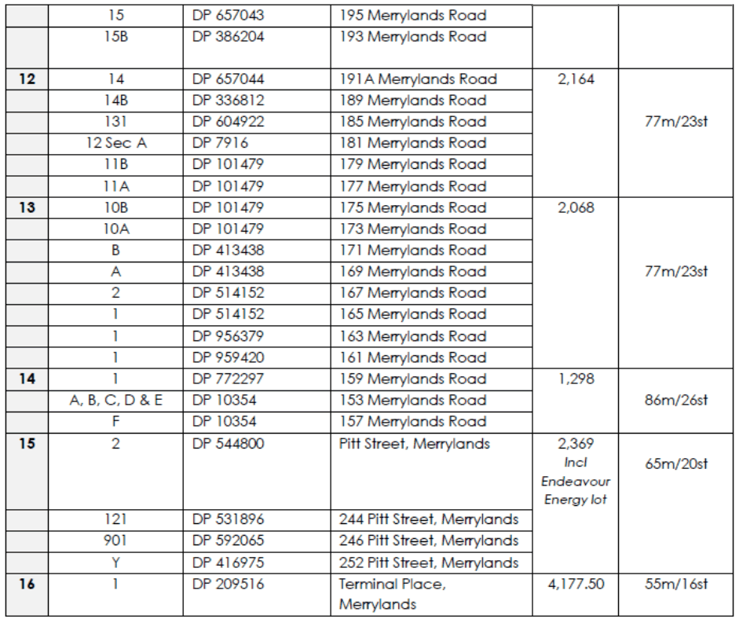

> [Picture on page 183: a picture, saved as a picture (images/part-f2-business-site-specific-page-183-1.gif, 150 dpi).]

Note: maximum building heights are defined in the Cumberland LEP 2021. Where there is any inconsistency in terms of building heights and storeys, the Cumberland LEP 2021 and the Apartment Design Guide (ADG) prevail.

#### 2.6.2 Design Excellence Provisions

#### Objectives

Cumberland City Council is committed to ensuring all major developments deliver the highest

standard of architectural and urban design. Design excellence is a tool whereby the objectives of the Precinct can be achieved by

encouraging:- High quality, diverse and innovative design.

Development that by virtue of its location, individually and collectively contributes to the

urban design context of Merrylands Centre.

#### Controls

Design excellence applies to land bounded by a heavy black line on the Design

Excellence Map. Refer Figure 11.

The Cumberland City Design Excellence Guidelines provides criteria and procedures

that must be followed for developments seeking an incentive bonus in building height of

up to an additional 10% and additional floor space ratio of up to 0.5:1.

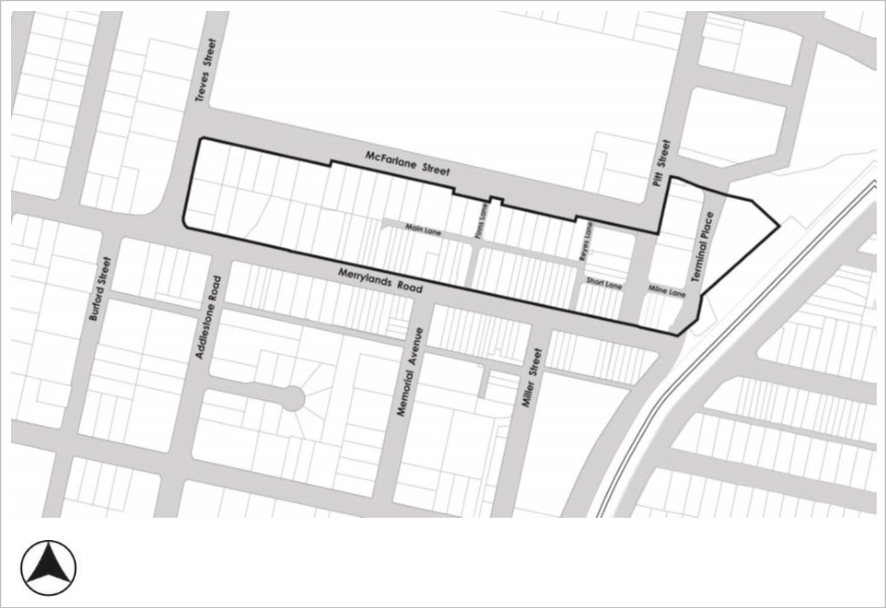

> [Picture on page 184: a picture, saved as a picture (images/part-f2-business-site-specific-page-184-4.gif, 150 dpi).]

Figure 11: Design Excellence Map

#### 2.6.3 Primary frontage requirements

#### Objectives

Ensure buildings are of an adequate size to reasonably accommodate development,

including vehicle access.

Avoid the creation of smaller, isolated sites that cannot be separately developed.

#### Control

The minimum site frontage width for new developments is 20m for 3 storey buildings.

#### 2.6.4 Building setbacks

#### Objectives

Enhance the character of the Precinct through consistent and uniform alignment of

building facades.

Reinforce strong definition of streets and public spaces in the Centre Precinct.

#### Control

New developments are to maintain setbacks to the street in accordance with Figure 12.

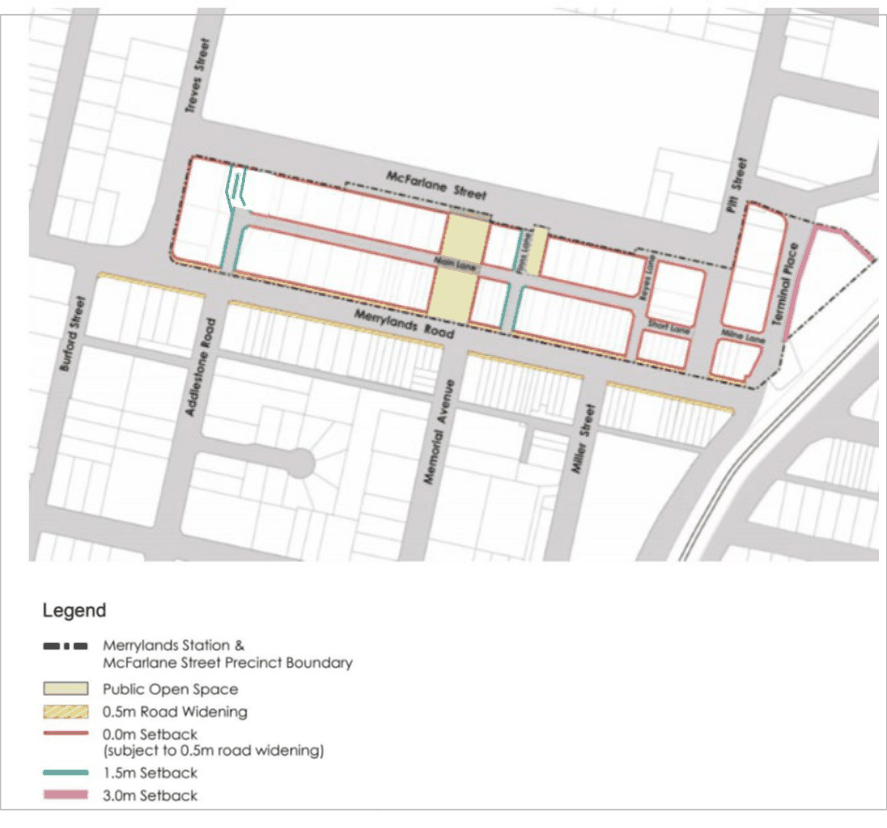

> [Picture on page 185: a picture, saved as a picture (images/part-f2-business-site-specific-page-185-1.gif, 150 dpi).]

Figure 12: Building Setbacks

#### 2.6.5 Street Wall Heights

#### Objectives

Provide street edges that reinforce and reflects the various uses and existing character

in the Precinct.

Ensure building heights at street level are at a human scale.

Facilitate a consistent street and laneway wall height throughout the Precinct.

Provide prominence to the street level, establish a clear presence for retail and increase

the visibility, marketability and utility of ground floor space.

#### Controls

Street wall heights of buildings (podium) shall be 3 storeys.

The 3-storey street wall height applies to a site’s primary frontage.

Where a site has frontage to a laneway, a maximum 2-storey street wall height is to be

maintained. Refer Figure 13.

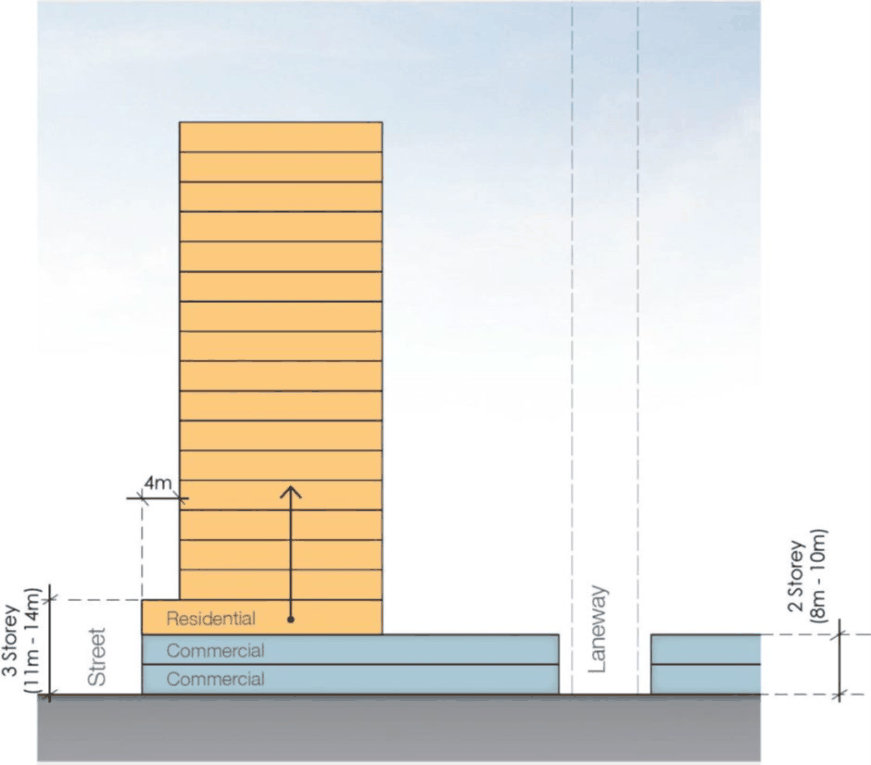

> [Picture on page 186: a picture, saved as a picture (images/part-f2-business-site-specific-page-186-3.gif, 150 dpi).]

Figure 13: Street wall height and podium setback

#### 2.6.6 Upper level street setbacks

#### Objectives

Enable more efficient tower footprints by removing incremental stepping of facades.

Minimise adverse wind impacts on the pedestrian environment.

Maximise sunlight penetration into streets, public places and surrounding buildings.

Ensure building modulation.

#### Control

All buildings above 3 storeys in height are to display a uniform 4m setback above the

street wall. Refer Figure 13.

#### 2.6.7 Solar access to Civic Square

#### Objective

Ensure adequate solar access is maintained to the Civic Square during core business

hours in mid-winter and that new buildings adjacent to the Civic Square do not prevent

solar access during key daylight hours.

#### Control

Solar access must be maintained to a minimum of 50% of the Civic Square area

between the hours of 11.00am and 1.00pm on the 21st June.

#### 2.6.8 Floor plates above podium

#### Objectives

Minimise overshadowing as compact floor plates cast smaller and faster moving

shadows.

Improve access to sky view and permit better views between buildings and through sites

and contribute to a more attractive skyline.

Enhance energy efficiency and increase daylighting within buildings.

Create architectural interest and visually diminish the overall scale of the building mass.

#### Controls

Where office premises are proposed, all points on an office floor above podium should

be no more than 15m from a source of daylight.

The maximum horizontal length of any building above the podium shall not exceed 50m.

#### 2.6.9 Awnings and colonnades

#### Objectives

To increase pedestrian amenity by the provision of weather protection.

Visually unify the Civic Square which otherwise is divided by the Main Lane.

#### Controls

Awnings Awnings are to be provided to the full extent of the street frontage of buildings in the

locations nominated in Figure 14.

Awnings along Merrylands and McFarlane Street shall be minimum 2.5m deep.

Awnings if provided on laneways shall be retractable and only to be used in hours of

operation.

Colonnades Provide colonnade/active frontage where shown in Figure 14.

Provide colonnades with a preferred minimum soffit height of 4m.

Provide under colonnade lighting to create a safe pedestrian environment at night.

Colonnade shall have a minimum width to height ratio of 1.5:1.

Activate the public domain, active ground level uses are required along the colonnade.

Locate columns of colonnades along build-to lines, to reinforce the character of the

public open space.

Ensure that colonnade heights and depths are continuous along the length of the open

space and are consistent with the neighbouring sites.

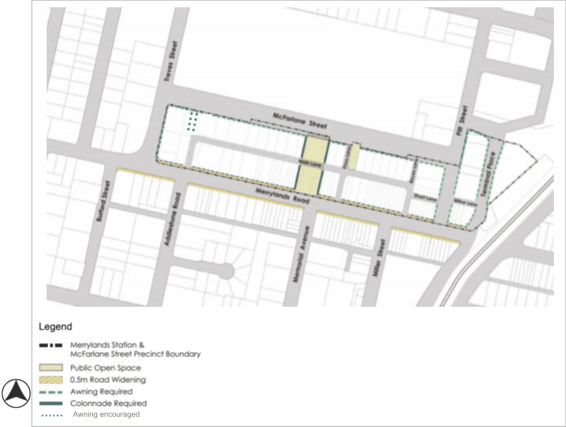

> [Picture on page 188: a picture, saved as a picture (images/part-f2-business-site-specific-page-188-8.gif, 150 dpi).]
> Words printed on the picture (title and legend, copied from the PDF):
> Awning encouraged

Figure 14: Awnings and Colonnades

This page has been left intentionally blank.

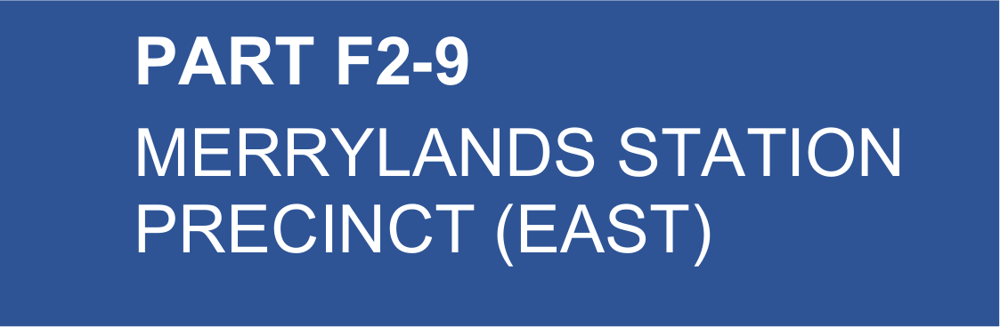

> [Picture on page 190: a picture, saved as a picture (images/part-f2-business-site-specific-page-190-1.gif, 150 dpi).]
