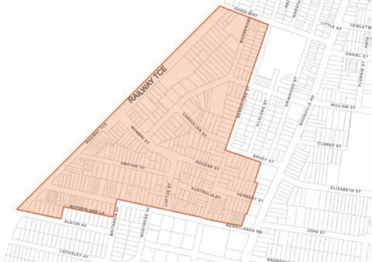
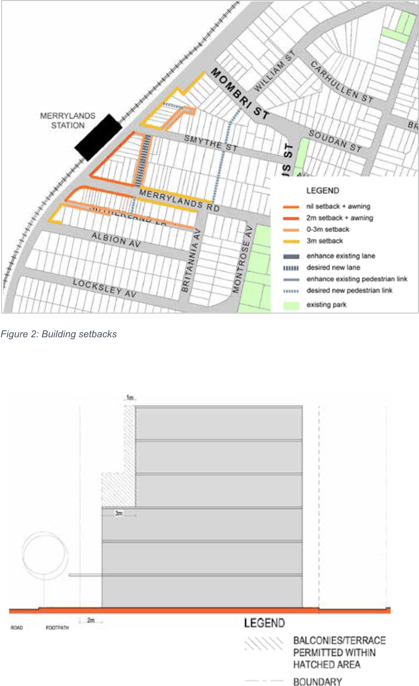
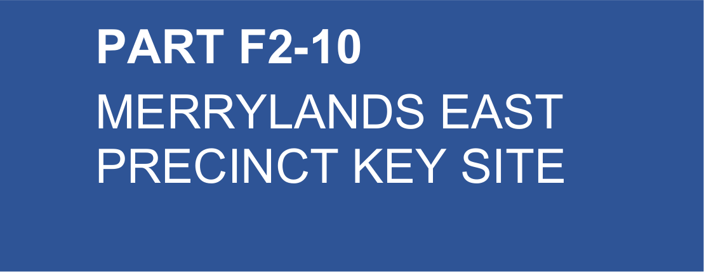

### PART F2-9

### MERRYLANDS STATION

### PRECINCT (EAST)

This page has been left intentionally blank.

## 1. Desired Future Character

New development is to provide an address to Merrylands Railway Station Precinct (East), including

Railway Terrace and Merrylands Road east of the rail line. New residential development in the form of

residential flat buildings and multi dwelling housing will be located in the areas surrounding the local

retail centre and the railway station, generally north of Albion Avenue. The highest densities will be

located along Railway Terrace transitioning downward to the east. Low density housing will be retained

south of Albion Avenue. The role of the existing local shopping strip in Merrylands Road is to be retained with opportunities for

additional retail and business uses to be extended along Railway Terrace. This additional retail area

will increase services for the local community and will improve the pedestrian connection to existing

and proposed high density development north of Mombri Street.

> [Picture on page 192: a picture, saved as a picture (images/part-f2-business-site-specific-page-192-12.gif, 150 dpi).]

Figure 1: Merrylands Station Precinct (East) Map

## 2. Objectives and Controls

#### General Objectives

Ensure that new development provides a strong interface to Railway Terrace and

Merrylands Road.

Ensure that new development at the intersection of Railway Terrace and Merrylands

Road is well defined and reflects the gateway to the eastern side of Merrylands Railway

Station.

### 2.1 Pedestrian connections and laneways

#### Objectives

Refer to 2. General Objectives.

#### Controls

New pedestrian connections and laneways should be provided in accordance with

Figure 2. Where a development provides for public access connections, a variation to

Council’s floor space ratio control may be considered, subject to consistency with

objectives.

New shared pedestrian and vehicular laneway links to the rear of properties within the

B4 Mixed Use Zone and are to provide for vehicular access and servicing needs of

development. The laneway will need to be located over or abutting the B4 Mixed Use

Zone.

Shared vehicular and pedestrian lanes are to have a minimum width of 6 metres.

New pedestrian links are to improve through block connections and are to have a

minimum width of 3 metre, being consistent in width for its full length.

### 2.2 Setbacks

#### Objectives

Refer to 2. General Objectives.

#### Controls

Front building setbacks are to be in accordance with Figure 3 and any additional controls

set out below:

• the 2 metre setback shown along Railway Terrace, between Merrylands Road and

Smythe Street, applies to the first 3 storeys of development. Additional storeys shall

be setback a minimum of 5 metres from the front boundary as shown in Figure 3. Balconies may encroach the upper level setback area as shown on Figure 3 as follows:

• an unroofed terrace area permitted to the 4th storey. Balustrade can extend from

building line of storey below.

• balconies may extend 1 metre into the setback area for the upper 2 storeys. The 2 metre front setback area to Railway Terrace, between Merrylands Road and

Smythe Street, is to be suitably treated to form an extension of the adjoining footway.

This area may also be used for outdoor dining, landscaping and the like.

Where it will not have a detrimental impact upon adjoining development, a nil side

setback should be provided for development in the B1 Neighbourhood Centre Zone and

B4 Mixed Use Zone (between Merrylands Road and Smythe Street) to provide a

continuous street edge.

Sites which have frontage to Railway Terrace should provide address to Railway

Terrace as the primary frontage.

Building setbacks to existing and desired laneways should be designed to promote

activation of the laneway while still allowing for the servicing needs of development.

> [Picture on page 194: a picture, saved as a picture (images/part-f2-business-site-specific-page-194-1.gif, 150 dpi).]

Figure 2: Building setbacks

Figure 3: Building setbacks section

### 2.3 Ground level uses

#### Objectives

Refer to 2. General Objectives.

#### Control

For new development along Railway Terrace between Merrylands Road and Smythe

Street ground floor uses are to be active and non-residential with at-grade pedestrian

access.

This page has been left intentionally blank.

> [Picture on page 197: a picture, saved as a picture (images/part-f2-business-site-specific-page-197-1.gif, 150 dpi).]
