### PART F2-10

### MERRYLANDS EAST

### PRECINCT KEY SITE

This page has been left intentionally blank.

## 1. Introduction

### 1.1 Land to which this Part applies

This part applies to all development on land defined as 244 and 264 Woodville Road, Merrylands and

2, 4, 6, 8-8a, 10, 12 and 14-16 Lansdowne Street and 19 Highland Street, Merrylands, as shown in

Figure 1.

#### 1.2 Relationship to other parts of Cumberland DCP 2021

This Part shall be read in conjunction with the other Parts of Cumberland DCP 2021, which contain

objectives and controls that relate to development in this Part.

Where there is an inconsistency between this Part and provisions contained elsewhere in Cumberland

DCP 2021, the provisions of this Part shall prevail to the extent of the inconsistency.

In addition to this Part, SEPP (Housing) 2021 and the NSW Apartment Design Guide (ADG) must be

taken into account when preparing a development application.

### 1.3 Purpose of this Part

The purpose of this Part is to facilitate the development of the Merrylands East Precinct Key site, either

through the existing development consent approval of the site (DA 2020/493), as well as any

modifications or amending development applications associated with the approved development

application, or, through detailed built form controls and desired future character in line with the Woodville

Road Corridor Strategy.

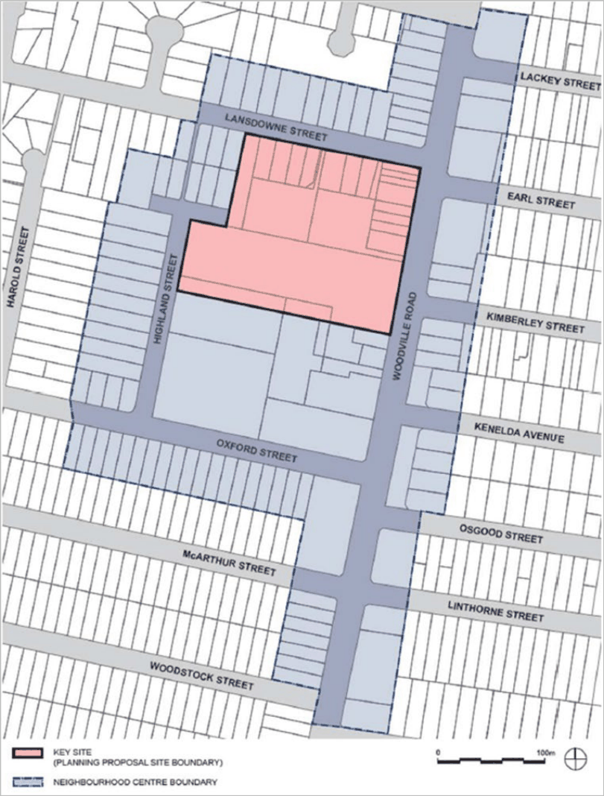

> [Picture on page 200: a picture, saved as a picture (images/part-f2-business-site-specific-page-200-1.gif, 150 dpi).]

Figure 1: Merrylands East Key Site

## 2. Existing Development consent approval

### 2.1 Purpose

The development of the land is to facilitate the establishment of a mixed-use centre with retail and

commercial uses anchored by a full line supermarket, and residential development that complements

the surrounding residential areas at a density appropriate for the site, its location and development

context. Development of the land is to contribute to the character and sustainability of the Merrylands

East Neighbourhood Centre Precinct.

Development of the land is to provide a mixture of retail, commercial and residential floor space, and

public open space for a neighbourhood centre. Development is to have a layout which provides quality

open spaces, reduced car dependency and a walkable neighbourhood environment. The development

of the site is to provide a variety of building heights to allow a transition to adjoining residential

development and to minimise overlooking and overshadowing of the Granville South Public School.

### 2.2 Objectives and controls

#### Objectives

O1. Ensure that future development does not prejudice the efficient delivery of future public

transport solutions along Woodville Road.

O2. Ensure development is setback to allow future road and carriageway widening.

O3. Ensure transition in scale between the main road frontage of key development sites

within the precinct, and surrounding lower scale residential development and the school.

O4. Ensure that the development provides for the greening of Woodville Road.

O5. Development within the neighbourhood precinct is to be generally in accordance with

Figure 2 Precinct Principles.

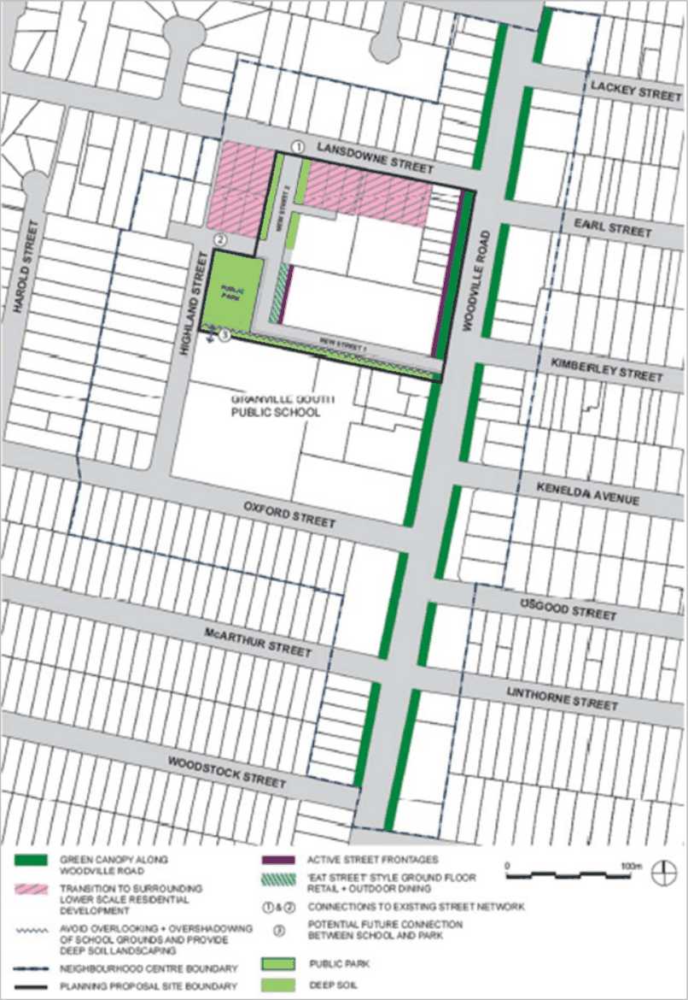

> [Picture on page 202: a picture, saved as a picture (images/part-f2-business-site-specific-page-202-1.gif, 150 dpi).]

Figure 2: Precinct principles

### 2.3 Development application requirements

In addition to these standard requirements, all development applications are to provide a detailed traffic

study.

### 2.4 Structure, form and density

#### Objectives

O1. Define the desired structure, general form and density of development on the land.

O2. Ensure the density of development on the land is suitable to its location, context and

development capacity.

O3. Facilitate the integration of the development of this key site with adjoining development

and the neighbourhood centre precinct.

O4. Establish a mixed-use centre, which will include a neighbourhood park and enhanced

connectivity (pedestrian and visual) within and with adjoining development.

O5. Allow for appropriate transition to the surrounding residential land uses and the Granville

South Public School, and to provide a reasonable separation between future

development and the Granville South Public School.

O6. Allow for a diversity of dwelling types and apartment sizes.

#### Controls

Development is to be in accordance with Figure 3 Site Structure and Land Use Plan.

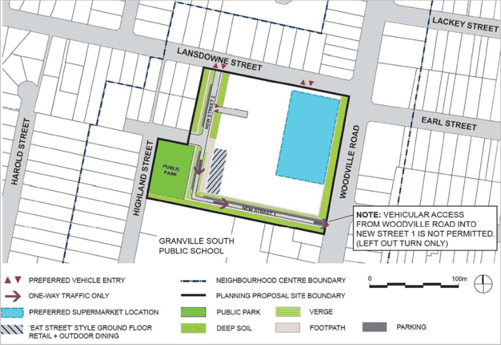

> [Picture on page 203: a picture, saved as a picture (images/part-f2-business-site-specific-page-203-19.gif, 150 dpi).]

Figure 3: Site Structure and Land Use Plan

New Street 1 and New Street 2 (Refer Figure 3) must be constructed and delivered by

the proponent as part of the development of the key site, in accordance with Council’s

engineering requirements, and at no cost to Council.

New Street 1 and New Street 2 are to provide separation between future development

and Granville South Public School to the south and neighbouring residential to the west.

The ground floor and first floor of the proposed development on the key site must be

non-residential.

### 2.5 Lot consolidation and minimum street frontage

#### Objectives

O1. Avoid isolating an adjoining site or sites and facilitate the efficient delivery of

infrastructure.

O2. Assist in the delivery of well-designed built forms and streetscapes.

O3. Development must be delivered in suitably sized and configured development parcels

that facilitate the delivery of infrastructure.

O4. Buildings must have appropriate horizontal to vertical proportions that relate to the size

of street frontages and be designed to minimise the impact of carpark entrances.

#### Controls

C1. Lots shall have a minimum street frontage as shown in the table below.

Table 1: Minimum street frontages

| Street | Minimum Street Frontage | Intention |
|---|---|---|
| Woodville Road | 30m | To encourage the consolidation of land and development of suitable building forms. |
| Lansdowne Road | 20m |  |
| Highland Road | 20m |  |

C2. Development must be designed and planned in relation to the development parcels as

shown in Figure 4 Preferred Lot Consolidation unless it can be demonstrated that lot

amalgamation cannot be achieved.

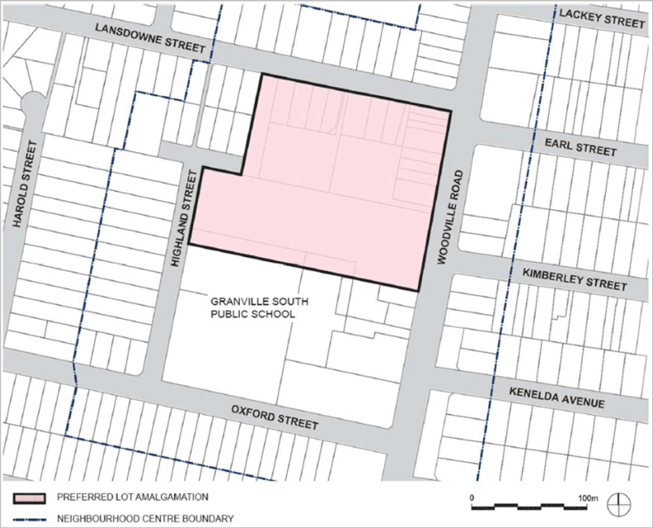

> [Picture on page 205: a picture, saved as a picture (images/part-f2-business-site-specific-page-205-1.gif, 150 dpi).]

Figure 4: Preferred lot consolidation

Council will require appropriate documentary evidence to demonstrate that a genuine and

reasonable attempt has been made to purchase an isolated site based on a fair market value.

At least one recent independent valuation is to be submitted as part of that evidence and is to

account for reasonable expenses likely to be incurred by the owner of the isolated site in the

sale of the property.

C3. Where a development proposal results in an isolated site, applicants will be required to

demonstrate that the development of the separate sites can be feasibly achieved, which

will require:

• provision of a feasible building envelope for the isolated site, indicating height,

setbacks and site coverage (building and basement);

• identification and assessment of the likely impacts the two developments will have

on each other including solar access and visual and acoustic privacy; and

• identification, assessment and mitigation of the impacts of the separate

development of the isolated site or sites on the streetscape. This will require an

applicant/s to document how the development of both sites respond to the character

of the streetscape and achieve a suitable built form and satisfactory level of amenity

including solar access and visual and acoustic privacy.

### 2.6 Building heights

#### Objectives

O1. Distribute building heights within the key site to reinforce the site structure and achieve

a height transition to adjoining development.

O2. Reduce the bulk of development by providing variations in individual building heights,

massing and scale and visual permeability within the site through the distribution of

different building heights.

#### Controls

C1. Development shall not impact on solar access or create overshadowing of the

playground or sporting fields of the Granville South Public School.

C2. The height of buildings is to be in accordance with Figure 5 Building Heights and all

requirements of the ADG, particularly building separation.

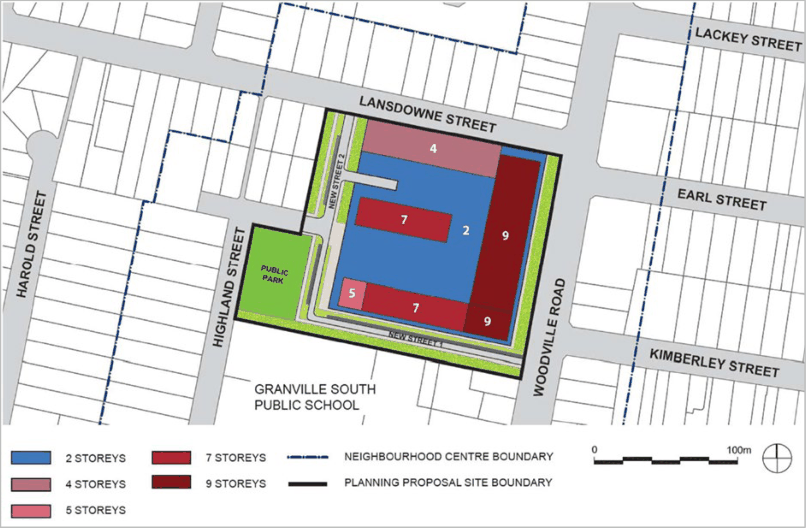

> [Picture on page 206: a picture, saved as a picture (images/part-f2-business-site-specific-page-206-9.gif, 150 dpi).]

Figure 5: Building heights (to be read in conjunction with Figure 7 Setbacks)

### 2.7 Setbacks

#### Objectives

O1. Ensure that development does not limit the provision of public transport options or

improvements on Woodville Road.

O2. Ensure that development relates to the street hierarchy and contributes to a suitable

scale and street character.

O3. Establish the new roads identified in the Site Structure Plan and Land Use Plan (Figure

3).

O4. Maintain the amenity of Granville South Public School by minimising overshadowing

and overlooking of the school grounds.

O5. Sufficient land is to be provided for an additional road lane on the western side of

Woodville Road to facilitate public transport improvements, traffic management and to

allow provision of substantial landscaping along Woodville Road (refer to Figure 9).

O6. The tower or upper storey elements of multi storey mixed used buildings are to be set

back to reduce the mass and bulk of buildings.

O7. Provide landscaping along boundaries, with deep soil planting with mature plants

particularly along the southern boundary between the development and the adjoining

School, to obscure sight lines for optimum visual privacy.

#### Controls

C1. Minimum setbacks are to be in accordance with Figure 6 Setbacks (Please refer to

Figure 8 to Figure 14 for details).

C2. Unless otherwise identified, street setbacks are to be in alignment with the predominant

existing street setbacks for each street within the neighbourhood precinct.

C3. If the key site is not developed as a single, consolidated lot, the development must be

setback a minimum of 6m from the property boundary of any undeveloped lot with

frontage to Lansdowne Street and New Street 2 as per Figure 14.

C4. A deep soil setback of 10m must be provided on the eastern boundary of the site along

Woodville Road as per Figure 4 Site Structure and Land Use Plan and Figure 9

Woodville Road Setbacks (Section B-B).

A deep soil setback of 6.5m must be provided on the southern boundary of the site along

New Street 1 as per Figure 3 Site Structure and Land Use Plan and Figure 10 New

Street 1 Setbacks (Section C-C).

A deep soil setback of 6.5m on the western side and a deep soil setback of 7m on the

eastern side of the northern end of New Street 2 (north of the street connecting to

Highland Street) must be provided as per Figure 3 Site Structure and Land Use Plan

and Figure 11 New Street 2 Setbacks – Northern End (Section E-E).

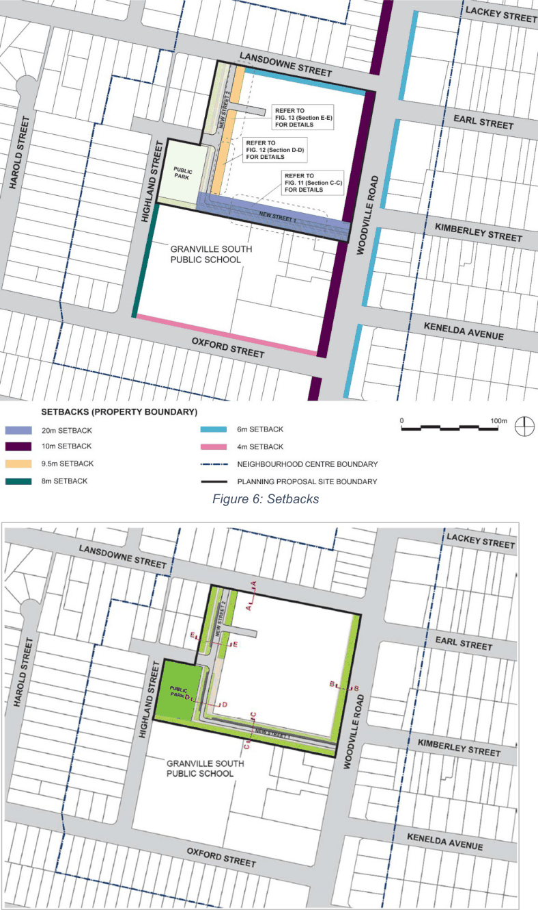

> [Picture on page 208: a picture, saved as a picture (images/part-f2-business-site-specific-page-208-1.gif, 150 dpi).]

Figure 6: Setbacks

Figure 7: Sections

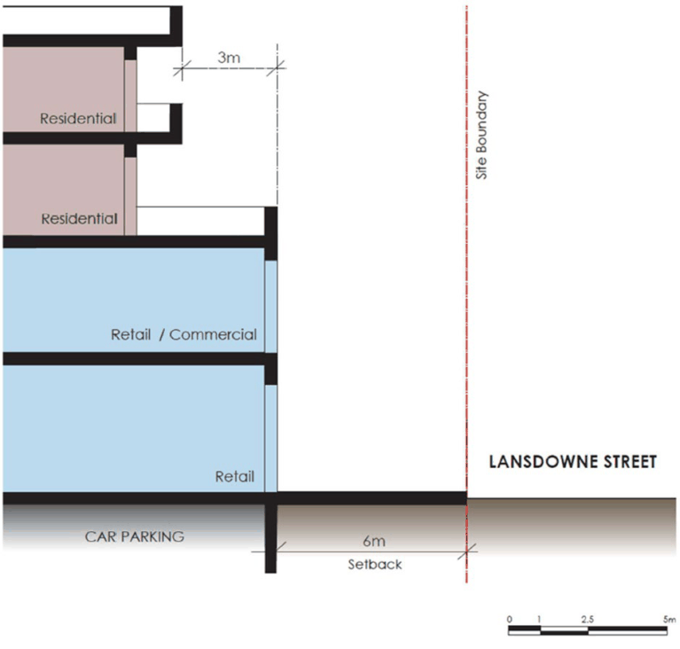

> [Picture on page 209: a picture, saved as a picture (images/part-f2-business-site-specific-page-209-1.gif, 150 dpi).]

Figure 8: Lansdowne Street setback - Section A-A

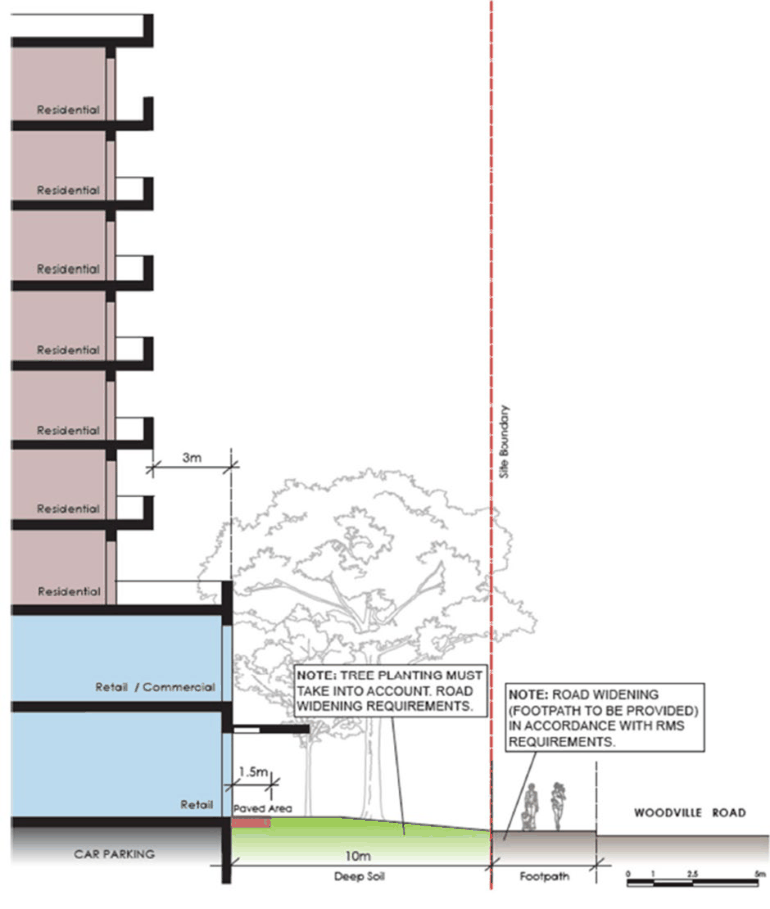

> [Picture on page 210: a picture, saved as a picture (images/part-f2-business-site-specific-page-210-1.gif, 150 dpi).]

Figure 9: Woodville Road setbacks - Section B-B

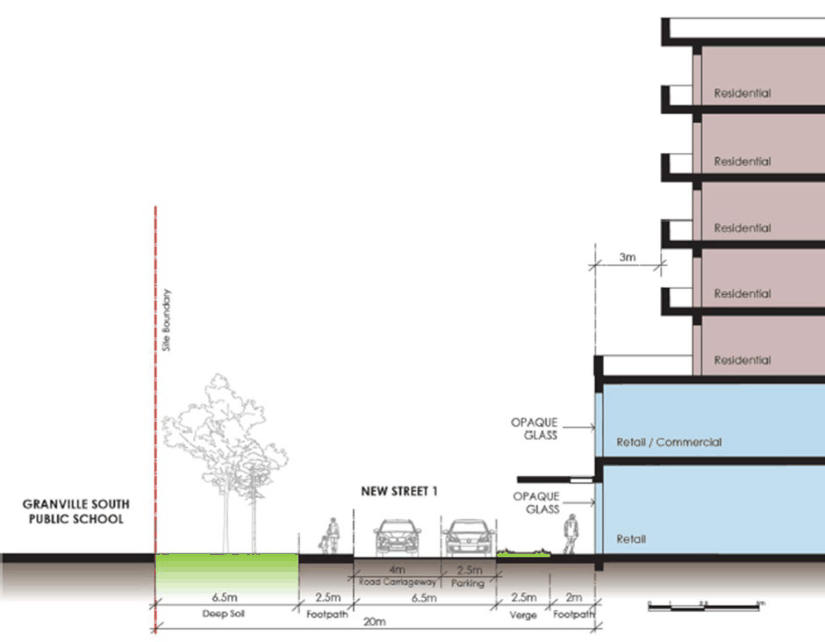

> [Picture on page 211: a picture, saved as a picture (images/part-f2-business-site-specific-page-211-1.gif, 150 dpi).]

Figure 10: New Street 1 setbacks - Section C-C

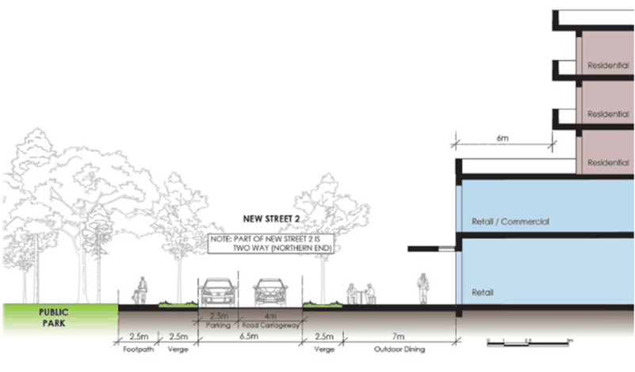

> [Picture on page 212: a picture, saved as a picture (images/part-f2-business-site-specific-page-212-1.gif, 150 dpi).]

Figure 11: New Street 2 setbacks - Southern End - Section D-D

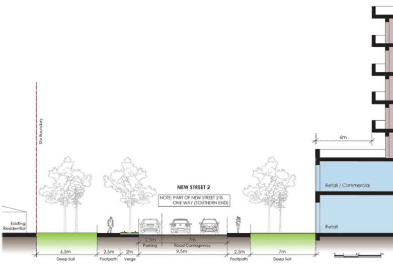

> [Picture on page 212: a picture, saved as a picture (images/part-f2-business-site-specific-page-212-3.gif, 150 dpi).]

Figure 12: New Street 2 - Northern End - Section E-E

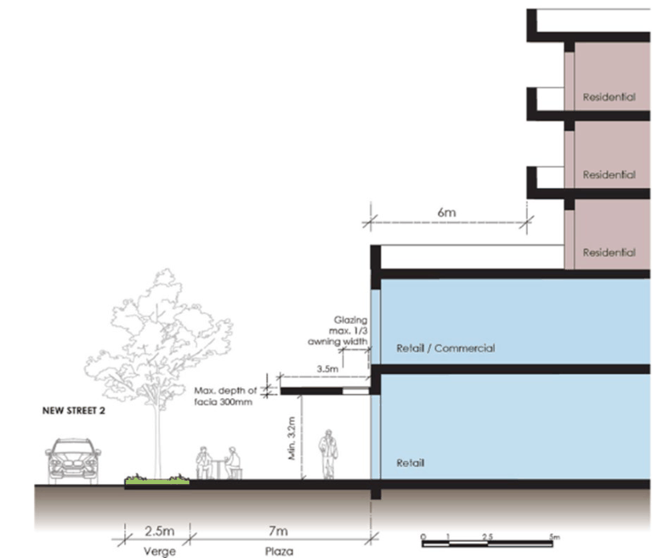

> [Picture on page 213: a picture, saved as a picture (images/part-f2-business-site-specific-page-213-1.gif, 150 dpi).]

Figure 13: New Street 2 southern end detail

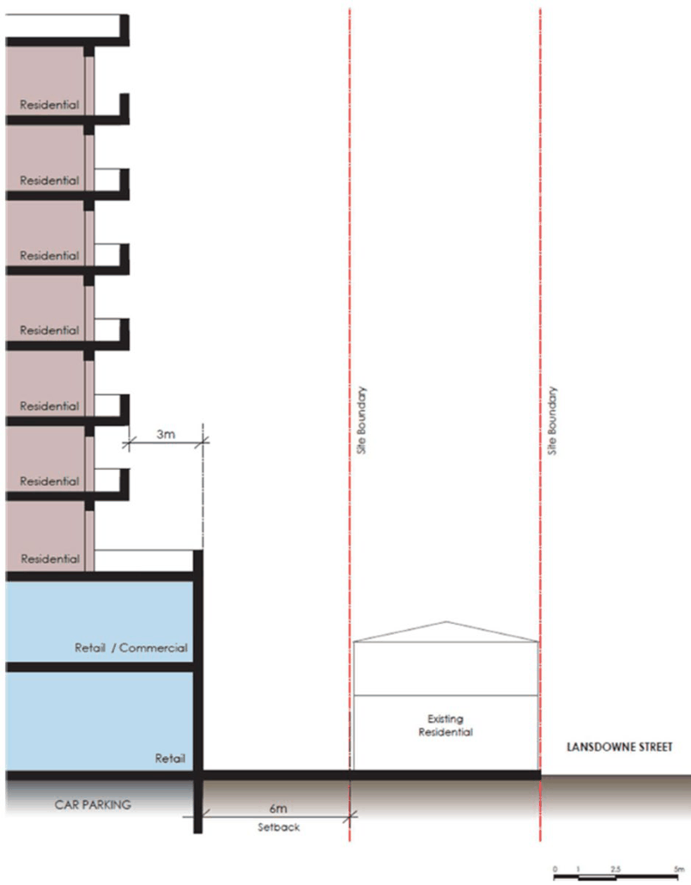

> [Picture on page 214: a picture, saved as a picture (images/part-f2-business-site-specific-page-214-1.gif, 150 dpi).]

Figure 14: Setback if key site not developed as a single, consolidated lot

### 2.8 New roads

#### Controls

C1. A 4m wide one-way road carriageway must be provided on New Street 1 with a 2.5m

wide pedestrian footpath on the southern side. On the northern side, a 2.5m wide

parking bay, a 2.5m wide verge, and a 2m wide pedestrian footpath should be provided

as per Figure 10 New Street 1 Setbacks (Section C-C).

C2. A 4m wide one-way road carriageway must be provided on the southern end of New

Street 2 (south of the street connecting to Highland Street) with a 2.5m wide pedestrian

footpath, a 2.5m verge, and a 2.5m wide parking bay on the western side. On the

eastern side, a 2.5m wide verge and a 7m wide outdoor dining area should be provided

as per Figure 11 New Street 2 Setbacks – Southern End (Section D-D).

C3. A 7m wide two-way road carriageway must be provided on the northern end of New

Street 2 (north of the street connecting to Highland Street) with a 2.5m wide pedestrian

footpath, a 2m verge and a 2.5m wide parking bay on the western side. On the eastern

side, a 2.5m pedestrian footpath should be provided as per Figure 12 New Street 2

Setbacks – Northern End (Section E-E).

### 2.9 Landscape and open space

#### Objectives

O1. Ensure that a high quality public neighbourhood park is provided.

O2. Ensure that the public domain is integrated with existing and potential future public

domain and open spaces within the neighbourhood centre precinct.

O3. Ensure the neighbourhood park has a sense of place and to establish it as the focal

point of the neighbourhood precinct.

O4. Achieve a variety of spaces that are inclusive of particular needs and desires of key

community groups such as children, young people, older people, people on low incomes

and people with a disability.

O5. Integrate the management of stormwater into the design of public open spaces.

O6. Integrate public art to create a more visually interesting and culturally diverse public

domain.

O7. Public open space to be designed to include clear, accessible, safe and convenient

linkages to the surrounding streets and community, inside and outside the

neighbourhood precinct.

O8. Landscaping and choice of materials is to respond to the character of each space and

is to unite and relate to other spaces throughout the neighbourhood precinct.

O9. The design of open space is to be of the highest quality with suitable landscaping, well

integrated public art and appropriately varied soft and hard surface design.

O10. Vehicular movements through the neighbourhood park are to be generally restricted

except for emergency vehicles, servicing and special events.

O11. Useable and sustainable green space at ground level, podium level, and roof top

gardens are to be provided and integrated with building design.

O12. Vertical gardens are encouraged, where possible.

#### Controls

C1. A public domain concept plan for the development of the site or any part thereof is to be

provided with the first Development Application for the land. The plan must:

• provide for deep soil planting zones (Refer Figure 3);

• show how a high amenity public domain will be achieved on the site and on

Woodville Road;

• provide an indicative landscape design, including details and indicative costs for

street furniture, street trees, landscaping works, materials and utilities; and

• indicate how street trees and other planting arrangements are to be provided on all

new streets to Council’s specifications.

C2. Development proposing outdoor dining must comply with Council’s Outdoor Dining

Policy and Guidelines.

C3. A fully embellished neighbourhood park not less than 2,000 square metres is to be

provided, to a design approved by Council and located as shown in Figure 3 Site

Structure and Land Use Plan. A concept plan is to be provided with the lodgement of

the first DA for the Site.

C4. A minimum of 85% of the neighbourhood park is to be deep soil zone, and the total area

of the neighbourhood park is to be excluded from all deep soil calculations associated

with private development.

C5. The neighbourhood park is to:

• provide the primary green public open space to act as the heart of the

neighbourhood precinct;

• provide for primarily soft landscaping and deep soil planting including mature plants;

• avoid basement parking beneath the neighbourhood park;

• provide both passive and active recreation spaces;

• be landscaped to include native trees;

• provide a safe play area for children which is to be visually and physically connected

to the main park area;

• include play elements integrated into the landscape design and enable informal

play; and

• be dedicated to Council and Council engineers are to be consulted prior to the

design of all internal roads within the precinct.

C6. Medium sized tree planting (a minimum 6-8 metres mature height at 7 – 10 m centre-to

centre) with an understorey of shrubs (1.5m – 3m) and ground cover must be provided

along the boundary on the southern side (adjacent the school). The medium sized tree

planting within a deep soil zone is to be incorporated at the southern end of the park.

All elements are to be vandal and graffiti resistant.

Design of the public domain is to be integrated with stormwater management.

All internal roads not in Council’s ownership must be maintained at all times. Note:

Council will not accept dedication of roads with basement parking underneath.

Wintergardens are to be provided fronting Woodville Road. The area of the

wintergardens is to be excluded from the GFA for FSR calculations.

### 2.10 Building elements, architectural diversity and articulation

#### Objectives

O1. Ensure the building design contributes to street, public domain and residential amenity.

O2. Reduce visual bulk and scale, add visual interest and avoid “boxlike” designs.

O3. Achieve architectural diversity and add visual interest.

O4. Ensure that development enhances and contributes to the streetscape and desired

future character of the neighbourhood.

O5. Buildings are to be designed to deliver high quality architecture through the use of faced

articulation, materials selection and use of vertical gardens where appropriate.

O6. Building design is to include horizontal and vertical architectural elements to articulate

the facades and minimize building bulk and mass, which frame public spaces and

contribute to or define the public domain.

#### Controls

C1. Minimise perceived building bulk and monotony, the building façade should have unique

architectural expressions while still maintaining cohesion.

C2. The maximum linear length of any building is to be 65m.

C3. Buildings in excess of 45m long must be designed as at least two distinct ‘building

components’ which are to:

• not exceed 25m in length with a preferred length of 20m (Refer Figure 15);

• have a building separation of minimum 6m for the full height of the building; and

• have their own distinctive architectural character.

C4. Full height gaps are to be provided between buildings consistent with the building

separation provisions of the NSW Apartment Design Guide (ADG) for solar access and

visual connections.

C5. Where possible, building breaks are to be aligned with streets and lanes in the

surrounding area or proposed streets and lanes.

C6. The southern façade of the proposed development adjoining the school must be

designed to maintain the visual privacy of the school.

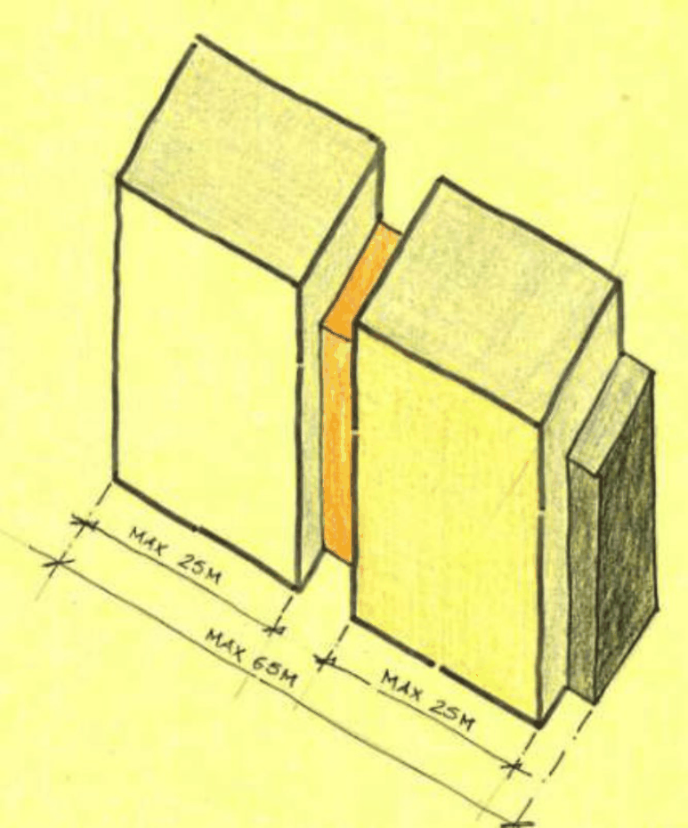

> [Picture on page 218: a picture, saved as a picture (images/part-f2-business-site-specific-page-218-1.gif, 150 dpi).]

Figure 15: Building articulation / Maximum building length

### 2.11  Active street frontage

#### Objectives

O1. Enhance pedestrian safety, security and amenity around and within the commercial

premises.

O2. Improve the amenity of the public domain by encouraging pedestrian activity.

O3. Support the economic viability of the street.

#### Controls

C1. Provide active street frontage at ground floor level as per Figure 16.

C2. Except for the southern façade, clear glazing is to be provided, and reflective, tinted or

obscured window coverings should be avoided.

C3. A minimum of 80% of the building facades with active street frontage and street address

at ground level are to be transparent.

C4. Opaque glass should be provided along the southern building façade.

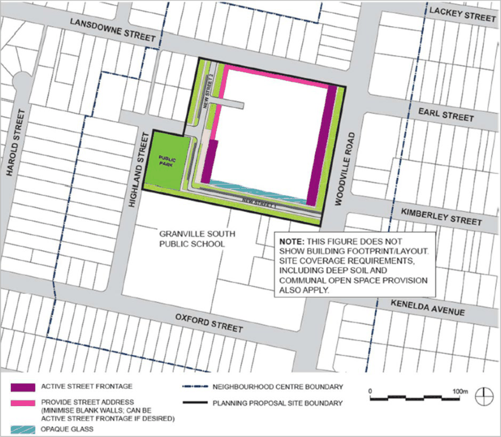

> [Picture on page 219: a picture, saved as a picture (images/part-f2-business-site-specific-page-219-6.gif, 150 dpi).]

Figure 16: Street activation

### 2.12 Awnings and canopies

#### Objectives

O1. Increase pedestrian amenity by the provision of weather protection.

O2. Visually unify the mixed-use development.

#### Controls

C1. Awnings are to be provided to the full extent along Woodville Road, the southern

boundary and the outdoor dining area.

C2. All awnings should be a minimum width of 3.5m (Refer Figure 13).

C3. Incorporate glazing/transparent material in the awning to allow solar access.

### 2.13 Street wall height

#### Objectives

O1. Provide street edge that reinforces the proposed uses and is consistent with the existing

character of the area.

O2. Ensure the building height at street level is of human scale.

O3. Establish a clear presence of the retail and commercial uses, and increase visibility of

these uses at ground floor level.

#### Control

C1. Street wall height for the mixed-use development should be two storeys (minimum 8.2m

and maximum 10m) with an upper level setback.

### 2.14  Upper level setback

#### Objectives

O1. Minimise adverse wind impact on the pedestrian environment.

O2. Maximise the solar access onto the public domain.

O3. Ensure that the podium and buildings above create a human scale and pedestrian

friendly environment.

#### Control

C1. The buildings above the podium are to be setback in accordance with Figure 8 to Figure

14.

### 2.15  Traffic management and parking

#### Objectives

O1. Manage traffic impacts and ensure that development does not unreasonably impact on

the traffic conditions on Woodville Road and local roads.

O2. Ensure suitable parking and traffic management arrangements are identified prior to

development of the land and are used to inform the preparation of Development

Applications.

O3. Ensure vehicle entries and loading bay entries do not compromise pedestrian safety.

O4. Increase the use of active transport and reduce vehicle use.

#### Controls

C1. A detailed traffic study will be submitted with any Development Application for the site

or part thereof. It will:

• identify and address traffic generation issues associated with the overall

development of the site;

• include modelling of the Lansdowne Street/Woodville Road and Oxford

Street/Woodville Road intersections as a network and not as individual

intersections; and

• include modelling of the priority control for the intersection of Lansdowne Street and

the internal street and determine whether a roundabout is required at that

intersection.

C2. The traffic study is to comply with the Roads and Maritime Services Traffic Modelling

Guidelines (2013).

C3. Ensure any site vehicle access points are located to avoid conflict with pedestrians and

vehicles accessing the school.

C4. The loading bay entry should be located on Lansdowne Street and separated from

vehicular entry into the mixed-use development.

C5. No driveway vehicle access from Woodville Road is permitted.

C6. Left-out exit from New Street 1 only permitted onto Woodville Road.

C7. A travel plan will be submitted with any Development Application for the site or part

thereof to reduce car trips and encourage the use of sustainable transport.

### 2.16  Contamination

#### Objectives

O1. Ensure that the changes of land use will not increase the risk to public health or the

environment.

O2. Ensure that any remediation to the land will not increase the risk to the users of the

adjoining school and surrounding residential development.

O3. Link decisions about the development of land within the information available about

contamination.

O4. A remedial action plan for the development of the site or any part thereof is to be

provided with the first Development Application for the land. The plan must be prepared

in accordance with the NSW Environment Protection Authority Guidelines

Contaminated Sites: Guidelines for Consultants Reporting on Contaminated Sites

(1997a) and the National Environment Protection (Assessment of Site Contamination)

Measure (2013 Amendment).

#### Control

C1. All contamination arrangements are to be in accordance with Part C and Part G of this

DCP.

### 2.17 Air quality

#### Objectives

O1. Ensure that development fronting Woodville Road provides an acceptable level of air

quality for the users and occupants.

O2. Encourage the inclusion of wintergardens along development fronting Woodville Road.

O3. Ensure that demolition and construction in the neighbourhood centre does not adversely

impact the air quality for users of the adjoining school and surrounding residential

development.

O4. Reduce the formation of urban canyons to avoid motor vehicle air transmissions and

other pollutants from becoming trapped and ensure dispersion. Appropriate setbacks

on the upper stories of multi-level buildings can help to avoid urban canyons.

O5. Consider building siting and orientation to incorporate an appropriate separation

between sensitive land uses and the road. The location of living areas, outdoor space

and bedrooms, and other sensitive uses (such as childcare centres) must be as far as

practicable from the major source of air pollution.

O6. Ventilation design and open-able windows should be considered in the design of

development located adjacent to roadway emission sources. When the use of

mechanical ventilation is proposed, the air intakes must be sited as far as practicable

from the major source of air pollution.

O7. Use vegetative screens, barriers or earth mounds where appropriate to assist in

maintaining local ambient air amenity. Landscaping has the added benefit of improving

aesthetics and minimising visual intrusion from an adjacent roadway.

#### Controls

C1. Air quality must be considered early in the design process for development fronting

Woodville Road.

C2. Air quality design considerations must be based on the above design principles and as

per the NSW Department of Planning Development Near Rail Corridors and Busy Roads

– Interim Guideline (2008).

### 2.18 Noise and vibration

#### Objectives

O1. Ensure appropriate measures are taken to ensure noise and vibration is managed for

development facing Woodville Road.

O2. Ensure noise emissions from the development including but not limited to proposed

mechanical plant, air conditioners, automatic roller doors, ventilation plant for the

underground car park) are minimised.

O3. Ensure noise emissions during the demolition, remediation of land and construction of

the development is managed to minimise impact on the adjoining school and nearby

residential development.

O4. Ensure the following LAeq levels are not exceeded for residential development:

• in any bedroom in the building: 35dB(A) at any time 10pm – 7am; and

• anywhere else in the building (other than a garage, kitchen, bathroom or hallways):

40dB(A) at any time.

#### Controls

C1. An acoustic report is to be prepared by an appropriately qualified acoustic consultant

having the technical eligibility criteria required for membership of the Association of

Australian Acoustical Consultants (AAAC) and/or grade membership of the Australian

Acoustical Society (AAS). The report is to consider noise intrusion from the road and

measures to ensure compliance with the SEPP (Infrastructure) 2007.

C2. The report must also consider noise emissions from the development including but not

limited to proposed mechanical plant (air conditioners, automatic roller doors, ventilation

plant for the underground car park), and access and egress to loading and car parking

areas.

C3. Consideration is required for the demolition/remediation/construction noise and

vibration intrusion of the proposed development on the neighbourhood school and

properties.

C4. The acoustic report must be prepared in accordance with the Noise Policy of Industry

(2017), NSW Government Department of Planning Development Near Rail Corridors

and Busy Roads – Interim Guidelines (2008), and the NSW Environment Protection

Authority Interim Construction Noise Guideline (2009).

C5. Construction management plans are to be prepared prior to the commencement of any

construction on site.

## 3. Woodville Road Corridor Strategy

### 3.1 Vision and desired future character

#### 3.1.1 Vision

The site is to facilitate mixed-use development with public open space, retail and commercial

uses anchored by a full line supermarket. The site shall also contain residential development

that complements the surrounding residential areas at a density and height appropriate for the

site, location and development context.

#### 3.1.2 Desired future character

Development is to have a layout which provides quality open spaces, reduced car dependency

and a walkable neighbourhood environment. The development of the site shall also provide a

variety of building heights to allow a transition to adjoining residential development and to

minimise overlooking and overshadowing of the Granville South Public School.

### 3.2 Objectives and controls

#### Objectives

Ensure that future development does not prejudice the efficient delivery of future public

and active transport solutions along Woodville Road and future public open space.

Ensure development is setback to allow future road and carriageway widening.

Ensure transition in scale between the key site, sites within the Merrylands East

precinct, surrounding lower scale residential development and the school.

Ensure that the development provides for the greening of Woodville Road.

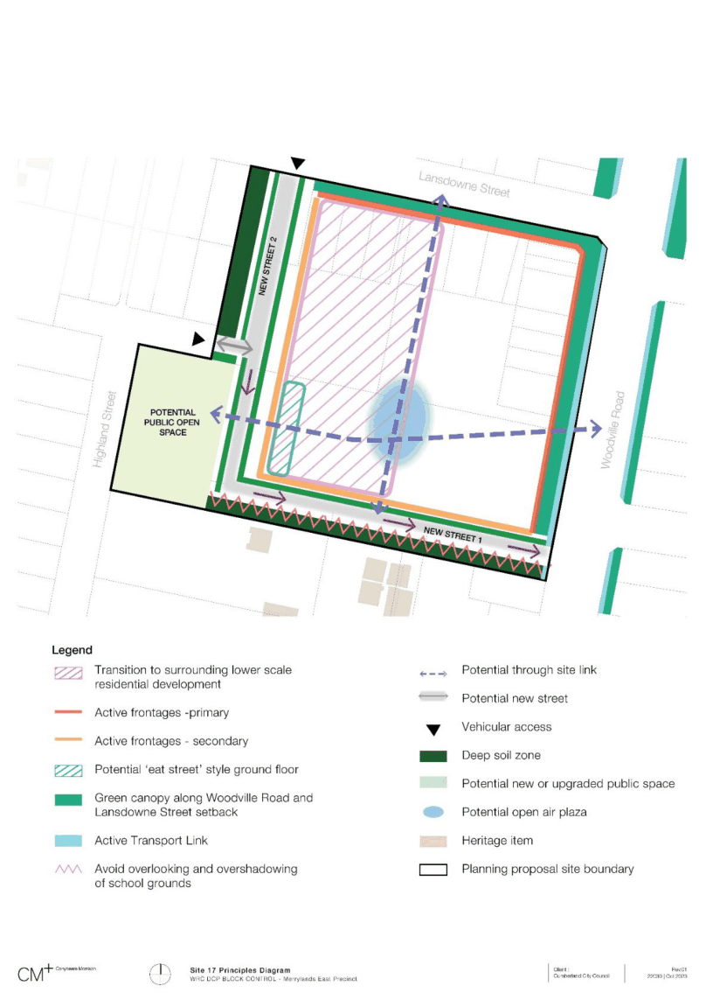

> [Picture on page 224: a picture, saved as a picture (images/part-f2-business-site-specific-page-224-1.gif, 150 dpi).]

Figure 17: Precinct principles

### 3.3 Structure, form and density

#### Objectives

O1. Define the desired structure, general form and density of development on the land.

O2. Ensure the density of development on the land is suitable to its location, context and

development capacity.

O3. Establish a mixed-use centre, which will include a neighbourhood park and enhanced

connectivity (pedestrian and visual) within the site and with adjoining development.

#### Controls

C1. Development is to be in accordance with Figure 18.

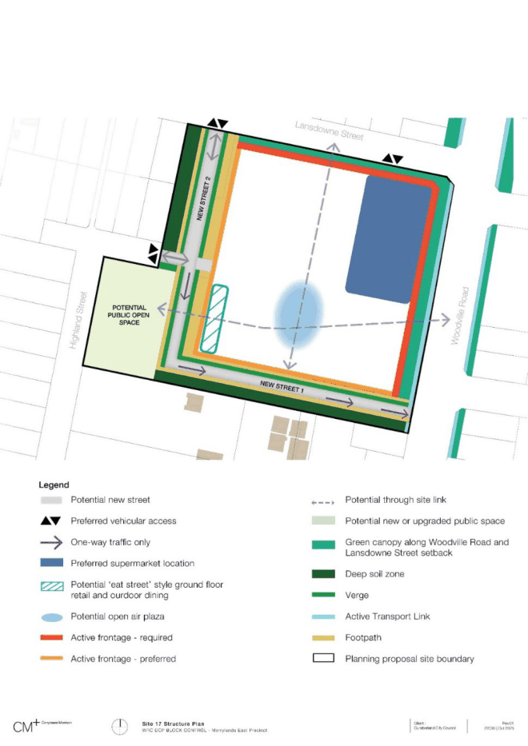

> [Picture on page 225: a picture, saved as a picture (images/part-f2-business-site-specific-page-225-10.gif, 150 dpi).]

Figure 18: Site Structure and Land Use Plan

C2. New Street 1 and New Street 2 shall be provided in accordance with Figure 18 to aid

movement around the site and to provide separation between future development and

Granville South Public School to the south and neighbouring residential to the west.

C3. The ground floor of the proposed development on the key site must be non-residential.

C4. A minimum 3,000m2 publicly accessible public park shall be included as part of

proposed development and must be constructed by the proponent and dedicated to

Council as part of the development of the key site, in the location shown in Figure 18.

### 3.4 Lot consolidation and minimum street frontage

#### Objectives

O1. Minimise isolating sites and facilitate the efficient delivery of infrastructure.

O2. Deliver well-designed built forms and streetscapes in suitably sized and configured

development parcels.

#### Controls

C1. Lots shall have a minimum street frontage as shown in the table below.

Table 2: Minimum street frontage

| Street | Minimum Street Frontage | Intention |
|---|---|---|
| Woodville Road | 30m | To encourage the consolidation of land and development of suitable building forms. |
| Lansdowne Road | 20m |  |
| Highland Road | 30m |  |

C2. Development must be designed and planned in relation to the development parcels as

shown in Figure 19 unless it can be demonstrated that lot amalgamation cannot be

achieved without isolating a lot or lots.

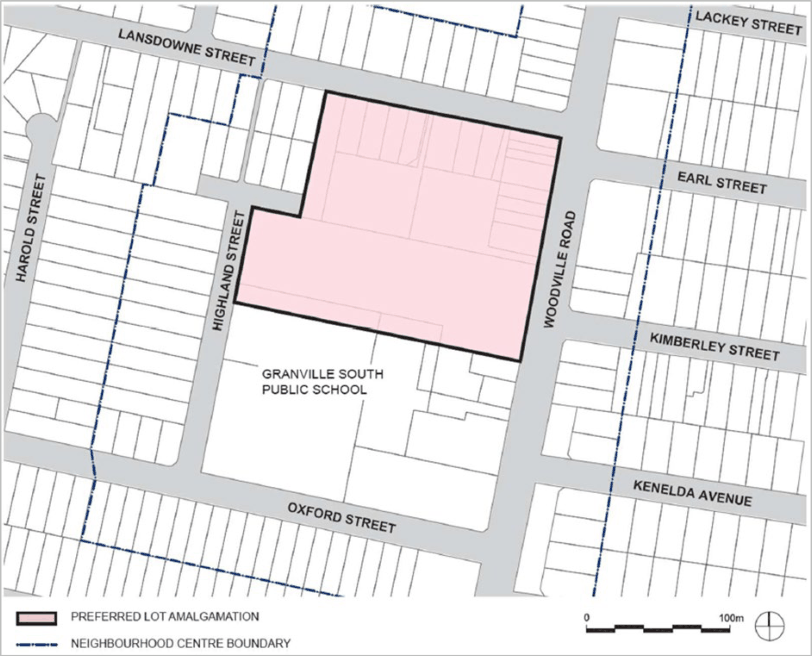

> [Picture on page 227: a picture, saved as a picture (images/part-f2-business-site-specific-page-227-1.gif, 150 dpi).]

Figure 19: Preferred lot consolidation

Council will require appropriate documentary evidence to demonstrate that a genuine

and reasonable attempt has been made to purchase an isolated site based on a fair

market value. At least one recent independent valuation is to be submitted as part of

that evidence and is to account for reasonable expenses likely to be incurred by the

owner of the isolated site in the sale of the property.

C3. Where a development proposal results in an isolated site, applicants will be required to

demonstrate that the development of the separate sites can be feasibly achieved, which

will require:

• Provision of a feasible building envelope for the isolated site, indicating height,

setbacks and site coverage (building and basement);

• Identification and assessment of the likely impacts the two developments will have

on each other including solar access and visual and acoustic privacy; and

• Identification, assessment and mitigation of the impacts of the separate

development of the isolated site or sites on the streetscape. This will require an

applicant/s to document how the development of both sites respond to the character

of the streetscape and achieve a suitable built form and satisfactory level of amenity

including solar access and visual and acoustic privacy.

### 3.5 Through site link

#### Objectives

O1. To break up the continuous block and increase the precinct’s permeability.

O2. To provide adequate and high-quality areas for pedestrian activity and amenity.

#### Controls

C1. The development shall provide a publicly accessible through-site link and urban plaza

as shown in Figures 17, 18, 20, 21 and 22.

C2. Non-residential active uses are to face the through-site link and urban plaza on the

ground floor.

C3. The building envelope is to allow for visibility along the internal length of the through-

site link to improve pedestrian permeability.

C4. The through-site links are to be a minimum 50% open air.

If through-site links are not a minimum 50% open air, justification shall be provided as

to why this control cannot be met or achieved.

C5. The through-site link and urban plaza are to be the responsibility of the relevant

ownership entity, with formalised public access to these areas to be created.

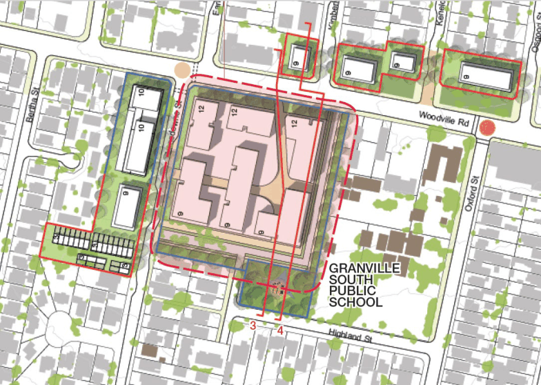

> [Picture on page 228: a picture, saved as a picture (images/part-f2-business-site-specific-page-228-17.gif, 150 dpi).]

Figure 20: Through-site link sections

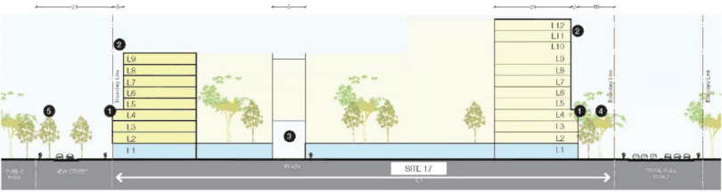

> [Picture on page 229: a picture, saved as a picture (images/part-f2-business-site-specific-page-229-1.gif, 150 dpi).]

Figure 21: Through-site link Section 3-3

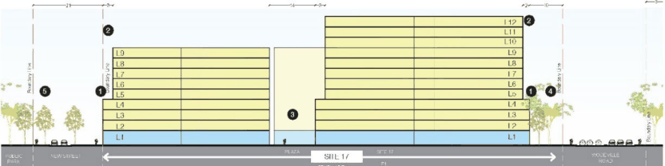

> [Picture on page 229: a picture, saved as a picture (images/part-f2-business-site-specific-page-229-3.gif, 150 dpi).]

Figure 22: Through-site link Section 4-4

### 3.6 Building heights

#### Objectives

O1. Distribute building heights within the key site to reinforce the site structure and achieve

a height transition to adjoining development.

O2. Reduce the bulk of development by providing variations in individual building heights,

massing and scale and visual permeability within the site through the distribution of

different building heights.

#### Controls

C1. Development shall not impact on solar access or create overshadowing of the

playground or sporting fields of the Granville South Public School.

C2. The height of buildings is to be in accordance with Figures 23 and 24 and all

requirements of the ADG, particularly building separation and upper-level setbacks.

C3. The floor-to-floor height of the ground floor of a mixed-use building shall be a minimum

4.3m.

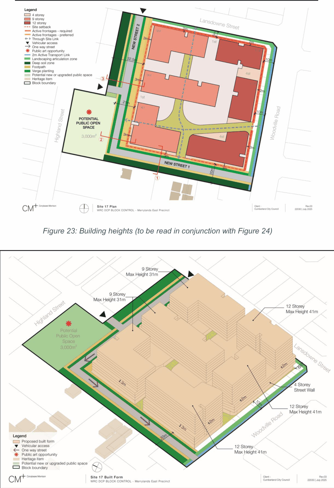

> [Picture on page 230: a picture, saved as a picture (images/part-f2-business-site-specific-page-230-1.gif, 150 dpi).]

Figure 23: Building heights (to be read in conjunction with Figure 24)

Figure 24: Block control diagram

### 3.7 Street wall height

#### Objectives

O1. Provide a street edge that reinforces the proposed uses and is consistent with the

existing character of the area.

O2. Ensure the building height at street level is of human scale.

#### Control

C1. A Street wall (podium) height of 4 storeys/13-15m is required for the whole site.

### 3.8 Setbacks

#### Objectives

O1. Ensure that development does not limit the provision of active transport and public

transport options or improvements on or along Woodville Road.

O2. Ensure that development relates to the street hierarchy and contributes to a suitable

scale and street character.

O3. Facilitate the development of new roads to aid movement around the site.

O4. Maintain the amenity of Granville South Public School by minimising overshadowing

and overlooking of the school grounds.

O5. Reduce the mass and bulk of upper storey elements.

O6. Provide landscaping with deep soil planting and mature plants.

#### Controls

C1. Minimum setbacks are to be in accordance with Figures 23 and 24 and Table 3. Refer

to Figures 25 to 32 for details of the setbacks.

C2. For the Woodville Road setback:

• The landscaped setback is to accommodate a rise in ground level with a gradual

slope of 1 in 20.

• Fencing is not permitted.

• The first 2m depth of the front setback shall be dedicated, constructed and provided

to Council for the purpose of a public active transport path.

• A 3m deep landscape articulation zone shall be provided behind the active transport

path and must contain medium to large canopy trees located 10m to 20m apart

centre to centre.

C3. For the Lansdowne Street setback:

• The landscaped setback is to accommodate a rise in ground level with a gradual

slope of 1 in 20.

• Fencing is not permitted.

• A 3m deep landscaping articulation zone shall be provided and must contain

medium to large canopy trees, located 10m to 20m apart centre to centre.

C4. A deep soil zone of 6.5m depth must be provided on the southern boundary of the site

along New Street 1 as per Figure 25 and Figure 28.

C5. A deep soil zone of 9m depth on the western side of the northern end of New Street 2

must be provided as per Figure 25 and Figure 30.

C6. Upper-level setbacks shall be provided above the street wall height on all sides of the

development as per Figure 24 and Table 3 below.

Table 3: Setbacks

| Site Direction | Boundary Description | Minimum setback to Street Wall Height | Minimum setback to levels above Street Wall Height (Upper- Level Setbacks | Minimum Width of setback to be dedicated to Council |
|---|---|---|---|---|
| North | Lansdowne Street | 6m | 2m | - |
| South | Granville South Public School and Neighbouring Lots | 20m | 3m | - |
| East | Woodville Road | 10m | 2m | 2m |
| West | Highland Street and Neighbouring lots | 32.5m | 3m | - |

C7. A minimum 21m distance/separation between the edge of the new public park and the

building line shall be provided to facilitate the delivery of New Street 1.

C8. If the key site is not developed as a single, consolidated lot, the development must be

setback a minimum of 6m from the property boundary of any undeveloped lot with

frontage to Lansdowne Street and New Street 2 as per Figure 32.

C9. Any acoustic treatments for the building shall be provided at the building line and not

within the landscaped setback.

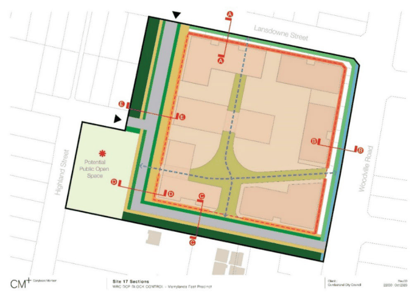

> [Picture on page 232: a picture, saved as a picture (images/part-f2-business-site-specific-page-232-14.gif, 150 dpi).]

Figure 25: Sections

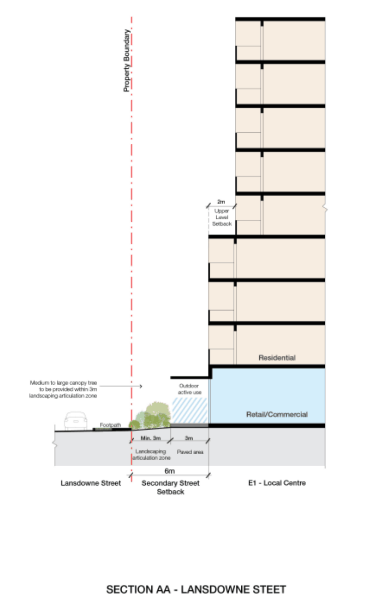

> [Picture on page 233: a picture, saved as a picture (images/part-f2-business-site-specific-page-233-1.gif, 150 dpi).]

Figure 26: Lansdowne Street setback - Section A-A

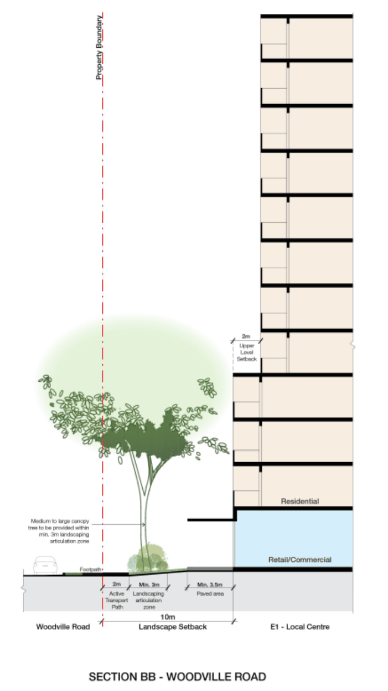

> [Picture on page 234: a picture, saved as a picture (images/part-f2-business-site-specific-page-234-1.gif, 150 dpi).]

Figure 27: Woodville Road setbacks - Section B-B

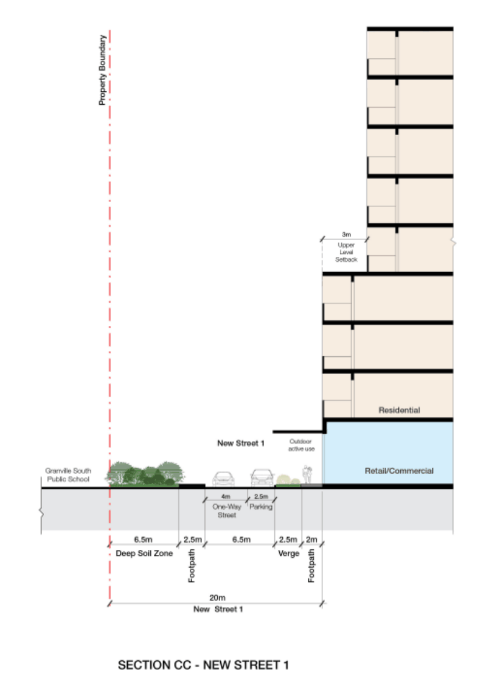

> [Picture on page 235: a picture, saved as a picture (images/part-f2-business-site-specific-page-235-1.gif, 150 dpi).]

Figure 28: New Street 1 setbacks - Section C-C

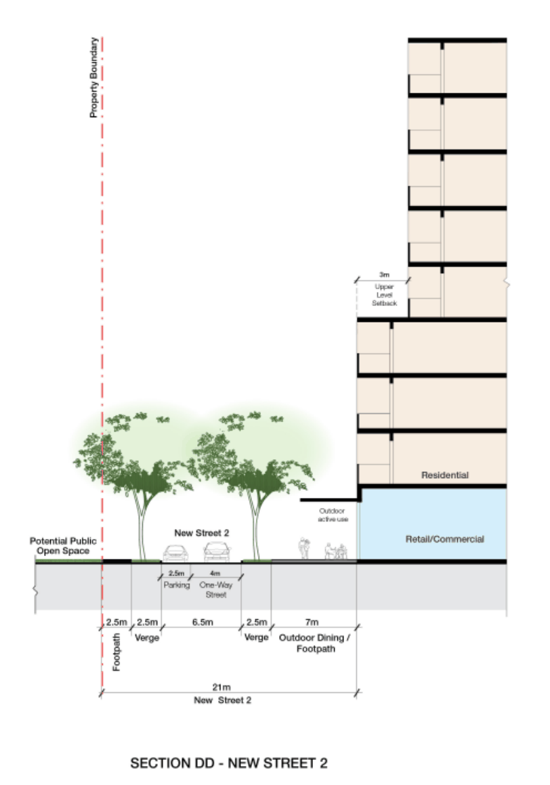

> [Picture on page 236: a picture, saved as a picture (images/part-f2-business-site-specific-page-236-1.gif, 150 dpi).]

Figure 29: New Street 2 setbacks - southern end - Section D-D

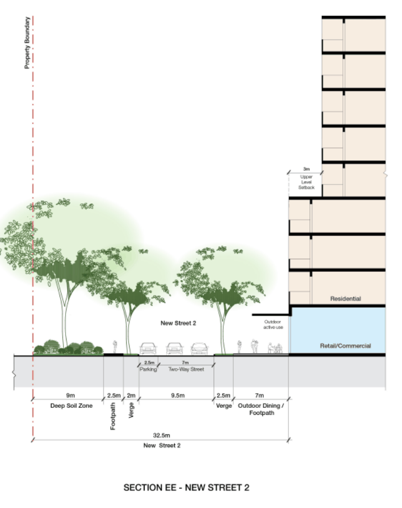

> [Picture on page 237: a picture, saved as a picture (images/part-f2-business-site-specific-page-237-1.gif, 150 dpi).]

Figure 30: New Street 2 - northern end - Section E-E

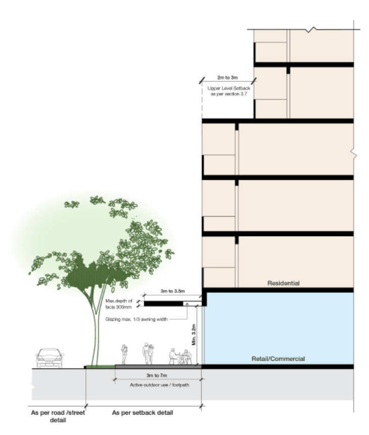

> [Picture on page 238: a picture, saved as a picture (images/part-f2-business-site-specific-page-238-1.gif, 150 dpi).]

Figure 31: New Street 2 southern end detail

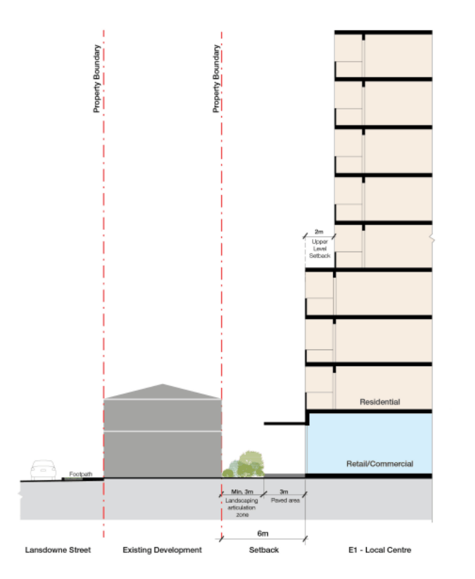

> [Picture on page 239: a picture, saved as a picture (images/part-f2-business-site-specific-page-239-1.gif, 150 dpi).]

Figure 32: Setback if key site not developed as a single, consolidated lot

### 3.9 Building elements, entries, architectural diversity and articulation

#### Objectives

O1. Ensure the building design contributes to and enhances street, public domain and

residential amenity.

O2. Reduce visual bulk and scale while adding visual interest.

O3. Ensure that development enhances and contributes to the desired character of the

neighbourhood.

#### Controls

C1. Buildings are to be designed to have bottom, middle and top components. This can be

achieved through vertical articulation, different built forms and varied colours and

finishes.

C2. The maximum linear length of any building is to be 65m.

C3. Buildings in excess of 45m long must be designed as at least two distinct ‘building

components’ which are to:

• not exceed 25m in length with a preferred length of 20m (Refer Figure 33);

• have a building separation of minimum 6m for the full height of the building; and

• have their own distinctive architectural character.

C4. Where applicable, building breaks are to be aligned with streets and lanes in the

surrounding area or proposed streets and lanes.

C5. The southern façade of the proposed development adjoining the school must be

designed to maintain the visual privacy of the school.

C6. Buildings are to be designed to facilitate active and passive surveillance between the

building and the street.

C7. Where a building comprises non-residential and residential activity, separate

pedestrian entrances, lift access, waste management areas, storage areas, communal

open space and car parking must be provided.

C8. All pedestrian entrances for residential activities must be designed to include canopy

features, articulation and varied materials and finishes to make the entrances prominent

from the street and aid wayfinding.

C9. All pedestrian entries to the building shall be designed to comply with the Disability

(Access to Premises – Buildings) Standards 2010 (Premises Standards).

C10. Wayfinding for apartments at the rear of the building shall be provided at the entry/foyer

area of the residential component of buildings.

C11. Ground floor entries to retail, commercial or other non-residential uses are to have the

same finished floor level as that of the adjacent footpath, unless required to be raised

due to flood impacts.

C12. Transparent glass balcony balustrades are not permitted. Opaque glass is permitted.

C13. Utilities are to be integrated within the building design or located in basements. They

are not to be prominently or independently sitting along building facades.

C14. Wintergardens are to be provided fronting Woodville Road.

C15. Podium and rooftop gardens shall be provided with the design to allow for access and

ease of movement between the development and communal open spaces and

minimise overlooking of neighbouring properties through use of passive screening or

planting.

C16.    Building design shall incorporate the principles of the NSW Healthy Higher Density

Living for Families with Children Design Guide.

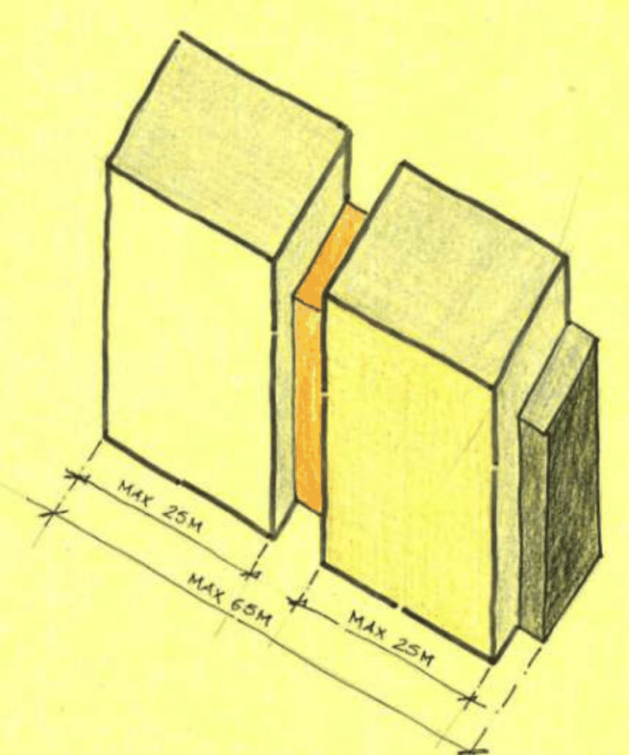

> [Picture on page 241: a picture, saved as a picture (images/part-f2-business-site-specific-page-241-8.gif, 150 dpi).]

Figure 33: Building articulation / Maximum building length

### 3.10 Active street frontage

#### Objectives

O1. Enhance pedestrian safety, security and amenity around and within the commercial

premises.

O2. Improve the amenity of the public domain by encouraging pedestrian activity.

O3. Support the economic viability of the key site and Merrylands East Precinct.

#### Controls

C1. Provide an active street frontage at ground floor level as per Figure 18.

C2. A minimum 80% of the building facade with an active street frontage and street address

at ground level shall be transparent.

C3. Corner buildings must be designed to have splay corners to aid in pedestrian movement

and to comply with Part C of Cumberland DCP 2021.

C4. Except for the southern façade, clear glazing is to be provided where glass or windows

are proposed. Reflective, tinted or obscured window coverings should be avoided.

C5. Opaque glazing for glass or windows on the southern building facade shall be provided

to protect the visual privacy of Granville South Public School.

C6. Outdoor dining is not permitted fronting Woodville Road.

### 3.11 Awnings

#### Objectives

O1. Increase pedestrian amenity by the provision of weather protection.

O2. Visually unify the mixed-use development.

#### Controls

C1. Awnings are to be provided to the full extent along Woodville Road, the southern

boundary and the outdoor dining area.

C2. All awnings should be structural in design and a minimum width of 3.5m (Refer to Figure

31).

C3. Awnings are to incorporate glazing/transparent material in the awning to allow for solar

access.

C4. Retractable awnings are not permitted.

C5. In addition to the above, awnings shall comply with Cumberland DCP 2021 Part C.

Where there is an inconsistency, the controls in this clause apply.

### 3.12 Public domain and open space

#### Objectives

O1. Ensure that a high quality public neighbourhood park is provided with a sense of place

to establish it as the focal point of the neighbourhood precinct.

O2. Ensure that the public domain is integrated with existing and future open spaces within

the neighbourhood centre precinct.

O3. Achieve a variety of communal open spaces that are inclusive of particular needs and

desires of key community groups such as children, young people, older people and

people with a disability.

O4. Incorporate Water Sensitive Urban Design measures into the design of public open

spaces.

O5. Integrate public art to create a more visually interesting and culturally diverse public

domain.

O6. Useable and sustainable green space is provided.

#### Controls

C1. A public domain concept plan for the development of the site or any part thereof is to

be provided and be in accordance with the separate Woodville Road Corridor Public

Domain Plan endorsed by Council. The plan must:

• Provide for deep soil planting zones as per Figure 18 and Clause 3.8 of this section;

• Show how a high amenity public domain will be achieved on the site and along

Woodville Road;

• Provide an indicative landscape design, including details and indicative costs for

street furniture, street trees, landscaping works, materials and utilities; and

• Indicate how street trees and other planting arrangements are to be provided on all

new streets to Council’s specifications.

C2. Development proposing outdoor dining must comply with Council’s Outdoor Dining

Policy and Guidelines.

C3. Design of the public domain must be integrated with stormwater management and

include Water Sensitive Urban Design elements.

C4. A fully embellished publicly accessible neighbourhood park not less than 3,000 square

metres is to be provided and dedicated to Council for public use, to a design approved

by Council and located, as shown in Figure 18. A concept plan for the park is to be

provided with any Development Application for the site showing the following

embellishments at a minimum:

• Minimum 85% deep soil zone for the public park, with primarily soft landscaping,

and mature canopy trees.

• Shade or pergola structures.

• Park furniture including seating and lighting.

• Public toilets.

• Water fountains.

• Play elements integrated into the landscape design and enable informal play.

• Landscaped to include native trees.

• Safe play area for children which is to be visually and physically connected to the

main park area.

• Both passive and active recreation spaces.

C5. Medium sized tree planting (a minimum 6-8 metres mature height at 7 – 10 m centre-

to centre) with an understorey of shrubs (1.5m – 3m) and ground cover must be

provided along the boundary on the southern side (adjacent the school). The medium

sized tree planting within a deep soil zone is to be incorporated at the southern end of

the park.

C6. All elements are to be vandal and graffiti resistant.

### 3.13 Traffic management, parking, new roads, access and movement

#### Objectives

O1. Manage traffic impacts and ensure that development does not unreasonably impact on

the traffic conditions on Woodville Road and local roads.

O2. Ensure suitable parking and traffic management arrangements are identified prior to

development of the land and are used to inform the preparation of Development

Applications.

O3. Ensure vehicle entries and loading bay entries do not compromise pedestrian safety.

O4. Increase the use of active transport and reduce vehicle use.

#### Controls

C1. A detailed Traffic Impact Assessment shall be submitted with any Development

Application for the site or part thereof, and shall:

• Identify and address traffic generation issues associated with the overall

development of the site;

• Include modelling of the Lansdowne Street/Woodville Road and Oxford

Street/Woodville Road intersections as a network and not as individual

intersections;

• Include modelling of the priority control for the intersection of Lansdowne Street and

the internal street and determine whether a roundabout is required at that

intersection; and

• Include an Active Transport Plan showing the provision of pedestrian paths,

cycleways or shared paths onsite that comply with the Walking Space Guide and

Cycleway Design Toolbox documents prepared by Transport for New South Wales,

and as amended from time to time.

C2. The Traffic Impact Assessment shall be undertaken by a qualified Traffic Engineer and

comply with the Roads and Maritime Services Traffic Modelling Guidelines (2013) and

Transport for NSW Guide to Transport Impact Assessment 2024.

C3. A 4m wide one-way road carriageway must be provided on New Street 1 with a 2.5m

wide pedestrian footpath on the southern side. On the northern side, a 2.5m wide

parking bay, a 2.5m wide verge, and a 2m wide pedestrian footpath should be provided

as per Figure 28 (Section C-C).

C4. A 4m wide one-way road carriageway must be provided on the southern end of New

Street 2 (south of the street connecting to Highland Street) with a 2.5m wide pedestrian

footpath, a 2.5m verge, and a 2.5m wide parking bay on the western side. On the

eastern side, a 2.5m wide verge and a 7m wide outdoor dining area should be provided

as per Figure 29 (Section D-D).

C5. A 7m wide two-way road carriageway must be provided on the northern end of New

Street 2 (north of the street connecting to Highland Street) with a 2.5m wide pedestrian

footpath, a 2m verge and a 2.5m wide parking bay on the western side. On the eastern

side, a 2.5m pedestrian footpath should be provided as per Figure 30 (Section E-E).

C6. Ensure any site vehicle access points are located to avoid conflict with pedestrians and

vehicles accessing the school.

C7. The loading bay entry should be located on Lansdowne Street and separated from

vehicular entry into the mixed-use development.

C8. No driveway vehicle access from Woodville Road is permitted.

C9. Left-out exit from New Street 1 only permitted onto Woodville Road.

C10. Basement parking beneath the neighbourhood park is not permitted.

C11. All internal roads not in Council’s ownership must be maintained at all times. Note:

Council will not accept dedication of roads with basement parking underneath.

C12. Vehicle parking is to be provided in the basement levels and in accordance with the

parking rates outlined in Part G3 of the Cumberland DCP 2021.

C13. Bicycle parking is to be provided in accordance with the following:

Table 4: Bicycle parking rates

| Development Type | Bicycle Parking Rate |
|---|---|
| Multi Dwelling Residential | 1 space per unit |
| Visitors | 1 space per 5 units |

C14. Electric vehicle charging point(s) shall be provided in an accessible location on site for

all new residential and non-residential development in accordance with the Part G3 of

the Cumberland DCP 2021.

C15       Existing Land Reservation Acquisition (LRA) for road widening, where applicable, must

be identified on the development application plans.

### 3.14 Contamination

#### Objectives

O1. Ensure that the changes of land use will not increase the risk to public health or the

environment.

O2. Ensure that any remediation works to the land will not increase the risk to the users of

the adjoining school and surrounding residential development, either during or post

construction.

#### Controls

C1. A Remedial Action Plan (RAP) for the development of the site or any part thereof is to

be provided with the first Development Application for the land. The plan must be

prepared in accordance with the NSW Environment Protection Authority Guidelines

Contaminated Sites: Guidelines for Consultants Reporting on Contaminated Sites

(1997a) and the National Environment Protection (Assessment of Site Contamination)

Measure (2013 Amendment). This includes any concept Development Applications.

C2. A Site Audit Statement (SAS) is to be provided with the first Development Application

for the land, including any concept Development Application.

C3. All contamination arrangements are to be in accordance with SEPP (Resilience and

Hazards) 2021, and Part G5 of Cumberland DCP 2021.

### 3.15 Air quality, noise and vibration

#### Objectives

O1. Ensure that development fronting Woodville Road provides an acceptable level of air

quality and acoustic amenity for the users and occupants.

O2. Ensure that demolition and construction in the neighbourhood centre does not adversely

impact the air quality for users of the adjoining school and surrounding residential

development.

O3. Ensure noise emissions from the development including but not limited to proposed

mechanical plant, air conditioners, automatic roller doors, ventilation plant for the

underground car park are minimised.

O4. Ensure noise emissions during the demolition, remediation of land and construction of

the development is managed to minimise impact on the adjoining school and nearby

residential development.

#### Controls

C1. An air quality impact assessment prepared by a suitably qualified air quality consultant

is to accompany development applications for any new sensitive development with

natural ventilation pathways adjacent to Woodville Road. The assessment should

consider the provisions of the following (as updated or superseded):

• State Environmental Planning Policy (Transport and Infrastructure) 2021.

• Development Near Rail Corridors and Busy Roads Interim Guideline 2008.

Recommendations from the assessment shall be incorporated into the design of the

development.

C2. Where the Air Quality Impact Assessment predicts an exceedance of the relevant air

quality standards may occur, the following design measures are to be considered to

mitigate potential impacts:

• Providing mechanical ventilation for apartments facing Woodville Road with

fixed glazing on the impacted façade and operable windows to non-impacted

façades.

• Where windows must be kept closed, the adopted ventilation systems must

meet the requirements of the National Construction Code and Australian

Standard 1668 – The use of ventilation and air conditioning in buildings.

• For public outdoor areas, these areas should be designed to minimise exposure

time of users (e.g., thoroughfares or garden paths rather than seating areas).

C3. A noise impact assessment is to be prepared by a suitable qualified acoustic consultant

and be submitted with any Development Application. The assessment should consider

the provisions of the following (as updated or superseded):

• State Environmental Planning Policy (Transport and Infrastructure) 2021.

• Development Near Rail Corridors and Busy Roads Interim Guideline 2008.

• NSW Apartment Design Guide.

The report must also consider:

• Noise emissions from the development, including but not limited to, proposed

mechanical plant (air conditioners, automatic roller doors, ventilation plant for

the underground car park), and access and egress to loading and car parking

areas.

• The demolition/remediation/construction noise and vibration intrusion of the

proposed development on the neighbourhood school and properties.

Recommendations from the report are to be included in the design of the buildings.

C4. A Construction Management Plan shall be submitted that details the air quality and

noise mitigation strategies that will be implemented to manage the impacts of

construction on the surrounding locality.

C5. Non-residential land uses shall be located on the ground floor, to vertically separate the

residential components of the development from the noise and pollution sources at

ground level.

C6. Internal habitable rooms of residential dwellings (other than bedrooms) are to be

designed to achieve noise levels of no greater than 50 dBA with windows open during

any time of the day.

C7. Bedrooms of residential dwellings are to be designed to achieve noise levels of no

greater than 45 dBA with windows open during the night period.

C8. Where noise criteria cannot be achieved concurrently with natural ventilation via open

windows, alternative ventilation shall be provided complying with the National

Construction Code ventilation requirements as a minimum.

### 3.16 Heritage conservation

#### Objectives

O1. Allow for the appropriate retention of the setting of heritage items.

O2. Future development is of a scale and character suitable to the heritage significance of

items in the vicinity of the Woodville Road Corridor.

#### Controls

C1. A Heritage Impact Statement shall be prepared by a suitably qualified heritage advisor

and submitted with any development application where the subject site is in proximity

of a heritage item. Recommendations from the Statement are to be incorporated into

the design of the building.

C2. The curtilage of existing built heritage items as identified on Schedule 5 of the

Cumberland LEP 2021 shall be retained and integrated into the design of new

developments.

C3. Development close to heritage items shall not overwhelm the heritage item in scale,

bulk, form, and design. A transitional zone comprising low-density development and

lower building heights should be retained in the blocks surrounding heritage items as

shown in Figure 34.

C4. Proposed development shall have a deep setback from heritage items to avoid

overshadowing, retain key sightlines to the heritage items and where possible respond

to the neighbouring subdivision pattern and character.

C5. New development must incorporate sympathetic or complementary materials to ensure

the new built form does not dominate the heritage place.

C6. A landscaped treatment to provide a green buffer zone between new developments

and historic items is encouraged.

C7. New development shall not cantilever over heritage items.

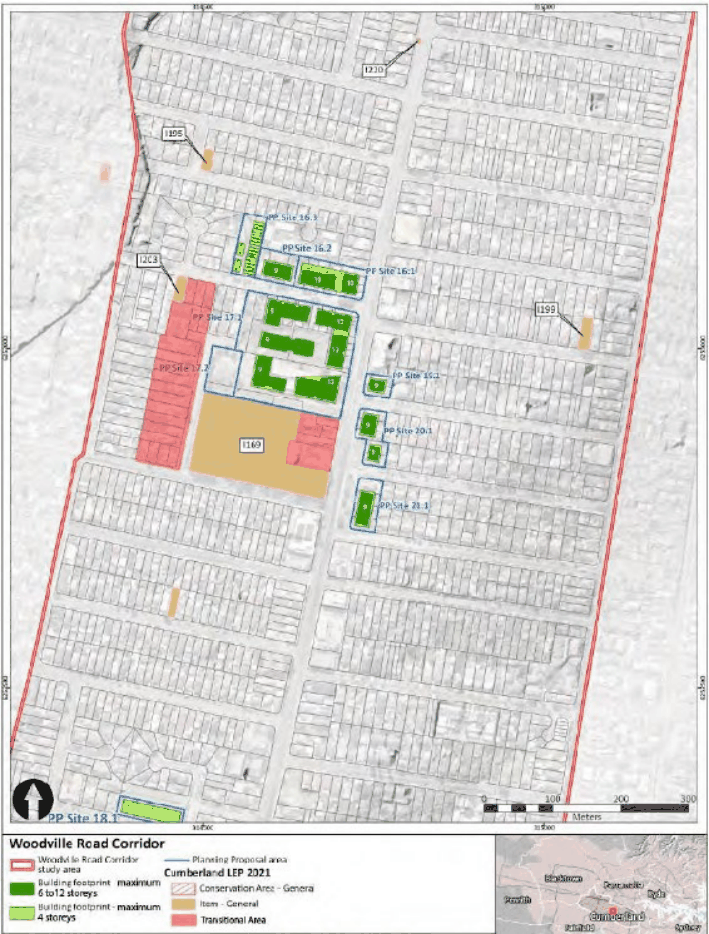

> [Picture on page 248: a picture, saved as a picture (images/part-f2-business-site-specific-page-248-6.gif, 150 dpi).]

Figure 34: Heritage transitional areas, Merrylands East

This page has been left intentionally blank.

> [Picture on page 250: a picture, saved as a picture (images/part-f2-business-site-specific-page-250-1.gif, 150 dpi).]
