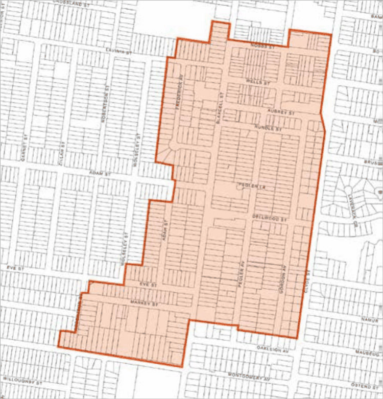
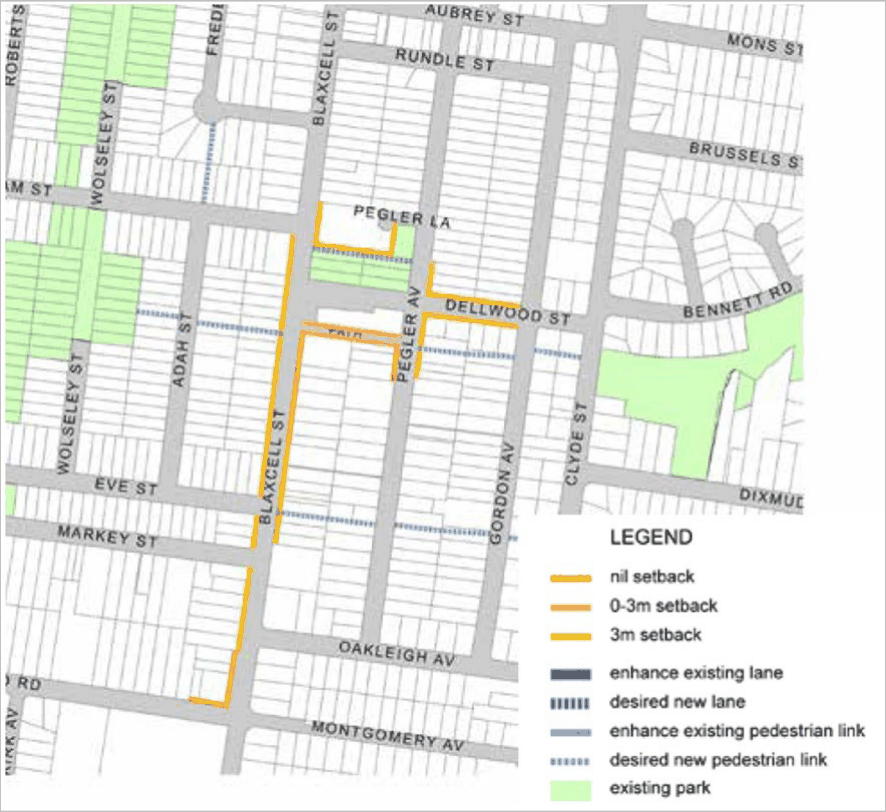

### PART F2-12

### SOUTH GRANVILLE

This page has been left intentionally blank.

## 1.  Desired Future Character

The South Granville Precinct will be centred around Delwood shops. There will be opportunities for

expansion of retail and business uses along Blaxcell Street with shop top housing above. A mix of

residential housing in the form of residential flat buildings, multi dwelling housing and shop top housing

will be provided close to bus services, recreation areas, shops and other services. Future development of the centre will provide an improved interface to the existing laneway behind the

Delwood Street shops while maintaining pedestrian and vehicular access. Pedestrian safety will be

enhanced by designing buildings that have passive surveillance of laneways, pedestrian links, public

open spaces and other elements of the public domain. The heritage character of the Delwood shops will be preserved and new development will be designed

to respect and preserve the significance and contribution of heritage to the character and identity of the

precinct. Public and private housing will blend in character and will have a transition in scale from higher

density to lower density housing areas.

> [Picture on page 259: a picture, saved as a picture (images/part-f2-business-site-specific-page-259-14.gif, 150 dpi).]

Figure 1: South Granville Precinct Map

## 2. Objectives and Controls

#### Objectives

Ensure that new development provides an interface to existing parks, laneways and

streets.

Ensure that new development responds well to existing heritage items.

### 2.1 Pedestrian connections and laneways

#### Objectives

Refer to section 2. Objectives above.

#### Controls

New pedestrian connections should be provided in accordance with Figure 2. Where a

development provides for public access connections, a variation to Council’s floor space

ratio control may be considered subject to compliance with objectives.

New pedestrian links are to improve through block connections and permeability of the

centre and increase connections to the retail centre and to existing public open spaces

surrounding the centre. A new pedestrian laneway is to be provided to William Lamb

Park (opposite Delwood Street shops) to encourage an interface between the park and

development to the north.

New pedestrian links are to have a minimum width of 3 metres, being consistent in width

for its full length.

### 2.2 Setbacks

#### Objectives

Refer to section 2. Objectives above.

#### Controls

Building setbacks are to be in accordance with Figure 2 and any additional controls set

out below:

• the nil setback shown to any street on Figure 2 applies to the first 2 storeys of

development. Additional storeys must be setback a minimum of 3 metres from the

front boundary;

• where a nil front setback is shown on Figure 2 development should have a nil side

setback where it will not have a detrimental impact upon adjoining development, to

achieve a continuous street edge;

• building setbacks to existing laneways should be designed to promote activation of

the laneway while still allowing for the servicing needs of development;

• •where the B1 Neighbourhood Centre zone adjoins a residential zone side and rear

setbacks must be suitably treated to protect and enhance the amenity of residential

development; and

• sites which have frontage to Blaxcell and Delwood Streets should provide address

to these streets as the primary frontage.

> [Picture on page 261: a picture, saved as a picture (images/part-f2-business-site-specific-page-261-1.gif, 150 dpi).]

Figure 2: Building setbacks, laneways and pedestrian links

### 2.3 Development adjoining William Lamb Park (opposite Delwood shops)

#### Objectives

Refer to section 2. Objectives above.

#### Control

Development adjoining William Lamb Park is to provide a direct interface to the park.

Redevelopment of the site is to address the key principles below:

• development must be oriented toward the park as well as adjoining streets with

entrances, windows and balconies facing the street and park, ensuring passive

surveillance of the park;

• development is to emphasise the south eastern and south western corners of the

site that adjoin the park through appropriate building articulation and corner

treatment;

• the 3 metre setback area to the park is to be utilised to interface with the park. It is

desired that this space be utilised as private open space with pedestrian gates

opening directly onto the park; and

• fencing between the site and the park is to be a maximum height of 1.2 metres and

is to be designed to encourage passive surveillance.

This page has been left intentionally blank.

> [Picture on page 264: a picture, saved as a picture (images/part-f2-business-site-specific-page-264-1.gif, 150 dpi).]
