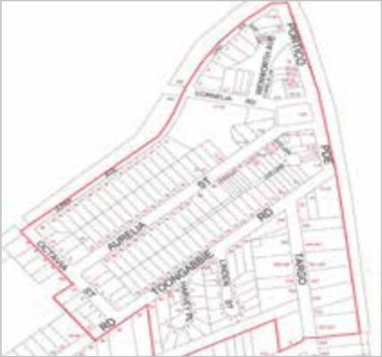
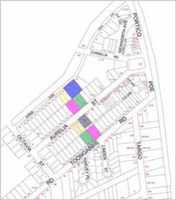
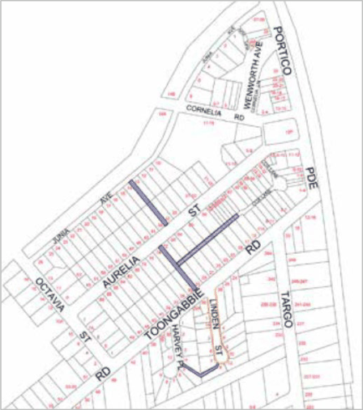
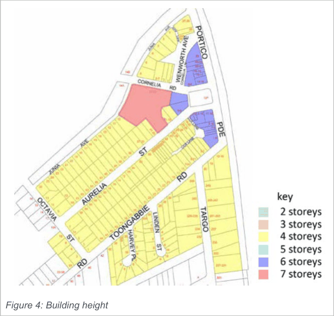
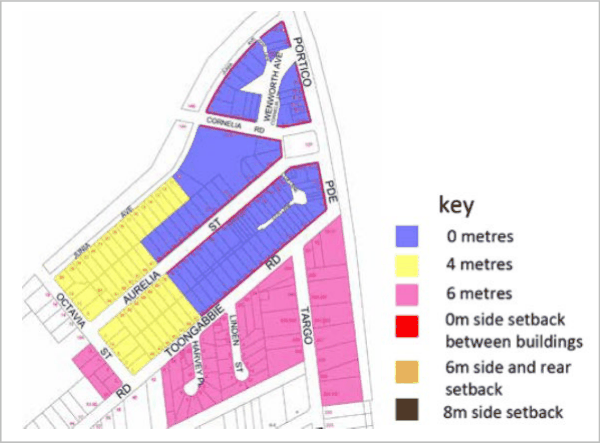

### PART F2-13

### TOONGABBIE TOWN

### CENTRE

This page has been left intentionally blank.

## 1. Introduction

### 1.1 Land to which this Part applies

This Part applies to all development on land shown in Figure 1.

> [Picture on page 266: a picture, saved as a picture (images/part-f2-business-site-specific-page-266-4.gif, 150 dpi).]

Figure 1: Toongabbie Town Centre

## 2. Objectives and controls

### 2.1 Site Consolidation

#### Objectives

Ensure all sites achieve the required minimum width to adequately provide for basement

car parking.

Minimise vehicular and pedestrian conflicts throughout the town centre through the

appropriate location and number of vehicular access points.

Require the provision of laneways to enable access of secondary streets for better

vehicular circulation and to reduce pedestrian vehicular conflict.

Enable better circulation and vehicular amenity on for high density residential

development.

Ensure all sites achieve the required minimum width to allow for a site configuration that

permits a consistent landscaped open space to the rear of sites.

Ensure any site amalgamation pattern does not restrict the development opportunity of

any adjoining site or the ability of adjoining sites to provide basement car parking or rear

open space.

Establish fine grain shopfronts along primary retail streets within the town centre.

Ensure new developments do not reduce the opportunity for the development of

adjoining properties to develop in accordance with this DCP and adversely impact on

the economic viability of development in accordance with s79C of the Environmental

Planning and Assessment Act 1979.

#### Controls

The amalgamation of lots in accordance with Figure 5 is required for development to

meet the objectives and desired future character contained within this DCP within the

Toongabbie Town Centre.

The minimum lot frontage requirements for all development within a Business zone is

located in Part C.

The minimum lot frontage requirements for all development within a Residential zone is

in Part B.

Notwithstanding the above, development within Business zones located on Aurelia

Street are to provide a fine grain retail shopfront character.

In instances where amalgamation cannot be achieved, the following information must

be submitted with any development application:

• Two written valuations indicating the value of the remaining sites that were to be

developed in conjunction with the applicants properties. These are to be undertaken

by two independent valuers registered with the Australian Institute of Valuers, and;

• Evidence that a reasonable offer has been made to the owner(s) of the affected

sites to purchase and valuation reports.

- Potential value can include, (but is not limited to) the land locked site developed

jointly with adjoining properties, or on its own, under the Cumberland LEP 2021

and this plan.

- A reasonable offer shall be a fair market value, and include for all expenses

that would be incurred by the owner in the sale of the land locked site.

• Council will accept as documentary evidence a copy of a written offer delivered by

registered mail to the affected owner(s) and dated no more than 3 months prior to

the date of lodgement of the development application. Where amalgamation (as required) is not achieved, the applicants must show that the

remaining sites, which are not included in the consolidation, and the proposed

development site, will still be able to achieve the development outcome prescribed in

this DCP, including achieving the required vehicular access, basement parking and built

form.

Sites must not be left such that they are physically unable to develop in accordance with

the prescribed built form outcomes outlined in this DCP.

> [Picture on page 268: a picture, saved as a picture (images/part-f2-business-site-specific-page-268-1.gif, 150 dpi).]

Figure 2: Toongabbie site consolidation

### 2.2 Rear laneways, land dedication, access and vehicular entries

#### Objectives

Require the provision of rear access ways on properties for private and service vehicle

access in order to reduce vehicular and pedestrian conflict and provide greater amenity

to future residents.

Require buildings fronting primary roads to have vehicular access from the rear of the

property in order to reduce vehicular and pedestrian conflict and create a safe retail

environment.

Require all sites with existing access ways from the rear of the property to be used for

vehicular access and parking.

Mitigate any impacts of vehicular traffic on adjoining residences.

Allow improved circulation space for pedestrians and future residents within the precinct.

Limit or prohibit vehicular access from primary street frontages.

#### Controls

Where new development has access available off existing or proposed laneways,

vehicular access must be provided from the laneway.

An 8 metre laneway between Junia Avenue and Aurelia Street is to be provided as

shown in Figure 3.

Land shall be dedicated to Council to finalise the completion of proposed Cox Lane as

shown in Figure 3.

An 8 metre laneway between Aureila Street and Toongabbie Road is to be provided as

shown in Figure 3.

An 8 metre laneway between Linden Street and Harvey Street is to be provided as

shown in Figure 3.

The existing footpath and verge in Linden Street (Figure 3) shall be reduced to 3.5

metres, with the residual land used to widen the existing carriageway.

> [Picture on page 269: a picture, saved as a picture (images/part-f2-business-site-specific-page-269-3.gif, 150 dpi).]

Figure 3: Proposed Laneways

### 2.3 Building height

#### Objectives

Require an appropriate scale relationship between building heights and street width.

Ensure the appropriate management of overshadowing, access to sunlight and privacy.

Enable flexibility of used by implementing higher floor to ceiling heights within buildings

for the ground and first floors.

Allow activation of the street edge on primary roads.

Allow for reasonable daylight access to other development and the public domain.

#### Controls

The maximum height for development within the Toongabbie Town Centre is detailed

within Cumberland Local Environmental Plan 2021.

The maximum building storey limits within the Toongabbie Town Centre is detailed in

Figure 4.

The minimum floor to ceiling height requirement are located in Part B and C.

The prominence of street corners shall be reinforced by concentrating the tallest portion

of the building on the corner in relation to the overall building height and predominant

street wall height.

> [Picture on page 270: a picture, saved as a picture (images/part-f2-business-site-specific-page-270-1.gif, 150 dpi).]

Figure 4: Building height

### 2.4 Building setbacks, separation and street presentation

#### Objectives

Require suitable definition of the public domain and public spaces.

Require a continuous built edge within commercial and mixed use development for

activation of the street edge.

Retain a landscaped setback character for residential development.

Ensure setbacks respond to the building separation requirements.

Reduce the visual impact of buildings on the public domain.

#### Controls

All front setbacks shall be in accordance with Figure 5.

Where a 0 metre setback is permitted, buildings shall form a continuous street edge.

Rear and side setbacks (unless indicated otherwise in Figure 5) are to be in accordance

with setbacks indicated in Part B or Part C of this DCP.

Residential development shall correspond to building depth and separation

requirements in Part B.

Development shall present and address the street.

Sites with corner lots shall present and articulate to both street frontages.

Where sites are adjacent to Portico Park, development shall primarily be orientated to

address the park.

> [Picture on page 271: a picture, saved as a picture (images/part-f2-business-site-specific-page-271-3.gif, 150 dpi).]

Figure 5: Front and zero side setbacks

This page has been left intentionally blank.

> [Picture on page 273: a picture, saved as a picture (images/part-f2-business-site-specific-page-273-1.gif, 150 dpi).]
