### PART F2-14

### WENWORTHVILLE TOWN

### CENTRE

This page has been left intentionally blank.

## 1. Introduction

### 1.1 Introduction

The Wentworthville Centre (the Centre) is one of Cumberland City’s larger commercial centres, located

close to Westmead Health and Education Precinct and the Parramatta CBD. Following receipt of

funding from the NSW Government’s Planning Reform Fund Program, Council prepared the

Wentworthville Planning and Place Making Strategy (the Strategy) to guide the redevelopment and

revitalisation of the Centre. The Strategy was adopted by Council in August 2016 and was the culmination of specialist studies into

Urban Design and Built Form Modelling; Economic Feasibility; Traffic and Transport Modelling; a Place

Audit and community and stakeholder workshops. The Strategy’s vision is to create:

A progressive, colourful, vibrant and engaging local centre that is comfortable and well connected to the surrounding area and facilities. Wentworthville Centre

will be a great place to live and shop; to stay.

The aims and objectives of the Strategy are reflected in this document as well as amendments to

Cumberland LEP 2021 to amend the height and floor space ratio controls within the Centre. The

intention of the Strategy is to introduce greater flexibility as a means of encouraging the Centre’s

revitalisation as well as promote Wentworthville as a health and education precinct supportive to

Westmead. The controls provide increased opportunities to achieve bonus commercial floor space in

addition to the introduction of design excellence provisions. Required infrastructure and public domain

works will also be implemented, commensurate with a renewed and expanded Centre.

### 1.2 Land to which this Part applies

This Part applies to all development on land identified within the Centre as shown in Figure 1, with the

exception of 42-44 Dunmore Street and 108 Station Street, Wentworthville, both of which are the subject

of separate site specific planning controls.

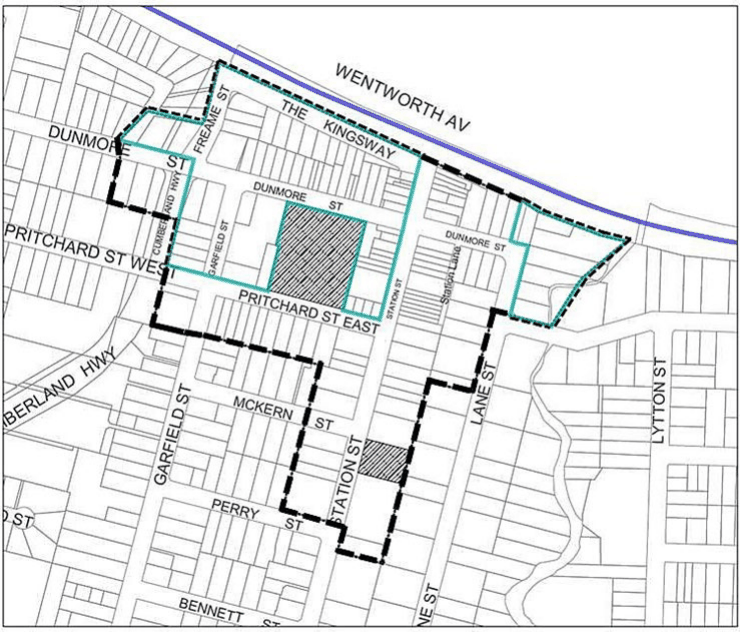

> [Picture on page 276: a picture, saved as a picture (images/part-f2-business-site-specific-page-276-1.gif, 150 dpi).]

Figure 1: Land covered by this Part

#### 1.3 Relationship to other parts of Cumberland DCP 2021

This Part shall be read in conjunction with the following parts of Cumberland DCP 2021, which contain

objectives and controls that relate to development in this Part: - Part A – Introduction and General Controls Part B – Development in Residential Zones Part C – Development in Business Zones Part E – Other Land Use Development Controls Part G – Miscellaneous Development Controls

In addition to this Part, SEPP 65 and the NSW Apartment Design Guide (ADG) must be taken into

account when preparing a development application. Where there is an inconsistency between this Part and provisions contained elsewhere in Cumberland

DCP 2021, the provisions of this Part shall prevail to the extent of the inconsistency.

### 1.4 Aims and purpose

The purpose of this Part is to articulate the detailed built form controls outlined in the Strategy and the

desired future character for a revitalised Centre. The key aims of this Part are to:

• develop a strong individual identity for the Centre through a vibrant mix of retail,

commercial and residential developments;

• ensure buildings are designed to maximise appropriate amenity outcomes for the Centre

and modernise the village atmosphere;

• create and maintain new public domain areas to be used and enjoyed by the general

community for recreation, living and working;

• improve vehicular circulation, traffic movements and laneway networks through and

around the Centre;

• create a pedestrian friendly Centre by improving connectivity, circulation, amenity and

safety; and

• respect heritage elements of the Centre.

### 1.5 Structure plan

The key elements of the preferred built form for the Centre contained in the adopted Wentworthville

Planning and Place Making Strategy, are:-

• for selected sites fronting the northern side of Dunmore Street, street wall heights are

designed to maintain solar access to the proposed linear street plaza during times of peak

usage;

• a mix of strategically located towers with base heights ranging from 12 to 16 storeys (41 –

53m – excluding bonuses) in close proximity to the Wentworthville Railway Station;

• street wall heights across the majority of the Centre are designed to maintain well-

proportioned and human scale streetscape, whilst modernising the village atmosphere of

the Centre;

• additional building heights and floor space permitted where a public benefit is to be

provided e.g. public open space and pedestrian linkages;

• floor space bonus incentives to secure public benefits and design excellence;

• an articulated skyline that reinforces the Centre with increased height located away from

surrounding residential neighbourhoods;

• limit overshadowing of residential areas and public open spaces;

• solar access controls to achieve a high-quality public domain;

• create new public domain spaces and through site links to enhance pedestrian connectivity

and amenity; and

• manage vehicular traffic within the Centre and extend and improve laneway networks.

## 2. Objectives and controls

### 2.1 Site amalgamation

Site amalgamation is required for all properties north of Dunmore Street bounded by Dunmore Street,

Station Street, The Kingsway and Cumberland Highway (Freame Street) as a means of achieving high

quality buildings, onsite parking, solar access and public benefits such as through site links. The area

is commonly referred to as the Dunmore Street North Precinct. Refer to Figure 2 and Table 1 for sites

subject to amalgamation.

#### Objectives

Deliver the preferred built form for the Centre that provides workable building footprints

to encourage the Centre’s revitalisation.

Ensure site dimensions allow for the achievement of an appropriate built form that meets

the objectives of the Centre including solar access and connectivity outcomes.

Prevent sites becoming isolated and unable to be developed in accordance with the

Cumberland DCP 2021.

Facilitate solar access and through site links in specific locations.

#### Controls

Site amalgamation of properties north of Dunmore Street bounded by Dunmore Street,

Station Street, The Kingsway and Cumberland Highway (Freame Street) is to be carried

out in accordance with Figure 2 and Table 1.

In instances where amalgamation cannot be achieved, the following information must

be submitted with any development application:

• two written valuations indicating the value of the remaining sites that were to be

developed in conjunction with the applicant’s properties. These are to be undertaken

by two independent valuers registered with the Australian Institute of Valuers; and

• evidence that a reasonable offer has been made to the owner(s) of the affected sites

to purchase and valuation reports. Where amalgamation (as required) is not achieved, the applicants must show that the

remaining sites, which are not included in the consolidation, and the proposed

development site, will still be able to achieve the development outcome prescribed in

this DCP, including achieving the required vehicular access, basement parking, built

form, solar access and connectivity outcomes.

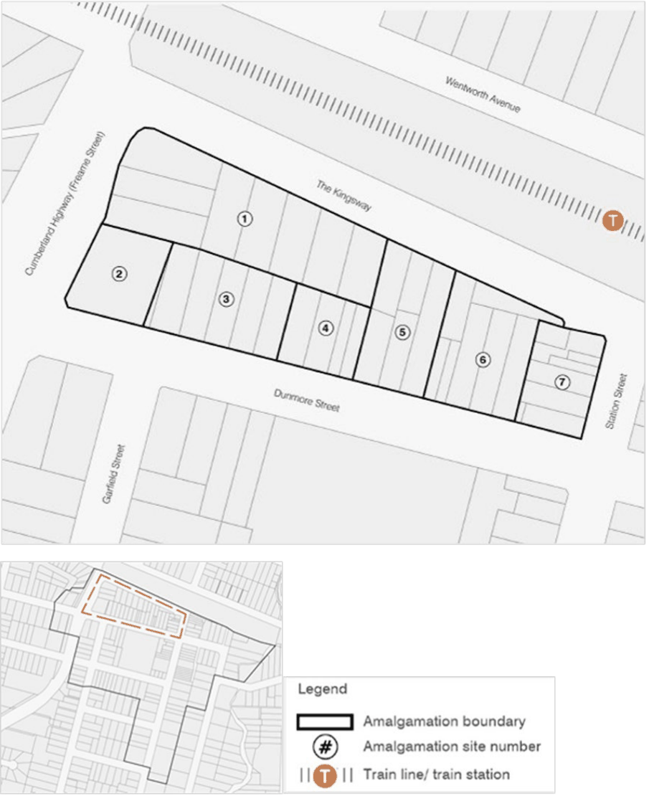

> [Picture on page 279: a picture, saved as a picture (images/part-f2-business-site-specific-page-279-1.gif, 150 dpi).]

Figure 2: Site amalgamation plan - Dunmore Street North Precinct

Table 2: Site amalgamation - property description

| Amalgamated Site No. | Lot | DP | Address - Wentworthville | Site Area m² |
|---|---|---|---|---|
| 1 | 15 16 9 22A 21A 20A 19A 18A | 9296 9296 264288 306494 306494 306494 306494 306494 | 6 Freame Street 8 Freame Street 10 Freame Street 23 The Kingsway 24 The Kingsway 25 The Kingsway 26 The Kingsway 27 The Kingsway | 586.19 524.38 665.26 482.53 515.88 532.33 561.31 578.37 4446.25 m² |
| 2 | 1 | 1075217 | 73-75 Dunmore Street | 1290.90 m² |
| 3 | 8 9 10 11 4 B | 9296 9296 9296 9296 368587 388555 | 63 Dunmore Street 63 Dunmore Street 63 Dunmore Street 67 Dunmore Street 71 Dunmore Street 71 Dunmore Street | 370.62 387.13 402.23 421.30 472.93 50.93 2105.14 m² |
| 4 | 2 1 6 7 | 530178 530178 9296 9296 | 53 Dunmore Street 55 Dunmore Street 57-59 Dunmore Street 61 Dunmore Street | 196.78 167.55 358.70 387.18 1110.21 m² |
| 5 | 2 6 4 5 25 | 9296 703262 9296 703262 9296 | 41 Dunmore Street 45 Dunmore Street 49-51 Dunmore Street 15 The Kingsway 22 The Kingsway | 597.82 329.74 343.53 251.79 337.99 1860.87m2 |

### 2.2 Minimum Lot Frontage

#### Objectives

Ensure development is carried out on sites that are sufficient in frontage in order to

provide adequate vehicular access and car parking and improved built form outcome.

Avoid the creation of smaller, isolated sites that cannot be separately developed.

Ensure developments are compatible with both the established character and desired

future amenity of the Centre and appropriate to the FSR and maximum height controls.

#### Control

The minimum site frontage width for properties not required to be amalgamated under

Section 2.1 is:

• up to 3 storeys – 20m;

• 4-8 storeys – 26m; and

• 9 storeys and greater – 32m.

Built Form The following controls generally reflect the adopted Wentworthville Planning and Place Making

Strategy.

### 2.3 Design Excellence

The following controls are provided for reference purposes and should be read in conjunction with

relevant statutory provisions contained in the LEP for the Centre.

#### Objectives

Cumberland City Council is committed to ensuring all major developments deliver the

highest standard of architectural and urban design. Design excellence is a tool whereby

the objectives of the Centre can be achieved by encouraging:-

• high quality, diverse and innovative design; and

• development that by virtue of its location, individually and collectively contributes to

the urban design context of the Wentworthville Centre.

#### Controls

Design excellence applies only to land within the boundaries of the Design Excellence

Map that permits development greater than 30m in height. Refer to Figure 3.

Cumberland City Design Excellence Guidelines provide further details on relevant

criteria and procedures when seeking an incentive bonus in building height of up to an

additional 10% and additional floor space ratio of up to 0.5:1.

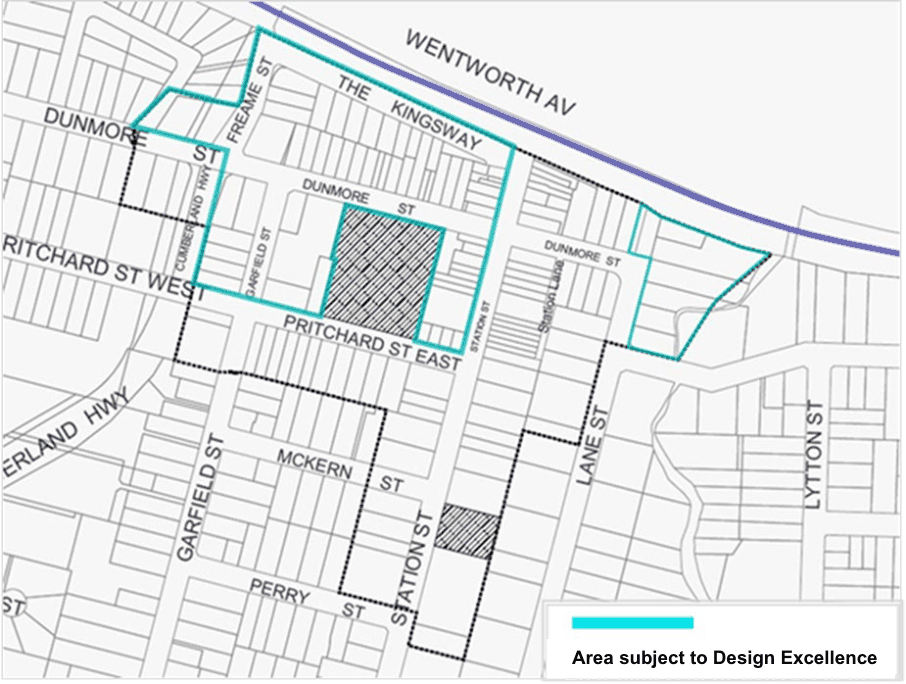

> [Picture on page 282: a picture, saved as a picture (images/part-f2-business-site-specific-page-282-1.gif, 150 dpi).]
> Words printed on the picture (title and legend, copied from the PDF):
> Area subject to Design Excellence

Figure 3: Design excellence map

### 2.4 Building Height

#### Objectives

Deliver a built form that provides a height transition from lower scale on the fringe of the

Centre to higher scale in the Centre’s core and clustering buildings of similar height.

Ensure the scale of the built form provides for a legible Centre with spatial definition and

transition between spaces.

Achieve appropriate management of visual impact, overshadowing, access to sunlight

and privacy.

#### Controls

The maximum building height for development within the Wentworthville Town Centre

is expressed in metres within the relevant Local Environmental Plan as a written

statement and associated maps.

Each storey shall comprise a minimum floor to ceiling height as defined in the NSW

Apartment Design Guide.

Refer to Section 3 of this Part for further details on varying height controls for sites within

certain precinct areas which require design outcomes based on their specific location

within the Centre.

### 2.5 Building Setbacks

#### Objectives

Enhance the character of the Centre through consistent and uniform alignment of

building facades and streetscape.

Reinforce strong definition of streets and public spaces in the Centre.

Provide a transition in built form to the lower scale residential areas adjoining the Centre.

#### Controls

All developments are to provide and maintain building setbacks in accordance with

Figure 4.

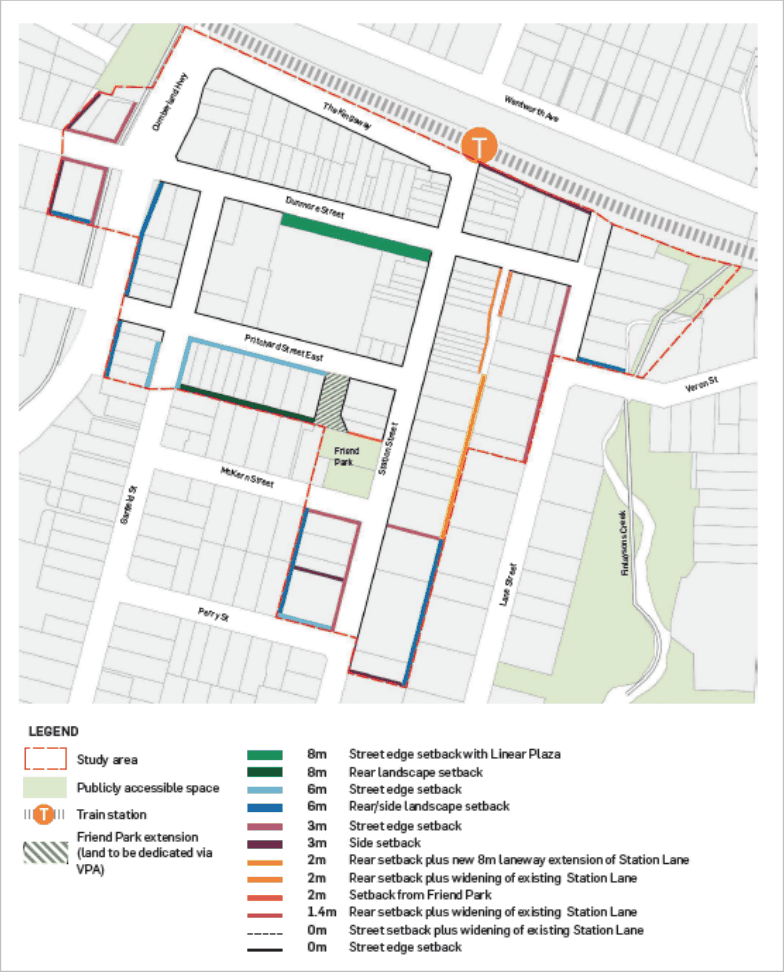

> [Picture on page 283: a picture, saved as a picture (images/part-f2-business-site-specific-page-283-10.gif, 150 dpi).]

Figure 4: Building setbacks

### 2.6 Primary and Secondary Active Frontages

#### Objectives

Provide for a vibrant, pedestrian focused Centre with active frontages that enliven the

vitality of streets through the orientation and design of ground floor entries and

shopfronts.

Contribute to a safe environment for pedestrians and residents through both passive

and active surveillance.

Maintain the established character of fine grain frontages at ground level.

Ensure vehicular access and car parking does not impact on character and function of

active frontages.

#### Controls

Continuous ground level active uses must be provided along primary active frontages

as shown on Figure 5.

Primary active frontages include but not limited to:

• retail and commercial shopfronts;

• food and drink premises including restaurants and cafes;

• entrances to public buildings or commercial building foyers; and

• customer service areas and receptions (where visible from the street). Maximise the use of entries, transparent glazing and display windows to encourage

visual engagement. Blank walls, roller shutters and the use of dark or obscured glass

are not permitted.

Restaurants, cafes and the like are encouraged to consider providing openable

shopfronts.

Continuous awnings are to be provided on all primary active frontages.

Vehicular access and parking are not encouraged on primary active frontages where

alternate access points are available.

Secondary active frontages are preferred locations for vehicle access, car parking, plant

and service areas, docks, secondary entrances and the like.

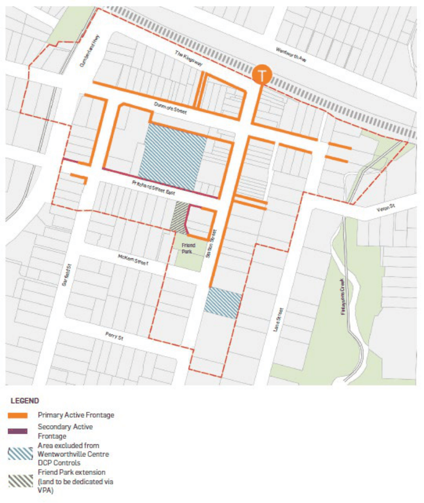

> [Picture on page 285: a picture, saved as a picture (images/part-f2-business-site-specific-page-285-1.gif, 150 dpi).]

Figure 5: Active frontages

Note: Vehicle access is proposed off Station Street, which is a Primary Active Frontage for ‘Pritchard

Street and Station Street Precinct’ only.

### 2.7 Street Wall Heights

#### Objectives

Ensure building heights at street level are well proportioned and maintain a human

scale.

Facilitate a consistent street wall height throughout the Centre.

Maintain adequate sunlight access to the Dunmore Street plaza through lower street

wall heights on selected sites to the north of Dunmore Street.

Provide prominence to the street level, establish a clear presence for retail and increase

the visibility and marketability of ground floor space.

Respect heritage elements within the Centre.

#### Controls

The nominated street wall height applies to a site’s street frontage.

A street wall height (podium) of 20m (5 storeys) applies across the Centre with the

exception of the following locations.

Amalgamated Sites 4,5,6,7 Selected sites north of Dunmore Street to facilitate solar access to the public plaza. A street

wall height of 17m (4 storeys) applies to amalgamated sites 4, 5, 6 and 7 north of Dunmore

Street as shown in Figure 6. Refer to Figure 2 and Table 1 for addresses of sites affected. Amalgamated Sites 6, 7 and 2-8 Station Street A street wall height of 11m (2 storeys) applies to The Kingsway street frontage of Amalgamated

Sites 6 and 7 together and Nos. 2 – 8 Station Street to preserve the existing traditional and

heritage shopfront pattern. Refer to Figure 6. Refer to Figure 2 and Table 1 for addresses of sites affected.

### 2.8 Upper Level Setbacks

#### Objectives

Create well-proportioned and human scale streets.

Reduce the visual impact of upper storeys.

Support building separation requirements and facilitate built form articulation.

Maintain adequate sunlight access to the Dunmore Street plaza at times of peak usage.

#### Control

A 3m upper level setback applies across the Centre for buildings above 20m (5 storeys)

with the exception of the following location.

Amalgamated Sites 4,5,6,7 A 6m upper level setback applies to Amalgamated Sites 4, 5, 6 and 7 north of Dunmore Street

to facilitate solar access to the public plaza during core lunchtime periods. Refer to Figure 6.

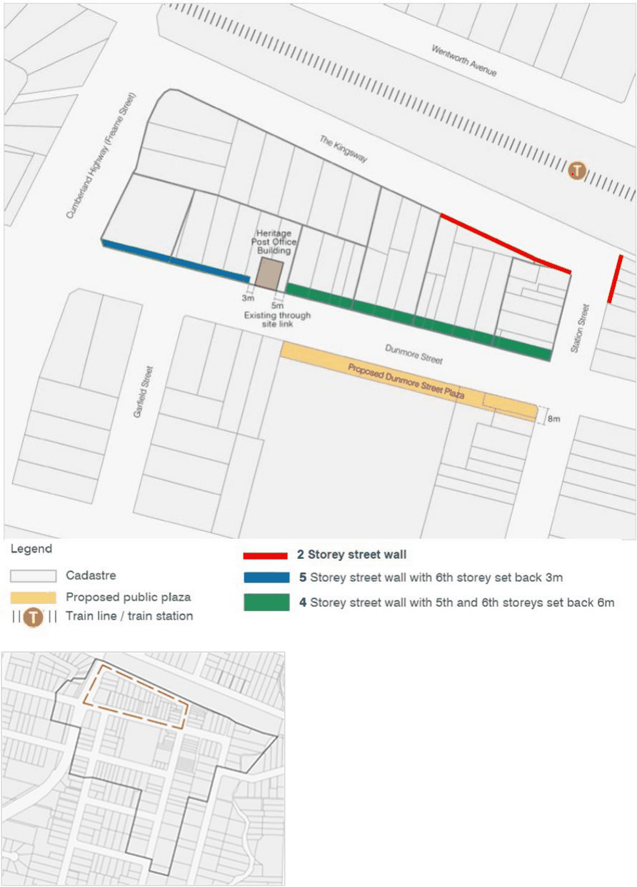

> [Picture on page 287: a picture, saved as a picture (images/part-f2-business-site-specific-page-287-1.gif, 150 dpi).]

Figure 6: Street wall heights and upper level setbacks Dunmore Street North Precinct

### 2.9 Building Facade Design

The design and detailing of building facades can have a major impact on the appearance and bulk of a

building. High quality facades are a balanced composition of building elements, textures, materials and

colour that collectively strengthens the character of the Centre and the continuity of streetscape.

#### Objectives

Building facades to provide visual interest and articulation while respecting the

traditional character of the Centre.

Building facades are to be designed to reinforce and promote a sense of safety and

security.

Building facades are to meet the aims and objectives of the NSW Apartment Design

Guide (ADG).

#### Controls

Building facades should be well resolved with an appropriate scale and proportion to

the streetscape and human scale. Design solutions may include:

• well composed horizontal and vertical elements;

• elements that are proportional and arranged in patterns;

• public artwork or treatments to exterior blank walls; and

• grouping of floors or elements such as balconies and windows on taller buildings. Building entries should be clearly defined

Corner buildings are given visual prominence through a change in articulation, materials

or colour, roof expression or changes in height and are to comply with Part C of

Cumberland DCP 2021.

### 2.10 Solar Access

Adequate solar access is to be maintained to key public domain areas within the Centre. New

developments are to be sensitively designed to provide adequate daylight access for the enjoyment of

Centre residents and visitors.

#### Objectives

Ensure adequate solar access is maintained to the Dunmore Street Plaza during core

lunchtime hours in mid-winter.

Ensure other key public domain areas receive adequate solar access to preserve the

amenity and enjoyment of these spaces.

#### Controls

Buildings to the north of Dunmore Street must maintain solar access to a minimum of

50% of the Dunmore Street Plaza at ground level between the hours of 12:00pm and

2:00pm on the 21st June. Tower elements must be slender in the east-west direction to

minimise the duration of overshadowing impacts on the plaza.

Redevelopment of sites to the north of Friend Park must maintain 3 hours of direct

sunlight to minimum 50% of Friend Park on 21st June between 11:00am and 3:00pm.

Buildings to the north of the proposed Civic Hub/Library Precinct plaza on land at 2-14

Lane Street must be designed to maintain 3 hours of direct sunlight to minimum 50% of

the plaza area on 21st June between 11:00am and 3:00pm. Refer to Section 3.7 of this

Part for location of proposed plaza.

### 2.11 Awnings

#### Objectives

Maintain a consistent streetscape and provide visual interest through a continuous

awning theme.

Locate awnings to provide for weather protection and the safety and security of

pedestrians.

Design awnings to accommodate the provision of street tree planting and furniture

location.

#### Controls

Continuous awnings are to be provided on all primary active frontages.

Compliance with Part C of this DCP for relevant awning controls.

### 2.12 Fine Grain Shopfront

#### Objectives

Reinforce the predominant historic pattern and character of shopfronts within the Centre

and express the building typology in future building façade designs.

Accentuate the pedestrian scale and create well-proportioned streetscapes.

Respect heritage elements within the Centre.

#### Controls

Development located on Dunmore Street (between Cumberland Highway and Lane

Street) and Station Street (between Pritchard St East and The Kingsway) is to provide

a fine grain retail shop front character by:

• ensuring ground floor frontages provide for active non-residential uses with at-grade

pedestrian access; and

• minimal use of blank walls with frontages divided into discrete sections to maintain

a fine grain, human-scale appearance. Where development adjoins a laneway or through site link, ground level uses should be

designed to provide a direct interface to that adjoining laneway or a through site link.

## 3. Special Precincts

The following describes planning controls for selected key precincts within the Centre that require

specific design outcomes. Typical sections and diagrams illustrate applicable controls such as street

setbacks, split heights, street wall height, podium setback, laneways and through-site links for the

following nominated locations: -

• Dunmore Street North Precinct comprising:

- 63-71 Dunmore Street (Amalgamated Site 3 – refer Table 1)

- 41-51 Dunmore Street and 15 and 22 The Kingsway (Amalgamated Site 5 – refer Table 1)

- 1-19 Station Street and Lot E The Kingsway (Amalgamated Site 7 – refer Table 1)

• Station Street and Lane Street Precinct

• Pritchard Street East Precinct

• Pritchard Street and Station Street Precinct (Refer to Part 3.4 for Site Specific Controls)

### 3.1 Dunmore Street North Precinct

As discussed in Section 2.1 of this Part, site amalgamation is required for properties within the Dunmore

Street North Precinct bounded by Dunmore Street, Station Street, The Kingsway and Cumberland

Highway as shown in Figure 2 and Table 1. The following diagrams describe typical controls for selected Amalgamated Sites 3, 5 and 7. The

sections typically illustrate split heights, locations where through site links are to be provided and the

desired building envelope to maintain solar access to the Dunmore Street Plaza. Amalgamated Site 3 Amalgamated Site 3 comprises properties 63 – 71 Dunmore Street, which includes the heritage

listed Post Office site. This land is subject to varying heights and floor space ratios across the

site, includes formalisation of an existing through site link alongside the heritage building and

the building envelope is dictated by the need to maintain solar access to the plaza. The above design elements are typically illustrated in Figures 7 and 8.

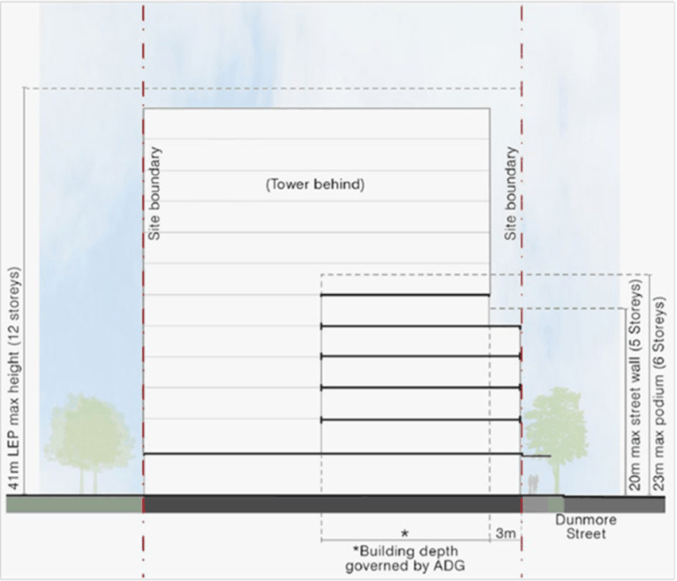

> [Picture on page 291: a picture, saved as a picture (images/part-f2-business-site-specific-page-291-1.gif, 150 dpi).]

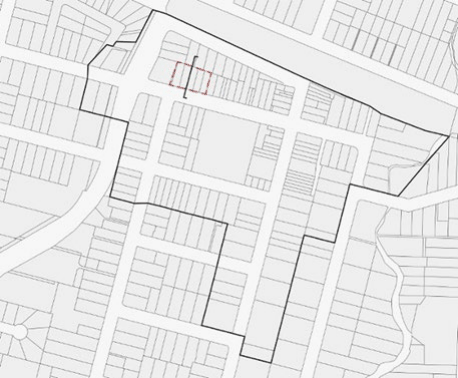

> [Picture on page 291: a picture, saved as a picture (images/part-f2-business-site-specific-page-291-2.gif, 150 dpi).]

Figure 7: Amalgamated Site 3 - Typical North-South section

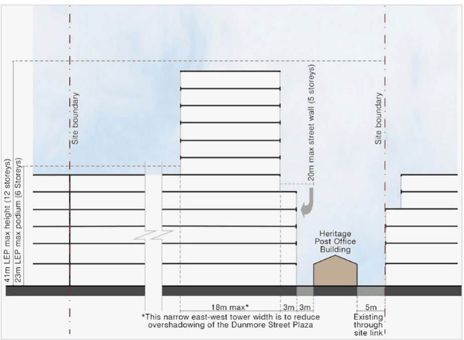

> [Picture on page 292: a picture, saved as a picture (images/part-f2-business-site-specific-page-292-1.gif, 150 dpi).]

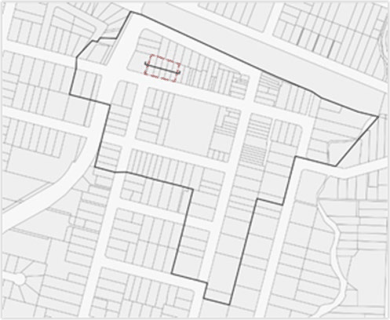

> [Picture on page 292: a picture, saved as a picture (images/part-f2-business-site-specific-page-292-2.gif, 150 dpi).]

Figure 8: Amalgamated Site 3 - Typical East-West section

Amalgamated Site 5 Amalgamated Site 5 comprises properties 41 – 51 Dunmore Street, 15 and 22 The Kingsway,

Wentworthville. This land is subject to varying heights across the site and includes formalisation

of an existing through site link at 41 Dunmore Street and the building envelope is dictated by

the need to maintain solar access to the plaza. The above design elements are typically illustrated in Figures 9 and 10.

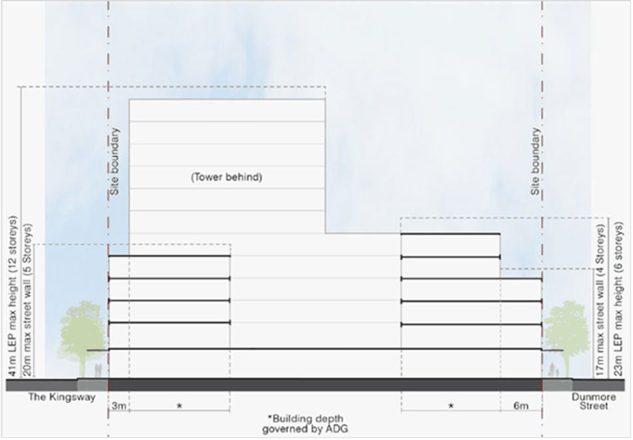

> [Picture on page 293: a picture, saved as a picture (images/part-f2-business-site-specific-page-293-7.gif, 150 dpi).]

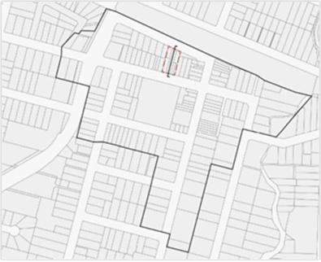

> [Picture on page 293: a picture, saved as a picture (images/part-f2-business-site-specific-page-293-8.gif, 150 dpi).]

Figure 9: Amalgamated Site 5 - typical North South section

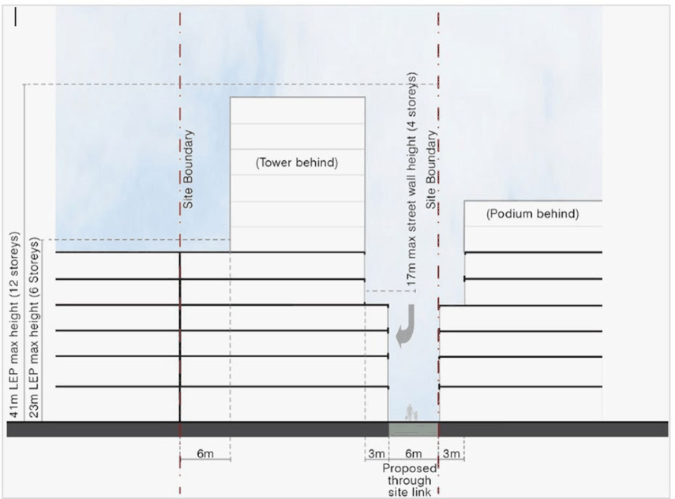

> [Picture on page 294: a picture, saved as a picture (images/part-f2-business-site-specific-page-294-1.gif, 150 dpi).]

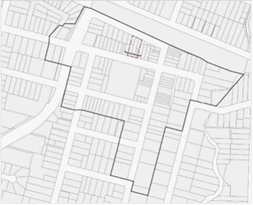

> [Picture on page 294: a picture, saved as a picture (images/part-f2-business-site-specific-page-294-2.gif, 150 dpi).]

Figure 10: Amalgamated site 5 - typical East West section

Amalgamated Site 7 Amalgamated Site 7 comprises properties 1-9 and 13-19 Station Street, and Lot E, The

Kingsway, Wentworthville. This land is subject to a building envelope that is required to maintain

solar access to the plaza and a two storey street edge along the Kingsway frontage to respect

the existing shopfront character of The Kingsway. The above design elements are typically illustrated in Figure 11.

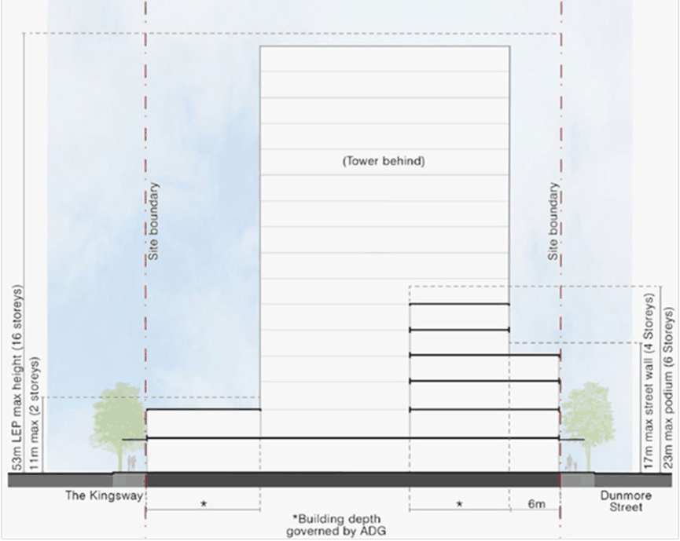

> [Picture on page 295: a picture, saved as a picture (images/part-f2-business-site-specific-page-295-1.gif, 150 dpi).]

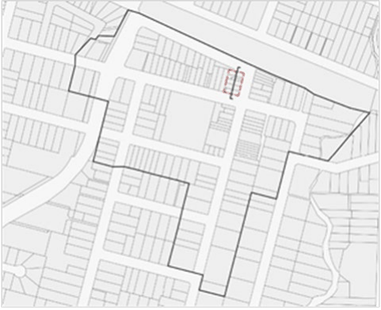

> [Picture on page 295: a picture, saved as a picture (images/part-f2-business-site-specific-page-295-2.gif, 150 dpi).]

Figure 11: Amalgamated site 7 - typical North South section

### 3.2 Station Street East and Lane Street Precinct

The Station Street East/Lane Street Precinct is affected by the extension and widening of Station Lane.

Its location on the fringe of the Centre, adjoining a medium density residential area to the east, also

necessitates a sensitive transition in building height across each site. Typical building heights are to

range from 20 – 30m (5 – 8 storeys) across sites. The sites affected by proposed widening and

extension of Station Lane are identified in Section 3.4 and Figure 14. Required building setbacks to

Station Lane are detailed in Figure 4.

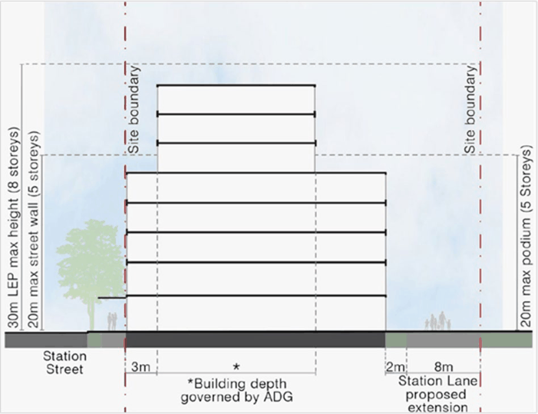

> [Picture on page 296: a picture, saved as a picture (images/part-f2-business-site-specific-page-296-8.gif, 150 dpi).]

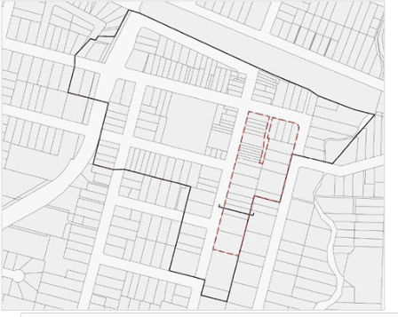

> [Picture on page 296: a picture, saved as a picture (images/part-f2-business-site-specific-page-296-9.gif, 150 dpi).]

Figure 12: Station Street East / Lane Street Precinct - typical east west section

### 3.3 Pritchard Street East Precinct

The Pritchard Street East Precinct comprises 8-18 Pritchard Street, adjoining a low density residential

area to the south which necessitates a sensitive transition in building height and scale. As shown in

Figure 13 building heights range from 17 - 23m (4 – 6 storeys) with a 6m front setback and an 8m

landscaped rear setback. The split height controls are reflected in the applicable LEP Height of Buildings

Map for the Centre.

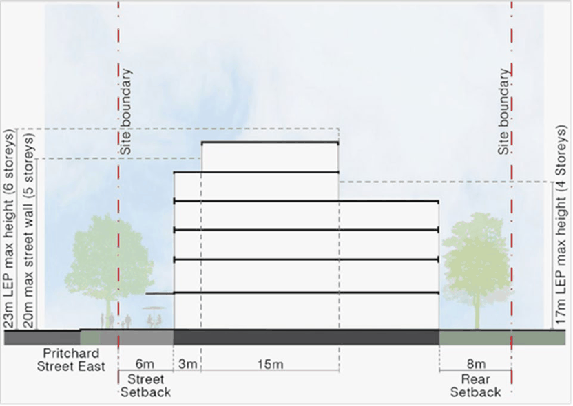

> [Picture on page 297: a picture, saved as a picture (images/part-f2-business-site-specific-page-297-7.gif, 150 dpi).]

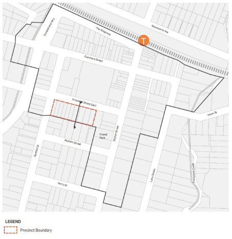

> [Picture on page 297: a picture, saved as a picture (images/part-f2-business-site-specific-page-297-8.gif, 150 dpi).]

Figure 13: Pritchard Street East - typical North South section

### 3.4 Pritchard Street and Station Street Precinct

The Pritchard Street and Station Street Precinct comprises 55-57 Station Street and 6 Pritchard Street

East, as shown in Figure 14. The site forms a key corner site within the Wentworthville Town Centre

and adjoins the existing Friend Park to the south.

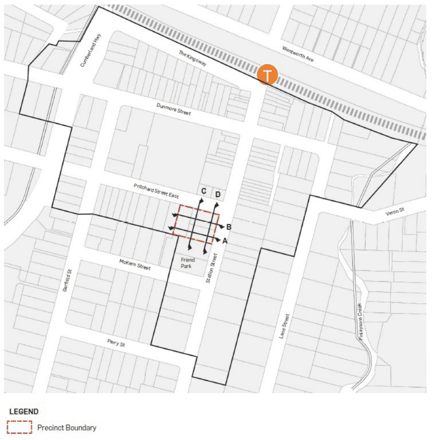

> [Picture on page 298: a picture, saved as a picture (images/part-f2-business-site-specific-page-298-5.gif, 150 dpi).]

Figure 14: Pritchard Street and Station Street Precinct

#### Objectives

To facilitate the redevelopment of the site to achieve a high quality mixed use

development outcome that acts as an arrival marker for the town centre.

To ensure that the height, bulk and scale of the built form results in a slender tower form

and is of a high level of urban design and architectural quality.

To improve the permeability of the centre for pedestrians, including the provision of an

extension to Friend Park and a through – site link, connecting Friend Park with the

Wentworthville Mall.

To ensure adequate direct solar access to Friend Park (both existing and the extension)

for the amenity of and enjoyment by users throughout the year.

To provide for casual surveillance and activation of the Park through provision of active

frontages and compatible uses

To protect the amenity of the Park through provision of a landscaping that will provide

privacy, reduce acoustic emissions and improve the interface and visual outcomes

between the Site (buildings) and the Park.

To enhance local biodiversity through the planting of diverse native plant species.

#### Controls

#### 3.4.1 Solar Access

C1. To maintain 3 hours of direct sunlight to a minimum 50% of Friend Park (existing and

extension) between 11.00am and 3.00pm on 21st June.

#### 3.4.2 Building Heights

C1. As shown in Figure 15, the maximum height of the building is not to exceed:

i. 11 storeys plus plant and lift overruns.

ii. 5 storeys at the western extent along Pritchard Street East.

iii. 1 storey in the south western corner fronting the Friend Park Extension.

Note: Due to level changes across the site, the ground level includes double height spaces and

mezzanine level. This is defined as 1 (one) storey.

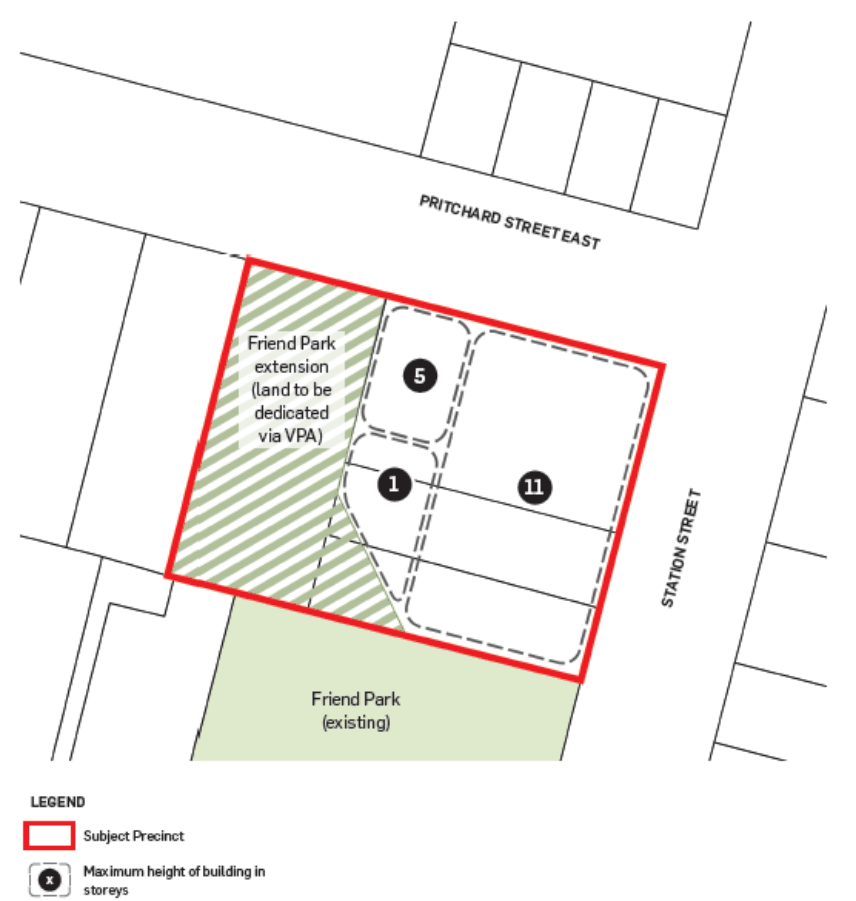

> [Picture on page 300: a picture, saved as a picture (images/part-f2-business-site-specific-page-300-1.gif, 150 dpi).]

Figure 15: Plan showing maximum building height in storeys.

#### 3.4.3 Building Setbacks

C1. Minimum setbacks and built-to-lines must be provided as follows: Ground Floor Setbacks as shown in Figure 16 include the following:

i. 4m setback to Station Street;

ii. 6m street setback to the western section of Pritchard Street East;

iii. Zero metre to 1 metre setback for the eastern section of Pritchard Street East;

iv. 2 metre setback to Friend Park; and

v. 0m setback to Friend Park extension.

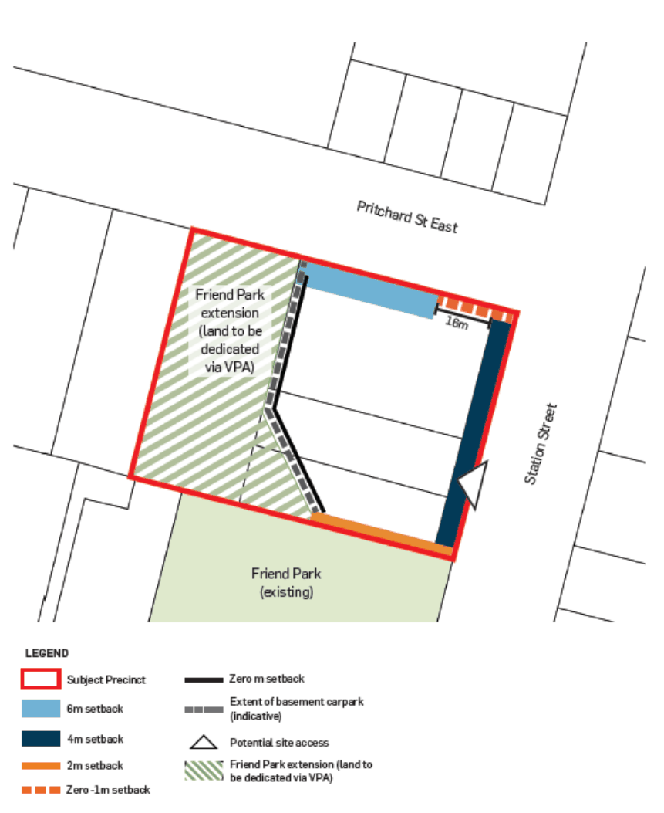

> [Picture on page 301: a picture, saved as a picture (images/part-f2-business-site-specific-page-301-1.gif, 150 dpi).]

Figure 16: Plan showing ground floor building setbacks.

#### 3.4.4 Street Wall and Upper-level Setbacks

C1. Street wall setbacks as shown in Figure 17 include the following:

i. Minimum zero metre setbacks to Station Street and Pritchard Street East.

ii. 2 metre setback to existing Friend Park.

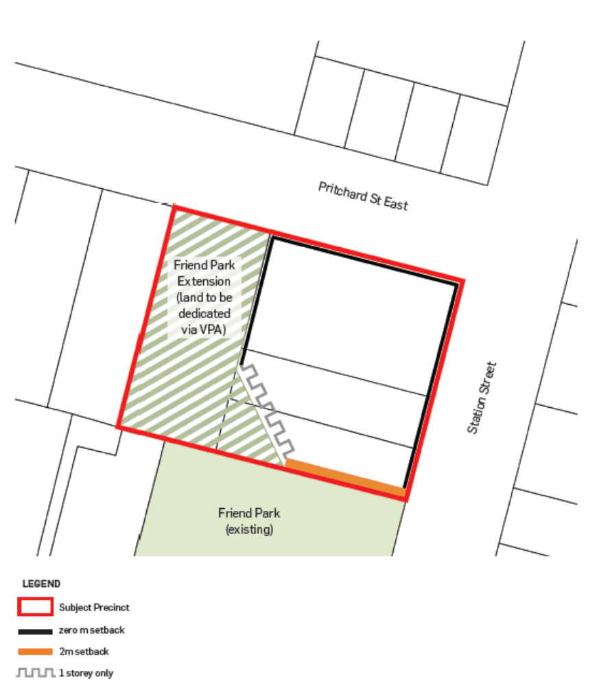

> [Picture on page 302: a picture, saved as a picture (images/part-f2-business-site-specific-page-302-1.gif, 150 dpi).]

Figure 17: Plan showing street wall setbacks.

C2. Upper Level Setbacks

i. The building above the street wall is to maintain a minimum 3 metre setback from the 5th storey along Station Street and Pritchard Street East.

ii. The building above the street wall is to maintain a minimum 2 metre setback to Friend Park (existing).

iii. The building above the 5th storey street wall is to maintain a minimum 10 metre setback to the Friend Park extension.

The above setbacks are further illustrated by Figures 18 to 23.

#### 3.4.5 Built Form and Park Interface

C1. Use variation in appropriate materials and neutral /subdued colours for those building

walls facing the Park.

C2. Where possible incorporate exterior green walls into the building/s for those walls

facing the Park.

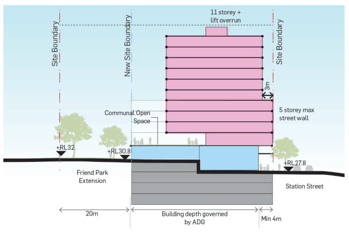

> [Picture on page 303: a picture, saved as a picture (images/part-f2-business-site-specific-page-303-6.gif, 150 dpi).]

Figure 18: Section A-A through corner of Pritchard Street and Station Street Precinct (typical east-west

podium section)

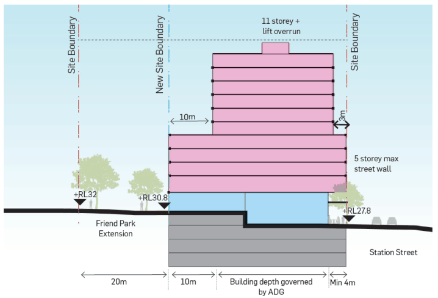

> [Picture on page 303: a picture, saved as a picture (images/part-f2-business-site-specific-page-303-9.gif, 150 dpi).]

Figure 19: Section B-B through corner of Pritchard Street and Station Street Precinct (typical east-west

tower section)

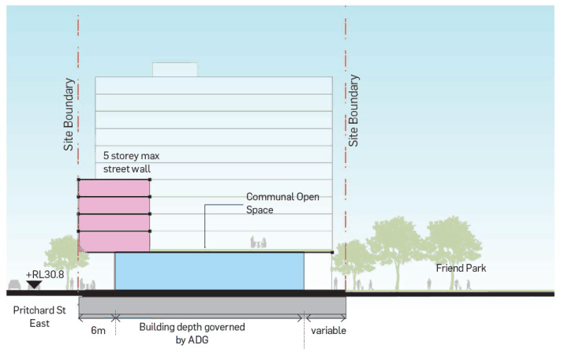

> [Picture on page 304: a picture, saved as a picture (images/part-f2-business-site-specific-page-304-1.gif, 150 dpi).]

Figure 20: Section C-C through corner of Pritchard Street and Station Street Precinct (typical north – south

podium section)

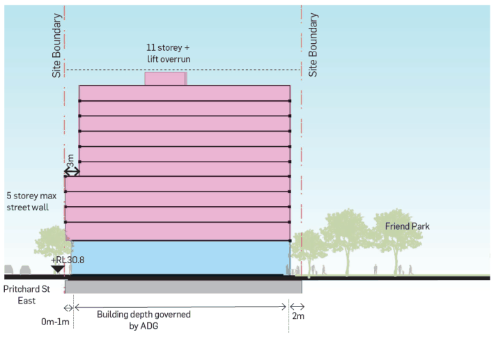

> [Picture on page 304: a picture, saved as a picture (images/part-f2-business-site-specific-page-304-4.gif, 150 dpi).]

Figure 21: Section D-D through corner of Pritchard Street and Station Street Precinct (typical north – south

tower section)

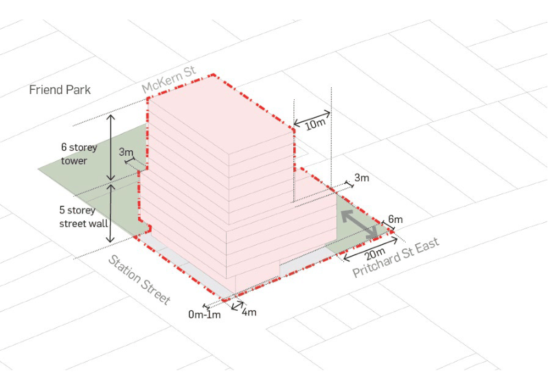

> [Picture on page 305: a picture, saved as a picture (images/part-f2-business-site-specific-page-305-1.gif, 150 dpi).]

Figure 22: Corner of Pritchard Street and Station Street Precinct (3D Conceptual Diagram north – south

section)

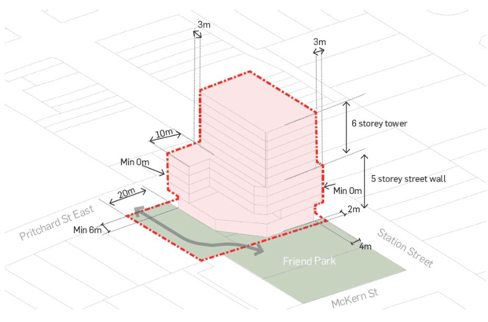

> [Picture on page 305: a picture, saved as a picture (images/part-f2-business-site-specific-page-305-4.gif, 150 dpi).]

Figure 23: Corner of Pritchard Street and Station Street Precinct (3D Conceptual Diagram east – west

section)

### 3.5 Vehicular Access and Laneways

#### Objectives

O1. Provide improved, safe, and efficient vehicular access and circulation throughout the

Centre.

O2. Create a safe and active pedestrian focus for the Centre along street frontages.

O3. Minimise impact of vehicular access on streetscape amenity and pedestrian safety.

O4. Implement traffic management measures to reduce through traffic on Dunmore Street

and enhance pedestrian amenity on Dunmore Street between Garfield and Station

Streets.

#### Controls

Vehicular access is discouraged on primary active frontages as identified in Figure 5.

Vehicular access to 53-71 Dunmore Street is to be provided via a formalised existing

service lane over The Kingsway car park – refer to Figure 24.

Maintain existing vehicular access to 73-75 Dunmore Street with the option to utilise

alternative vehicular access from the rear service lane across The Kingsway car park.

Widen and extend Station Lane for vehicle access over adjoining properties as identified

in Table 2 and Figure 24.

Development is not to preclude the delivery of the main street bypass as identified in

Figure 24.

Table 2: Properties affected by widening and extension of Station Lane

| Sites Affected | Control | Land to be dedicated for road widening |
|---|---|---|
| 8 Dunmore Street and 40-50 Station Street | Widen the existing Station Lane by dedicating approximately 2m of land along the western side boundary of 8 Dunmore St and eastern rear boundary of 40-50 Station Street. The final width of the lane is to be 8m including a footpath. | Yes |
| 32-38 Station Street | Widen the existing Station Lane by dedicating approximately 0-2m of land along the eastern rear boundary. The final width of the lane is to be 8m including a footpath. | Yes |
| 56 – 82 Station Street and 86-96 Station Street | Extend the existing Station Lane (to the south) by dedicating 8m of land along the eastern rear boundary. | Yes |

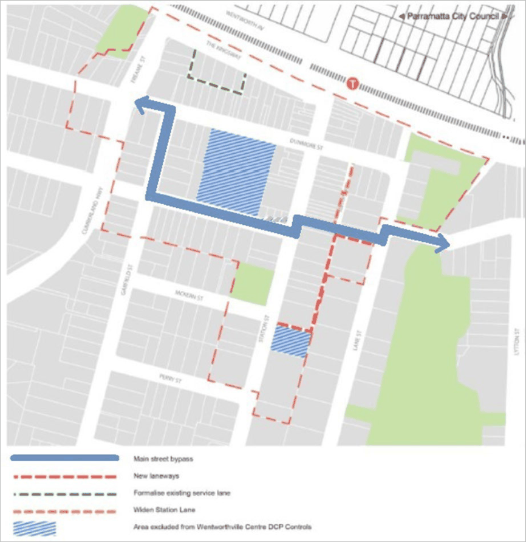

> [Picture on page 307: a picture, saved as a picture (images/part-f2-business-site-specific-page-307-1.gif, 150 dpi).]

Figure 24: Vehicular access - proposed and extended

### 3.6 Parking

#### Objectives

Provide sufficient car parking within the Centre to meet expected demand while

minimising impacts on the surrounding road network.

Minimise traffic congestion in the Centre.

Ensure off-street parking facilities and access does not interfere with traffic flow and

safety in adjacent streets or endanger pedestrian traffic on or off the site.

Encourage cycling as an alternative form of transport.

#### Controls

On-site car parking rates for all land uses with the exception of Commercial Premises

are to be provided in accordance with Part G of the Cumberland DCP 2021.

On-site car parking rates for Commercial Premises are 1 space per 50 sqm of gross

leasable floor area.

Bicycle parking is to be provided in accordance with Part G3 of the Cumberland DCP

2021.

### 3.7 Pedestrian Connectivity and Amenity

Several pedestrian through site links have been identified in order to improve pedestrian accessibility

and movement throughout the Centre. Of five locations identified, three existing thoroughfares are to

be improved and enhanced as part of future redevelopment. The link locations are identified below.

#### Objectives

Improve the connectivity and pedestrian amenity throughout the Centre.

Create a safe, active and friendly pedestrian environment.

Provide direct and accessible through site pedestrian links that improve the legibility of

the Centre.

#### Controls

All through site links must:

• provide a functionally and visually continuous pedestrian link with a clear line of

sight for the purpose of surveillance and accessibility;

• ensure pedestrian safety and the security of adjacent businesses is maintained at

all times;

• be publicly available at all times and be well lit for the safety of users; and

• incorporate active frontages where possible. Through site links are to be provided in future redevelopment proposals on sites

described in Controls C3 to C7 below and as shown in Figure 25.

Dunmore Street - The Kingsway (Amalgamated Site 5)

• transformation of an existing arcade within Amalgamated Site 5 into a 6m wide open

air pedestrian link with shopfronts, dining opportunities and appropriate lighting to

create safe pedestrian access between the Wentworthville Rail Station and

Dunmore Street / Plaza;

• the preferred location for the through site link is through 41 Dunmore Street which

is to be incorporated into future Development Applications for this site; and

• this link must maintain an easily identifiable continuous pedestrian link with the

redevelopment of 42 - 44 Dunmore Street (Wentworthville Mall) site. Dunmore Street - The Kingsway Car Park (Amalgamated Site 3)

• formalisation of the existing through site link adjoining the heritage listed Post Office

at 63 Dunmore Street (within amalgamated site 3) as part of the site’s future

development; and

• designs are to consider a connected outdoor public space in conjunction with the

adaptive reuse of the old post office.

Pritchard Street and Station Street Precinct - Friend Park (6 Pritchard St)

• future redevelopment of 6 Pritchard Street is to include a new through site

pedestrian link connecting Friend Park through to Pritchard Street East to facilitate

direct access between the park and the main shopping area. The pedestrian link is

to be a minimum 3.5m in width and must not exceed 6.0 metres in width. Station Street - Lane Street (56 Station St)

• formalisation of the existing through site link at 56 Station Street adjoining the

Wentworthville Hotel to improve pedestrian access between Station Street and

Lane Street car park. The pedestrian link is to be a minimum 3.5m in width. Civic Hub/Library Precinct (2-14 Lane St)

• create a new pedestrian access link from Dunmore Street to Veron Street Park,

through a future new Library and Civic Hub at 2-14 Lane Street. Detailed design of

the plaza link is to be determined by future design concepts for the precinct.

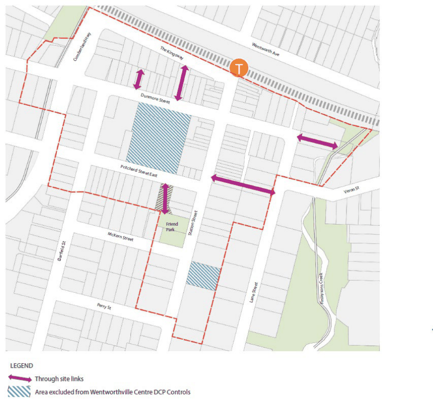

> [Picture on page 309: a picture, saved as a picture (images/part-f2-business-site-specific-page-309-14.gif, 150 dpi).]

Figure 25: Pedestrian connectivity and amenity

### 3.8 Public Domain

The following controls are to be read in conjunction with the Wentworthville Public Domain Strategy and

Landscape Strategy.

#### Objectives

Provide publicly accessible integrated open space to cater for informal gatherings and

recreational purposes.

Ensure publicly accessible open space has appropriate levels of sunlight, shade, air

circulation and safety.

#### Controls

Create three new public places as shown in Figure 26 and described in Controls C2 to

C4 below.

Dunmore Street Plaza Included in the redevelopment of 42-44 Dunmore Street (Wentworthville Mall Site) is the

construction of a Plaza along the southern side of Dunmore Street. In compliance with

the Wentworthville Strategy’s Structure Plan this plaza is to be extended in an easterly

direction over No. 21 Station Street. This will:-

• require a dedicated continuous strip of land 8m in depth from the existing footpath

boundary extending the full length of the site at 21 Station St along the Dunmore

Street frontage;

• be a paved urban plaza with the flexibility to cater for a range of informal uses,

functioning as a promenade and including distinct zones for outdoor dining, public

seating/gathering and public art;

• include zones for unobstructed pedestrian movement, outdoor dining and street

furniture such as seating, lighting and rubbish bins;

• allow for temporary uses such as markets, stalls and outdoor music;

• include adequate landscaping with large soil volumes capable of sustaining tree

planting;

• include extensive, co-ordinated street tree planting;

• be an active frontage to promote street activation; and

• be open air with no permanent buildings or structures over the plaza with the

exception of awnings. Refer to Figure 27 for a concept image of the Plaza. Dunmore Street - The Kingsway (Amalgamated Site 5)

• provision of a 6m wide open air pedestrian through site link over Amalgamated Site

5 with shopfronts, dining opportunities and appropriate lighting to create safe

pedestrian access between the Wentworthville Rail Station and Dunmore Street and

its Plaza; and

• this area is also identified as a new formalised pedestrian through site link (Refer to

Section 3, C3) Refer to Figure 28 for a concept image of the pedestrian link. Civic Hub/Library (2-14 Lane St) An open air public plaza is to be provided at the eastern end of Dunmore Street coupled

with the creation of a new future Library and Civic Hub at 2-14 Lane Street. Refer to Figure 29 for a typical concept image of the Plaza.

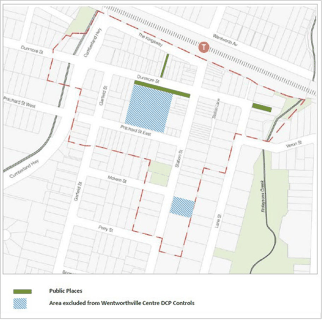

> [Picture on page 311: a picture, saved as a picture (images/part-f2-business-site-specific-page-311-1.gif, 150 dpi).]

Figure 26: Proposed public places

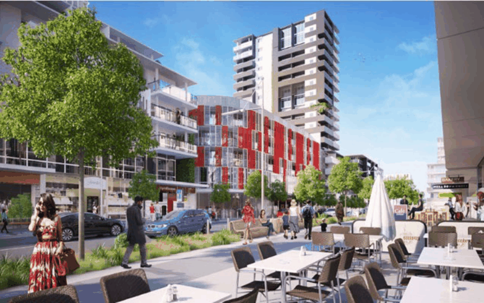

> [Picture on page 311: a picture, saved as a picture (images/part-f2-business-site-specific-page-311-3.gif, 150 dpi).]

Figure 27: Proposed new Dunmore Street Plaza (concept image only)

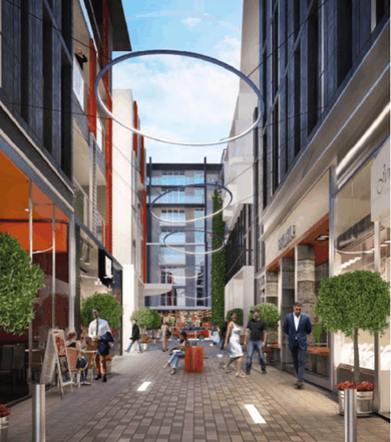

> [Picture on page 312: a picture, saved as a picture (images/part-f2-business-site-specific-page-312-1.gif, 150 dpi).]

Figure 28: Proposed new pedestrian through site link

between Dunmore Street and Plaza and The Kingsway

(concept image only)

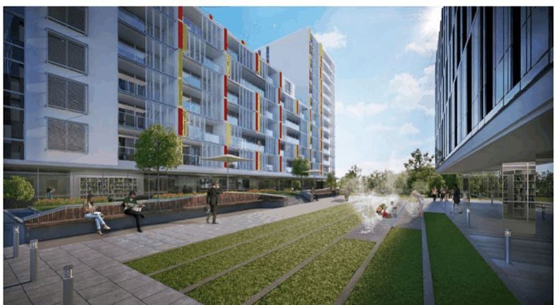

> [Picture on page 312: a picture, saved as a picture (images/part-f2-business-site-specific-page-312-5.gif, 150 dpi).]

Figure 29: Proposed new open plaza - Civic Hub / Library Precinct

### 3.9 Green walls and planting on structures

Planting on structures such as roofs, podiums and basement car parks can improve urban amenity as

well as reduce direct energy use and stormwater runoff. Planting includes roof top gardens, green walls

and planter boxes.

#### Objectives

Encourage the ‘greening’ of sites through vegetation planting of external areas and

promote renewable energy initiatives.

Improve the aesthetic features of a building’s facade and roofscape.

Reduce environmental impact over the life cycle of a building and the necessity for

mechanical heating and cooling.

#### Controls

Structures are to be adequately designed with regard to soil weight, appropriate draining

and irrigation systems.

Plant species are to be suited to local site conditions including seasonal changes and

be drought and wind tolerance.

A landscape maintenance plan is to be submitted with the development application and

include reference to the proposed irrigation and drainage systems.

Structures incorporating green walls should be integrated into the overall design of the

building including the building facade.

Minimum soil standards for plant types and sizes are to adhere to Table 5, Part 4P of

the NSW Apartment Design Guide (ADG).

The planting design should (where applicable) allow for access and ease of movement

from within the development and minimise overlooking of neighbouring properties

through use of passive screening or planting.

### 3.10 Safety by Design

#### Objectives

Ensure new developments are designed to incorporate safety elements that reduce

opportunities for crime and enhance the community perceptions of safety and security.

Ensure building and place design is guided by the Crime Prevention through

Environmental Design (CPTED principles).

Provide pedestrians with direct and well used traffic routes with good night lighting.

Ensure there is adequate lighting and signage to provide a safe pedestrian environment.

#### Controls

Compliance with Cumberland DCP 2021 Part C – Safety and Security.

This page has been left intentionally blank.

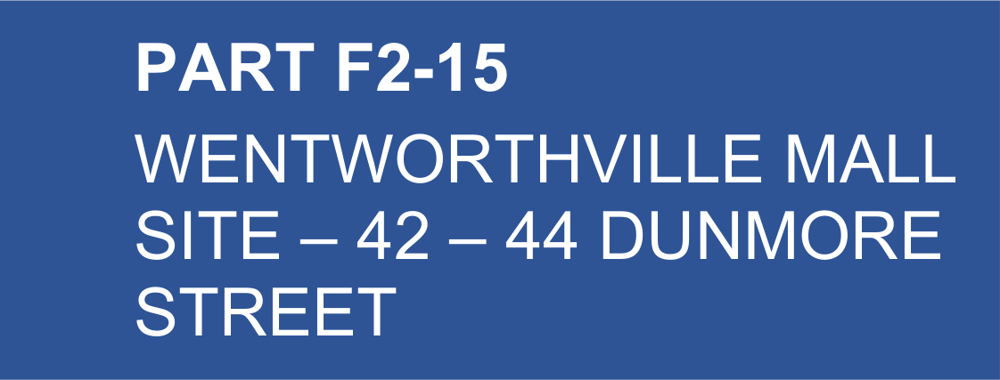

> [Picture on page 315: a picture, saved as a picture (images/part-f2-business-site-specific-page-315-1.gif, 150 dpi).]
