### PART F2-15

### WENTWORTHVILLE MALL

### SITE – 42 – 44 DUNMORE

### STREET

This page has been left intentionally blank.

## 1. Introduction

### 1.1 Land to which this Part applies

This Part applies to land at 42-44 Dunmore Street, Wentworthville (Wentworthville Mall site), being

identified as Lot 11 DP746514, as shown in Figure 1.

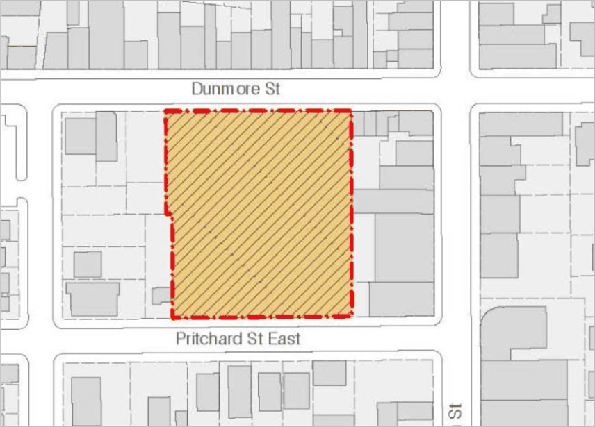

> [Picture on page 317: a picture, saved as a picture (images/part-f2-business-site-specific-page-317-5.gif, 150 dpi).]

Figure 1: Land to which this Part applies

## 2. Vision

### 2.1 Vision

The purpose of these development controls is to establish a detailed planning and design framework to

guide the redevelopment of the site. The vision for the site is that it will make a positive contribution to the renewal of the Wentworthville

centre as a progressive, colourful, vibrant and engaging local centre that is well-connected to the

surrounding area and is a great place to live and visit.

### 2.2 Structure Plan

The vision and objectives for the site as identified above are spatially expressed in the Structure Plan

(Figure 2). Where variations to the structure plan are proposed, the development application is to

demonstrate how the vision and objectives have been achieved.

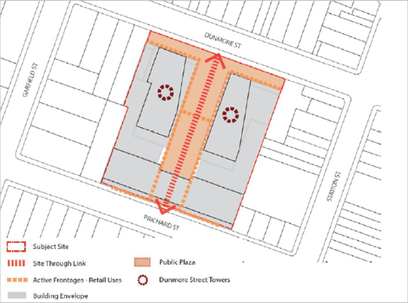

> [Picture on page 318: a picture, saved as a picture (images/part-f2-business-site-specific-page-318-1.gif, 150 dpi).]

Figure 2: Structure plan

## 3. Objectives and controls

### 3.1 General

#### Objectives

Establish a landmark, mixed use and transit-oriented heart for the town centre that

signifies the importance of Wentworthville within the Cumberland City centres hierarchy

Deliver new housing that activates and enlivens the centre

Contribute to the creation of a distinct sense of place for the centre that acknowledges

its past and embraces its future as a vibrant, urban location

Reinforce the role of Dunmore Street as the centre’s main street

Strengthen the retail and employment role of the centre

Increase the supply and choice of housing for the community in a high-density

environment

Improve the permeability of the centre for pedestrians, including the provision of a

through-site link between Dunmore Street and Prichard Street

Provide publicly accessible open space that allows for informal gathering, interaction

and recreation

Ensure a high level of urban design and architectural quality.

### 3.2 Circulation and access

#### Objectives

Provide a new pedestrian link between Dunmore Street and Pritchard Street East to

improve pedestrian permeability and promote activation along Pritchard Street East.

Provide for convenient, safe and attractive pedestrian connection between Dunmore

Street and Pritchard Street.

Promote shop activation by enabling an arcade-style development layout.

#### Controls

Development includes a through-site link as shown in Figure 3.

The through-site link:

• provides a functionally and visually continuous pedestrian link between Dunmore

and Pritchard Streets;

• has a minimum width of 5m or 2 x 2.5m where stairs and a ramp are required to

ensure universal access or where the gradient requires;

• is integrated with the on-site plaza spaces; and

• includes mechanisms to enable negotiation of any gradient changes for mobility

impaired persons in accordance with relevant legislation. The through-site link is open to the sky except for that part closest to Pritchard Street

which passes under the Pritchard Street street-wall for a maximum distance of 25m and

has a minimum vertical clearance of 9m

The through-site link is open to the public at all times.

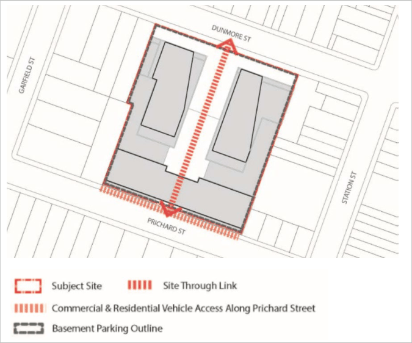

> [Picture on page 319: a picture, saved as a picture (images/part-f2-business-site-specific-page-319-22.gif, 150 dpi).]

Figure 3: Circulation and access

### 3.3 Open space

#### Objectives

Provide an integrated series of well-designed and publicly accessible urban plazas that

cater for informal gathering, interaction and recreation.

Ensure publicly accessible open space has appropriate levels of sunlight, shade, air

circulation and safety.

Design public open space to improve the environmental performance of the site and the

overall town centre, including for stormwater management, biodiversity and reducing

the urban heat island effect.

#### Controls

Public open space is located generally in accordance with Figure 4 and includes the

following key spaces:

• Dunmore Street plaza

• Northern plaza

• Central plaza

• Southern plaza The Dunmore Street Plaza:

• comprises a continuous strip of land having a depth of 8m from the existing footpath

boundary along the site’s Dunmore Street frontage (to be dedicated to Council);

• is a paved, urban plaza that has the flexibility to cater for a range of informal uses,

functioning as a promenade and including space for outdoor dining, public

seating/gathering and public art;

• includes zones for unobstructed through pedestrian movement, outdoor dining and

street furniture such as seating, lighting and rubbish bins;

• allows for temporary uses such as markets, stalls and outdoor music;

• does not include permanent structures, ensuring an open and flexible space;

• includes large soil volumes capable of sustaining trees;

• includes adequate landscaping and tree planting;

• includes extensive, co-ordinated street tree planting; and

• is bordered by active frontages Note: basement car parking for the development may be located beneath the plaza The Northern Plaza:

• has a minimum width of 20m;

• includes the establishment of an easement for public open space at the front of the

northern plaza having an area of approximately. 200sqm with a minimum width of

12m. Embellishment of this open space is to a specification and finish to be agreed

with Council;

• is a paved, urban plaza that has the flexibility to cater for a range of informal uses;

• is visually and physically integrated with the Dunmore Street Plaza, including

consistent paving and street furniture;

• enables a clear line of sight to be gained between Dunmore Street and the

supermarket;

• facilitates the convenient movement of people between Dunmore Street, the

supermarket and the southern part of the site;

• maximises the visual exposure of the supermarket façade;

• is bordered by active frontages;

• provides a connection to the Southern Plaza that is visually unobtrusive and

complies with relevant legislation/standards; and

• is publicly accessible at all times. The Central / Southern Plaza:

• has a minimum width of 20m;

• provides for informal gathering and seating;

• accommodates uses that are compatible with adjoining residential uses;

• may be either paved or a combination of paving and grassed areas;

• includes raised planting beds and tree planting; Note: as the plaza is located on a podium, deep soil areas are not possible

• manages any gradient change with Pritchard Street with stairs, as well as a visually

unobtrusive complies with disability legislation;

• incorporates stairs and visually unobtrusive disabled access to address any change

in gradient;

• is bordered by active uses and / or residential uses that have a high level of

engagement with the plaza in accordance with the relevant provisions of this DCP;

• is publicly accessible at all times;

• is designed in accordance with CPTED principles’;

• incorporates lighting that ensures adequate night-time illumination for safety and

security without any light spill or glare to adjoining dwellings; and

• considers the acoustic environment to ensure noise does not create a nuisance for

adjoining dwellings. Public open space is designed and constructed in accordance with a Landscape and

Public Domain Plan to be prepared between the site owner and Council, and approved

by Council.

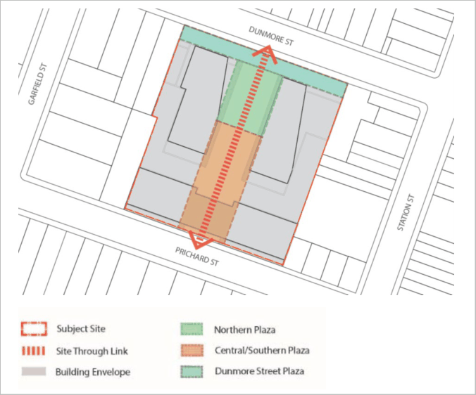

> [Picture on page 321: a picture, saved as a picture (images/part-f2-business-site-specific-page-321-26.gif, 150 dpi).]

Figure 4: Public open space

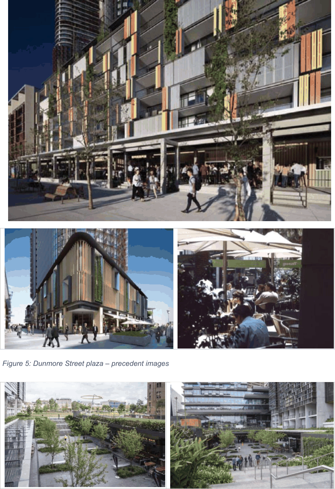

> [Picture on page 322: a picture, saved as a picture (images/part-f2-business-site-specific-page-322-1.gif, 150 dpi).]

Figure 5: Dunmore Street plaza – precedent images

Figure 6: Northern plaza – precedent images

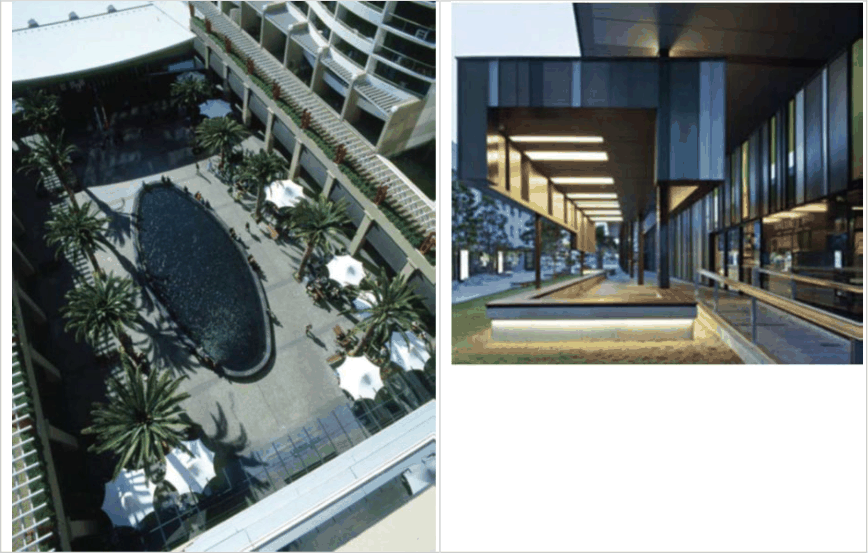

> [Picture on page 323: a picture, saved as a picture (images/part-f2-business-site-specific-page-323-1.gif, 150 dpi).]

Figure 7: Southern plaza – precedent images

### 3.4 Public art

#### Objective

Provide opportunities for public art that strengthens the identity and amenity of the

centre.

#### Controls

A Public art plan is prepared that identifies the location and type of public art to be

provided within the site.

Public art is sensitively placed and designed to form part of cohesive public domain

outcome, and does not overwhelm the public domain due to bulk, height, colour or other

aspect.

Public art is located in places of high visibility including Dunmore Street Plaza.

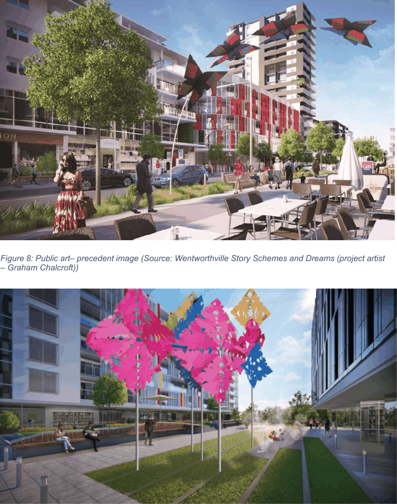

> [Picture on page 324: a picture, saved as a picture (images/part-f2-business-site-specific-page-324-1.gif, 150 dpi).]

Figure 8: Public art– precedent image (Source: Wentworthville Story Schemes and Dreams (project artist

– Graham Chalcroft))

Figure 9: Public art– precedent image (Source: Wentworthville Story Schemes and Dreams (project artist

– Graham Chalcroft))

### 3.5 Land use

#### Objectives

Strengthen the role of Wentworthville as a vibrant, mixed use town centre that contains

a range of complementary business, retail and higher density residential uses.

Encourage uses that extend activity within the town centre into the early evening and

weekend.

#### Controls

Development includes a full-line supermarket having a minimum gross floor area of

4,000sqm.

Development includes a minimum of 4,400sqm gross floor area of Commercial

Premises above ground level.

The following uses are encouraged at the ground floor (Dunmore Street Plaza and

Northern Plaza level):

• café;

• restaurant; and

• small bar. The following uses are encouraged at the first floor (Southern Plaza level:

• office premises; and

• medical centre.

### 3.6 Building height

#### Objectives

Establish a visual landmark that reinforces the site as the heart of the centre and

signifies the importance of the centre within the Cumberland City urban form and centres

hierarchy.

Transition building height downwards from north to south across the site.

Provide for a human scale, mid-rise street wall along the Pritchard Street site frontage.

#### Controls

Building height is generally in accordance with Figure 10 and:

• creates two landmark towers at the Dunmore Street frontage of the site; and

• creates a continuous street wall building at the Pritchard Street frontage of the site

that is of a lower height than the Dunmore Street towers The maximum street wall height fronting Dunmore Street and Pritchard Street is five

storeys, with a podium level setback of 3m.

The maximum street wall height fronting the through-site link is 7 storeys.

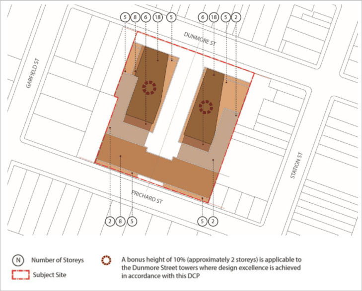

> [Picture on page 326: a picture, saved as a picture (images/part-f2-business-site-specific-page-326-1.gif, 150 dpi).]

Figure 10: Building height

### 3.7 Setbacks and building separation

#### Objective

Achieve setbacks from site boundaries and separation between buildings on the site

and on adjoining sites that:

• activates and engages with the adjoining public domain;

• is consistent with an urban centre character;

• provides for high levels of amenity to the public domain and dwellings, including

through adequate solar access, natural ventilation and air circulation; and visual and

acoustic privacy; and

• reduces the appearance of density and building bulk and scale

#### Controls

Development is setback from Dunmore and Pritchard Streets in accordance with Figure

11.

Non-residential development may be built to side boundaries.

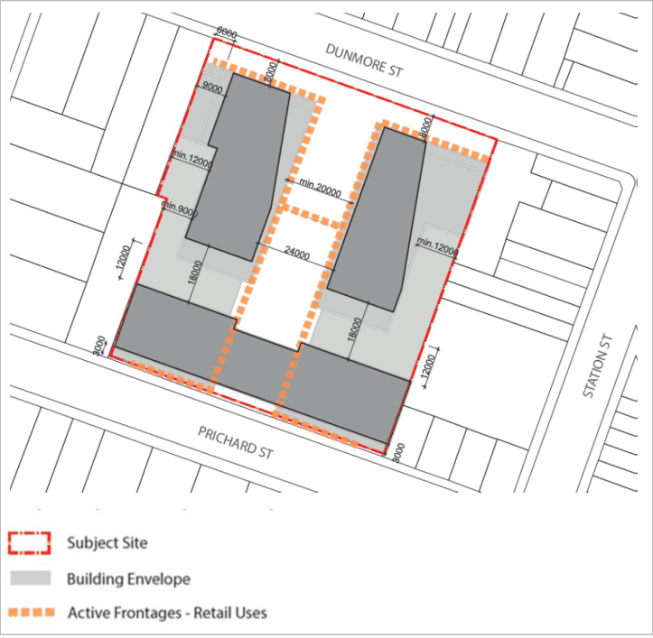

> [Picture on page 327: a picture, saved as a picture (images/part-f2-business-site-specific-page-327-1.gif, 150 dpi).]

Figure 11: Setbacks and active frontages

### 3.8 Built form

#### Objectives

Built form is designed to:

• define the public domain;

• reduce the appearance of building bulk and scale when viewed from the public

domain and provide visual interest; and

• activate and engage with the adjoining public domain.

#### Controls

Building setbacks are in accordance with Figure 11.

Building facades feature articulation within a cohesive overall composition through the

use of design measures such as:

• recessed and / or projecting balconies;

• slots;

• large windows and other openings;

• sun control devices such as eaves, louvres and screens;

• privacy screens;

• blades or fins;

• elements of a more lightweight material than the main structural framing; and

• balustrades to balconies that have a more lightweight appearance than masonry

such as glass or metal. Buildings are designed to have their main living areas and adjoining private open space

oriented to and directly overlook the public domain.

Built form is in accordance with Figure 12 - 14.

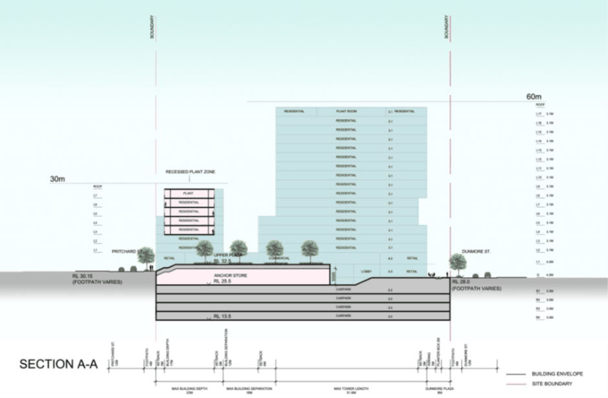

> [Picture on page 328: a picture, saved as a picture (images/part-f2-business-site-specific-page-328-6.gif, 150 dpi).]

Figure 12: Section/elevation of through-site link

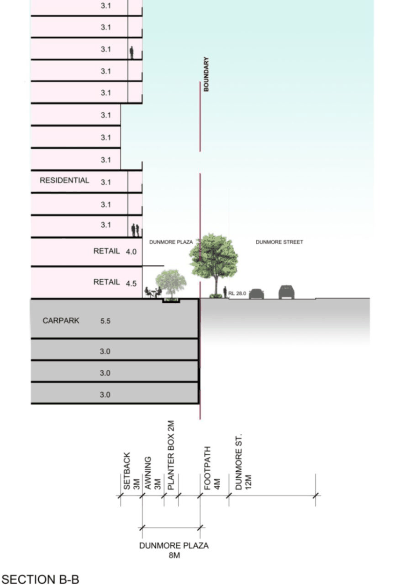

> [Picture on page 329: a picture, saved as a picture (images/part-f2-business-site-specific-page-329-1.gif, 150 dpi).]

Figure 11: detail section of Dunmore Plaza

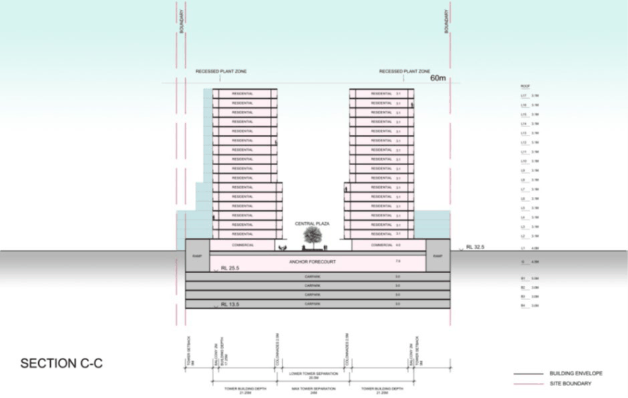

> [Picture on page 330: a picture, saved as a picture (images/part-f2-business-site-specific-page-330-1.gif, 150 dpi).]

Figure 14: section/elevation east-west through site

### 3.9 Ground floor treatment

#### Objective

Ensure development activates and engages with the public domain.

#### Controls

Development includes an active frontage to Dunmore Street as shown in Figure 11.

Building foyers:

• are not permitted fronting Dunmore Street;

• are minimised in width; and

• have a minimum of 75% of their street facing edge as transparent glass. Non-residential uses at the ground floor:

• have a maximum width facing Dunmore Street of 10m;

• maximise the proportion of their façade that includes transparent glass;

• where possible, enables areas of highest activity to be readily visible from the

adjoining public domain; and

• where possible, incorporate openable elements that facilitate interaction between

indoor and outdoor space, in particular where outdoor dining is provided. Continuous awnings are provided along the Dunmore Street and Pritchard Street

frontages of the site and have a:

• minimum depth of 1.5m;

• minimum vertical clearance of 3m; and

• simple, contemporary design.

Blank walls are not permitted where they:

• are greater than 5m in length where facing Dunmore Street; and

• are greater than 10m in all other locations. Roller shutters or bars are not permitted where active frontages are required in

accordance with Figure 11.

Setbacks are:

• a minimum of 1.5m from the edge of the public domain to the outermost project of

the building; and

• a minimum of 4m from the edge of the public domain to the glass line enclosing

internal space. The area between the public domain and the glass line enclosing internal space has a

minimum 25% of soft landscaping such as garden beds and turf. Note: as these areas are located on a podium and have small dimensions, deep soil

areas are not appropriate. The maximum height difference between the adjoining public domain and the private

landscaped open space is 1m.

Ground floor dwellings are to have individual entries accessed from the adjoining public

domain.

Where a site boundary fence is included it has a maximum height of 1.2m from the

height of the adjoining public domain.

Screening vegetation is not to be provided within the private landscaped open space

forward of the glass line enclosing the internal space, except where alongside

boundaries.

The main living areas of ground floor dwellings are to be located and oriented to directly

face the adjoining public domain.

The extent of the ground floor façade enclosed by transparent glass is to be maximised.

### 3.10 Towers

#### Objective

Locate and design towers to reduce the appearance of building bulk and scale and

provide visual interest.

#### Controls

Towers are located at the Dunmore Street frontage of the site.

Towers are inflected away from the Northern and Southern Plazas to direct views

outwards.

Towers fronting Dunmore Street are angled to facilitate solar access to living rooms and

balconies located on their east-facing facades.

Buildings are sited with their long axis aligned north-south.

Towers fronting Dunmore Street are articulated into three visually distinct but cohesive

components:

• base element;

• intermediate element; and

• upper tower element The base element:

• is generally three storeys in height;

• has a zero setback to the public domain; and

• includes awning or canopies adjoining the public domain. The intermediate element:

• provides a transition between the base and upper tower element; and

• where fronting Dunmore Street, is setback at least 3m from the outermost projection

of the preceding floor to provide a visual break to the verticality of the towers. The upper tower element:

• presents a slender form to Dunmore Street;

• has a zero setback to the public domain;

• is articulated through the use of slots along its side facades; and

• incorporates a visually interesting roof form that screens plant and other mechanical

utility devices.

### 3.11 Transport, access and parking

#### Objectives

Vehicle access, manoeuvring and parking is provided in a co-ordinated way, minimises

visual impact on the streetscape and does not impede the convenient and safe

movement of pedestrians.

The transport demand generated by development is managed in a sustainable manner.

On-site car parking is provided at a rate that balances the need to provide for the

convenience needs of residents and visitors with encouraging more sustainable forms

of movement such as public transport, car-sharing, walking and cycling for commuter

and recreational trips.

#### Controls

On-site car parking is provided in basement form.

On site car parking in basement form may be located under the Dunmore Street plaza

to the edge of the original site boundary.

On-site car parking rates for Commercial Premises is 1 space per 50sqm of gross

lettable floor area.

All development applications are to include a ‘Transport Impact Study’ addressing the

potential impact of the development on surrounding movement systems, where the

proposed development comprises: a. non-residential development of more than

1,000m² GFA; b. residential development of 100 or more new dwellings; or c. likely to

generate significant traffic impacts according to the consent authority.

The development application is to include a site-wide ‘Green Travel Plan’ to outline

initiatives for walking, cycling and the use of public transport. The Green Travel Plan

should address different transport needs and patterns for residential and non-residential

uses. Where relevant, initiatives are to be implemented prior to the issue of an

Occupation Certificate.

All development applications are to include a ‘Transport Access Guide’, and a strategy

for its future availability to residents, employees and visitors, where the proposed

development comprises:

• multi-dwelling housing; or

• non-residential development more than 1,000m² GFA. Lockable on-site bicycle parking is provided for residential and non-residential uses.

End-of-trip facilities including showers and lockers must be provided to adequately

service the number of bicycle parking spaces required for employees in commercial

premises and are to be located close to the bicycle parking area, entry/exit points, and

within an area of security camera surveillance.

24hour, publicly accessible parking spaces within the site for car-share vehicles is

encouraged.

Where a car share scheme operates locally, at least one car-share parking space for

every 100 dwellings is provided within the residential parking area for the development.

Car-share parking spaces are included in the maximum number of visitor car parking

spaces required for a development in the Part G of this DCP.

Car-share parking spaces must be publicly accessible at all times, conveniently located,

adequately lit and identified with sign-posting and road marking.

Car-share spaces must comply with the relevant Australian Standard.

All car-share parking spaces are to be retained as common property by the Owners

Corporation of the site. A covenant is to be registered with the strata plan advising of

any car-share parking space. The covenant is to include provisions that the car-share

parking space(s) cannot be revoked or modified without prior approval of Council.

Site access is generally in accordance with Figure 3 – Circulation and access.

Vehicular access to the site is obtained from Pritchard Street.

### 3.12 Environmental performance

#### Objectives

Incorporate measures that enhance the environmental performance of the site and

buildings.

Enhance local biodiversity.

Ensure that development does not result in an unacceptable impact on the public

domain by way of wind generation.

Note: the acceptability of wind impacts depends on use. For example, people walking

or window-shopping will tolerate higher wind speeds than those seated at an outdoor

restaurant.

#### Controls

Rain water is captured, stored and used for non-potable uses such as irrigation of

landscaping.

Native planting is used as a key element of on-site landscaping, incorporating a diverse

selection of locally indigenous plant species (robust, drought-tolerant species are

preferred).

Note: Species selection should consider appropriate species for an urban environment.

Where possible, buildings incorporate a dual water system that recycles grey water for

toilet flushing and car washing.

Buildings incorporate an articulation zone of 450mm to north and west facades to enable

integration of external screening and shading devices to maximise the comfort of those

in northern and western facing apartments.

Lift lobbies preferably utilise natural lighting and ventilation.

The form and arrangement of towers shield the Dunmore Street Plaza and the Northern

Plaza from direct westerly winds.

Towers are setback from the outer edge of lower levels where fronting the Northern and

Southern Plazas to mitigate the impact of wind on the ground level public domain.

Wind mitigation measures such as awnings and landscaping are incorporated into the

design of both street frontages and the plazas to mitigate any potential wind funnelling

effects of northeasterly and southerly winds from the towers and:

• are integrated into the overall landscape design;

• are visually appealing;

• contribute to the overall character of the public domain;

• are consistent with CPTED principles; and

• ensure a high level of functionality for the public domain. Wind mitigation measures are included in the design of communal recreation areas to

ensure a high level of comfort, in particular for highly used areas.

This page has been left intentionally blank.

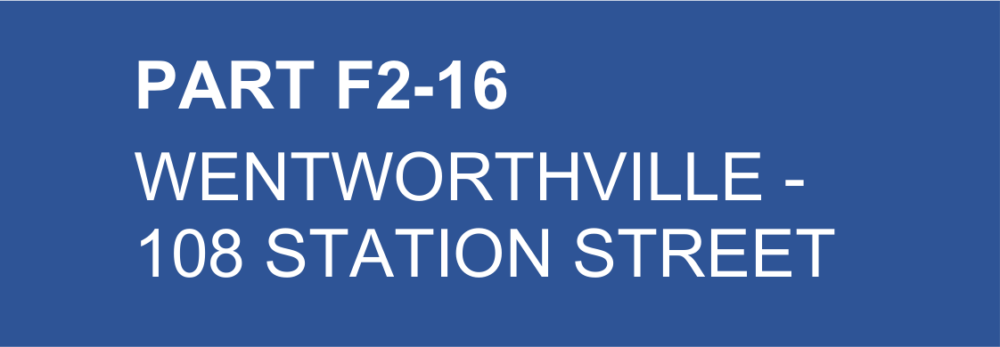

> [Picture on page 336: a picture, saved as a picture (images/part-f2-business-site-specific-page-336-1.gif, 150 dpi).]
