### PART F2-16

### WENTWORTHVILLE -

## 108 STATION STREET

This page has been left intentionally blank.

## 1. Introduction

### 1.1 Land to which this Part applies

This Part applies to development on land identified as 108 Station Street, Wentworthville, legally

described as Lot B on DP410947, as shown in Figure 1. The subject site is located within the Wentworthville Centre. The planning framework (Wentworthville

Centre Planning and Place Making Strategy) for the urban renewal and economic revitalisation of the

Wentworthville Centre is based on economic, traffic and urban design studies and was subject to

community consultation.

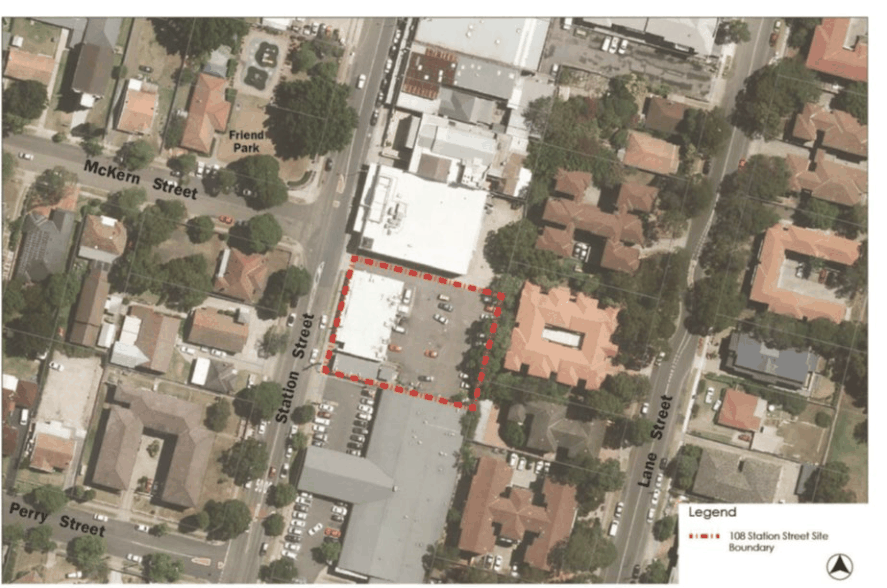

> [Picture on page 338: a picture, saved as a picture (images/part-f2-business-site-specific-page-338-9.gif, 150 dpi).]

Figure 1: 108 Station Street site boundary

This land comprises two key parts being:

• the development site; and

• the laneway which extends along the northern property boundary between Station Street and the

rear property boundary. Further details regarding the laneway are provided in Section 3.2. In addition, any development controls developed for the Wentworthville Centre should be taken into

consideration.

### 1.2 Purpose of this Part

The purpose of this Part is to set out a detailed planning and design framework to guide the

redevelopment of the site. This DCP is generally consistent with the Wentworthville Centre Planning and Place Making Strategy. Where there is an inconsistency between this Part and provisions contained elsewhere in the DCP, the

Site Specific Controls contained in this Part shall apply to the extent of the inconsistency.

## 2. Vision

The site will make a positive contribution to the renewal and status of the Wentworthville Centre as a

progressive, colourful, vibrant and engaging local centre that is comfortable, well-connected to the

surrounding area and facilities, and is a great place to live and visit.

## 3. Objectives and controls

### 3.1 General

#### Objectives

Facilitate the redevelopment of the site to achieve a high quality urban form and

architectural quality.

Enable additional building height at certain portions of the site where the development

provides for publicly accessible laneway.

Protect sunlight access to properties fronting Lane Street (south-east).

Deliver new housing that activates and enlivens the centre.

Increase the supply and choice of housing for the community in a high-density

environment.

### 3.2 Access

Laneway

#### Objectives

Ensure that vehicular access and egress points are best located to reduce potential for

conflict between pedestrians and vehicles.

Ensure the safe ingress and egress for vehicles using the laneway.

Ensure laneway design integrates with the ground floor uses of 108 Station Street and

provide for pedestrian movement.

#### Controls

The design layout and alignment of the new laneway is generally to be in accordance

with Figure 2 and 3, subject to detailed design development in consultation with Council.

Vehicular access is to be generally in accordance with the locations shown on Figure 4.

The new laneway is to incorporate the following elements as a minimum requirement:

• A total width of reservation = 6.6m;

• 800mm out of property boundary, both sides to be set aside for services, lights as

well as footpath; and

• 2.5m travel lane width x 2. Laneway alignment is to maintain clear sight-lines from each end.

All building vehicular access and egress points are subject to final Council approval.

All land within the new laneway reserve is to be dedicated to Council.

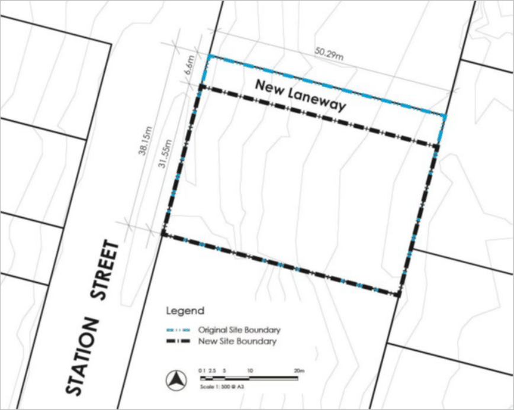

> [Picture on page 340: a picture, saved as a picture (images/part-f2-business-site-specific-page-340-13.gif, 150 dpi).]

Figure 2: Plan - New Laneway Detail

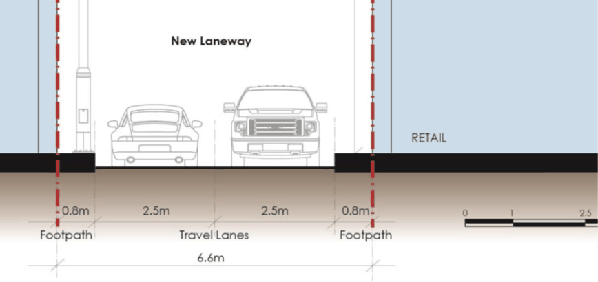

> [Picture on page 341: a picture, saved as a picture (images/part-f2-business-site-specific-page-341-1.gif, 150 dpi).]

Figure 3: Typical Section - New Laneway Detail

### 3.3 Built form

Active street frontage

#### Objectives

Ensure that the non-residential character of Station Street is maintained.

Ensure that façade articulation and elements within the building setback areas facilitate

an active street environment.

Encourage pedestrian movement within the Wentworthville Centre.

Enhance pedestrian safety, security and amenity around and within commercial

premises.

#### Controls

General Clear glazing is to be provided and reflective, tinted or obscured window coverings

should be avoided.

Blank wall should be avoided and visual interest and interaction at street level should

be provided.

The corner of Station Street and New Laneway should be emphasised through façade

articulation and roof form.

Station Street

A minimum 90% of the building façade at ground level is to be transparent.

Continuous ground level active uses must be provided where primary active frontages

are shown in Figure 4. Building must address Station Street.

Main entry to the building is to be located on Station Street.

Loading docks, vehicular access is not to be located where primary active frontage is

shown in Figure 4.

The active uses may include shop fronts, cafes and restaurants and appropriate

commercial uses such as gymnasium.

On sloping sites, the maximum level change between ground floor tenancies and the

adjacent footpath is to be maximum 600mm. On flood prone land advice should be

sought from Council’s engineers.

New laneway Frontage along the new laneway should be visually activated by incorporating clear

glazing to minimum 90% of the façade at ground level.

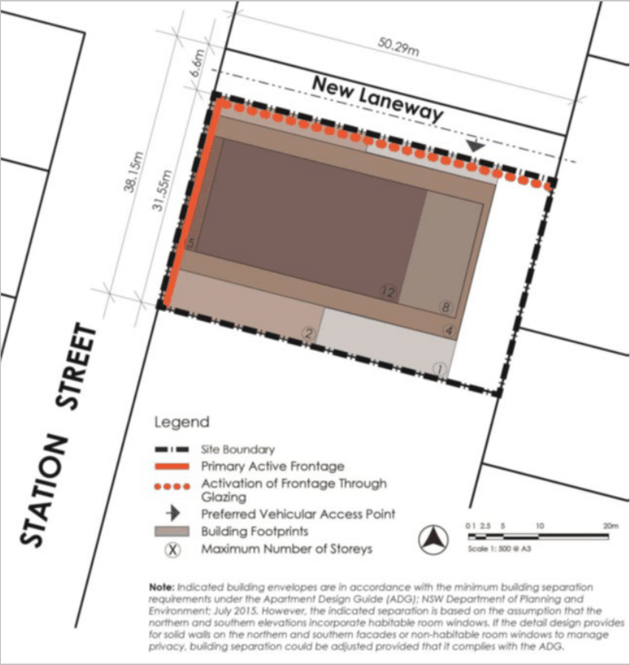

> [Picture on page 342: a picture, saved as a picture (images/part-f2-business-site-specific-page-342-11.gif, 150 dpi).]

Figure 4: Active street frontage location

Note: The building footprints indicated in Figure 4 represents Council’s preferred building configuration.

### 3.4 Street setbacks and build-to lines

#### Objectives

Enhance the character of Station Street and the Centre at large through consistent and

uniform alignment of building facades.

Increase pedestrian amenity.

Provide deep soil zones and maintain mature/significant vegetation.

Contribute to the landscape character of the Centre.

#### Control

Minimum setbacks and build-to lines must be provided as shown in Figure 5,

summarised as follows:

• zero setbacks / build-to lines to Station Street, new laneway and southern boundary;

• minimum 8m rear landscape setback;

• underground parking is not permitted to encroach into the rear setback unless it can

be demonstrated that the basement is designed to support mature trees and deep

root planting;

• awning, balconies, sun shading and screening elements can project forward of the

street setback line; and

• natural ground level is to be retained throughout the rear setback, where possible.

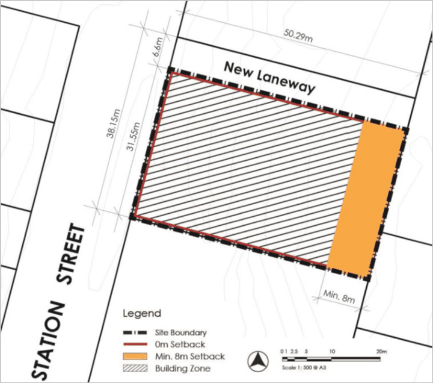

> [Picture on page 343: a picture, saved as a picture (images/part-f2-business-site-specific-page-343-19.gif, 150 dpi).]

Figure 5: Plan - Street Setbacks

### 3.5 Street wall heights

#### Objectives

Provide street edges that reinforces and reflects the various uses and existing character

in the Centre.

Ensure building heights at street level are at a human scale.

Facilitate a consistent street and laneway wall height throughout the Centre.

Provide prominence to the street level, establish a clear presence for retail and increase

the visibility, marketability and utility of ground floor space.

#### Controls

Street wall height shall be 5 storeys along Station Street (Refer Figure 7) with upper

level setback.

A maximum two storey street wall height is to be maintained along the new Laneway

(Refer Figure 6) with upper level setback.

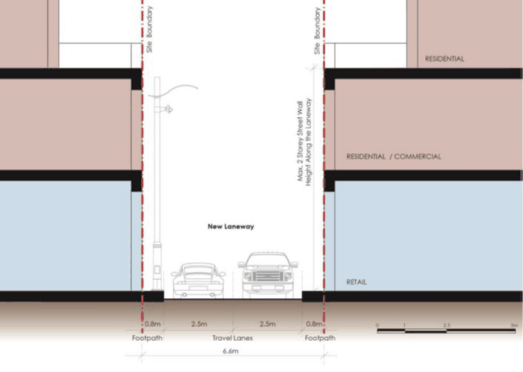

> [Picture on page 344: a picture, saved as a picture (images/part-f2-business-site-specific-page-344-14.gif, 150 dpi).]

Figure 6: Street Wall Height - New Laneway – West

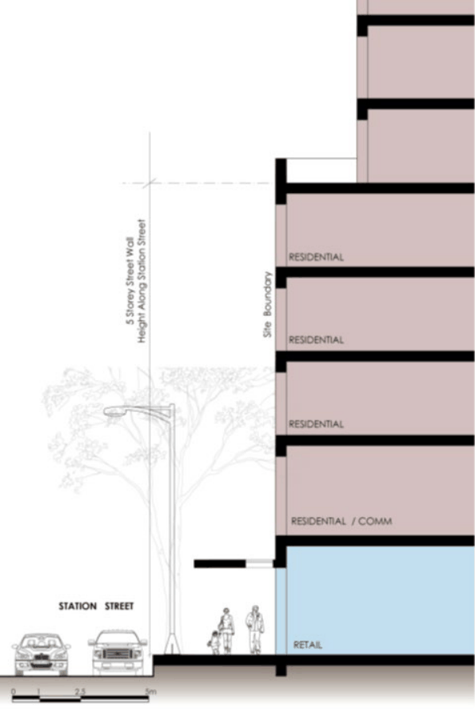

> [Picture on page 345: a picture, saved as a picture (images/part-f2-business-site-specific-page-345-1.gif, 150 dpi).]

Figure 7: Street Wall Height - Station Street

### 3.6 Upper level setbacks

#### Objectives

Enable more efficient tower footprints by removing incremental stepping of facades.

Minimise adverse wind impacts on the pedestrian environment.

Maximise sunlight penetration into streets and surrounding buildings.

Ensure that the building is modulated and articulated to respond to streetscape, visual

bulk and amenity issues.

Ensure that the podium above second storey fronting the new laneway is to be setback

to create a human scale laneway to make the space walkable.

#### Control

The building above the street wall is to display a uniform 3m setback as shown on Figure

8 and 9.

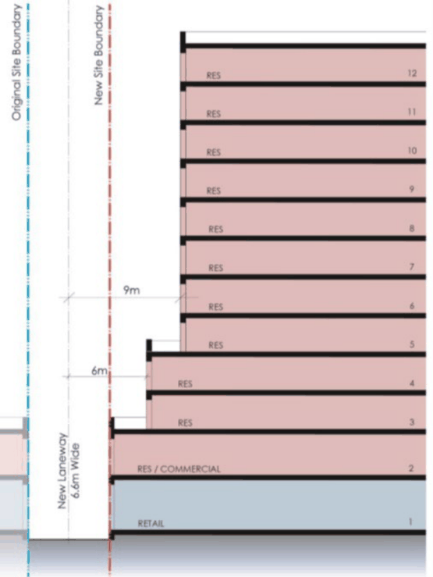

> [Picture on page 346: a picture, saved as a picture (images/part-f2-business-site-specific-page-346-4.gif, 150 dpi).]

Figure 8: Upper Level Setbacks - New Laneway – West

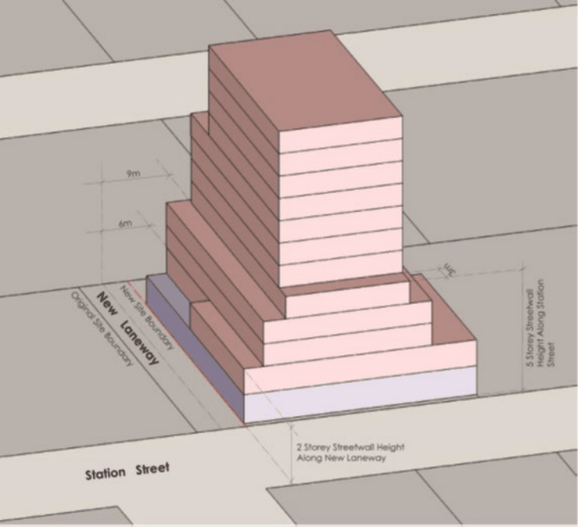

> [Picture on page 347: a picture, saved as a picture (images/part-f2-business-site-specific-page-347-1.gif, 150 dpi).]

Figure 9: 3D Conceptual Block Model - Upper Level Setbacks - Station Street

### 3.7 Building bulk and design

#### Objectives

Minimise overshadowing as compact floor plates cast smaller and faster moving

shadows.

Ensure that building is designed to reinforce the urban character of the locality.

Improve access to sky view and permit better views between buildings and through sites

and contribute to a more attractive skyline.

Enhance energy efficiency and increase daylighting within buildings.

Create architectural interest and visually diminish the overall scale of the building mass.

#### Controls

Building Heights are to be provided in accordance with Figure 10.

Floor to ceiling heights are to be provided in accordance with the NSW Apartment

Design Guide (ADG).

The floor plate of building above 8 storeys is not to exceed 500m2, unless it can be

demonstrated that slender building form can be achieved through courtyards, atria,

articulation or architectural devices.

Where office premises are proposed, all points on an office floor above podium should

be no more than 15m from a source of daylight.

Façade design is to:

• Reflect and respond to the orientation of the site using elements such as sun

shading and other passive environmental controls where appropriate;

• Provide building articulation such as expressed vertical circulation, well designed

roof form, shading devices etc;

• Car parking entry doors are to be incorporated with the overall design of the façade;

• Street corner locations are to be expressed by giving visual prominence to parts of

the façade such as change in building material or colour, articulation or well-

designed roof form; and

• Roof form, building services and screening elements are to occur within the overall

height controls.

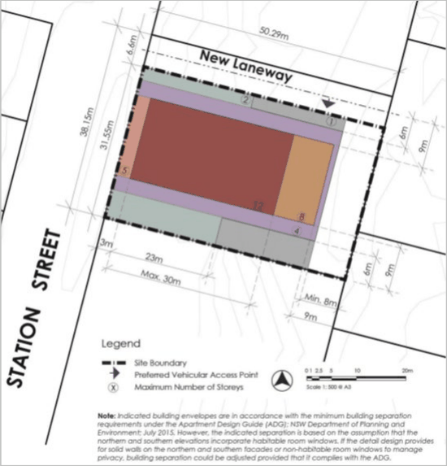

> [Picture on page 348: a picture, saved as a picture (images/part-f2-business-site-specific-page-348-14.gif, 150 dpi).]

Figure 10: Building height

### 3.8 Awnings and canopies

#### Objectives

Increase pedestrian amenity by the provision of weather protection.

Visually unify the Centre.

#### Controls

Awnings are to be provided to the full extent of Station street frontage.

Awning along Station Street shall be minimum 3m deep (Refer Figure 11).

Explore possibility of incorporating glazing/transparent material in the awning to allow

solar access.

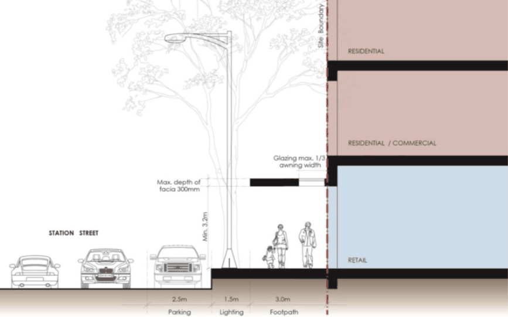

> [Picture on page 349: a picture, saved as a picture (images/part-f2-business-site-specific-page-349-3.gif, 150 dpi).]

Figure 11: Public domain interface - Station Street

### 3.9 Building separation

#### Objectives

Allow solar access to buildings and communal areas.

Provide visual privacy between buildings.

Provide outlook from buildings.

Provide a visual break between buildings and reduce to the perceived bulk and scale of

the built environment.

#### Controls

Provide building separation in accordance with the ADG.

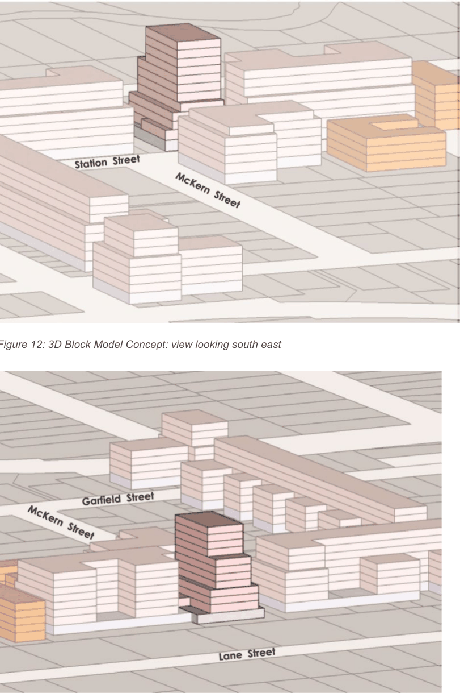

> [Picture on page 350: a picture, saved as a picture (images/part-f2-business-site-specific-page-350-1.gif, 150 dpi).]

Figure 12: 3D Block Model Concept: view looking south east

Figure 13: 3D Block Model Concept: view looking north west

### 3.10 Site planning

Topography and building interface

#### Objectives

Ensure that buildings are connected to the street.

Ensure that building entry contributes positively to the streetscape and public domain.

Address level changes across street frontages, and between adjoining properties.

Reduce the impact of site levelling on adjacent properties, and future site development

opportunities.

#### Controls

Level changes across sites are to be resolved within the building footprint:

• where buildings are built to the street boundary, a level transition must be provided

between the building and the adjacent footpath. This level must be maintained for a

minimum depth of 10m into the building;

• an accessible path of travel is to be provided from the street through the main entry

door of the building;

• where necessary, stairs and ramps are to be integrated with the landscape design;

and

• the maximum height of retaining walls within the rear setback is not to exceed 1.2m.

### 3.11 Site facilities

Site facilities include loading areas, garbage areas, mail boxes, external storage areas, courier/service

entries, and residential clothes drying facilities. Site facilities are to be considered at an early stage of design development. This ensures that the impact

of necessary site facilities on the public domain and adjacent properties can be minimised.

#### Objectives

Provide appropriate site facilities for retail, commercial and residential uses.

Minimise the impact of site facilities on the streetscape and public domain.

Provide adequate garbage and recycling areas to all developments.

#### Control

Please refer to Part C and G8 of this DCP for specific controls.

### 3.12 On-site parking

#### Objectives

Encourage more sustainable forms of movement such as public transport, car-sharing,

walking and cycling for all trips.

Encourage pedestrian activity.

Minimise visual impact of car parking on street and adjoining sites.

Provide resident and visitor car parking rates in accordance with those car parking rates

as required under SEPP65.

#### Controls

Provide car parking for the commercial/retail premises at the rate of 1 space per 50m2

of gross lettable floor space in accordance with the Wentworthville Centre Planning and

Place Making Strategy.

Provide residential car parking at the rate specified in SEPP65, and in accordance with

the Guide to Traffic Generating Developments (Roads and Maritime Services) or

otherwise specified document.

Lockable on-site bicycle parking is to be provided for residential and non-residential

uses.

Basement parking should be located directly under building footprint to maximise

opportunities for deep soil planting unless the structure can be designed to support

mature plants and deep root plants.

Along active frontage, basement parking must be located fully below the level of the

footpath.

### 3.13 Landscaping

#### Objectives

Create a high quality and appealing streetscape on Station Street that includes provision

of street trees (plantings).

Protect the amenity of adjacent properties through provision of a landscape (vegetation)

transition that will provide privacy, a visual and noise interruption between, and improve

the interface between the site and the adjacent lower scale and density properties to

the east.

#### Controls

The land within the rear setback is to include landscaping and deep soil planting. This

landscaping is to have a width of min. 8m measured from the rear property boundary.

The rear setback area is to be landscaped using native planting. It should include a

diverse selection of locally indigenous plant species which are robust and drought-

tolerant.

### 3.14 Environmental performance

#### Objectives

Reduce environmental impact over the life cycle of a building.

Reduce the necessity for mechanical heating and cooling.

Enhance local biodiversity through the planting of diverse native plant species.

Encourage the ‘greening’ of the site through vegetation planting of the buildings external

areas including rooftop.

Promote renewable energy initiatives.

#### Controls

Ensure rain water is captured, stored and used for non-potable uses such as irrigation

of landscaping.

Native planting to be incorporated in on-site landscaping.

Where possible, incorporate a dual water system that recycles grey water for toilet

flushing and car washing.

Consideration should be given to utilising roof space for developing roof gardens (green

roof).

Where appropriate biowalls (green walls) should be incorporated in the design of

buildings.

### 3.15 Roof garden (green roof) + biowall (green wall)

#### Objectives

Add insulation to the façade.

Act as bio-filters and reduce the rate of stormwater runoff.

Reduce the destruction caused by UV rays, as well as be an aesthetic feature.

#### Controls

Provide a green and/or community garden on the roof of the building (Refer to Figure

14).

Where possible incorporate exterior and interior green walls (Refer to Figure 15).

The design of the green roof is to:

• allow for access and ease of movement from with the development and from the

roof garden; and

• minimise overlooking of neighbouring properties through use of passive screening

or planting.

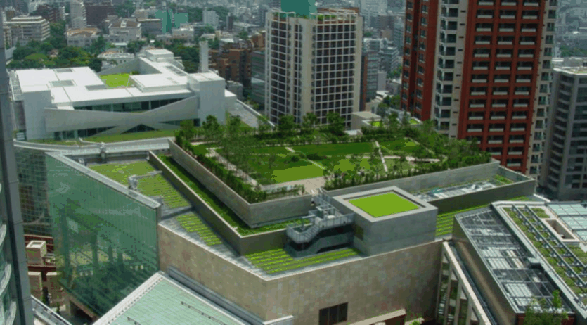

> [Picture on page 354: a picture, saved as a picture (images/part-f2-business-site-specific-page-354-1.gif, 150 dpi).]

Figure 14: Roof garden (source: www.pinterest.com)

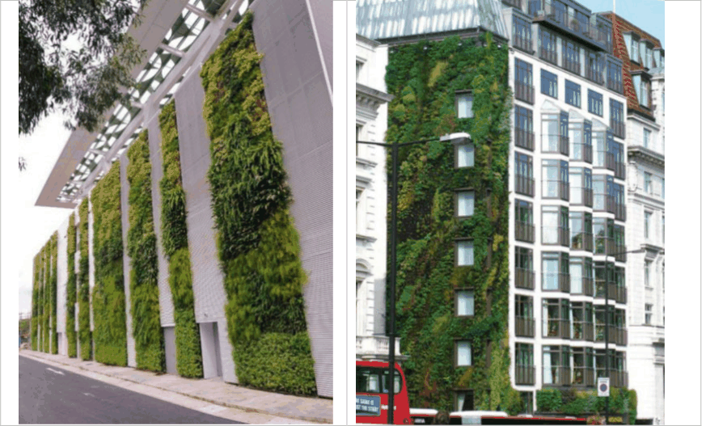

> [Picture on page 354: a picture, saved as a picture (images/part-f2-business-site-specific-page-354-3.gif, 150 dpi).]

Figure 15: Biowall (green wall) (source: www.pinterest.com)
