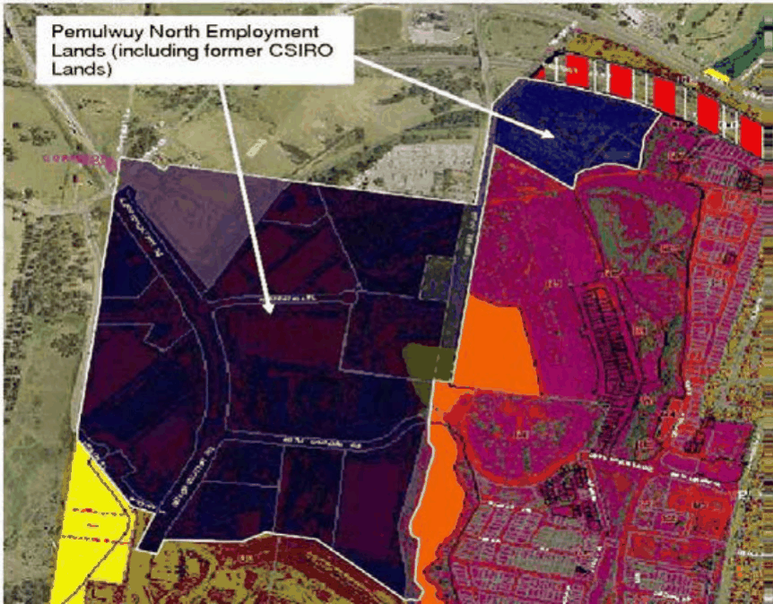
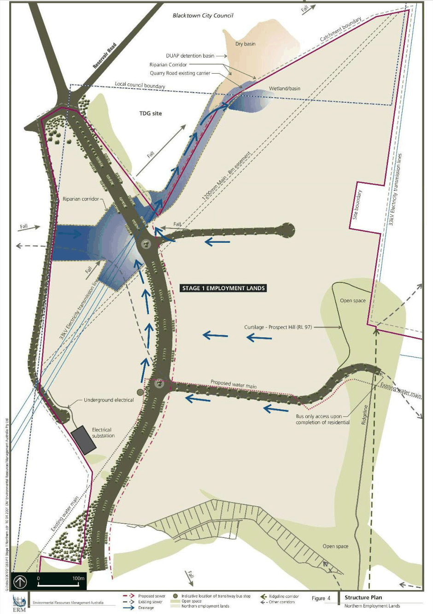
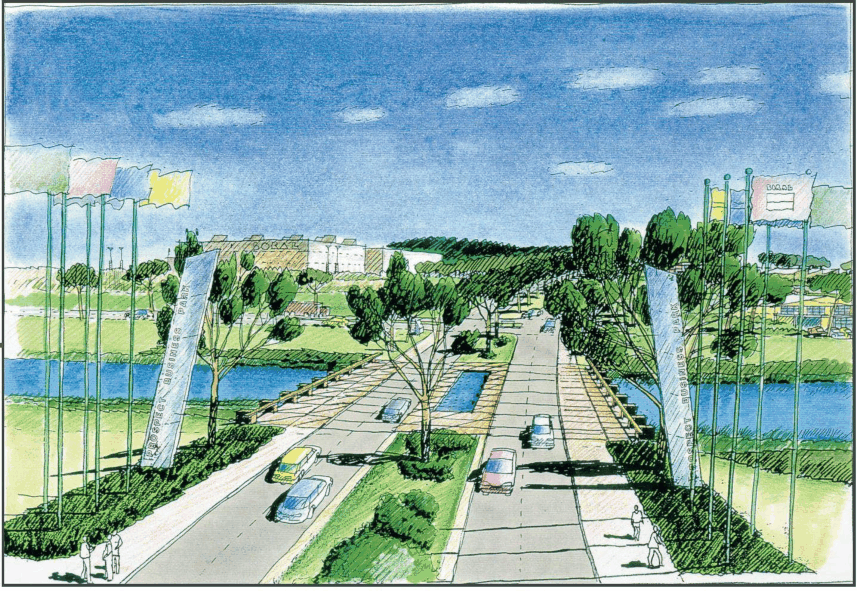
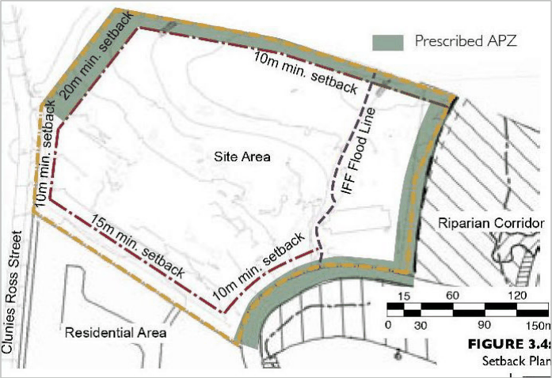
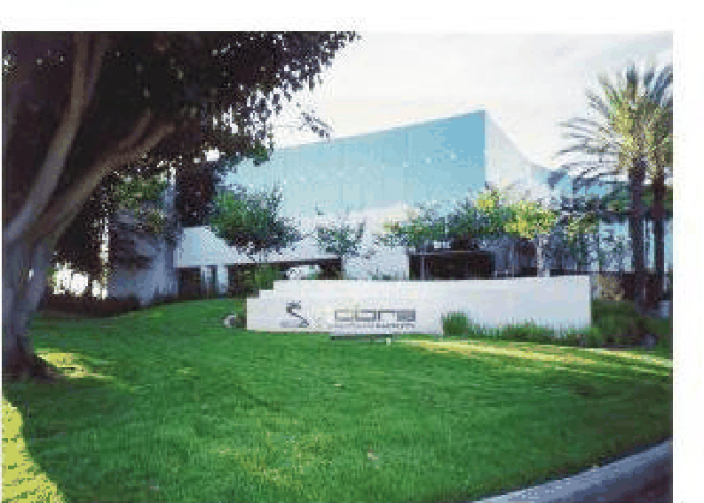
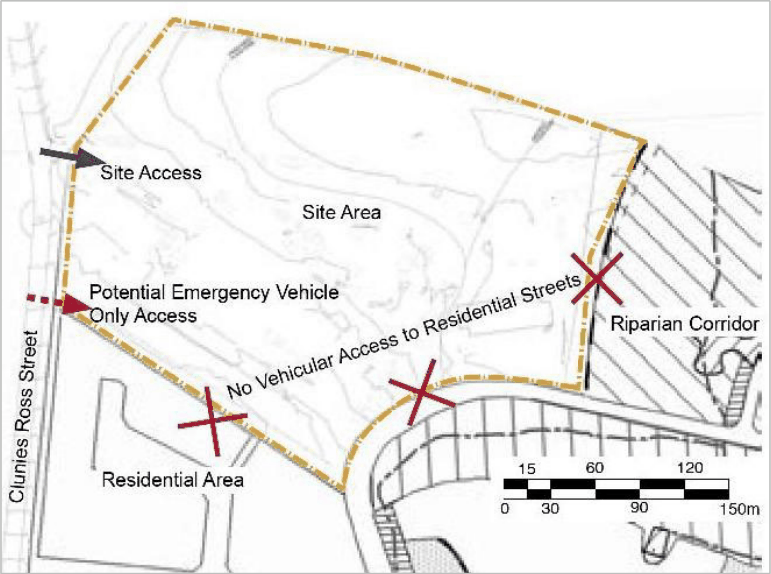
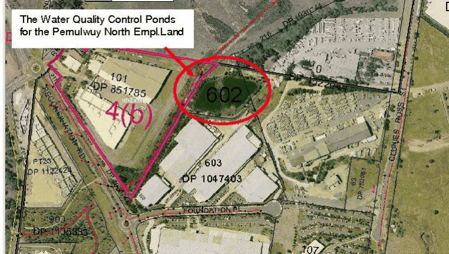
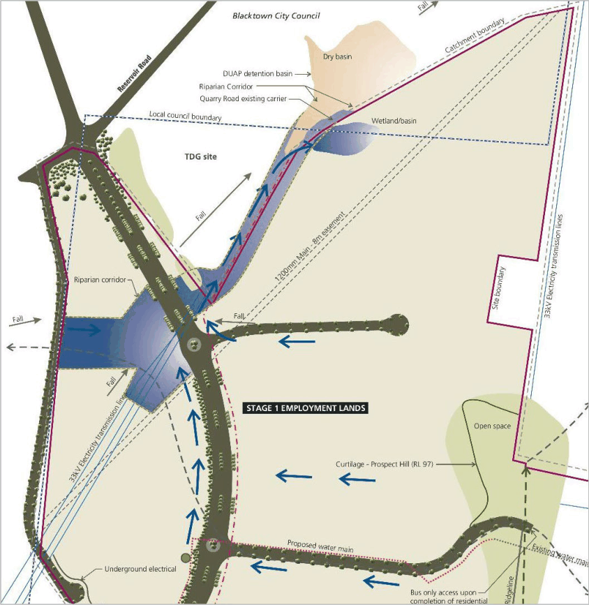
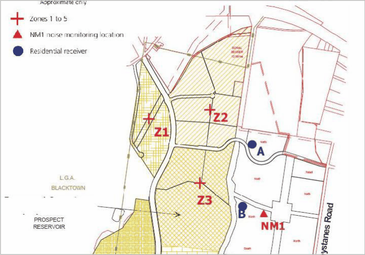
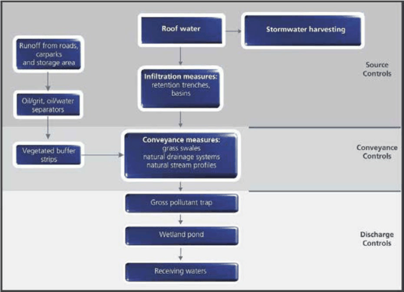

### PART F3-1

### PEMULWUY NORTHERN

### EMPLOYMENT LANDS

This page has been left intentionally blank.

## 1. Introduction

### 1.1 Land to which this Part applies

This Part relates only to the Pemulwuy North Employment Lands, the land shown in Figure 1.

The entirety of the site is within Cumberland City. This DCP does not apply to the whole of the

Greystanes Precinct that was defined in the State Environmental Planning Policy No. 59 -

Central Western Sydney Economic and Employment Area (SEPP 59). Lands not included are:

the residential land within Pemulwuy, parts of the Employment Lands in Blacktown LGA, and

the ‘Greystanes Southern Employment Lands’ (as defined by the 20/07/2007 Part 3A

Determination). Also, the southeast boundary of the former CSIRO lands has been redefined

to reflect the landowners’ intended uses for the lands here. Therefore, this Section of the DCP

applies only to some of the employment component of the Greystanes Precinct that was defined

in SEPP 59. It also includes the north-west corner industrial land (Lot 101 DP 851785l, Lot 9

DP 374325 and public road reserve) originally excluded from SEPP 59. It also includes the

eastern half of Clunies Ross Street linking the two industrial lands, as this is part of the WSEA

SEPP 2009 land.

> [Picture on page 8: a picture, saved as a picture (images/part-f3-industrial-site-specific-page-8-16.gif, 150 dpi).]

Figure 1: Land application map - Pemulwuy Northern Industrial lands

### 1.2 Relationship to other Plans

State Environmental Planning Policy No. 59 - Central Western Sydney Economic and

Employment Area (SEPP 59) was gazetted In February 1999, and applied to a number of

landholdings in Western Sydney including the Greystanes Estate. The SEPP rezoned the

Greystanes Estate for urban development including employment generating and residential

land uses and establishes the planning framework for the development of the land. As a result of to the gazettal of the State Environmental Planning Policy (Western Sydney

Employment Area) 2009 (WSEA SEPP) on Friday 21 August, 2009, control of the Employment

Lands of SEPP59 was transferred to the WSEA SEPP. Most of the land that is the subject of

this section of the DCP is controlled by the WSEA SEPP. As required now under clause Part 4 (Development control plans) of the WSEA SEPP, prior to

the lodgement of a development application for the site, the owner or Council needs to prepare

a Development Control Plan for the site pursuant to section 80 (11) of the EP&A Act and

consistent with the issues of consideration in Schedule 4 of the WSEA SEPP (Requirements

relating to preparation and content of development control plans), and then have it determined

(approved) by the Director-General of the Department of Planning. This Part of the Cumberland DCP 2021 provides guidance on specific development matters

pertinent to the land defined in Section 1.1 above, and is consistent with Schedule 4 of the

WSEA SEPP. Infrastructure services are not addressed by this DCP, having been provided

prior to the adoption of this control. Where this Part does not provide guidance on specific development matters, reference shall be

made to other Parts, such as Part A, Part C, Part D, Part G and Council Codes and Policies.

The objectives and controls of these Parts will be considered in the determination of the

Development Application. Where there is an inconsistency between this Part and Part A or D,

this Part should take precedence. Historically, this Part was amalgamated from relevant sections of two Precinct Plans:

• Former CSIRO Site Pemulwuy Employment Lands; and

• Greystanes Estate SEPP 59 Residential Lands. These Precinct Plans continue to apply to the subject land of Pemulwuy, except where there is

an inconsistency between this Development Control Plan and these Precinct Plans, in which

case this DCP prevails to the extent of the inconsistency. Note: Lot 63 DP 752051, on the western side of Clunies Ross Street, Pemulwuy, was formerly

part of the SEPP 59 land, though it had not been included in the Greystanes Estate Precinct

Plan.

## 2. Objectives and controls

### 2.1 General

#### Objectives

Achieve the principles of ESD through:

• provision of a range of new employment opportunities;

• efficient re-use of degraded land;

• proximity of local employment to workforce and the consequent benefits to the

community such as reduced travel time, promotion of healthy lifestyles, reduced

expenditure for transport;

• energy efficient design of employment developments;

• provision of public transport networks;

• implementation of sustainable practices, where practicable e.g. water efficiency and

conservation measures to reduce water consumption, maintenance or improvement

of water quality through a catchment management approach to the site and the

control and minimisation of air pollutant emissions;

• efficient use of land to minimise urban growth and better utilise existing

infrastructure;

• promoting the use of appropriate and renewable source materials;

• maintaining and enhancing the significant vegetation and habitat and protecting

threatened ecological communities; and

• recognising and integrating significant cultural and archaeological features/aspects. Continue existing employment;

Offer new job opportunities in Western Sydney. The accessibility of the site to a regional

road and public transport network will assist in attracting new employment generating

industries.

Provide within the public domain of the Pemulwuy north employment lands:

• riparian corridor;

• water bodies;

• paths and cycleways; and

• roads. Design these areas so as to create a unique setting and encourage development

throughout the Estate.

Note: For a vision of Residential Pemulwuy, see Part F1 – Site Specific Controls.

### 2.2 Public domain and open space

#### 2.2.1 Open space

#### Objectives

Protect scenic values and ridge skyline.

Create an integrated open space system that is safe, visually attractive, environmentally

sustainable, manageable and flexible to cater for changing community needs.

Retain significant vegetation bands and corridors including the dominant north-south

wooded ridgeline.

Rehabilitate existing quarry batters to provide a vegetated setting for employment lands.

Create a major northern gateway to the employment lands of high quality landscape

that reflects the character of the entire employment area.

#### Controls

C1. Provide open space generally in accordance with the development concept set out in

Figure 2. The public domain should comprise: riparian corridor, water bodies, paths and

cycleways, and roads. The treatment of these areas will be important in creating a

unique setting and encouraging development throughout the Estate. These areas are

to be reflected in subsequent development applications for the site, and maintained as

such.

C2. Open space areas may be used for stormwater detention purposes.

C3. Open space may include elements of the natural environment and provide for active

and passive recreation.

C4. Retain and reinforce existing vegetation patterns through the Open space landscaping

within public domain areas.

C5. On the north-south wooded ridgeline, replace the pine plantation with new locally

indigenous planting to protect the skyline.

C6. Provide a cross site link to allow for connection between Greystanes and Prospect

Reservoir.

C7. Provide pedestrian and cycle systems through the riparian corridor where possible,

designed to minimise the impact on the ecology of the riparian corridor.

C8. Design accessible open space corridors to ensure the safety of pedestrians and cyclists

using the corridors as thoroughfares.

C9. Maintain and vegetate the riparian corridor in accordance with the agreement with the

relevant State authority and to the satisfaction of Cumberland City Council.

C10. Create a major northern gateway to the employment lands of high quality landscape

that reflects the character of the entire employment area, as shown in Figure 2.

C11. Provide a linear open space area with water elements, landscaped areas and suitably

designed signage, bridge, lighting and pavements to evoke the character and theme of

a quality industrial park.

C12. Along the eastern ridgeline, plant to reinforce the topographical bounds of the

employment area.

> [Picture on page 12: a picture, saved as a picture (images/part-f3-industrial-site-specific-page-12-1.gif, 150 dpi).]

Figure 2: Open space concept plan

#### 2.2.2 Pedestrian and cyclist facilities

#### Objectives

Provide a convenient access to the employment precinct.

Encourage walking and cycling by providing safe, convenient and legible routes to

points of attraction within and beyond the suburb.

Provide open space permeability through development precincts.

Link the existing Greystanes community with new development precincts.

Utilise natural drainage systems and vegetation corridors as open space links.

#### Controls

C1. Construct pedestrian footpaths generally as part of the normal street network, other than

paths in open space corridors.

C2. Ensure that development applications that relate to the cycle network and pedestrian

link the site facilities to the off-site facilities The cycle network is a combination of on

street, dedicated street lanes, shared paths (parks and streets) and dedicated paths

(parks) that link the main points of attraction, particularly the residential and employment

areas and village centre with the open space network including the Prospect Canal

linear park and Hyland Park.

C3. Provide key pedestrian and cycle routes broadly along the alignment shown on Figure

3 below.

C4. Align cycle/foot paths in open space approximately parallel with the park edge streets

wherever possible to take advantage of the street lighting and allow for casual

surveillance by residents and drivers.

C5. Wherever possible and practical, design and construct footpaths or shared paths to be

of appropriate width, longitudinal gradient, sight distance and kerb details to cater for

the likely population and user types, including aged people, people with prams and

wheelchairs, and people with disabilities. Provide a minimum width of 1200mm and

maximum gradient where possible of 15%.

C6. Consider incorporating drainage lines into the open space networks as pedestrian and

cycle paths.

C7. Pedestrian and cyclist access to the north east employment area will be via the main

gate onto Clunies Ross Street.

C8. Pedestrian access to private land should be designed as an integral part of the internal

circulation network.

> [Picture on page 14: a picture, saved as a picture (images/part-f3-industrial-site-specific-page-14-1.gif, 150 dpi).]

Figure 3: Illustration - Entry into employment lands

#### 2.2.3 Entrance treatment

#### Objective

Create distinctive, high quality, landscaped gateways to the Estate.

#### Controls

C1. Establish north and south entry gateways into the northern employment lands along the

spine road to create a distinctive character.

C2. Locate the site entry to the northeast area on Clunies Ross Street and integrate it with

the landscape character.

#### 2.2.4 Street trees and furniture

#### Objective

Establish a character and unifying element through street tree planting and furniture.

#### Controls

C1. Use thematic street tree planting to complement the role of streets. Use different species

for different street types and orientation.

C2. Use a co-ordinated palette of street furniture throughout the Estate.

C3. Ensure that lighting in public areas is of a style, colour and form that is compatible with

the street furniture.

C4. Co-ordinate the spacing of light poles with street trees.

#### 2.2.5 Safety and security

#### Objective

Promote the feeling of safety.

#### Controls

C1. Design buildings to overlook public and communal streets and other public areas to

provide casual surveillance.

C2. Through site planning, buildings, fences, landscaping and other features, clearly define

territory and ownership of all public, common, semi-private and private space.

C3. Provide appropriate lighting to all pedestrian paths between public and shared areas,

parking areas and building entries, and light building entries to provide a sense of

security for both residents and visitors.

C4. Ensure no lighting spills onto or affects the amenity of residential areas.

C5. Use robust materials which are aesthetically pleasing in public or communal spaces.

C6. Ensure pedestrian site access and car parking are:

• clearly defined,

• appropriately lit,

• visible to others and

• provide direct access to buildings from areas likely to be used at night.

C7. Design major pedestrian, cycle and vehicle thoroughfares to:

• minimise opportunities for concealment;

• avoid 'blind' corners;

• maximise casual surveillance; and

• allow 'long distance' sight lines.

C8. Identify major pedestrian, cycle and vehicle thoroughfares, and reinforce them as ‘safe

routes’ through:

• appropriate lighting;

• the potential for casual surveillance;

• minimised opportunities for concealment;

• landscaping which allows long-distance sight lines; and

• avoidance of ‘blind corners’.

C9. Site and design landscape and fencing so they do not present a security risk by

screening doors, windows and major paths.

C10. Provide safety fencing along the ridge line, suitably designed to allow for views and

outlook.

C11. Ensure landscaping maintains view corridors & clear sight lines.

### 2.3 Building and siting requirements

Where this Part of the DCP does not provide guidance on specific development matters,

reference should be made to other Part of the DCP, such as Part G and Part D. Where there is

an inconsistency between this Part and any other Part of this DCP, this Part should take

precedence

#### 2.3.1 Land Uses

#### Objectives

The objectives for and land uses permissible within the Pemulwuy North Employment

Lands are defined by:

• The WSEA SEPP 2009 (in relation to land zoned IN 1 as defined by that SEPP);

and

• The Cumberland Local Environmental Plan 2021 (in relation to land zoned IN 2 and

excluded from Precinct 10 of the Land Application Map of the WSEA SEPP 2009).

#### Controls

C1. Provide a retail service centre catering for the needs of the workforce at a central

location within the employment lands. Locate the centre on a corner allotment facing

the north-south spine road so that it is readily accessible to the local workforce.

C2. Provide recreational and community uses within the employment lands consistent with

the provisions of the Western Sydney Employment Area SEPP 2009.

C3. Ensure open space that provides active and passive recreation for the workforce. Open

space should be readily accessible and well located and should be incorporated within

individual developments as well as along public corridors.

C4. Restrict retail activity on industrial land (having the potential to increase land prices and

effectively push traditional industrial users out, and to threaten the industrial ‘address’

and image).

#### 2.3.2 Lot Sizes and Site Cover

#### Objectives

Achieve a quality industrial park setting and ensure adequate provision is made for

landscaping, parking and manoeuvring areas.

Create site layouts which consider the opportunities and constraints of the site.

#### Controls

C1. Ensure a minimum lot size of 1 hectare, although, a range of lot sizes is anticipated to

meet market demand.

C2. Subdivisions of land should:

• seek to maximise solar access to all parts of the development;

• encourage passive solar design; and

• protect site attributes such as views, existing vegetation and other environmental

features.

C3. Subdivision of land should avoid the creation of battle-axe blocks or long and narrow

blocks at right angles to street frontages.

C4. Maximum site coverage is 60%. Local services including commercial, retail, community

and recreational uses are excluded from this provision given the different design

characteristics of these uses.

C5. “Site area” is defined as the whole of the land to which an application relates and

includes areas set aside for open space, drainage and other services. “Site coverage”

is defined as the area of a site covered by buildings including awnings.

C6. In the layout of the site, design the buildings and landscaping to provide direct,

convenient and safe access to the street for the pedestrians.

C7. On industrial sites, make adequate allowance for manoeuvring and turning of heavy

vehicles on site. In accordance with the Roads and Maritime Service’s Policies,

Guidelines and Procedures for Traffic Generating Developments, apply the design

standard for “large rigid truck”.

C8. Ensure that the width of an industrial allotment at the building line is equal to or greater

than 24m and the average depth is equal to or greater than 45m.

#### 2.3.3 Siting

#### Objectives

Achieve attractive streetscapes.

Provide a quality setting and to allow for landscaped curtilages between buildings and

front property boundaries.

Create setbacks that allow for landscaping and visual amenity.

Provide solar access to sites and adjacent development.

On the former CSIRO lands, to create a consistent streetscape with the residential area

along the Clunies Street frontage.

On the former CSIRO lands, to provide a setback on the southern boundary that allows

for reasonable sunlight access and reduces visual dominance of employment buildings

to the rear of the residential area.

Prescribe Asset Protection Zones (APZs) within the Pemulwuy northern employment

lands for bushfire protection.

#### Controls

C1. Setback buildings to the west of Clunies Ross Street as follows:

• north-south spine road: buildings are to be setback 20 metres from the property

boundary. The first 10 metres is to be landscaped in accordance with the Landscape

section below;

• all other roads: buildings are to be set back 8 metres from the property boundary.

The first 3 metres is to be landscaped in accordance with the Landscape section

below.

C2. Setback buildings within the former CSIRO employment land consistent with Figure 4.

C3. Within the former CSIRO employment land:

• the Eastern Building Setback is the prescribed flood line based on the dam break

Imminent Failure Flood (IFF) line;

• new buildings are not permitted in the IFF zone;

• car parking and like uses are permitted in the IFF zone;

• new buildings are not permitted within the Asset Protection Zone (APZ);

• no new development, including buildings, car parking, fire trails and like activities,

is permitted within the riparian corridor alignment agreed with a State environmental

authority.

C4. The setback controls may be varied where:

• a predominant street building line exists;

• the current setback of buildings is staggered and continuity in street building line

should be maintained;

• there is no obvious street building line and new buildings should align with existing

maximum and minimum building lines of development;

• public domain improvements or environmental benefits such as solar access,

protection of vegetation are achieved; or

• where the building is located on a corner site and a lesser setback is consistent with

streetscape objectives.

C5. Setback buildings 10 metres from any public open space, including riparian reserves,

and 20 metres from Greystanes Creek.

C6. Site and design buildings to allow for casual surveillance of building entrances and the

street.

C7. Site buildings to allow for adequate lines of sight to building entrances, the street and

carpark areas for pedestrians, cyclists and vehicles.

C8. Locate offices to address and activate the street/s. The warehouse/factory functions as

well as car parking, manoeuvring areas, loading and unloading facilities are to be

located within the site.

C9. Through layout of the site, the design of buildings and landscaping, provide direct and

safe access to the street for pedestrians.

C10. Large setbacks with significant car parking in front of buildings are not permitted on the

principal street frontage.

C11. Establish and maintain landscaping within the southern setback of the former CSIRO

employment land.

C12. Site and design buildings so that solar access to staff recreation areas on site and in

adjoining developments is not compromised between 12 noon and 2pm (as measured

at 21 June).

C13. Site buildings to satisfy maintenance, utility and safety requirements.

> [Picture on page 19: a picture, saved as a picture (images/part-f3-industrial-site-specific-page-19-1.gif, 150 dpi).]

Figure 4: Setbacks - Former CSIRO employment land

#### 2.3.4 Solar Access

#### Objectives

Consider mid-winter solar access to the office building areas within the Employment

Land.

Achieve reasonable mid-winter solar access to primary indoor spaces and primary

private open spaces within the residential area to the immediate south of the former

CSIRO employment land.

#### Controls

C1. Design office areas to consider north/south orientation in order to maximise solar access

to the habitable area in midwinter.

C2. Site and design buildings so that solar access to staff recreation areas on site and in

adjoining developments is not compromised between 12 noon and 2pm (as measured

at 21 June).

C3. Within the former CSIRO employment land, ensure that the residential development to

the immediate south of the employment area achieves a minimum 4 hours of direct

sunlight to windows of the north facing living areas between 8.00am and 4.00pm

midwinter, and 3 hours direct sunlight between 9.00am and 3.00pm to 50% of the private

open space in mid-winter.

Note: Accompanying development applications, submit shadow diagrams showing the

effect of shadows on public open space, adjoining properties and outdoor recreation

areas at 9am, 12 noon and 3pm mid-winter.

C4. Where industrial development abuts residential lots or streets, shadow diagrams shall:

• be provided demonstrating the impact on adjoining residential properties or public

domain;

• be based on a survey of the site and adjoining development;

• be at 9.00a.m., 12.00noon and 3.00p.m. at 21st June (private open space); and

• be at 8.00a.m., 12.00noon and 4.00p.m. at 21st June (north facing living areas).

C5. Additionally, ensure height of such industrial development does not exceed (in metres)

the height allowed for the adjoining use along the common boundary, subject to meeting

the controls of overshadowing.

C6. If the existing lot or open space already receives less than 4 hours of sunlight then the

development shall not further reduce this solar access.

#### 2.3.5 Building heights and design

#### Objectives

Ensure buildings do not adversely affect views from the M4, Great Western Highway

and Prospect Reservoir environs to Prospect Hill.

Create building forms with appropriate scale and height, taking into consideration site

topography.

Encourage a high architectural standard of contemporary design and innovation.

Provide for low rise, large scale buildings generally in horizontal form.

Achieve a good quality development which complements the streetscape.

Provide for low rise and large scale building to reduce visual impact to the surrounding

area.

Ensure building heights do not adversely impact on the amenity of adjacent residential

areas.

Ensure the scale and character of the development is compatible with other

employment-generating development in the precinct concerned.

Ensure buildings are compatible with the height, scale, siting and character of existing

residential buildings in the vicinity.

On development adjoining residential land, to store goods, plant, equipment and other

material resulting from the development within a building, or to suitably screen them

from view from residential buildings and associated land.

#### Controls

C1. Ensure that the height and scale of buildings in the Northern Employment area are

sensitive to views from the environs of Prospect Reservoir and the M4 Motorway.

Generally 12 metres is the building height limit in the Northern Employment area. In the

former CSIRO land, building heights shall not exceed 12.2 metres.

C2. In the former CSIRO land, ensure compliance with Part D to protect adjacent residential

amenity.

C3. In the former CSIRO land, new buildings should not exceed the height of RL 63.0 metres

(AHD).

C4. In the former CSIRO land, the height level of buildings at the 15 metre setback line from

the southern boundary, which abuts the residential lands, shall not exceed RL 61.5

metres (AHD).

From this maximum height level, the height of buildings may increase away from the

southern boundary setback to the highest level permitted for the site providing there are

no increased overshadowing effects on the adjoining residential lands.

C5. Ensure the architectural treatment of building facades is directed by energy efficiency

and other environmental design considerations.

C6. Articulate building facades to address all street frontages. Building facades can be

articulated using architectural elements which include:

• variable roofs and skyline silhouettes (for example: saw toothed or pitched roofs

and innovative skillion curved or ‘floating’ roof forms);

• varying façade alignments;

• ‘breaking-up’ facades with windows, changing wall alignments and the use of

decorative features and structural features.

• variation in materials, finishes and colours;

• location, style and quantity of windows;

• blade and fin walls;

• cantilevered or overhanging elements;

• verandahs, terraces, sun shading devices;

• colonnades; or

• variation in height.

C7. Architectural style is to contribute to the quality of the Estate, with emphasis on the

horizontal lines and planes.

C8. Integrate roof top plant and services into building/roof forms or screened and compatible

with the building design. Mobile phone towers are not permitted on tops of buildings

unless integrated into the building/roof design.

C9. Articulate building entries so they are easily identifiable.

C10. Locate service areas including waste/recycling areas and external storage areas away

from principal frontages and adequately screen them from view from any public road.

C11. Locate loading docks, roller shutters and other building openings that detract from the

appearance of the building so they are not visible from the principal street frontage.

C12. Minimise cut and fill to protect existing drainage patterns and maintain integrity of the

groundwater system.

#### 2.3.6 External materials and colours

#### Objective

Contribute to the visual quality of the Pemulwuy northern employment lands through

selection of building materials and colours.

#### Controls

C1. Use materials and colours for buildings and roofs that are subtle (no strong hues),

recessive (mid-tone) and non-reflective.

C2. Create varied facades through choice of external materials, including masonry, metal

panels, CFC panels, metal sheeting for walls and roofs.

C3. Express one predominant external material. The range of external materials on any

individual building should be limited and compatible.

C4. Ensure that dado panels or similar are a minimum height of 2 metres to all external

walls. Construct dado panels of face brick, masonry, or other material that provides a

high standard of finishes.

C5. Pre-colour metal deck roofs in landscape tones.

C6. Use only low maintenance and robust materials.

C7. Minimise variations in colour. Accent colour is acceptable, e.g. for corporate logos and

architectural details.

C8. Ensure that external finishes are graffiti resistant.

Note: Indicate details of external materials and colours on the plans accompanying

development applications.

#### 2.3.7 Energy and water efficiency

#### Objectives

Encourage site planning and building design that optimises site conditions to achieve

energy efficiency.

Design working environments that minimise energy and water use.

Encourage use of building materials that minimise impact on development.

Use passive and active design initiatives that respect the principles of ecological

sustainable development.

Implement sustainable practices, e.g. water efficiency and conservation measures to

reduce water consumption, and the use of solar energy for heating appliances.

Encourage Water Sensitive Urban Design Principles (WSUD) for the new development.

Encourage the use of rainwater tanks for outdoor use and toilet flushing in accordance

with the requirements of Sydney Water;

Encourage the use of permeable paving, wherever possible, to increase water filtration

into the ground.

#### Controls

C1. Ensure all building development (including additions and alterations) complies with the

requirements of the Building Code of Australia (BCA), and relevant reports accompany

applications for construction.

C2. In designing the orientation, internal layout and design of buildings, minimise energy

consumption for heating and cooling. Aspects to consider include:

• light penetration to internal areas;

• natural ventilation;

• passive solar design;

• shading devices to minimise glare; and

• solar access to outdoor recreation areas.

C3. Select building materials which, where feasible:

• use renewable resources;

• are energy efficient;

• are low maintenance;

• are recycled or recyclable;

• are non polluting;

• are non-ozone depleting; and

• avoid where possible the use of PVC.

C4. Install rainwater tanks to provide water for flushing toilets and other non-potable uses.

C5. See Section 2.7.1 below under Stormwater Management for controls for water flow and

quality management during and particularly after development, and for Stormwater

plans to minimise pollutant loads.

C6. Ensure compliance with Part G Water Sensitive Urban Design (WSUD).

#### 2.3.8 Landscaping

Note: “Landscaping” incorporates vegetation, gardens, outdoor staff recreation areas, natural

site features and watercourses, but does not include that part of the site used for driveways,

parking or outdoor storage.

#### Objectives

Encourage a high standard of landscaping to enhance the streetscape and amenity of

the Pemulwuy north employment lands.

Accommodate outdoor staff areas.

Provide for retention of water for irrigation and drainage purposes.

On sites adjacent to the open space corridors, to select species to complement the plant

species in the corridors.

Screen the interface to the adjacent residential uses.

Soften the impact of built form and car parking areas.

#### Controls

C1. Design the landscape of both hard and soft landscape features to create a quality

industrial park setting. Hard landscape features include paving, terracing, retaining walls

and kerbing. Soft landscape features refer to vegetation (including grass, shrubs and

trees).

C2. Within the landscape masterplan, identify existing waterbodies, creeks and creeklines

on the site and provide for protection and rehabilitation of riparian zones within the site.

C3. Design landscaping to visually unify and enhance the overall quality of the Pemulwuy

north employment lands.

C4. Provide outdoor amenity/recreation facilities for employees within the landscaped areas,

to meet the likely needs of the workforce.

C5. Protect existing significant trees and incorporate them into the design.

C6. Provide landscaping as both hard and soft areas. However, provide and maintain

approximately 15% of a site as soft landscaped area at ground level. The location of the

landscaped areas will be determined at the development application stage having

regard to meeting the criteria contained in this section. Landscaping design of both hard

and soft landscape features should create a unified setting.

C7. Where feasible, drain hard stand areas to soft landscaping areas to improve on-site

infiltration of stormwater.

C8. Provide non-slip finishes to paving.

C9. Design landscaping to complement the buildings on site, the adjoining developments

and streetscape, and to be compatible in scale.

C10. Separate landscaped areas from vehicle areas with an effective physical barrier.

C11. In the former CSIRO land, where a site adjoins a non- industrial use, provide a mature

planting buffer and secondary acoustic fence within the industrial lot within the side and

rear setbacks. Adequate acoustic buffers are required so that any impact is minimised.

C12. Plant local indigenous species with mulched beds to help improve water quality and

reduce water consumption.

C13. Plant to highlight pedestrian and vehicular access points and building entries.

C14. Landscape informally to promote parkland quality. Structured treatment may be used to

enhance entries, etc.

C15. Provide earth mounding in the landscaped setback along the north-south spine road.

Embankments should be no steeper than 1:4 gradient in order to enable vegetation to

be grown and maintained.

C16. Landscape carparks to complement the surrounding landscaped areas, soften car

parking areas and provide shade for parked cars. Plant a minimum of one tree for every

four car parking spaces. Provide landscaping around the perimeter of carpark areas.

C17. In open parking areas, plant 1 shade tree per 4 cars within or around the parking areas,

except in the instance of central carpark divides (see Part D of this DCP).

C18. Install automatic irrigation systems for all landscaped areas on the developed lots.

Design them to meet specific site requirements. Consider minimising water consumption

and preventing salinity in the design of landscaping and irrigation systems; prefer

irrigation systems that monitor soil moisture conditions.

C19. Install a drip irrigation system to all soft landscaped areas to reduce water use. Connect

this system to rainwater storage tanks where possible.

C20. Design landscaping to assist energy conservation in buildings and have regard to

microclimatic conditions and shading control.

C21. Design landscaping to encourage safety by ensuring street surveillance is possible,

paths are not excessively screened, and lighting is provided to pathways and building

entries.

C22. Design landscaping and setbacks to create an environment that encourages walking

and the pedestrian use of public streets.

C23. Submit a separate landscape masterplan with the first application received to subdivide

land in each stage of the development. Requirements for subdivision include:

• details of landscape concepts including thematic street planting, lighting and street

furniture proposals to guide future development;

• proposals for entry gateways in the north and south as appropriate;

• identification of existing and proposed open space and vegetation corridors

including riparian land, drainage corridors, stormwater detention ponds;

• identification of existing natural features such as waterbodies and creeklines;

• reference to and consistency with any relevant bushland management plan;

• location and extent of pedestrian and cycleway networks; and

• demonstrate provisions for linkages of the above facilities to facilities on adjoining

land.

#### 2.3.9 Signage

The purpose of this section is to establish Council’s specific objectives and development

controls for the provisions of signage in the Cumberland City LGA. This section should be read

in conjunction with State Environmental Planning Policy No. 64 Advertising and Signage (SEPP

64). For the purposes of this section, signage has the same meaning as defined in SEPP 64

(or equivalent):

• advertisement;

• business identification sign; and

• building identification sign. Any application to which this section applies must also consider Council’s large display

advertising policy.

#### Objectives

Encourage signage that contributes to the aesthetic integrity of the Pemulwuy north

employment lands.

Ensure signage does not detract from the visual appearance of the buildings and

locality.

Provide the opportunity for an approved use to adequately state the nature of the

business conducted on the premises.

Regulate signage so that it contributes to the identity of the site.

Ensure signage does not compromise the safety of the M4 user.

Ensure illuminated signs do not unduly affect the amenity of the surrounding areas or

interfere with driver’s vision.

#### Controls

C1. Relate advertising, other than real estate signs, to the use occurring on the respective

property. i.e.: to serve only to identify the occupants of the premises.

C2. Locate directional and tenancy signage in a convenient point close to the main entry to

a development.

C3. Locate signs below parapet level.

C4. Moving, blinking or flashing signs are prohibited.

C5. Incorporate signage into the architectural elements of the building of a size, shape and

colour that does not detract from the architectural character of the building.

C6. Where council has a fixed building line, advertisements will generally not be permitted

between the building line and street alignment. Council will consider allowing business

identification signs that serve only to identify the occupants of the premises, within the

building line, provided they comply with the standards set out below. Council will also

consider advertisements in the form of logos and trademarks, where they are

incorporated into landscaping design.

C7. Provide no more than one wall sign per occupancy, on the facade of the unit with which

that occupancy is associated. The sizes and dimensions of such signage shall have

regard to existing signage on other units, and dimensions of 2m x 1m are permitted

without consent.

C8. Where there is only one occupant for an entire building, provide no more than one wall

sign per building facade.

C9. Directory boards are to be comprised of not more than one (1) panel per unit. Each

panel is:

• to be uniform in size, colour and dimensions;

• not to exceed 0.2 square metres per panel; and

• to serve only to identify the number of the unit and the name of the respective

occupant.

C10. Locate the directory board on or behind the building line setback adjacent to the

entrance to the site, unless with the prior consent of Council. Where the directory board

is proposed to be located within the building line setback incorporate it into the

landscaping to Council’s satisfaction.

C11. Ensure that signage is easily readable.

C12. Locate and display illuminated signs in a manner that does not cause glare, distract

drivers or adversely impact on the amenity of nearby residences.

> [Picture on page 27: a picture, saved as a picture (images/part-f3-industrial-site-specific-page-27-1.gif, 150 dpi).]

Figure 5: Example of tenancy signage

#### 2.3.10 Fencing

#### Objectives

Allow for security in the Pemulwuy north employment lands.

Ensure that the design of fencing contributes to the streetscape and amenity of the

Pemulwuy north employment lands.

Provide for the amenity of adjacent residential land.

#### Controls

C1. Avoid fencing between the building and the principal street frontage, where possible.

C2. Where fencing is required for safety or security reasons to be forward of the building

line, ensure that it is of a standard and style that does not detract from the landscaping

and main building facades. Pre-painted solid metal fencing will generally not be

acceptable. Provide details of fencing at the development application stage.

C3. Locate fencing so it does not impede sight lines for drivers.

C4. Ensure that fencing complements all landscaping to minimise visual impacts to the

adjacent residential areas whilst providing site security.

C5. Restrict fences fronting Clunies Ross Street to a height of 1 metre above natural ground

level.

C6. Within the Pemulwuy north employment lands, open form front fences to a height of 1.8

metres will be considered having regard to the presentation and design of the fence;

C7. Use graffiti-resistant materials and finishes on fencing.

#### 2.3.11 Exempt and complying development

See Part 5 (General Commercial and Industrial Code) of the State Environmental Planning

Policy (Exempt and Complying Development Codes) 2008. This SEPP controls certain

Commercial and Industrial development with respect to:

• internal alteration to a building that is used as bulky goods premises, commercial

premises, premises for light industry or a warehouse or distribution centre; or

• change of use of [Commercial and Industrial] premises;

• mechanical ventilation systems;

• shop front and awning alterations; and

• skylights and roof windows. Part 1 of the SEPP defines the general requirements for exempt and complying development

for Commercial and Industrial purposes. Part 2 controls general exemptions such as Access ramps, Bollards, Demolition, Minor building

alterations, Privacy screens, Scaffolding, hoardings and temporary construction site fences,

Replacement of identification signs, Temporary builders’ structures, and Water features and

ponds.

### 2.4 Transport

#### 2.4.1 Principles for a Transport Plan

Guiding principles and performance targets for the establishment of a transportation system for

Pemulwuy were based on SEPP 59 (State Environmental Planning Policy No. 59 – Central

Western Sydney Economic and Employment Area). These principles have guided the precinct

plans on which this DCP is based. With the transferral of much of the land to which this DCP

applies to the State Environmental Planning Policy (Western Sydney Employment Area) 2009

(WSEA SEPP), the “existing precinct plans” (upon which this section of the DCP is based)

continue to apply in determining a development application. Note: see clause 26 (Development on or in vicinity of proposed transport infrastructure routes)

of the WSEA SEPP.

#### Objectives

Address transport targets.

Establish guiding principles for design and layout of the site consistent with increasing

the mode split towards public transport and non private vehicle usage and minimise

vehicle kilometres travelled (VKTs).

Provide for all modes of transport, including roads, transit ways, walking and cycling

facilities, which are integrated into the surrounding network of each mode.

Identify a range of transport infrastructure which addresses site requirements including

the staging and funding proposals.

Identify links to the Transitway network outlined by Action for Transport 2010.

Recognise freight and industry transport requirements including:

• linkages from the site to the M4 Motorway; and

• initiatives for integrating freight handling between industries.

#### Controls

C1. Reduce the mode split of 'car as driver' for the journey to work by at least 10% (e.g. from

75% to 65%) compared to the existing surrounding area.

C2. Reduce the total VKT (vehicle kilometres travelled) to be generated by the proposed

development by at least 5% below that which would be generated by a 'conventional'

approach to development”.

#### 2.4.2 Regional transport requirements

#### Objectives

Provide regional transport infrastructure which will achieve the transport targets

established in clause 2.4.1.

Develop regional transport infrastructure that will service the needs of the site and

integrate into an improved regional transport network.

Provide infrastructure which recognises the need to integrate all modes of transport

including public transport, private vehicle transport, walking and cycling.

Develop measures to mitigate potential adverse transport impacts generated by the

development of Pemulwuy on surrounding areas.

#### Controls

C1. Provide regional (and local) transport infrastructure improvements that are consistent

with the Deeds of Agreement between the owners and the Roads and Maritime

Services.

#### 2.4.3 Transport design guidelines – land use location

#### Objectives

Generate efficient travel patterns across the site to reduce VKTs.

Maximise the use and support the viability of public transport services.

Avoid potential conflicts between various land uses.

#### Controls

C1. Locate higher traffic generating land (office, retail) uses in close proximity (within 400

metres, walking distance) to public transport stops, nodes or interchanges on regional

transport routes (such as the transitway) to reduce traffic generation and improve public

transport usage and service viability.

C2. Provide appropriate and conveniently located services such as shops and open space

to reduce trip length and encourage use of pedestrian / cycleway networks.

C3. Ensure that land uses are well integrated with public transport stops, nodes and

interchanges so as to provide safe, attractive and inviting environments for public

transport patrons.

C4. Separate residential and employment precincts to avoid potential road function conflicts.

C5. Favour co-locating similar or co-dependent employment developments within close

proximity in order to generate potential synergies in transport and freight, so as to:

• maximise simultaneous servicing by one vehicle thereby reducing the number of

trips entering and leaving the site;

• improve trip containment levels within the site; and

• manage travel demand. The location of co-dependent developments is primarily

market driven. However, the marketing and sales promotion strategies employed

can have a significant impact on the type of land uses attached to the development

site and should be employed as a travel demand management tool.

#### 2.4.4 Access and circulation

#### Objectives

Ensure safe access movements to/from the Pemulwuy north employment area.

Provide access through the employment area to improve the regional road network.

Provide access to the employment area for employment land uses which minimise

impacts on the surrounding local community.

Construct roads in such a way to accommodate the anticipated traffic volumes and in

particular heavy vehicles. For example, to ensure that road access facilities are

commensurate with the scale and extent of the proposed development and compatible

with the surrounding traffic network.

Provide a 50 metre road reserve which allows for the future provision of a 25 metre wide

transitway by the RMS.

Minimise potential conflict between street traffic and pedestrians caused by the

vehicular movements to and from the site.

Minimise potential conflict between service vehicle (heavy vehicle) with smaller vehicle.

#### Controls

C1. Ensure that intersections into the Pemulwuy north employment lands are designed with

sound traffic planning principles and relevant guidelines including but not limited to:

• Roads and Maritime Services’ Road Design Guide;

• Roads and Maritime Services’ Guide to Traffic Generating Development (1993);

• AUSTROAD - Guide to Traffic Engineering Practice; and

• while ensuring that walking and cycling are encouraged and not impeded.

C2. Direct property access to north-south link will not be permitted other than in

circumstances stated below.

C3. The number of road access points to the north-south link is restricted, and at full

development no direct property access from the north-south link will be permitted.

Provide access from a limited number of service roads and separate the intersections

by a minimum distance of 500 metres. Therefore, there are only two service road

intersections with the north-south link between the northern boundary and Butu Wargun

Drive.

C4. Direct property access from the north-south spine road, is only permitted as an interim

arrangement during the staged construction of the development. Direct access to

properties north of Butu Wargun Drive is permitted until the north-south spine road is

constructed to the southern boundary of Pemulwuy north employment lands.

C5. Provide the north-south link through the employment precinct so that direct and efficient

access for freight and other heavy vehicles is provided to employment lots from the

regional road network.

C6. Ensure site access allows vehicles to enter and exit in a forward direction

C7. Within the former CSIRO employment land, ensure vehicular access to and from the

site is via Clunies Ross Street only, as illustrated in Figure 6. Direct vehicular access to

the residential land is not permitted.

C8. Within the former CSIRO employment land, provide a potential access point at the

southern end of site boundary to Clunies Ross Street for emergency vehicles, as

illustrated in Figure 6.

C9. Within the former CSIRO employment land, ensure that emergency Access for fire

appliances has a minimum width of 6m with 7m passing bays and internal radius of 6m

for corners.

C10. Within the former CSIRO employment land, ensure driveway width, configuration and

location shall accord with ‘Roads and Maritime Services’ Guide to Traffic Generating

Development (1993) and Australian Standard AS 2890.1: 2004.

C11. Within the former CSIRO employment land, position access to Clunies Ross Street as

far as practicable, to minimised impacts to adjoining residential development. Locate

the driveway as far north as practicable having regard to sight lines along Clunies Ross

Street.

C12. Design internal circulation road and heavy vehicle manoeuvring areas to comply with

the requirements of the following:

• AS2890.1-2004;

• AS2890.2-2002; and

• NSWB Guidelines for Emergency Vehicle Access.

> [Picture on page 32: a picture, saved as a picture (images/part-f3-industrial-site-specific-page-32-1.gif, 150 dpi).]

Figure 6: Site access within the former CSIRO Employment land

#### 2.4.5 Parking

#### Objectives

Encourage a reduction in the level of vehicular traffic by reducing parking requirements.

Ensure adequate parking for various land uses and sustain the market viability of the

development.

Ensure that all car parking demands generated by any development are accommodated

on the development site.

Design parking supply in accordance with the site’s urban design principles. Thus, to:

• ensure that the provision of off street car parking facilities does not detract from the

visual character, particularly the streetscape of an area; and

• ensure that the location of driveways, parking and servicing areas are efficient, safe

and suitably landscaped. Implement parking strategies which minimise adverse impacts on local communities and

wider land uses. For example, to minimise conflict between service vehicles (heavy

vehicles) and smaller vehicles within the site.

#### Controls

On-Street Parking C1. Note that the provisions of on-street parking for various road types within the road

hierarchy are summarised below in Section 2.4.7, which indicates that on-street parking

would be appropriate on some roads with the exception of the north-south spine road

and the first 500 metres of the east-west link from Greystanes Road.

C2. Design on-street parking to be consistent with the design principles and dimensional

requirements of Australian Standards AS2890.5 and 1742.11.

C3. In the provision of on-street parking, do not compromise street security and urban

design / streetscape objectives.

Off-Street Parking Design C4. Design off-street parking to be consistent with the design principles and dimensional

requirements of Australian Standards AS2890.1: 2004. Include in the design,

compliance with driveway dimensions and location, sight distances, and dimensions for

circulation aisles and grade / ramps.

C5. Design off-street parking to ensure that vehicles are able to efficiently access parking

spaces within minimal manoeuvring.

C6. Suitably landscape off-street parking areas to minimise visual dominance.

Off-Street Parking Supply C7. Note that the parking requirements of developments within the Pemulwuy north

employment lands are assessed on a site-by-site basis due to the varying parking

demands of particular land uses.

C8. Use Part G clause 3.8 (Parking and Vehicular Access) of this DCP as the appropriate

guidelines for the supply of off-street parking. However, consider these guidelines as

maximum provisions rather than minimum provisions, as a means of encouraging public

transport use (dependent upon provision of public transport).

C9. Minimise off-street parking supply, having regard to:

• access to public transport (located within 400 metres);

• likely employee usage of pedestrian and cycleway links to the employment precinct;

• surveys of existing similar developments indicate a lower parking demand;

• land use synergies with surrounding land uses;

• the ability to manage the use of on street parking; and

• complimentary/shared use of parking facilities.

#### 2.4.6 Service areas

#### Objectives

Provide adequate access for heavy vehicles.

Design road networks to minimise freight and heavy vehicle movements through the

employment zones.

Create separation between service areas (loading and unloading docks) and parking in

order to avoid traffic congestion;

Ensure that service areas are located and designed to facilitate convenient and safe

usage.

#### Controls

C1. Position loading/unloading facilities so they:

• do not interfere with visitor and employee parking spaces;

• minimise any potential noise impacts; and

• avoid delivery vehicles standing on any public roads, footways, laneways or service

roads.

C2. Provide adequate on-site manoeuvring to enable all vehicles to enter and leave the site

in a forward direction.

C3. Design access and circulation design within developments to comply with requirements

specified by Australian Standards AS2890.2 2002. This will allow heavy vehicles to

efficiently and safely access sites from the road network and internal facilities such as

loading docks and courier type drop off zones.

C4. Design all roads to be wide enough to allow passage of regular service vehicles and

emergency vehicles. These factors have been considered in the development of the

road hierarchy described in the Section on Public Road Design.

#### 2.4.7 Public road design

#### Objectives

Create a clearly defined road hierarchy based on use, function, amenity and geometric

design requirements.

Maximise the efficiency of the Pemulwuy road network to reduce trip lengths and

enhance the viability of public transport.

Allow efficient movement through Pemulwuy for regional traffic while discouraging such

traffic into the employment or residential areas.

Provide convenient and efficient access for freight transport to the employment precinct.

Provide a safe road network for all modes using the roads including private and public

transport, cyclists, pedestrians and mobility impaired persons.

Design streets that enhance the physical and visual connectivity of neighbourhoods.

#### Controls

C1. Ensure that the internal road network layout should be permeable for direct pedestrian

movements, but sufficiently constrained in order not to attract regional traffic into the

employment or residential precincts.

C2. Ensure that detailed design of the road network (i.e. intersection layout, pavement

materials) is consistent with the traffic engineering principles of the RMS' Road Design

Guidelines or the Austroad Guide to Traffic Engineering Practice.

C3. Design roads so as to minimise the traffic noise impact on adjacent properties,

particularly at approaches to residential areas.

C4. Design roads and bridges so as to accommodate, wherever possible, the continuity of

vegetation corridors and habitat to promote fauna movements.

The Spine Road C5. Currently, one traffic lane is provided in each direction. In future. Consider providing a

dual lane carriageway with two through traffic lanes in each direction.

C6. The RMS to provide two bus only transitway lanes within the road reserve (one in each

direction) plus median, shoulder and footpath/cycleways.

C7. Ensure no parking in the road reserve.

C8. Ensure no direct property access.

C9. Provide a 1.2 - 1.75 metre width footpath located on both sides away from the kerb.

C10. Provide a cycleway separated from the road pavement.

Butu Wargun Drive (west of Prospect Hill) C11. Ensure the potential to utilise clearway conditions during peak periods.

C12. Ensure parking provision in carriageway during non-clearway periods (or indented)

providing two through traffic lanes in each direction at peak times and one through lane

in each direction at other times.

C13. Provide a 1.2 metre - 1.75 metre width footpath located on both sides away from the

kerb.

C14. Provide a designated cycle lane.

Access streets Note: Access streets contain an indicative traffic volume of less than 6,000 vehicles per day

depending upon particular land uses. Cyclists are to share the road with vehicles. C15. Provide a 20 metre road reserve.

C16. Provide an 8 metre carriageway where no on-street parking is permitted and heavy

vehicle turning movements can be accommodated.

C17. Provide access to all sites.

C18. Provide a 1.2 - 1.5 metre width footpath located both sides away from the kerb.

C19. Ensure that employment precinct road widths provide sufficient space to allow heavy

vehicles to enter and exit lots safely in a single forward turning movement.

C20. In cul-de-sacs, provide a 12-metre kerb radius turning area.

#### 2.4.8 Public transport

#### Objectives

Achieve a minimum 10 per cent increase in non-private vehicle mode splits for journey

to work compared to a “conventional development” approach.

Provide a rapid bus transitway through the site which creates links between the site and

the regional transport network.

Ensure that public transport stops, nodes and interchanges are safe, attractive and

Development Controls

#### Controls

Rapid Bus Transitway C1. Provide public transport access points to maximise the proportion of employees who

are located within 400 metres safe walk of a bus stop on a regular bus route.

C2. Integrate Transitway Stations where possible with the surrounding land uses. In

particular, the transitway stations should be located near the service centre, local

activities, associated businesses and the public domain.

C3. Align the transitway to follow the north-south Spine Road through the employment

precinct.

C4. Ensure the proposed transitway comprises:

• two transitway lanes, one in each direction;

• 2 stations;

• stations that provide adequate accessibility, shelter, and commuter information to

encourage usage. This will include facilities and linkages for pedestrians and

cyclists.

Local public transport C5. Ensure that local bus feeder services from the residential and employment precincts are

able to provide access to the site and future Transitway.

C6. Provide link feeder services to surrounding local areas, i.e. Greystanes, to improve

access, catchment size and hence service viability.

C7. Provide appropriate facilities at bus stop locations to encourage increased use and

safety. Such facilities would include bus lay-bys, speed controls to protect pedestrians,

shelters and seating for waiting passengers, display of timetable information and street

lighting for security.

C8. Co-locate bus stops should with after-hour business or other activity wherever possible.

C9. The alignment and geometry of roads that form bus routes need to allow for efficient

and unimpeded movement of buses without facilitating high traffic speeds. Where

potential traffic calming devices are installed along bus routes, specific design

requirements for bus access must be employed.

C10. Implementation of 'Demand Management' by promoting alternative modes of travel to

the private car. This would include distribution of information packs on bus services and

cycle routes, free bus tickets and advertising of services.

C11. Indicative performance guidelines for bus routes are as follows:

• Minimum geometric layout:

- Radius: 12.5 metres

• Road grades:

- Max. desired pavement crossfall: 3%

- Max. desired gradient: (within 50 metres of stations): 6%

- Absolute max. gradient: (within 50 metres of stations): 12% (Source: RMS and AUSTROADS)

#### 2.4.9 Pedestrian and cycle routes

#### Objectives

Encourage trips to be undertaken by walking and cycling instead of private vehicle.

Promote connectivity throughout Pemulwuy.

Create a clearly defined pedestrian and cycleway network within and through

Pemulwuy.

Make connections to regional cycle links and between major areas of proposed and

existing open space and other recreational, community and employment land uses.

Ensure non-vehicular links provide a safe and secure environment, both in terms of road

safety and personal security, which encourages walking and cycling.

#### Controls

C1. Create pedestrian and cycle linkages between the residential precinct and areas of open

space, recreational, community and employment land uses.

C2. Locate and design walking and cycling networks to:

• provide direct routes between key trip origins and destinations;

• minimise steep grades; and

• be safe in terms of road safety and person security.

Pedestrian C3. Undertake detailed design of pedestrian control and protection facilities in accordance

with the relevant sections of the Australian Standards (AS1742) and council’s Work

Specifications for Subdivision and Development. This includes pedestrian crossings,

signage, local area traffic management and disabled access.

C4. Ensure pedestrian-only footpaths have a minimum width of 1.2 metres (wider footpath

may be required in areas of high pedestrian activity such as community facilities, shops

and other activity centres) and a maximum grade of 15 per cent, except where grades

on Prospect Hill make this unachievable.

Cycleways C5. Design cycling routes within the road hierarchy to reflect the level of activity and function

of the various roads such as dedicated cycleways on collector roads and shared access

on local streets.

C6. Link designated cycleway routes to the surrounding regional cycleway network. Cycle

routes along open spaces are to be between 2.5 – 3.0 metres in width (where shared

with pedestrians), and designated accordingly.

C7. Dedicated cycle lanes are to be either line marked or separated from the road lanes.

C8. Provide opportunities for the cycle network to link with the proposed regional cycle route.

C9. Use cycle routes to link all amenities and areas of interest, including commercial/retail

areas, play areas and viewpoints.

C10. Ensure technical design requirements such as pavement design and

intersection/crossing treatments are consistent with AUSTROADS Guidelines (1998)

Guide to Traffic Engineering Practice, Part 14, Bicycles.

C11. Distribute secure bike parking throughout the cycleway network and likely destination

points. Parking facilities range from simple hitching rails to secure bike lockers. Key

locations would be within the employment precinct, near public transport linkages, and

at the village centre.

C12. Provide for cycle refuge facilities at cycleway access points with collector roads.

### 2.5 Heritage

#### 2.5.1 Guiding Principles

Clause 8 of Schedule 4 of the State Environmental Planning Policy (Western Sydney

Employment Area) 2009 states that: In making provision for or with respect to heritage conservation, a development control

plan must address:

• the impact of proposed development on indigenous and non-indigenous heritage

values; and

• opportunities to offset impacts on areas of heritage significance.

In terms of Archaeological and European Heritage, SEPP 59, upon which this DCP is based,

requires that any precinct plan or DCP is to abide by the following relevant guiding principles:

• Have regard to the conservation of items of heritage significance identified in the

SEPP 59 or any other environmental planning instruments or subject to an order

under the Heritage Act 1977; and

• Have regard to development should be planned to minimise impacts on areas of

high biodiversity or Aboriginal heritage significance and should seek to enhance the

values of these areas.

#### 2.5.2 Archaeology

#### Objectives

Protect site locations.

Reflect Aboriginal occupation and history in the public areas.

Potential Archaeological Deposits: Within the Employment Lands of Pemulwuy, two areas originally identified as having

Potential Archaeological Deposits (PAD), were located in the northern section and south

western corner of the Pemulwuy employment lands. Further investigations by Navin

Officer (2001) concluded that there were no areas of PAD on the site, and that no further

mitigation measures were required on the previously nominated PADs. Nevertheless:

#### Controls

C1. Take care when disturbing this area, and if archaeological material is observed during

or after clearing, work should cease immediately and the Aboriginal community

consulted and advice sought from NPWS.

C2. Do not make site locations and descriptions publicly available.

C3. Provide to developers and general maintenance staff only general knowledge of

Aboriginal sites and their legal protection.

C4. Prepare an education strategy for cultural heritage awareness for developers,

contractors and Consent authority staff, including a fact sheet and sensitivity map

indicating areas requiring particular attention and consultation with the Aboriginal

community and NPWS.

C5. Invite the Aboriginal community to actively participate in developing the education

strategy.

C6. Consult the Aboriginal community prior to and during clearing and preliminary ground

work to collect artefacts if any, from areas to be developed.

C7. Do not erect signs which draw attention to the archaeological sites, so as to prevent

disturbance and defacement of Aboriginal/archaeological sites.

C8. In naming parklands, reserves and roadways, incorporate recognition of Aboriginal

occupation and the history of the area. Consult the Aboriginal community in the naming

of these features.

C9. Consult the Aboriginal community on the development of any walking routes or areas

within the precinct which incorporate descriptive signs and interpretation.

C10. Develop a program to educate the local community in the pre-European history of the

site.

C11. Recreate and manage the cultural landscape in conjunction with the local Aboriginal

community by vegetating open space to resemble the natural landscape prior to

European settlement.

Note: The former CSIRO employment land is highly disturbed. It has been mostly cleared and

subject to many years of use for research laboratories and associated stock holding areas

associated with a CSIRO sheep research laboratory. Previous disturbance is associated with

WW II occupation by a U.S. Army Camp. Consequently, there are no Aboriginal Archaeological

management measures applicable to the former CSIRO employment land.

#### 2.5.3 European Cultural Heritage

For more information, see the Prospect Hill Conservation Management Plan.

#### Objectives

Protect the integrity of the crown of Prospect Hill.

Research and document the history of the site of Pemulwuy and its role in the history of

Sydney.

Educate the community on the history and role of the site.

Utilise the history of the site as a theme in its redevelopment.

Protect Prospect Hill from development sited below RL 97, which approximately defines

the curtilage of the Prospect Hill State Heritage Registered Area.

#### Controls

C1. See Section 2.4.4 for controls for the Prospect Hill State Heritage Registered Area.

C2. Record Pemulwuy as a whole in its current state photographically, utilising aerial

photography and possibly digital video recording.

C3. All documentary, cartographic and photographic material related to the development,

growth, buildings and history of the site should be sourced, accessioned and archived.

Collect copies of accessible historic material into an archive which must be lodged in

the care of an organisation which is acceptable to Council and where it is available for

research and educational purposes. Identify archive material held elsewhere and cross-

reference it with the above archive. A written description of major structures should

accompany the photographic record.

C4. Ensure that all development adjacent to the Prospect Hill State Heritage Registered

Area is accompanied by a Heritage Assessment with all Development Applications. The

Heritage Assessment shall be in accordance with the three documents listed below

under 2.4.4 C3.

C5. In the instance where a broad Heritage Assessment of the interface between the

Prospect Hill State Heritage Registered Area and the adjoining sites has been

undertaken, submit a Statement of Environmental Effects addressing this Heritage

Assessment with all Development Applications.

#### 2.4.4 Prospect Hill State Heritage Registered Area

#### Objectives

Protect the integrity of the Prospect Hill State Heritage Registered Area.

Research and document the history of the Prospect Hill State Heritage Registered Area

and its role in the history of Sydney.

Educate the community on the history and role of the site.

Utilise the history of the site as a theme in its redevelopment.

#### Controls

C1. Maintain the prominence of Prospect Hill as a significant remnant geologic and

topographic element. Site and design development so that views of the ridgeline are

maintained.

C2. Maintain the views from Prospect Hill towards the Blue Mountains and St.

Bartholomews, Prospect.

C3. Ensure that future use, landscape interventions, heritage interpretation and vegetation

management of the Prospect Hill SHRA are informed by and consistent with:

• The Prospect Hill Conservation Management Plan (Conybeare Morrison: 2005);

• The Prospect Hill Heritage Landscape Study and Plan (Government Architect’s

Office: 2008); and

• The Prospect Hill Heritage Interpretation Plan (MUSEcape: 2009).

C4. Ensure that all development adjacent to the Prospect Hill State Heritage Register Area

is accompanied by a Heritage Assessment with all Development Applications. The

Heritage Assessment shall be in accordance with the three documents listed above

under C2.

C5. In the instance where a broad Heritage Assessment of the interface between the

Prospect Hill State Heritage Register Area and the adjoining sites has been undertaken,

submit a Statement of Environmental Effects addressing this Heritage Assessment with

all Development Applications.

C6. Prepare management plans for open space and other public domain areas, and identify

how they will inform and educate the community and utilise the history of the site as a

theme of the redevelopment, using interpretative trails, signage, environmental design

and other features.

### 2.6 Biodiversity

Ecological objectives for the northern employment lands take into account the provisions of

SEPP 59, upon which this DCP is based, National Parks and Wildlife Act 1974, the Threatened

Species Conservation Act 1995, Environment Protection and Biodiversity Act,

recommendations of the Urban Bushland Biodiversity Survey - Stage 1: Western Sydney

(NPWS, 11 99 111), Rivers and Foreshores Improvement Act 1948 and Fisheries Management

Act 1994.

#### 2.6.1 Biodiversity in Development Areas

#### Objectives

Maintain and enhance the existing level of biodiversity during and after development.

Incorporate ecological and archaeological resources into the creation of public open

space.

Rehabilitate and regenerate native vegetation.

Protect significant trees.

Reintroduce local indigenous species where feasible, especially in drainage areas, open

spaces and landscaped areas.

Create fauna movement corridors within the site and to external ecological resources

(where practicable allowing for other site uses).

Reduce water and fertiliser demand.

Protect threatened species.

Manage weeds.

Plant and manage the site to minimise hazards and manage impacts from bushfire.

Manage litter and waste to minimise impacts.

Control and minimise impacts from sediment disturbance and erosion.

Manage feral and domestic animals to minimise impacts on native flora and fauna.

Protect water quality and aquatic habitat.

Involve the community.

#### Controls

Local species C1. Undertake a tree survey to identify and flag all significant trees on the site to be retained.

C2. Prepare a bushland management plan prior to development which identifies areas to be

revegetated, the species to be used and other detailed conservation area management

issues.

C3. Ensure tree removal is approved under Cumberland Local Environmental Plan 2021.

C4. Ensure tree removal is subject to Arborist Assessment and recommendation.

C5. Use locally indigenous plant species, including threatened and regionally significant

species in drainage areas, streetscapes, open spaces and landscaped areas. This will

not only enhance biodiversity but will reduce water and fertiliser demand.

C6. Select plant species used in the development of the site from the ‘Indigenous Plant List

-Holroyd’ from Table D2.1 of the BASIX Specifications.

C7. Retain existing canopy species typical of Grey Box Woodland unless significant harm is

likely to result.

C8. Where possible, retain significant mature trees with high ecological value as habitat for

the Grey Headed Flying Fox (e.g. Melaleuca swamps, Banksia woodlands, mangroves

and riparian woodlands).

C9. Avoid lopping or removing Grey Box Woodland canopy species greater than three

metres tall.

C10. Collect and propagate seeds of locally indigenous species prior to development. Use

these, hardened on site, in revegetating the open space corridors.

C11. Prohibit species other than locally indigenous species in the central ridgeline corridor

and strongly discourage them in the service / open space corridors.

C12. Retain and enhance continuous canopy in the open space corridors to allow for possible

squirrel glider movement onto the site.

C13. Retain and maintain hollow-bearing trees on site for their fauna habitat value wherever

possible.

C14. Incorporate in the design of sites sufficient space to allow for tree establishment, where

proposed. This includes the provision for the development of deep structural roots.

C15. Investigate the use of native grasses in service / open space corridors rather than

kikuyu, couch or other conventional non-native grasses.

Weeds C16. A priority listing of target and noxious weeds should be outlined in the bushland

management plan, including lantana, African olive, small-leaved privet and large-leaved

privet.

C17. The bushland management plan should address weed management and removal

methods such as hand weeding, spraying etc. The plan should give attention to the

corridor areas.

C18. Remove all weeds, including any non-indigenous native species.

C19. Weed control should be an integral part of maintaining and enhancing biodiversity of the

corridors.

C20. Involve the community in weed removal and replanting programs; continue to involve

community in maintenance to instil a sense of ownership.

C21. Replant cleared areas with locally indigenous plants following weed removal, to

minimise soil erosion.

Waste Management C22. Provide adequate signs and rubbish bins to encourage proper disposal of litter.

C23. Secure rubbish bins sufficiently to prevent feral cats, dogs, rats or other undesirable

species from opening them.

C24. Maintain and empty bins on a regular basis to prevent waste accumulating.

C25. Incorporate litter and waste management in the community consultation strategy.

Creeklines (see also clause 2.6.2 Fauna Movement Corridors, below) C26. Rehabilitate, enhance and re-establish on-site waterways including creeklines and

drainage lines.

C27. Identify locations within the corridor network, in addition to the central ridgeline, where

understorey regeneration can be promoted. Plantings should allow for a continuous

canopy along the length to facilitate movement of non ground-dwelling fauna.

C28. Only plant locally indigenous species in vegetating the corridor network including

threatened and regionally significant species.

C29. Commence planting and/or install fencing as soon as possible following weed removal,

to minimise erosion.

C30. Provide an appropriate buffer either side of creeklines. Rehabilitate vegetation within

the buffer and remove weeds.

C31. Install appropriate pollution controls such as gross pollutant traps in upper catchments

(at site boundary if necessary) to prevent ingress of litter.

C32. Prepare a sediment and erosion control plan with particular emphasis on the open space

corridors and creekline.

Sediment and erosion controls C33. Ensure appropriate sediment and erosion controls are implemented on site.

C34. Prepare a sediment and erosion control plan for each stage of the development.

Feral and domestic animals C35. Prepare a feral and domestic animal management plan incorporating strategies outlined

in the Background Report.

C36. Implement an education program on responsible pet ownership.

Fire C37. Prepare a Fire Management Plan for the protection of life and property within Pemulwuy

north employment lands. The Fire Management Plan should identify suitable fire

regimes for the protection and maintenance of biodiversity.

C38. Ensure that fire management elements are incorporated into the design of the central

ridgeline i.e. fire trails.

C39. Identify appropriate fire management regimes for vegetation management.

C40. Provide external hydrants for bushfire operations.

C41. Plant fire retardant species within the landscape areas.

C42. On the former CSIRO lands, provide roads of 6 metres in width for fire appliances

access with passing bays for opposing vehicles.

Community involvement C43. Ensure that Aboriginal community are involved in reserve and corridor design,

revegetation and interpretation programs.

C44. Develop an educational program highlighting the significance of the site and how the

community can be involved in restoring and maintaining the conservation area and open

space corridors.

C45. Prepare a community consultation strategy to involve the community in ongoing

biodiversity management including preparation of the bushland management plan.

C46. Involve the community, including local school groups in Streamwatch programs.

#### 2.6.2 Fauna movement corridors

Note: The main fauna corridor within Pemulwuy is proposed within the residential area. It is a

predominantly vegetated corridor with some passive recreational and aesthetic functions. This

corridor should be located along the central ridgeline separating the employment lands from

residential development. See also C26 to C32 above on Creeklines.

#### Objective

Extend the ridgeline fauna movement corridor westward to provide additional

opportunities to link to Greybox Reserve and Prospect Reservoir.

#### Controls

C1. Plant vegetation in riparian corridors, to facilitate fauna movement through the other

open space corridors and street trees.

C2. Provide vegetation which will facilitate movement through the site of non-ground

dwelling fauna as well as providing additional foraging habitat.

C3. Within development applications, provide details which demonstrate how connectivity

with off-site ecological linkages can be achieved.

### 2.7 Environmental management

#### 2.7.1 Stormwater management during construction

The Pemulwuy employment lands can be divided into two main catchments. These are:

• the Pemulwuy north employment lands, approximately 82 hectares, that drain to the

Greystanes Creek; and

• the Pemulwuy south employment lands, approximately 134 hectares that drain to

Prospect Creek.

Development of the Pemulwuy employment lands without proper mitigation measures will

increase the flow volumes and pollutant loads discharged to these creeks. Greystanes Creek

is a tributary of the Toongabbie Creek and is located in the upper Parramatta River catchment.

A Stormwater Management Plan was prepared for this catchment by the four catchment

councils and the Upper Parramatta River Catchment Trust. See Appendix A. A riparian corridor in the north of the Pemulwuy north employment lands is constructed, capable

of conveying the 1%AEP flood flows. Water flows in a naturalistic creek channel, providing

aquatic habitat and riparian vegetation as well as cycle and pedestrian pathways. It links to the

constructed wetland basin in the north eastern part of the Lands to maintain suitable water

quality as well as providing further aquatic habitat. Where possible, make maximum use of

regional detention basins or water quality control ponds just downstream of the Lands.

#### Objective

Prevent sediment polluting creeks during construction of the development.

#### Controls

C1. Prior to construction a sediment and erosion control strategy will be developed in

accordance with the “Blue Book” 2004 and Council’s requirements. See DCP Part G for

Council’s requirements.

C2. Sediment and Erosion control plans are required for new developments to prevent

pollution of the creeks during the construction phase of the development. The plans are

required to be prepared in accordance with the Managing Urban Stormwater guidelines

including the Managing Urban Stormwater: Soils and Construction published by the

Department of Housing.

C3. Stage development activities to minimise land disturbance.

C4. Limit earthworks and disturbance of stable rehabilitated landforms.

C5. Divert clean run-off from upstream areas around disturbed areas.

C6. Stabilise and vegetate areas immediately following the completion of works.

C7. Provide temporary sediment basins, fences, catch drains, check dams and other

structures to collect and treat run-off from disturbed areas.

C8. Monitor discharges from sediment basins and flocculation as required to limit TSS

concentrations in water discharged from the basins to 50 mg/L.

C9. Provide vegetated buffer strips around all water bodies and drainage channels.

C10. Temporarily stabilise stockpiles and disturbed areas exposed for more than 15 days.

C11. Restrict vehicle access to designated entry and exits.

#### 2.7.2 Stormwater management after development

#### Objectives

Provide a development consistent with the principles of total watercycle management

but recognising potential salinity problems.

Limit stream velocities to prevent erosion and scour of local waterways.

Reduce pollutant loadings to maintain downstream water quality.

Prevent the contamination of surface water or groundwater by stormwater run-off.

Ensure reduced demand for imported mains water by water conservation measures and

re-use of stormwater in accordance with the principles of Water Sensitive Urban Design.

Protect the downstream aquatic ecosystems and riparian vegetation of any creek

corridors.

Ensure that additional stormwater runoff generated by the development does not

adversely affect peak flows, velocities and water levels downstream of the site in the full

range of flood up to 1 in 100 year storm event.

Meet catchment wide water quality objectives of EPA’s Interim Environmental

Objectives and Sydney Harbour and Parramatta River Catchment.

Ensure that additional stormwater runoff generated by the development does not

adversely affect peak flows, velocities and water levels downstream of the site in the full

range of floods.

#### Controls

C1. The treatment objectives for the Upper Parramatta River catchments are listed below in

Table 1. The objectives outlined in this table are consistent with Council’s Stormwater

Management Plans.

C2. Ensure stormwater management systems are incorporated in the initial stages of design

and infrastructure provided prior to the development of individual sites.

C3. Design on-site stormwater management measures to the water quality objectives of:

• the Stormwater Management Plan;

• the flow requirements of the UPRCT; and

• Cumberland City Council.

C4. Where feasible, incorporate in the proposed stormwater management measures,

natural treatment mechanisms and features.

C5. Integrate public open space with the trunk stormwater drainage corridors.

C6. Where practical, reuse stormwater collected on developed lots. This can include

rainwater tanks. This should be encouraged to minimise pollutant exports and reduce

the hydrologic impacts associated with the development.

C7. Carry out further stormwater management consultation with authorities during the

development application stage.

C8. As part of the development process, undertake detailed hydrologic, hydraulic and water

quality modelling.

C9. Design stormwater systems including on-site storage so that there are no linkages

between surface and groundwaters to minimise the risk of contamination of surface

waters by potentially saline groundwaters.

C10. Use the results of the monitoring program required by the Soil Erosion section of this

plan to inform surface water management practices as required.

Table 1: Upper Parramatta River Catchment Stormwater Management Plan

| Pollutant | Description | Retention Controls |
|---|---|---|
| Litter | All anthropogenic material | 70% of objects 5mm diameter or greater |
| Coarse Sediment | Coarse sand | 80% of the load particles 0.5mm or less |
| Nutrients | Total phosphorus and Total Nitrogen | 45% retention of the load |
| Fine Particulates | Fine sand | 50% of the load for particles 0.1mm dia. or less |
| Cooking Oil/Grease | Free Floating Oils that do not emulsify in aqueous solutions | 90% of the load with no visible discharges |
| Hydrocarbons | Anthropogenic hydrocarbons that can be emulsified | 90% of the load with no visible discharges |

Source: Upper Parramatta River Catchment Stormwater Management Plan

C11. Design and maintain development so that downstream flows are not adversely affected,

based on comparison of peak flows, velocities and water levels in the 2 year ARI, 100

year ARI and probable maximum floods at critical points further downstream

C12. Arrangements for the expansion of the regional detention basin (200m to the north of

the Pemulwuy north employment lands in Blacktown City Council LGA) must be

confirmed and proposals identified as part of any application for the subdivision of land

in the Pemulwuy north employment lands.

C13. Should it prove impractical or impossible, for whatever reason, to modify the detention

basin to meet the above-stated objective that downstream off-site flows are not

adversely affected, a flood retarding basin should be provided within the Pemulwuy

north employment lands to satisfy that objective.

C14. During any development and construction, remove at regular intervals any sediment

from the Pemulwuy north employment lands deposited off site in the flood basin of the

Pemulwuy north employment lands or the downstream creek channel, and again prior

to completion of construction.

C15. On the former CSIRO lands:

• provide on-site Stormwater Detention for the entire site;

• provide an above ground detention basin that accords with Upper Parramatta River

Catchment Trusts requirements;

• install end of line proprietary water quality devices which are capable of removing

gross pollutants and fine sediment, at suitable locations before discharging into the

basin;

• utilise the aboveground detention basin to facilitate further settling of suspended

solids and the removal of nutrients; and

• the recommended wetland ponding size for the Greystanes Creek catchment is 1.4

hectares surface area.

> [Picture on page 48: a picture, saved as a picture (images/part-f3-industrial-site-specific-page-48-27.gif, 150 dpi).]

Figure 7: The constructed wetlands - Pemulwuy North Employment Lands

#### 2.7.3 Stormwater Plans

#### Objectives

Employ source controls to minimise the pollutant loads discharged from individual

development sites.

Apply conveyance controls to the local and trunk drainage systems to minimise the

pollutant load transferred from the development sites to the discharge points.

Use Discharge controls immediately prior to discharge from the employment land to

Greystanes Creek. This will ensure that water quality of the downstream creek is

protected.

#### Controls

C1. Prepare Stormwater Plans to accompany development applications for individual lots in

the Employment Lands.

C2. Ensure these Plans are consistent with Stormwater Management Plans prepared by

councils by direction from the EPA.

C3. Adopt a treatment for the individual lots which addresses source controls issues.

C4. Incorporate Convergence and Discharge Controls in the design of the drainage

infrastructure for the site. In summary the controls are:

• Source Controls = controls applied to the individual lots to address specific

pollutants associated with the specific development;

• Conveyance Controls = controls applied to the local and trunk drainage systems

these may include grass swales, and streams incorporating ponds, riffle zones and

macrophytes; and

• Discharge Controls = controls prior to discharge from the Pemulwuy north

employment lands prior to run-off flowing into Greystanes Creek. These include

gross pollutant traps, wetlands and water quality control ponds.

Source controls C5. Pollution Prevention – Minimise the amount of impervious areas on the development

lot, bund and roof all chemical and fuel storage areas, roof vehicle servicing and

refuelling facilities, separate run-off from ‘clean’ and ‘dirty’ areas of the lot.

C6. Stormwater Harvesting = Maximise the amount of stormwater run-off used on the

development lot. Investigate the feasibility of re-using stormwater runoff for dust

suppression systems, vehicle washing and wheel washes, and irrigation of landscaped

areas of the lot.

C7. Oil/Water and Oil/Grit Separators = Use oil/water and oil/grit separators and first flush

basins to treat run-off from ‘dirty’ areas of the development lot. Design these systems to

meet the pollution retention criteria for hydrocarbons and coarse sediment in Table 1.

C8. Buffer Strips = landscape approximately 15% of the area of the lots. Where the

development lot layouts allow, use the landscaping to treat run-off from the primary

treatment devices. Plant vegetated buffer strips to reduce the amount of fine sediment

and nutrients discharged from the lot to the wetlands and water quality control ponds.

Conveyance controls C9. Grass Swales = Use open grass swales in the detailed design of the subdivision in

preference to conventional kerb and gutter and pipe drainage. Swales reduce flow

velocities limiting erosion of the stream banks. The lower velocities and filtration through

vegetation reduces fine sediments, nutrients, hydrocarbons and heavy metals

discharged to the treatment ponds.

C10. Watercourse Profiles = one watercourse is provided through the Estate to collect

stormwater run-off, draining to the northern water quality control ponds. Where feasible

the watercourse, should include a meandering low flow invert, ponds and riffle zones,

and aquatic and riparian vegetation.

Discharge controls C11. Provide gross pollutant traps, incorporating a screen and coarse sediment sump,

upstream of the ponds and wetlands. Design these to achieve the pollutant reduction

targets set out in Table 1 for coarse sediment and litter.

C12. Provide Constructed Wetlands and Water Quality Control Ponds for tertiary treatment

of stormwater before it is discharged from the Pemulwuy north employment land to

Greystanes Creek. The wetlands and ponds have been sized to meet the treatment

objectives for sediments and nutrient outlined in the stormwater management plans.

The ponds and wetlands should be located off-line with a bypass channel used to divert

flows during large storms around the ponds. The ponds, where feasible, should consist

of a series of shallow densely planted zones and deep water areas.

#### 2.7.4 Water quality control pond management

#### Objectives

Provide dry weather flows and minimise changes in the hydrologic regime of Greystanes

Creek.

Provide a safe, efficient urban water management system which also contributes to the

amenity, appearance and urban structure of the Pemulwuy north employment lands.

Achieve multiple use of drainage systems.

#### Controls

C1. In addition to the Water Quality Control Pond (a constructed wetland) on site, the

Pemulwuy north employment lands may also use regional detention basin immediately

north of the Lands.

C2. Prepare an Operational Plan for the pond. This should set out how flow releases in the

main water body are managed to improve baseflows in the downstream creek, which

suffers from decreased base flows due to urbanisation of the catchment.

C3. Note that hard edges may be required to prevent creation of mosquito habitat.

C4. Design the outlet into the pond to allow water levels to be varied for aquatic plant

management.

C5. Regularly maintain the gross pollutant traps and coarse sediment sumps to prevent a

build-up of sediment in the main water bodies.

C6. Develop an operational manual for the wetland pond that outlines the requirements for

inspections and maintenance.

C7. Integrate the landscaping with the design of the waterbodies to improve the amenity of

the area.

C8. Maximise use of regional facilities to achieve the run off flow rate and water quality

controls.

C9. As an industrial catchment with native landscaping, there will generally be insufficient

nutrients to promote excessive aquatic weed growth. However, should any aquatic weed

management measures be required, implement the following methods:

• changes in basin water levels;

• harvesting of the aquatic weed; or

• application of herbicides approved for aquatic weed management by the EPA.

C10. Seek to attain a 1.4 hectare area for the wetland pond.

> [Picture on page 52: a picture, saved as a picture (images/part-f3-industrial-site-specific-page-52-1.gif, 150 dpi).]

Figure 8: The constructed wetland and riparian corridor Pemulwuy North Employment lands

#### 2.7.5 Flood Risk Management

#### Controls

C1. Design any proposed structure with a floor level (habitable, office, storage, and/or shop)

a minimum of 500mm above the 1% AEP flood level.

C2. In the Pemulwuy North Employment Lands, the riparian channel cross-section has been

designed so that the Probable Maximum Flood levels (called Flood Prone Land) will be

contained within the 40 metre riparian corridor. Development is prohibited within this

corridor.

C3. Design road systems to provide a flood-free evacuation route.

C4. On the former CSIRO lands, site all new buildings outside the Imminent Flood Failure

(IFF) zone, and provide them with adequate free board to the IFF levels.

#### 2.7.6 Site Contamination and Remediation

The Pemulwuy Employment Lands largely comprise land that has been quarried as part of

Prospect Quarry. Historical and present land uses include:

• quarrying and overburden stockpiles;

• recycling of construction materials;

• quarry maintenance buildings; and

• pine plantation and naturally vegetated areas.

State Environmental Planning Policy 55 requires Council to consider contamination issues in

determining development and subdivision applications. Given the limited range of past and

present land uses, the possibility of site contamination is considered to be low. However, to ensure that land is free from contamination, a Stage 1 Preliminary Environmental

Audit was required to be submitted with the first development application received for the

Pemulwuy north employment lands. A Site Audit Statement was also provided to address the former CSIRO site.

#### Objectives

Ensure the appropriate assessment, remediation, validation and auditing of potentially

contaminated land to reduce the risk of harm to human health or the environment.

Ensure land is suitable for the intended use.

Ensure that future occupants or workers at the site are not exposed to contaminated

materials.

Undertake investigations and remediation consistent with Cumberland DCP Part G.

#### Controls

C1. Initiate an unexpected findings protocol to address the potential discovery of

contaminated soil or other hazardous materials during bulk earthworks activities.

C2. As a result of the protocol, ensure that appropriate Stage 2 assessment, and (where

necessary) remediation and validation occurs.

C3. Make provision in the protocol to inform Council of the discovery of such materials.

C4. Before the lodgement of any development application for the site, complete a

groundwater Assessment in accordance with ‘Schedule B(6) Guidelines for Risk Bases

Assessment of Groundwater Contamination’ in the National Environmental Protection

Councils National Environment Protection (Assessment of site Contamination) Measure

(1999).

C5. Remediation is required to render the site suitable for the proposed land use, consistent

with the above Stage 1 Environmental Audit.

C6. Ensure the remediation of the site is certified by a NSW EPA Accredited Site Auditor.

#### 2.7.7 Earthworks procedures

#### Objective

Ensure that any fill utilised throughout the site is clean and complies with relevant

standards.

#### Controls

C1. Evaluate each portion of the Pemulwuy north employment lands as required by the

Phase 1 Investigation provided by an environmental consultant for:

• Existing soil condition down to bedrock;

• Groundwater monitoring; and

• Validation of both fill zone foundation and proposed fill material to provide material

within acceptable EPA criteria for re-use.

C2. Provide approval of the above by a NSW DEEC&W Accredited Site Auditor to allow

placement of fill and the excavation and re-use of on-site material to provide a revised

landform.

C3. Upon the validation and approval of fill foundation and fill material, place and compact

material generally in accordance with:

• all material <300 mm in size;

• compaction up to 98% standard compaction to building and road lots;

• moisture contact 60-90% of optimum; and

• compaction to 95% standard in landscaped areas. Rip landscaped areas to a depth

of 300/450 mm and mix in organic material to improve soil quality as required.

C4. Final verification of placement of clean fill material will be undertaken through the

process of design/construction Quality Assurance Audits.

#### 2.7.8 Salinity

A site investigation, entitled Greystanes Estate Salinity Assessment, carried out by ERM in

June 2001, undertook limited field testing of the DLWC Draft Salinity Hazard Mapping for

Western Sydney, and found areas of known salinity and extensive salinity hazard within the

Pemulwuy north employment lands, associated with the riparian corridors in particular.

#### Objectives

Minimise disturbance to natural hydrological systems as a result of development.

Ensure the proper management of land affected by salinity.

Prevent damage to buildings and infrastructure caused by salinity.

Manage and mitigate impacts from salinity.

#### Controls

Monitoring C1. Undertake monitoring of groundwater levels to provide additional information on which

to base future design.

C2. Establish monitoring wells in two cross-sections in the creek located adjacent to the

northern boundary of the Pemulwuy North Employment Lands.

C3. The monitoring program should consist of monthly sampling for a minimum period of 5

years or until development is commenced on all lots within the Northern Employment

Lands, in addition to sampling after rainfall events greater than 20 millimetres in 24

hours.

C4. These results should be consolidated into a single report at the end of each 12 month

period.

C5. For development proposed in the areas known as at risk of salinity and extensive salinity

hazard, this report must be used to refine building location, layout and design as

appropriate and salinity prevention and management measure must be addressed in

development applications submitted to the consent authority. Some measures that

could be considered include:

Building slabs/concrete C6. In order to prevent moisture rising through the slab, firstly lay a thick layer of sand on

the building site. Next, lay a damp-proof membrane of thick plastic.

C7. Concrete can be made more resistant to salinity by increasing its strength to reduce the

permeability. A sulfate resistant concrete can also be used which will reduce

reinforcement corrosion. A minimum of 65 millimetres of concrete cover on strip or slab

reinforcement is recommended in saline environments. Compaction and curing of the

concrete are also advised.

Bricks C8. A brick damp course which is correctly installed will prevent moisture moving into the

bricks. It is possible to use exposure quality bricks which are more resistant to water

and salt. Waterproofing can also be added to the mortar to prevent water entry.

Parks and Gardens C9. Plant gardens which do not require a lot of watering. This includes use of native plants

which do not require excess watering, deep rooted trees to prevent the ground water

table rising, the use of mulch, and the reduction of lawn areas. See section

‘Landscaping’ above.

C10. Where automatic watering systems are installed, measure soil moisture content to

ensure they work, and to counter the possibility of over-watering.

C11. Do not locate gardens close to buildings, as watering may affect foundations or render

the dampcourse ineffective.

Site design C12. Avoid disturbance of natural flow lines, as this is where the salinity is first likely to appear.

This includes retaining native vegetation along watercourses and rehabilitation of

disturbed areas using native vegetation.

C13. Minimise throughflow when designing stormwater management, and this includes the

careful design and construction of detention and retention basins to avoid high velocity

runoff and soil erosion in susceptible areas.

#### 2.7.9 Noise impacts

#### Objectives

Reduce road traffic noise.

Limit noise impacts from vehicle traffic upon nearby and adjoining residential land.

Implement a strategic approach in new industrial areas to ensure that amenity objectives

are not compromised.

Achieve an equitable share of the amenity, as per The NSW Government’s Industrial

Noise Policy.

More evenly distribute allowable amenity noise limits amongst the employment sites.

Minimise the risk of adverse cumulative impacts.

Provide some flexibility in sharing the noise within each zone.

Ensure that the use of the land does not create an offensive noise or add significantly

to the background noise level of a locality.

#### Controls

Road traffic noise C1. Construct the north-south spine road and the east-west road in a manner that minimises

road traffic noise. Utilise the range of road design measures within the NSW

Government’s Environmental Criteria for Road Traffic Noise (ECRTN).

C2. Permit bus only access on the east-west road between the residential and industrial

areas prior to the establishment of the North-South spine link.

C3. Before opening the east west road to other classes of traffic the consent authority must

consider the noise impacts likely to arise, in particular, whether the ECRTN criteria

relevant to the northern residential area will be exceeded.

Industrial noise controls (west of Clunies Ross Street) C4. Employment lands in the Pemulwuy have been divided into 5 noise zones for the

purpose of managing noise impacts (See Figure 9). Each zone has an amenity limit that

should not be exceeded (by all sites operating within that zone) at any residential

receiver. The limits for each zone are shown in Figure 9 are set out in Table 2. Note that

this map may be out of date, and that measures must be taken at the “Nearest Affected

Residential Location”, whether that residence has been constructed or not.

> [Picture on page 57: a picture, saved as a picture (images/part-f3-industrial-site-specific-page-57-1.gif, 150 dpi).]

Figure 9: Noise zones - Pemulwuy North employment lands

Table 2: Noise Emissions Limits (LAeq) at Nearest Affected Residential Location

| Noise Emissions Limits (LAeq) at Nearest Affected Residential Location |  |  |  |  |  |  |
|---|---|---|---|---|---|---|
| Period | Noise from Zone 1 | Noise from Zone 2 | Noise from Zone 3 | Noise from Zone 4 | Noise from Zone 5 | Residential Noise Criterion |
| Day | 50dBA | 50dBA | 49dBA | 49dBA | 51dBA | 55dBA |
| Evening | 40dBA | 40dBA | 39dBA | 39dBA | 45dBA | 45dBA |
| Night | 35dBA | 35dBA | 34dBA | 34dBA | 40dBA | 40dBA |

Industrial noise (the former CSIRO land) C5. The noise criteria presented in Table 3 is applicable to the residential receivers on the

former CSIRO land.

Table 3: Noise Criteria for residences adjoining the former CSIRO Employment Land - dBA re 20 µPa

| Noise Criteria for Residences Adjoining the former CSIRO Employment Land - dBA re 20 µPa |  |  |
|---|---|---|
| Time of Day | Intrusive LAeq (15 minute) Criterion | Amenity LAeq (period) Criterion |
| Day - 7am - 6pm | 51 | 47 |
| Evening - 6pm - 10pm | 51 | 44 |
| Night - 10pm - 7am | 46 | 42 |

C6. Site garbage collection, machinery, parking areas, and air conditioning plants away from

adjoining residential area and where necessary, screen them by barrier or other

acoustical treatment.

C7. Where the residential interface is not shielded from employment generated noise by

employment buildings (south-west corner), provide a noise barrier to allow for

acceptable acoustic outcomes at the residential receiver (see above table);

C8. Incorporate acoustic measures, such as an acoustic barrier, into the built form to

mitigate noise impacts on the adjacent residential lands.

C9. Accompany all Development Applications for potential noise generating industries

adjacent to residential zoned land with documentation from a qualified Acoustic

Engineer specifying noise standards.

C10. Ensure compliance with the relevant requirements such as the Noise Guide for Local

Government New South Wales Industrial Noise Policy.

C11. Comply with Acoustic Standards: Noise Limits (Table 7.7.2 from Noise Impact

Assessment by Richard Heggie Associates Pty Ltd) measured at the residential

boundary.

C12. Provide a noise impact assessment with Development Applications that propose

activities with operating hours outside Council’s standard business hours.

Note: 24 hour operation of business use is permissible providing the residential receiver

noise criteria (as mentioned above) are achieved.

#### 2.7.10 Air quality

#### Objectives

Ensure no adverse impacts on residences both within and surrounding Pemulwuy.

Ensure minimal emissions.

#### Controls

C1. Provide air quality control measures during and after development of the Estate.

C2. Address the relevant air quality guidelines within each development application in the

employment area for industrial uses.

C3. During construction, implement appropriate mitigation measures such as truck washing

bays and wetting of dirt roads.

C4. Ensure that the use of any premises and machinery is in accordance with the Protection

of the Environment Operations Act 1997.

C5. If any proposed use or activity within the site falls into Schedule 1 of the Protection of

the Environment Operations Act 1997, the occupier must hold a licence from the NSW

OEH, or its equivalent.

C6. Within the Statement of Environmental Effects of a Development Application, include an

assessment of air quality according to EPA standards.

C7. Ensure that the endorsement of any machinery used does not result in air pollution

emissions that exceed EPA guidelines.

### Appendix A – Stormwater Management Plan

#### STORMWATER MANAGEMENT

#### A.1 INTRODUCTION

Stormwater management measures will be required as part of the development of the employment

lands to protect the water quality of downstream creeks. The site is divided into two main catchments

these are:

• the Northern Employment Lands, approximately 82 hectares, that drain to the Greystanes

Creek; and

• the Southern Employment Lands, approximately 134 hectares that drain to Prospect Creek.

Development of site will increase the flow volumes and pollutant loads discharged to these creeks.

Greystanes Creek is a tributary of the Toongabbie Creek and is located in the upper Parramatta River

catchment. A stormwater management plan was prepared for this catchment by the four catchment

councils and the Upper Parramatta River Catchment Trust. The Southern Employment Lands are located in the Prospect Creek catchment. Fairfield, Holroyd,

Bankstown and Liverpool Councils have prepared a stormwater management plan for this catchment.

The stormwater management plans provide pollutant retention criteria for new developments and rank

treatment objectives for various types of developments. Currently it is anticipated that the majority of the employment lands will be developed for a range of

uses which would typically include warehouses, transport facilities, distribution centres, manufacturing

and supporting offices. The minimum lot size is one hectare.

#### A.2 STORMWATER MANAGEMENT OBJECTIVES

Stormwater management objectives for water quality for new urban areas are set out in Council’s

stormwater management plans. These objectives include measures to manage pollutants generated

during the construction and operational phase of the development. Stormwater management measures

for the Greystanes Estate also address the issue of water quantity. A.2.1 Construction Objectives Sediment and Erosion control plans are required for new developments to prevent pollution of the

creeks during the construction phase of the development. The plans are required to be prepared in

accordance with the manual Managing Urban Stormwater: Soils and Construction (NSW Department

of Housing, 1998). Measures that will be implement include:

• staging development activities to minimise land disturbance;

• limiting earthworks and disturbance of stable rehabilitated landforms;

• diversion of clean run-off from upstream areas around disturbed areas;

• stabilise and vegetate areas immediately following the completion of works;

• provide sediment basins, fences, catch drains, check dams and other structures to collect

and treat run-off from disturbed areas;

• sediment basins sized for the 1 in 3 month design storm based on the majority of fill materials

being coarse-grained;

• monitoring discharges from sediment basins and flocculation as required to limit TSS

concentrations in water discharged from the basins to 50 mg/L;

• vegetated buffer strips around all water bodies and drainage channels;

• temporarily stabilisation of stockpiles and disturbed areas, not associated with the on-going

quarry operations, exposed for more than 15 days; and

• restricting vehicle access to designated entry and exit points.

A.2.2 Operational The treatment objectives for Prospect Creek and the upper Parramatta River catchments are listed in

Table A.1 and Table A.2 respectively. The range of urban land uses produce different types and quantities of pollutants and consequently the

stormwater treatment strategies used to mitigate these impacts vary depending on the type of

development proposed. To assist in selecting the appropriate treatment strategies the Upper

Parramatta River Stormwater Management Plan (SMP) ranks the treatment objectives for a range of

urban land use based on their importance for that particular land use. Rankings provided in the listed

in Table A.3 below. The stormwater management strategy for a new development is required to address all the listed

pollutants, however in the case of an industrial development only the pollution retention criteria for

objectives ranked (a) to (e) need to be met.

#### A.3 STORMWATER MANAGEMENT STRATEGY

A.3.1 Stormwater Management Principles Stormwater management principles listed below for the employment lands have been developed to

meet water quantity objectives, the water quality treatment objectives set out in the SMP’s and to

address the broader issues of water sensitive urban design. Key stormwater management principles to

be used in the design of stormwater management systems in the employment lands are:

• stormwater management systems will be incorporated in the initial stages of design;

• on-site stormwater management measures will be used, where feasible to meet catchment

wide water quality objectives;

• the proposed stormwater management measures will incorporate, where feasible, natural

treatment mechanisms and features;

• integration of the public open space with the trunk stormwater drainage corridors;

• on-site stormwater reuse will be encouraged to minimise pollutant exports and reduce the

hydrologic impacts associated with the development;

• stormwater systems designed so that there are no linkages between surface and

groundwaters to minimise the risk of contamination of surface waters by potentially saline

groundwaters;

• the results of the monitoring program required by Section 2.7 of this Plan should be used to

inform surface water management practices as required;

• development should be designed so that downstream flows off-site are not adversely

affected.

• for the Northern Employment Lands, avoid any increases in flood peak flows, velocities and

water levels at all downstream points in the full range of flood magnitudes, taking into account

the planned developments on the adjoining sites and modifications to the DUAP basin.

• for the Southern Employment Lands, avoid any increases in flood peak flows and velocities

at all downstream points in the full range of flood magnitudes, taking into account the planned

developments on the adjoining sites.

• these principles are designed to meet the following key objectives:

- limit stream velocities to prevent erosion and scour of local waterways;

- reduce pollutant loadings to maintain downstream water quality;

- prevent the contamination of surface water or groundwater by stormwater runoff;

- reduced demand for imported mains water by water conservation measures and re-use

of stormwater;

- protection of downstream aquatic ecosystems and riparian vegetation; and

- enhance the scenic and recreational value of creek corridors and water quality control

ponds.

A.3.2 Stormwater Plan A stormwater plan will be prepared to accompany the development applications for the employment

lands. The stormwater plan for the sub-division of the land will address issues associated with the conveyance

and discharge controls. Source controls will be designed at the development application stage for the

individual lots. In summary the controls are:

• Source controls: controls applied to the individual lots to address specific pollutants

associated with the specific development;

• Conveyance controls: controls applied in the local and trunk drainage systems these include

grass swales, and streams incorporating ponds, riffle zones and macrophytes; and

• Discharge controls: controls prior to discharge from the estate prior to run-off flowing into the

creeks. These include gross pollutant traps, wetlands and water quality control ponds.

Source controls

• A range of source controls can be used to minimise the pollutant loads discharged

from the individual development lots. The type of controls adopted will depend on

the nature of the development. Stormwater management plans will be prepared and

submitted with the development applications for the individual lots.

• Pollution Prevention - Minimise the amount of impervious areas on the site, bund

and roof all chemical and fuel storage areas, roof vehicle servicing and refuelling

facilities, separate run-off from ‘clean’ and ‘dirty areas’ of the site.

• Stormwater Harvesting – Maximise the amount of stormwater run-off used onsite.

Investigate the feasibility of re-using stormwater run-off for dust suppression

systems, vehicle washing and wheel washes, and irrigation of landscaped areas of

the site.

• Oil/Water and Oil/Grit Separators - Oil/water and oil/grit separators and first flush

basins are to be used to treat run-off from ‘dirty’ areas of the site. These systems

will be designed to meet the pollution retention criteria for hydrocarbons and coarse

sediment in Tables A.2 and A.3. Oil/grit separators are to be provided for all site car

parks with more than 12 spaces. Treatment devices are to be sized to treat the run-

off from the 90th percentile rainfall event, (BCC 2001).

• Buffer Strips - Approximately 15% of the lots will be landscaping. Where the site

layouts allow the landscaping will be used to treated run-off from the primary

treatment devices. Vegetated buffer strips will be used to reduce the amount of fine

sediment and nutrients discharged from the site to the wetlands and water quality

control ponds. Research by the CRC for Catchment Hydrology on vegetated buffer

strips found that a six metre wide strip can reduce sediment loads by up to 90% and

nutrient loads by up to 70%, (CRC 1997).

Conveyance controls

• Grass Swales – In the detailed design of the sub-division open grass swales can be

used in preference to conventional kerb and gutter and pipe drainage. Swales

reduce flow velocities limiting erosion of the stream banks. The lower velocities and

filtration through vegetation reduces fine sediments, nutrients, hydrocarbons and

heavy metals discharged to the treatment ponds.

• Typical pollutant removal rates are; total suspended solids – 75 -100%,

hydrocarbons 75-100%, nutrients - 50-75%, and heavy metals – 60%, (EPA 1997a).

• Watercourse Profiles – Three main watercourses will be provided through the site

to collect stormwater run-off. Two for the southern employment lands draining to the

southern water quality control ponds and the second drains to the northern water

quality control ponds. Where feasible, the watercourses will include a meandering

low flow invert, ponds and riffle zones, and aquatic and riparian vegetation.

Discharge Controls

• Gross Pollutant Traps – Gross pollutant traps incorporating a screen and coarse

sediment sump will be provided upstream of the ponds and wetlands. These will be

designed to achieve the pollutant reduction targets set out in Tables A.2 and A.3 for

coarse sediment and litter.

• Constructed Wetlands and Water Quality Control Ponds - Wetlands and ponds will

be provided for tertiary treatment of stormwater before it is discharged from the

estate to Prospect Creek or Greystanes Creek. The wetlands and ponds have been

sized to meet the treatment objectives for sediments and nutrient outlined in the

stormwater management plans. The ponds and wetlands would be located off-line

with a bypass channel used to divert flows during large storms around the ponds.

The ponds, where feasible, should consist of a series of shallow densely planted

zones and deep water areas. The relationship between the three levels of

stormwater treatment in the treatment train approach is shown in Figure 10 below.

> [Picture on page 62: a picture, saved as a picture (images/part-f3-industrial-site-specific-page-62-17.gif, 150 dpi).]

Figure 10: Stormwater management system

#### A.4 STORMWATER POLLUTION LOAD ASSESSMENT

To provide preliminary sizes for the water quality ponds, a level one pollution load assessment was

completed, as defined in the EPA guidelines, (EPA 1997c). This level of stormwater quality model is

suitable for preliminary sizing, but given the size and scales of the development would need to be

supported by a more detailed, level two water quality model, at the detailed design phase. For the purposes of the modelling existing pollutant loads were estimated assuming that the entire area

of the quarry was a rural catchment. Due to the lack of site specific water quality data Event Mean

Concentrations (EMC’s) based on the Sydney Water’s water quality monitoring data for a range of land

uses in the catchment. No EMC data is available for quarries so average rural EMC values have been

used. This is a conservative approach and under-estimates the existing pollutant loads. Pollutant loads

after development with no controls were estimated using average EMC values for industrial catchments.

The surface area of wetland/water quality control ponds necessary to achieve the pollutant reduction

targets was then calculated. Pond sizes have been calculated based on achieving two levels of

treatment the first is the treatment objectives outlined in the SMP’s and the second is to reduce post-

development pollutant loads to the rural pollutant loads. Wetland surface areas were estimated using

the surface loading rates included in the EPA’s guidelines Managing Urban Stormwater Treatment

Techniques. These are described as Option 1 and Option 2 respectively in the tables below. Details of

the pollution load assessment are included in Appendix A of this paper and summary of the results are

provided in Tables A.4 – A.6.

#### A.5 RECOMMENDATIONS

Staged sediment and erosion control plans should be prepared for the development of the infrastructure

for the employment lands. Sediment and erosion plans should also be submitted with the individual

development applications for the lots. The plans should be prepared in accordance with the guidelines

published by the NSW Department of Housing Managing Urban Stormwater Soils and Construction. The stormwater management strategy outlined in Section A.3.2 should be adopted for the site so that

the water quality objectives set in the relevant SMP’s are met and exceeded. These measures include

a ‘treatment train’ approach with site specific controls included on the individual lots and conveyance

and discharge controls included during the design of the infrastructure for the employment lands. Water

quality control ponds (WQCP) are to be included in both the northern and southern employment lands.

These are to have a minimum surface area of 1.4 and 2.0 hectares respectively. WQCP’s will be

designed to achieve the treatment objectives set out in both the Prospect Creek and Upper Parramatta

River SMP’s for suspended solids and nutrients for the Southern Employment lands and Northern

Employment Lands respectively. Approximately 50% of the water quality control ponds are to be shallow

wetland area planted with appropriate species of emergent macrophytes. The remaining areas are

deeper open water zones. The ponds should have a minimum hydraulic retention time of twelve days. The effectiveness of the proposed stormwater management measures is to be confirmed using more

detailed water quality modelling. The model should use appropriate EMC values, a daily time step and

a ten year simulation period that incorporates years with rainfall totals similar to the 10th, 50th and 90th

percentile years, (EPA 1997c).

#### A.6 REFERENCES

Bankstown, Fairfield, Holroyd and Liverpool City Councils, 1999 Prospect Creek Catchment Stormwater

Management Plan BCC 2001 Blacktown City Council, 2001 Stormwater Quality Control Policy CRC 1997 Cooperative Research Centre for Catchment Hydrology, 1997 Controlling Sediment and

Nutrient Movements within Catchments - Industry Report. Cooperative Research Centre for Catchment Hydrology, 1997 Urban Stormwater Pollution – Industry

Report. Cooperative Research Centre for Catchment Hydrology, 1998 From Roads to Rivers. Gross Pollutant

Removal from Urban Waterways. EPA 1997a Environment Protection Authority, November 1997 Managing Urban Stormwater. Treatment

Techniques. EPA 1997b Environment Protection Authority, April 1997 Managing Urban Stormwater. Strategic

Framework. Draft.

EPA 1997c Environment Protection Authority, November 1997 Managing Urban Stormwater.  Council

Handbook. Draft. Environment Protection Authority, December 1998 Managing Urban Stormwater. Source Control. Draft. New South Wales Department of Housing, August 1998 Managing Urban Stormwater: Soils and

Construction Lower Hunter and Central Coast Regional Environmental Management Strategy, 1999 Water Sensitive

Urban Development. Implementation Issues for the Lower Hunter & Central Coast. Patterson Britton and Partners, January 2000 Greystanes Estate General Services Plan PPK Environment and Infrastructure, April 2001 Drainage Services Plan for the Employment Land Upper Parramatta River Catchment Trust, July 1999 Upper Parramatta River Catchment Trust

Stormwater Management Plan

This page has been left intentionally blank.

> [Picture on page 66: a picture, saved as a picture (images/part-f3-industrial-site-specific-page-66-1.gif, 150 dpi).]
