### PART F2-10

### REGENCY GREEN

### INDUSTRIAL ESTATE

This page has been left intentionally blank.

## 1. Introduction

### 1.1 Land to which this Part applies

This Part applies to land zoned IN1 General Industrial known as the Regency Green Industrial

Estate as shown in Figure 1. This site is formerly known as part of the RAAF Stores Depot.

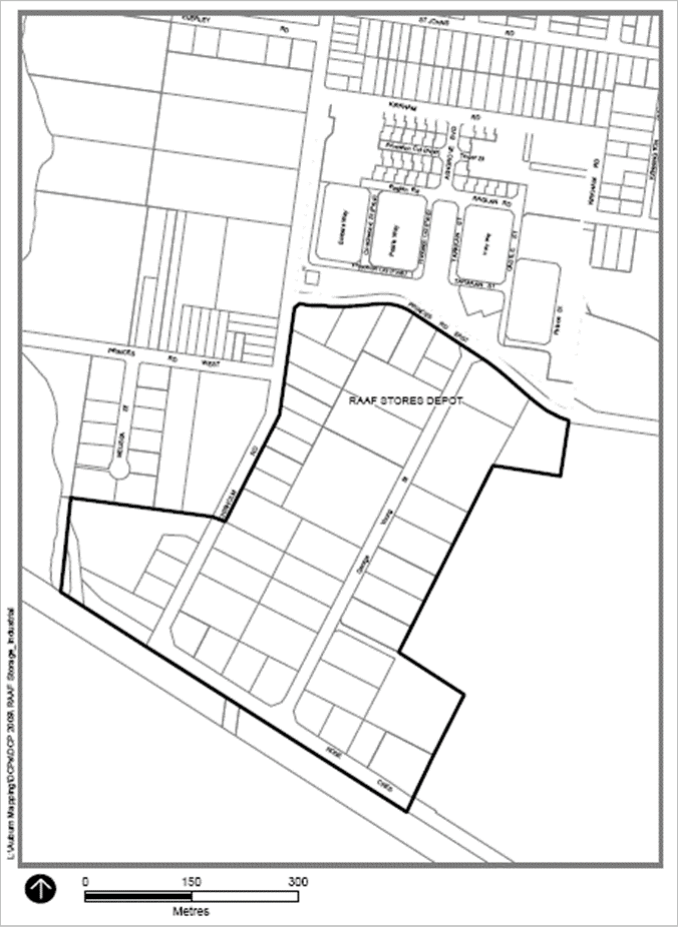

> [Picture on page 68: a picture, saved as a picture (images/part-f3-industrial-site-specific-page-68-5.gif, 150 dpi).]

Figure 1: Area to which this Part applies

### 1.2 Purpose of this Part

The purpose of this Part is to create a quality industrial business estate comprising a range of

allotment sizes supported by a functional and high quality public domain (as per the Former

RAAF Stores Depot Public Domain Plan).

## 2. Objectives and controls

### 2.1 General

#### Objectives

Ensure the economic development and use of the industrial zoned land that forms part

of the former Regents Park RAAF Stores Depot site.

Enhance and reinforce the existing industrial development in the surrounding area and

within the Regency Green Industrial Estate.

Enhance employment opportunities in the area.

Ensure a high standard of industrial development on the site and to encourage this high

standard in future development in surrounding industrial areas.

Ensure development responds to its context and is aesthetically and environmentally

compatible with the existing built environment and the public domain.

Ensure development contributes to improvements to the public domain.

Encourage design that will enhance the existing character of the locality.

Ensure development adheres to principles of ecologically sustainable development.

Ensure that redevelopment is integrated with surrounding development.

### 2.2 Staged development

On 23 June 2004 development consent DA-608/2003 was granted by Council (see Council

report 260/04 – CCLO2-04) for the staged development of part of the former RAAF Stores

Depot (Lots 102 and 103 DP 1048829). Stage 1 included subdivision of the site into 41 industrial

lots, civil works including roads, drainage and provision of public open space, site re-grading,

removal of trees, and landscaping. The Stage 1 development consent also approved a master plan (Regency Green Industrial

Estate Draft Master Plan, prepared by Woods Bagot, dated May 2004). The relevant provisions

within the Regency Green Industrial Estate Draft Master Plan have been incorporated in this

Part. In addition, condition 2(c) of the development consent required that the industrial

development and associated drainage and any ancillary works within each allotment intended

for industrial use, be the subject of further development consent pursuant to the provisions of

Section 80(5) of the EP&A Act 1979.

#### Objectives

Ensure that the distribution of floor space is such that the scale of buildings reinforces

the desired streetscape character.

Ensure that the built form and scale of development maintains and enhances the

amenity and visual quality of the locality, the public domain and adjoining areas.

#### Controls

Site coverage and setbacks C1. The total ground floor area of all buildings shall not exceed 70% of the area of the

allotment. Where an industrial building comprises more than one (1) unit, the total

ground floor area shall not exceed 60% of the area of the allotment.

C2. New buildings along the street frontage shall be setback a minimum of 3m. The setback

zone shall not be used for car parking, storage or display of goods.

C3. In the case of an allotment with side boundaries angled to the road alignment, the

setback line shall be perpendicular to the side boundary and the setback shall be 3m at

its closest point.

C4. Lots to the south of where Building 40 (as shown in Figure 3 was located shall have a

20m front setback in order to retain the existing trees as shown (refer to Figure 2 below).

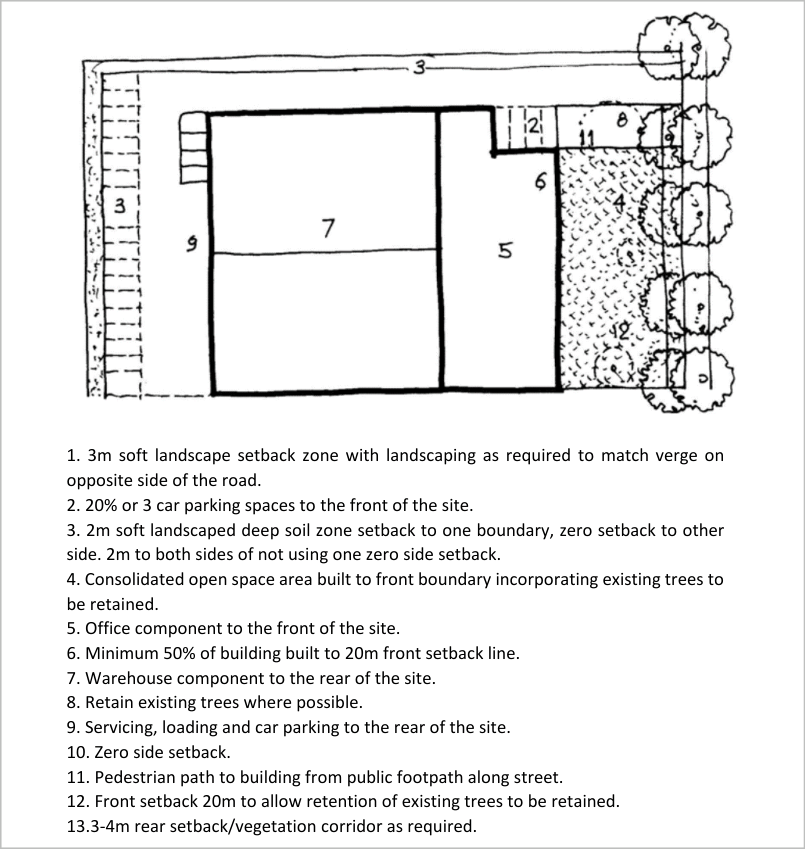

> [Picture on page 70: a picture, saved as a picture (images/part-f3-industrial-site-specific-page-70-13.gif, 150 dpi).]
> Words printed on the picture (title and legend, copied from the PDF):
> 1\. 3m soft landscape setback zone with landscaping as required to match verge on
> opposite side of the road.
> 2\. 20% or 3 car parking spaces to the front of the site.
> 3\. 2m soft landscaped deep soil zone setback to one boundary, zero setback to other
> side. 2m to both sides of not using one zero side setback.
> 4\. Consolidated open space area built to front boundary incorporating existing trees to
> be retained.
> 5\. Office component to the front of the site.
> 6\. Minimum 50% of building built to 20m front setback line.
> 7\. Warehouse component to the rear of the site.
> 8\. Retain existing trees where possible.
> 9\. Servicing, loading and car parking to the rear of the site.
> 10\. Zero side setback.
> 11\. Pedestrian path to building from public footpath along street.
> 12\. Front setback 20m to allow retention of existing trees to be retained.
> 13.3-4m rear setback/vegetation corridor as required.

Figure 2: Typical boulevard allotment pan with 20m setback for existing trees.

C5. A minimum of 50% of the front facade of the building shall be built to the minimum

specified front setback to ensure a strong reading of the street address. A 2m

articulation zone shall be allowed.

C6. No setback shall be required from internal laneways or minor access driveways.

C7. Side boundaries shall have a landscaped deep soil zone of at least 2m where the

building is not built to either boundary. Where one side setback is zero the other side

shall have a 4m deep soil zone.

C8. Rear boundaries shall have a landscaped deep soil zone of 3m unless the lot does not

back onto another within the development in this case the deep soil zone will be 4m.

This zone shall be planted in accordance with the revegetation plan as shown in Figure

3.

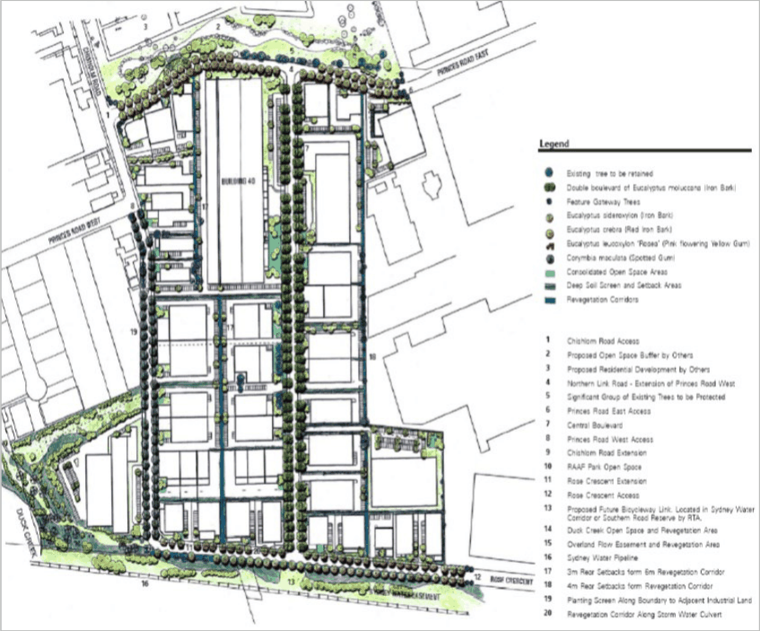

> [Picture on page 71: a picture, saved as a picture (images/part-f3-industrial-site-specific-page-71-12.gif, 150 dpi).]

Figure 3: Revegetation plan.

C9. Allotments bounding Duck River shall have a 30m setback from the mean high water

line. Refer to Figure 4 below.

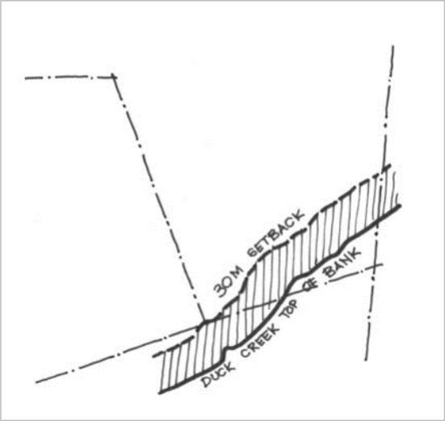

> [Picture on page 72: a picture, saved as a picture (images/part-f3-industrial-site-specific-page-72-1.gif, 150 dpi).]

Figure 4: Setback from Duck Creek (Duck River).

C10. Lots shall use a zero side setback to one boundary except where access is required.

C11. Landscaping with appropriate native species shall be provided to setbacks and

alongside vehicle access driveways. Refer to Table 1- Regents Park plants list.

C12. Components of the buildings which incorporate ancillary offices, showrooms and

customer service areas shall be located along the allotment frontage and shall be of a

high standard of architectural design.

### 2.3 Allotment size and configuration

#### Objectives

Development creates or maintains an overall variety of allotment sizes to facilitate a

wide range of industrial, warehousing and related activities.

Allotment sizes and configuration enable the efficient siting of buildings and associated

activities.

#### Controls

C1. The average minimum site width shall be 30m. Refer to Figure 5 below.

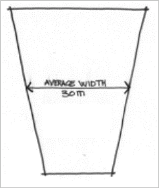

> [Picture on page 73: a picture, saved as a picture (images/part-f3-industrial-site-specific-page-73-1.gif, 150 dpi).]

Figure 5: Average site width.

C2. Battle-axe allotments accessed by narrow frontages shall not be permitted.

C3. Allotments use opportunities for shared access. Refer to Figure 6 to 8 showing allotment

plans for mid-block, corner blocks and multi-unit sites.

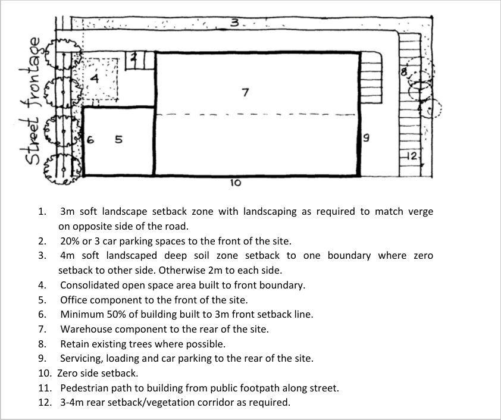

> [Picture on page 73: a picture, saved as a picture (images/part-f3-industrial-site-specific-page-73-6.gif, 150 dpi).]
> Words printed on the picture (title and legend, copied from the PDF):
> 1\.  3m soft landscape setback zone with landscaping as required to match verge
> on opposite side of the road.
> 2\.  20% or 3 car parking spaces to the front of the site.
> 3\.  4m soft landscaped deep soil zone setback to one boundary where zero
> setback to other side. Otherwise 2m to each side.
> 4\.  Consolidated open space area built to front boundary.
> 5\.  Office component to the front of the site.
> 6\.  Minimum 50% of building built to 3m front setback line.
> 7\.  Warehouse component to the rear of the site.
> 8\.  Retain existing trees where possible.
> 9\.  Servicing, loading and car parking to the rear of the site.
> 10\.  Zero side setback.
> 11\.  Pedestrian path to building from public footpath along street.
> 12\.  3-4m rear setback/vegetation corridor as required.

Figure 6: Typical mid block allotment plan.

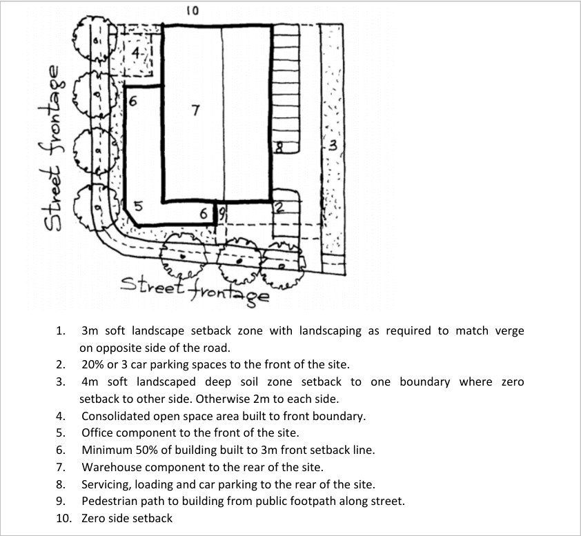

> [Picture on page 74: a picture, saved as a picture (images/part-f3-industrial-site-specific-page-74-1.gif, 150 dpi).]
> Words printed on the picture (title and legend, copied from the PDF):
> 1\.  3m soft landscape setback zone with landscaping as required to match verge
> on opposite side of the road.
> 2\.  20% or 3 car parking spaces to the front of the site.
> 3\.  4m soft landscaped deep soil zone setback to one boundary where zero
> setback to other side. Otherwise 2m to each side.
> 4\.  Consolidated open space area built to front boundary.
> 5\.  Office component to the front of the site.
> 6\.  Minimum 50% of building built to 3m front setback line.
> 7\.  Warehouse component to the rear of the site.
> 8\.  Servicing, loading and car parking to the rear of the site.
> 9\.  Pedestrian path to building from public footpath along street.
> 10\.  Zero side setback

Figure 7: Typical corner block allotment plan.

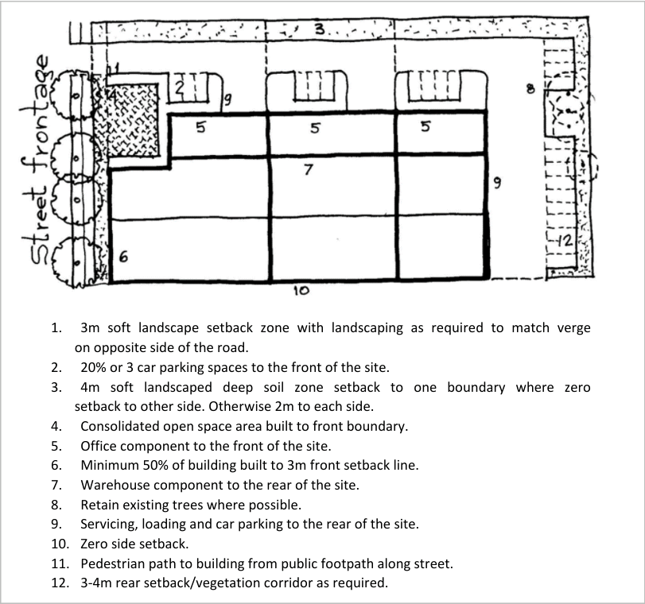

> [Picture on page 75: a picture, saved as a picture (images/part-f3-industrial-site-specific-page-75-1.gif, 150 dpi).]
> Words printed on the picture (title and legend, copied from the PDF):
> 1\.  3m soft landscape setback zone with landscaping as required to match verge
> on opposite side of the road.
> 2\.  20% or 3 car parking spaces to the front of the site.
> 3\.  4m soft landscaped deep soil zone setback to one boundary where zero
> setback to other side. Otherwise 2m to each side.
> 4\.  Consolidated open space area built to front boundary.
> 5\.  Office component to the front of the site.
> 6\.  Minimum 50% of building built to 3m front setback line.
> 7\.  Warehouse component to the rear of the site.
> 8\.  Retain existing trees where possible.
> 9\.  Servicing, loading and car parking to the rear of the site.
> 10\.  Zero side setback.
> 11\.  Pedestrian path to building from public footpath along street.
> 12\.  3-4m rear setback/vegetation corridor as required.

Figure 8: Factory unit allotment plan.

### 2.4 Building height and density

#### Objectives

Building height, scale and mass is similar to adjoining development.

Building form is designed to avoid detrimental effects upon the amenity and visual

character of the locality.

#### Control

C1. Building plants/service such as lift motor room, air conditioning equipment and exhausts

shall either be concealed from view behind parapet walls or housed within the building

envelope entirely.

### 2.5 Visual quality and building design

#### Controls

C1. Loading, storage and external work areas shall be located where the visual quality of

the locality is not compromised.

C2. Buildings, fencing and landscape treatment shall be used to screen visually obtrusive

activities and car parking.

C3. Building facades to street frontages shall be of a contemporary architectural style. Refer

to examples in Figure 9 and 10.

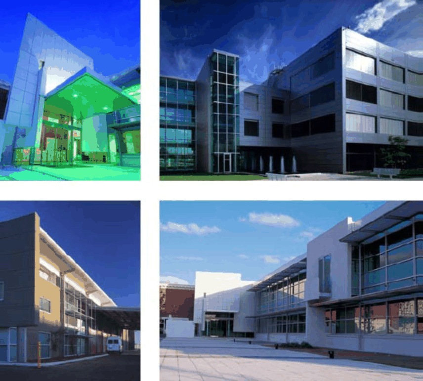

> [Picture on page 76: a picture, saved as a picture (images/part-f3-industrial-site-specific-page-76-9.gif, 150 dpi).]

Figure 9: Examples of appropriate architectural character.

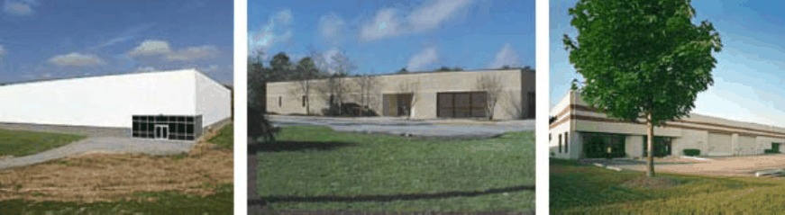

> [Picture on page 77: a picture, saved as a picture (images/part-f3-industrial-site-specific-page-77-1.gif, 150 dpi).]

Figure 10: Examples of inappropriate architectural character.

C4. Design of industrial buildings shall include:

• elements which punctuate the skyline;

• distinctive roof forms;

• facades with visual variety in materials and form;

• architectural emphasis on the built form;

• roof and building form appropriate and indicative of building function;

• window forms to vary based on orientation and internal functions;

• entrance areas to be visually prominent within overall building form, by use of visual

cues such as awnings, roof projections, blade walls or variation in materials scale

or form; and

• introduce variation in unit design within building group. Refer to Figure 11.

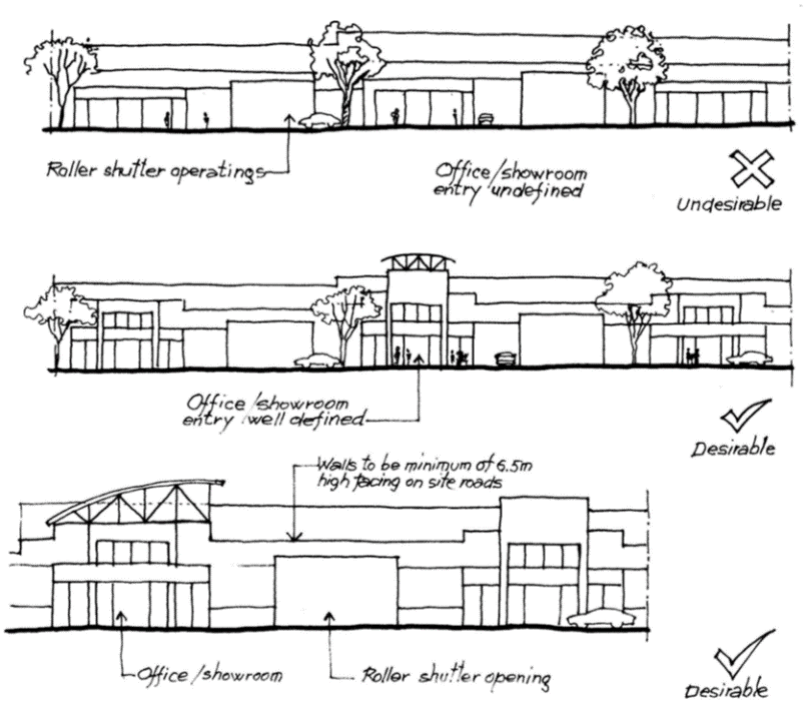

> [Picture on page 78: a picture, saved as a picture (images/part-f3-industrial-site-specific-page-78-1.gif, 150 dpi).]

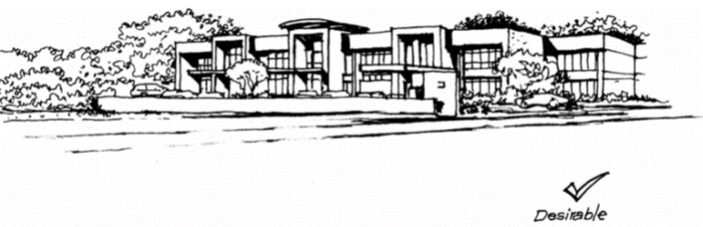

> [Picture on page 78: a picture, saved as a picture (images/part-f3-industrial-site-specific-page-78-2.gif, 150 dpi).]

Figure 11: Building form.

C5. Walls facing side roads shall be a minimum height of 6.5m.

C6. On corner sites, built form shall emphasise the corner by massing and facade

orientation. The office component of developments shall be located at the corner and

the architectural form shall address the corner of the block by a chamfered footprint to

the corner. Refer to Figure 12 to 15.

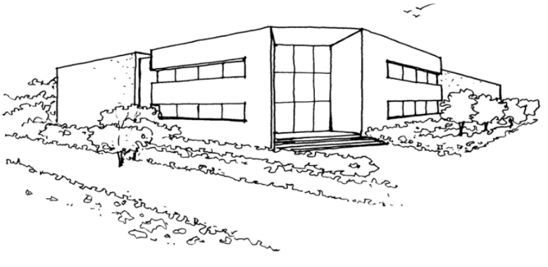

> [Picture on page 79: a picture, saved as a picture (images/part-f3-industrial-site-specific-page-79-1.gif, 150 dpi).]

Figure 12: Example of chamfered corner treatment.

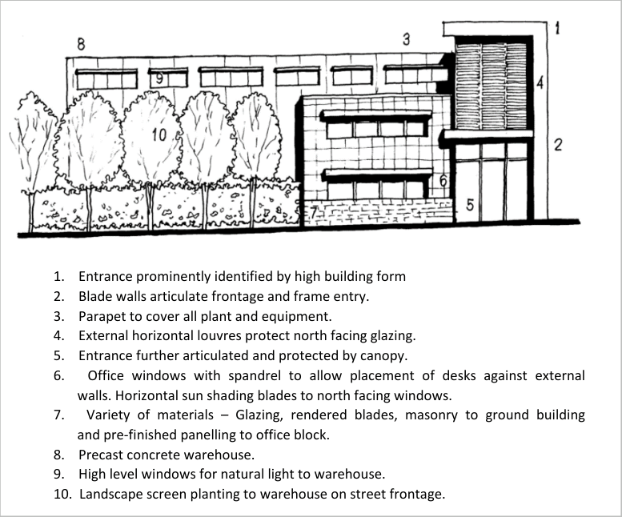

> [Picture on page 79: a picture, saved as a picture (images/part-f3-industrial-site-specific-page-79-3.gif, 150 dpi).]
> Words printed on the picture (title and legend, copied from the PDF):
> 1\.    Entrance prominently identified by high building form
> 2\.    Blade walls articulate frontage and frame entry.
> 3\.    Parapet to cover all plant and equipment.
> 4\.    External horizontal louvres protect north facing glazing.
> 5\.    Entrance further articulated and protected by canopy.
> 6\.   Office windows with spandrel to allow placement of desks against external
> walls. Horizontal sun shading blades to north facing windows.
> 7\.   Variety of materials – Glazing, rendered blades, masonry to ground building
> and pre-finished panelling to office block.
> 8\.    Precast concrete warehouse.
> 9\.    High level windows for natural light to warehouse.
> 10\.  Landscape screen planting to warehouse on street frontage.

Figure 13: Options for building frontages – boxes and blades.

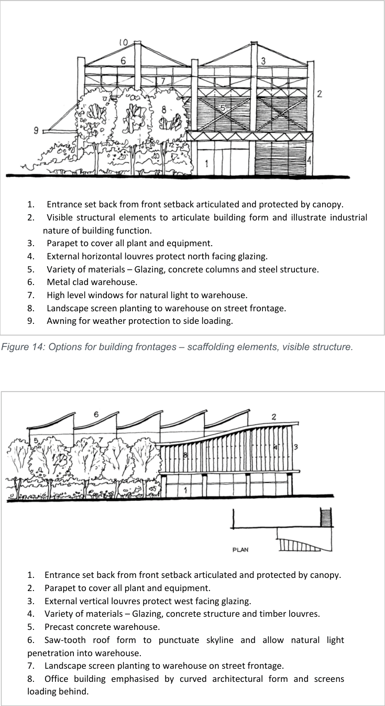

> [Picture on page 80: a picture, saved as a picture (images/part-f3-industrial-site-specific-page-80-1.gif, 150 dpi).]
> Words printed on the picture (title and legend, copied from the PDF):
> 1\.  Entrance set back from front setback articulated and protected by canopy.
> 2\.  Visible structural elements to articulate building form and illustrate industrial
> nature of building function.
> 3\.  Parapet to cover all plant and equipment.
> 4\.  External horizontal louvres protect north facing glazing.
> 5\.  Variety of materials – Glazing, concrete columns and steel structure.
> 6\.  Metal clad warehouse.
> 7\.  High level windows for natural light to warehouse.
> 8\.  Landscape screen planting to warehouse on street frontage.
> 9\.  Awning for weather protection to side loading.

Figure 14: Options for building frontages – scaffolding elements, visible structure.

> Words printed on the picture (title and legend, copied from the PDF):
> 1\. Entrance set back from front setback articulated and protected by canopy.
> 2\. Parapet to cover all plant and equipment.
> 3\. External vertical louvres protect west facing glazing.
> 4\. Variety of materials – Glazing, concrete structure and timber louvres.
> 5\. Precast concrete warehouse.
> 6\. Saw-tooth roof form to punctuate skyline and allow natural light
> penetration into warehouse.
> 7\. Landscape screen planting to warehouse on street frontage.
> 8\. Office building emphasised by curved architectural form and screens

Figure 15: Options for building frontages – curves and roof form.

### 2.6 Landscape treatment

#### Controls

C1. Large car parking areas shall be broken up using landscape zones. Car parking shall

be located so as to integrate with the landscaping and provide a harmonious design for

the site.

C2. An area shall be provided for outdoor staff recreation (areas for sitting, eating and

barbecues) being appropriate to the needs of the particular premises and incorporating

adjacent open space or natural areas.

### 2.7 Landscape

#### Objectives

Open space areas within allotments are to comprise a high quality of landscape design

to maintain the visual amenity and habitat potential of the locality.

Adequate open space areas are provided for the amenity of visitors and workers in the

Estate.

#### Controls

C1. All industrial allotment frontages shall be separate from the street by a minimum 3m

wide landscape softworks buffer. This buffer shall contain trees, gravel, lawn and

planting to match the verge on the other side of the street. Entrance and access

pavements may cross this buffer.

C2. A row of trees shall be planted within the 3m wide landscape buffer at the front of all the

allotments fronting the George Young Street. The trees shall be planted as part of the

future development of the individual lots. The trees shall be Eucalyptus moluccana

(Grey Box), installation size 100 litre and at same spacing as the street trees planted

within the road reserve of the Boulevard. These trees shall be planted at 1m within the

site boundary and shall create the outer row of the double avenue of street trees along

the Boulevard. The area under these trees shall be turfed.

C3. All allotments with a boundary fronting the Princess Road East shall install soft

landscaping within the 3m wide landscape softworks buffer. Informal copses of

Eucalyptus leucoxylon ‘Rosea’ and entrance feature trees as identified shall be planted

within this zone. The area under these trees must be turfed.

C4. All garden beds shall be edged with a 150mm wide concrete strip.

C5. Rear deep soil planting zones shall be mass planted, mulched garden bed in

accordance with the revegetation plan prepared for the site where required.

C6. All lots shall allow for a pedestrian access path from the pedestrian footpath on the

street to the entrance of the building.

C7. All unbuilt areas of the site not required for loading, carparking, or vehicle access shall

be landscaped. The area of soft landscaping in the form of trees shrubs and lawns shall

not be less than 15% of the site area including the consolidated open space area.

C8. A consolidated open space area shall be provided on every lot in a distinct area (of

proportions of approximately 1:1 to 2:3 or 3:2 width to depth). The area shall be built to

the front property line.

C9. The consolidated open space area shall be located to the front of the lot and extend to

1500mm past the building setback line and must be landscaped in such a manner to

contribute to the overall public domain character of the site.

C10. The size of the area to be provided shall be determined based on lot area. Refer to

Figure 16.

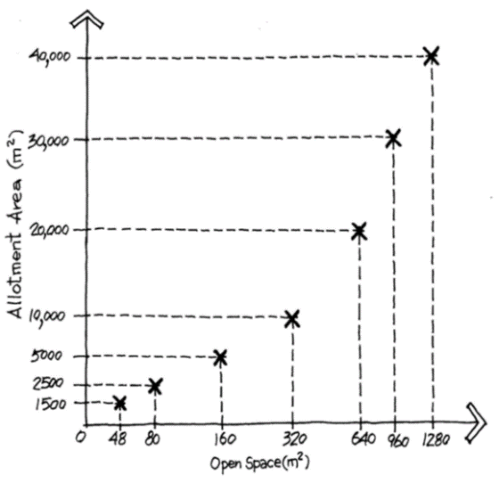

> [Picture on page 82: a picture, saved as a picture (images/part-f3-industrial-site-specific-page-82-6.gif, 150 dpi).]

Figure 16: Consolidated open space area table.

C11. The consolidated open space area shall be defined by the public footpath along the site

boundary, the driveway, building or private paths.

C12. The consolidated open space area shall contain street furniture, seating, bins, bike racks

etc, lighting, planting, trees and paved areas (unit paving or gravel). It shall also contain

a pergola structure for shade which shall also be built to the front property boundary.

Refer to Figure 17.

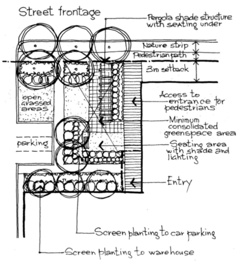

> [Picture on page 83: a picture, saved as a picture (images/part-f3-industrial-site-specific-page-83-1.gif, 150 dpi).]

Figure 17: Example of a consolidated open space area.

C13. All species planted within the front setback and consolidated open space areas are to

be selected from the relevant proposed species list in Table 1.

Table 1: Regents Park plant list.

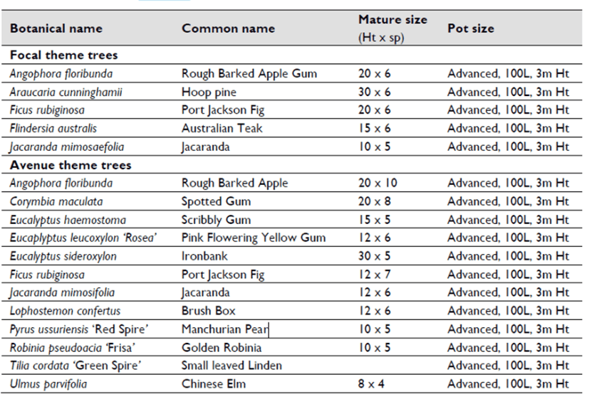

> [Picture on page 83: a picture, saved as a picture (images/part-f3-industrial-site-specific-page-83-6.gif, 150 dpi).]

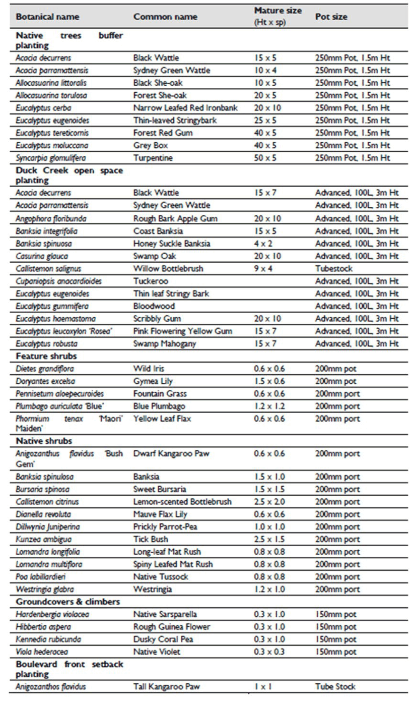

> [Picture on page 84: a picture, saved as a picture (images/part-f3-industrial-site-specific-page-84-1.gif, 150 dpi).]

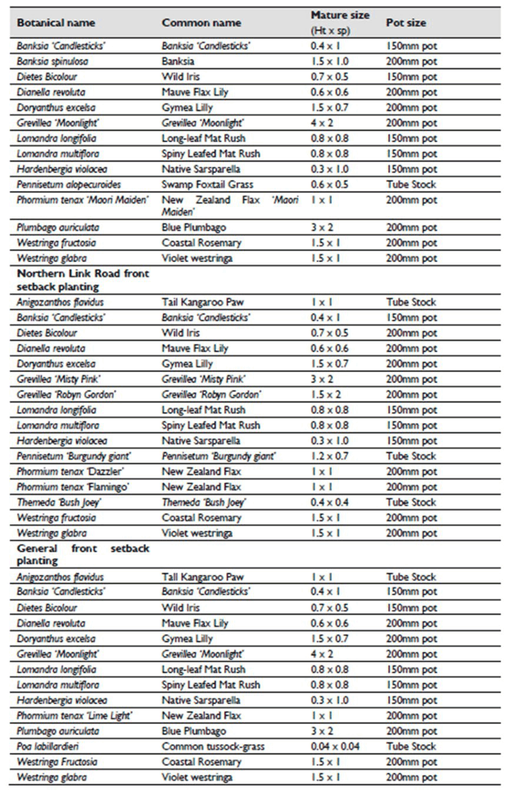

> [Picture on page 85: a picture, saved as a picture (images/part-f3-industrial-site-specific-page-85-1.gif, 150 dpi).]

C14. The consolidated open space area shall be located to achieve best orientation to create

a comfortable micro climate.

C15. Public safety through open surveillance of the building frontage shall be achieved at all

times.

C16. Landscaped areas shall be separated from vehicle areas by a kerb or other effective

physical barrier

C17. Landscape planting shall be provided on the overland flow easement and the batter

slopes of Lot 47 to Lot 51 DP 1081545 in accordance with the following principles:

• planting shall be 100% native with 70% indigenous to the area;

• planting of the stormwater easement area shall incorporate riparian species but

shall not obstruct the overland flow; and

• the area incorporating the banks surrounding the building platform to the boundary

with the reserve shall be fully landscaped with mass planting and clear trunked trees

which shall not obstruct the visual connection to the reserve.

C18. Fencing shall be integrated into the landscape design theme so as to minimise its visual

impact while providing required site security.

C19. Warehouse facades on street frontage shall be screened with a landscape buffer unless

they are built to the setback line.

C20. For plant selection, biodiversity, plant supply and specification refer also to the Former

RAAF Stores Depot Public Domain Plan.

### 2.8 Business Identification Signage

#### Objectives

To provide coordinated signage throughout the public and private domain that is

distinctive and aesthetically pleasing.

To ensure visual impact of signs on adjoining residential areas is minimised through

design and illumination standards

Advertising signs and structures are incorporated within the overall design theme of the

industrial component of the site. Refer to Figure 18.

Development minimises the visual impact of signs and structures upon adjoining

residential areas through design and illumination standards.

#### Controls

C1. Signs shall be limited to identifying the user/tenant of the industry by their name, logo

or trademark. Illustrative advertising of products or services shall not be allowed.

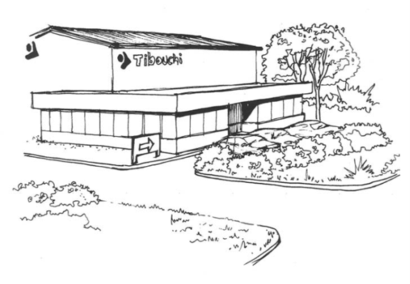

> [Picture on page 87: a picture, saved as a picture (images/part-f3-industrial-site-specific-page-87-1.gif, 150 dpi).]

Figure 18: Distinctive, coordinated signage integrated with development.

C2. Illumination of signs shall not cause nuisance or annoyance to pedestrians, vehicles or

adjoining residential properties.

C3. Signs shall be placed so that they do not obscure vehicular sightlines and vehicular

control signs.

C4. Non illuminated signs shall use reflective material for typography and directional arrows.

C5. Word spacing shall be regular and excessive variation in length of lines shall be avoided.

C6. Signs shall not be placed above the roof line or parapet

C7. Identification signs shall be placed perpendicular to approaching traffic, no closer than

3m to any property line.

C8. One identification sign shall be provided. More than one may be used where a site has

more than one vehicular entrance, on different sides of the building or where the nature

of the site and adjacent roads require more than one sign for adequate identification.

C9. Building identification signage shall be in the form of a single free standing primary

signage element. This element shall be setback 2m from the front allotment boundary.

Secondary signage may be located on the building facade.

C10. The 2m setback area shall be planted with low ornamental plants and shrubs which do

not obscure signage and are consistent with the landscape principles of the site. Refer

to Figure 20.

C11. Signage shall be not more than 1.5m in height and shall incorporate a solid base

element 600mm high of stone construction. This is illustrated in Figure 19 to 21.

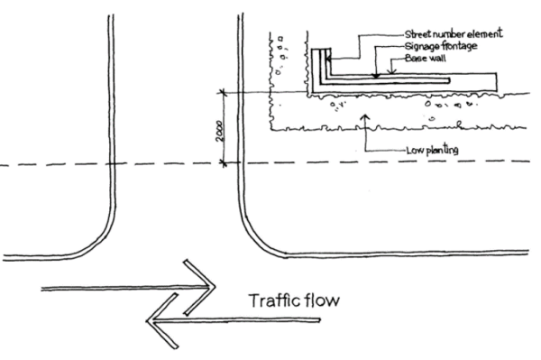

> [Picture on page 88: a picture, saved as a picture (images/part-f3-industrial-site-specific-page-88-1.gif, 150 dpi).]

Figure 19: Signage – plan view.

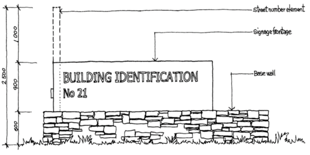

> [Picture on page 88: a picture, saved as a picture (images/part-f3-industrial-site-specific-page-88-3.gif, 150 dpi).]

Figure 20: Signage – elevation.

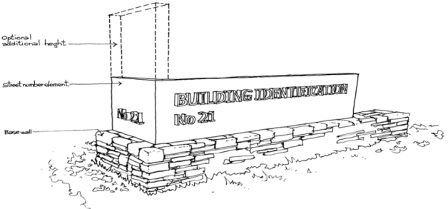

> [Picture on page 88: a picture, saved as a picture (images/part-f3-industrial-site-specific-page-88-5.gif, 150 dpi).]

Figure 21: Signage – perspective illustration.

C12. Signs shall not have a front face area greater than 5m² excluding the base wall face

area.

C13. Signs shall be placed parallel to the road alignment. Where the sign is located after the

access driveway for approaching traffic an element of the sign shall be perpendicular to

the approaching traffic and as a minimum shall indicate the street number and may be

up to 2.5m in height. Refer to Figure 20.

C14. Signs on the front facade of the building shall not be greater than 1/3 of the total length

of the front facade and not longer than 12m in total length.

C15. Identification signs on a secondary street frontage shall be 50% of the size of those on

the primary frontage.

C16. Pylon signs shall not be allowed.

### 2.9 Lighting, privacy and security

Lighting

#### Objectives

Provide a functional and coordinated site lighting system which contributes to a safe

and visually attractive environment

Ensure lighting does not cause distraction to vehicle drivers on internal or external roads

or to the occupants of adjoining properties and residential land.

The impact of lighting upon adjoining sites, particularly residential areas, is minimised

by controlling the intensity, design and location of lighting facilities.

#### Controls

C1. Lights shall be placed so as to cause no glare or excessive light spillage on neighbouring

sites. External lighting complies with the Australian Standard 4282 (INT) 1995 – Control

of the Obtrusive Effects of Outdoor Lighting.

C2. All parking areas and driveways shall be illuminated to a minimum level of between 25

and 50 lux at ground level. The standard adopted for the surrounding roads is 50 lux.

C3. Security lighting fixtures shall not project above the facade of the nearest adjacent

building and shall be shielded. Shields shall be painted to match the surface to which

they are attached. Security lighting fixtures shall not substitute for parking area or

pedestrian path lighting fixtures and shall be restricted to lighting only loading and

storage locations or other limited service areas.

C4. Exterior wall mounted flood lights shall be prohibited except for security lighting to the

rear of buildings.

C5. Accent illumination shall be provided at key locations, such as building entries and

driveways. The tops of footings of all lighting standards shall be a minimum of 100mm

below adjacent surface levels.

C6. Buildings shall be externally lit using a system of lighting that accentuates the

architectural features.

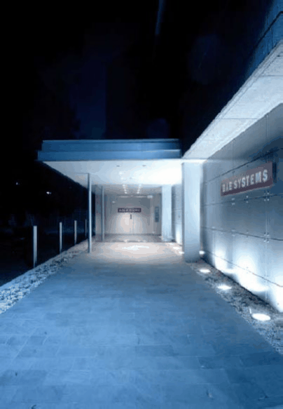

> [Picture on page 90: a picture, saved as a picture (images/part-f3-industrial-site-specific-page-90-1.gif, 150 dpi).]

Figure 22: Lighting to emphasise building form.

Fencing

#### Objective

Fences and walls are designed to ensure that they do not have a detrimental effect on

the visual amenity of the public domain.

#### Controls

C1. Fencing along street boundaries of a height greater than 1m shall be located behind a

landscape buffer with a minimum setback of 3m.

C2. Fencing shall be either transparent or integrated into the building form. It shall be

designed to ensure its materials and colours blend into the landscape and allow through

visual access. Refer to Figure 23.

C3. Solid fencing shall be designed to read visually as part of the building form and be

constructed of the same or complementary materials to the building.

C4. Fences shall not be erected in front of landscaping along street frontages.

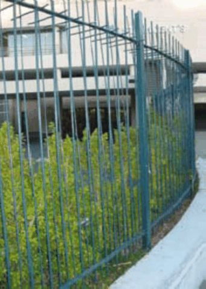

> [Picture on page 91: a picture, saved as a picture (images/part-f3-industrial-site-specific-page-91-1.gif, 150 dpi).]

Figure 23: Example of transparent fencing.

Safety and security

#### Objective

The design and ongoing development of the site is consistent with the principles of

Crime Protection through Environmental Design (CPTED).

#### Controls

C1. Clear sightlines between public and private spaces shall be provided.

C2. Effective lighting for public places shall be provided.

C3. Landscapes and physical locations that channel and group pedestrians into target areas

shall be provided

C4. Access to internal areas or high risk areas shall be restricted.

C5. Design shall incorporate clear transitions and boundaries between public and private

space.

C6. Space management strategies shall be undertaken, including activity coordination, site

cleanliness, rapid repair of vandalism and graffiti and replacement of burnt out lighting.

### 2.10 Ecologically sustainable development principles

#### Objectives

Encourage a high standard of environmental design.

Minimise energy use in buildings while providing a comfortable working environment.

Substantially reduce carbon dioxide emissions compared to similar developments

through the design of buildings.

Minimise potable water mains demand of non-residential development by implementing

water efficiency measures.

Buildings are designed to minimise energy consumed for heating and cooling

Buildings reduce reliance on existing energy supplies through the use of renewable

energy technologies.

Water efficiency is increased by appropriate building design, site layout, internal design

and water conserving appliances.

#### Controls

C1. Buildings shall aim to achieve a north-south orientation.

C2. Air conditioning shall be zoned to enable the most efficient heating and cooling of the

building

C3. Roof and wall insulation shall be used in office components of buildings to reduce winter

heat loss summer heat gain.

C4. Cross ventilation shall be maximised by using high level roof ventilators. Where practical

and appropriate, skylights and/or wind powered ventilators are to be installed.

C5. Stairwells shall be positioned to create a stack effect to enhance natural ventilation to

upper floors.

C6. Windows shall be protected from summer sunlight by eaves and sunshade devices

where appropriate.

C7. Buildings shall be finished in lighter colours to increase heat reflectivity.

C8. Low energy lighting shall be used.

C9. Buildings shall use renewable energy technologies, including:

• photovoltaic cells;

• battery storage; and

• natural ventilation.

C10. Water conserving landscape techniques shall be employed; such as drought tolerant

species selection, soil additives, irrigation zoning, limited turf areas and planting to

reflect micro climates.

C11. The ancillary office component of development shall be to the north of the site.

C12. Roofs shall be designed to maximise penetration of natural light.

C13. Landscaping shall be used to shade exposed walls from summer sun. Deciduous

species shall be included where summer shade and winter sun is desirable.

C14. All developments shall reuse grey water wherever appropriate, feasible and practical.

C15. New developments shall connect to recycled water if serviced by a dual reticulation

system for permitted non potable uses such as toilet flushing, irrigation, car washing,

fire fighting and other suitable industrial purposes.

C16. Where a property is not serviced by a dual reticulation system, development shall

include an onsite rainwater harvesting or an onsite reusable water resource for

permitted non potable uses such as toilet flushing, irrigation, car washing, fire fighting

and other suitable industrial purposes.

C17. Development shall install all water using fixtures to meet the WELS (Water Efficiency

Labelling Scheme) rated industry standards.

### 2.11 Stormwater management

#### Objectives

Take advantage of opportunities for the multiple use of stormwater management areas

for recreation and amenity.

Avoid stormwater discharge impacts on downstream properties and natural waterways.

Protect water quality and minimise gross pollutants leaving the site.

Reduce the pressure of new development on existing water supply and drainage

infrastructure.

Treat and manage stormwater in an equitable manner for all future occupants of the

estate.

Incorporate highly innovative financially responsible water quality management

strategy.

Stormwater drainage is designed to integrate with landscape concept plans prepared

for the site.

Drainage design minimises the environmental impact of stormwater run-off.

Stormwater management systems provide the community with opportunities for the

reuse of stormwater

Lot owners are responsible for management of stormwater on their site in terms of both

water quality and quantity.

#### Controls

C1. The drainage system has the capacity to accommodate the 1-in-100 year flood event

without risk or damage.

C2. The stormwater drainage system shall be integrated with the landscape concept plan.

C3. The maximum permissible site discharge (PSD) and minimum site storage requirement

(SSR) shall be in accordance with the Table 2.

Table 2: Maximum permissible site discharge

Specific details relating to boundaries are to be confirmed with Council’s drainage

engineer.

C4. Detention storage shall not be located in any natural watercourse or overflow flow path,

and functions independently during any events up to and including Council’s 100 year

ARI event.

C5. On-site detention basins shall be provided with an overflow spillway directed towards

the trunk drainage system.

C6. On-site detention storage shall be designed so that run-off is stored underground.

C7. All stormwater quality control structures shall have the capacity to intercept and filter

run-off from the one (1) year average recurrence storm event.

C8. Gross pollutant traps and devices shall be located underground with readily available

access for maintenance or are screened.

C9. Development shall comply with the Stormwater Drainage in Part G of this DCP.

C10. Stormwater management shall be undertaken in accordance with the principles

contained in the Water Cycle Management Plan prepared by Storm Consulting dated

November 2003.

C11. On-site detention for the industrial estate shall be provided for each lot.

C12. Each lot shall provide water quality treatment consisting of oil and grease separation,

gross pollutant and nutrient retention.

This page has been left intentionally blank.

> [Picture on page 96: a picture, saved as a picture (images/part-f3-industrial-site-specific-page-96-1.gif, 150 dpi).]
