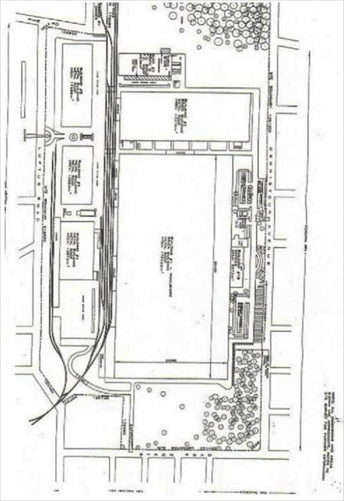
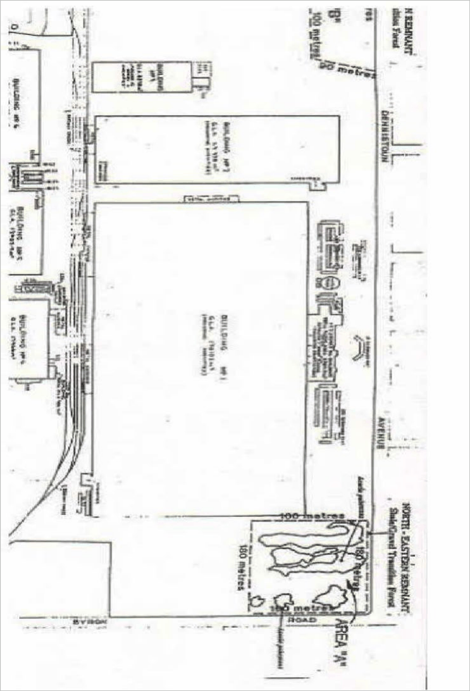

### PART F3-3

### YENNORA DISTRIBUTION

### PARK

This page has been left intentionally blank.

## 1. Introduction

The following controls apply to Yennora Distribution Park, being land described as Lot 2 DP 711948,

and known as 14-54 Dennistoun Avenue, Yennora. The subject property is one of the most significant industrial sites in Sydney and Cumberland City. The

combination of size, location, accessibility and the well developed railway infrastructure provides a

strategically important asset having local, regional and state status. The site has been used historically as a major wool warehousing and distribution centre. In recent times

other storage and distribution activities have developed on the site. In the short to middle term, the property will continue to be used for wool related activities and other

conforming uses. The vision for the site is to maximise its efficient use and development as a strategic industrial property,

which will be a major employment and business centre in Holroyd and the greater metropolitan area. This vision, including redevelopment and change of use of existing buildings and development of vacant

land, must be carried out while ensuring operations and activities have regard to the impact on the

features of the site and surrounds.

## 2. General objectives

#### Objectives

Establish a strategic planning framework to guide the future development of the site.

Acknowledge the strategic importance of the site as a generator of major economic and

employment activity for both Cumberland City, and for the Sydney Region.

Recognise the regional significance of the site as a potential major inter-modal

distribution centre servicing western Sydney.

Identify opportunities to enhance the economic potential of the site as an inter-modal

distribution centre servicing western Sydney.

Ensure that future development on the site satisfies environmental and design

standards and satisfies community expectations.

## 3. Objectives and controls

### 3.1 Building Form

#### Objectives

Ensure that any new building works comply with the Building Code of Australia.

Ensure a high standard of visual and environmental quality.

#### Controls

C1. All building works associated with the construction of new standalone premises are to

comply with the Building Code of Australia.

C2. The compliance of existing buildings with contemporary building and fire standards will

be determined when alterations are proposed to such buildings.

C3. Any future building works proposed to take place on those parts of the site in close

proximity to adjacent residential zones must have regard to the following:

• the visual appearance of the development when viewed from surrounding areas;

• the reflective qualities of proposed external building treatments and their potential

to cause nuisance glare; and

• the possible impact of noise, vibration and dust generated by operations and

activities in the proposed building or surrounds.

C4. Building facades to all street frontages and a minimum of a 3 metre return, shall be

constructed of brick, split masonry block or pre-cast exposed aggregate panels, with a

minimum of 3.5mm aggregate. No standard concrete block work can be permitted.

Painted masonry will not be accepted unless the applicant can demonstrate that the

building has outstanding architectural merit incorporating special features.

C5. Side and rear walls, not visible from the street, can be constructed in galvanised iron,

zincalume, fibre cement or pre-colour coated metal sheeting. Council encourages the

use of pre-colour coated metal sheeting, as this cladding is more aesthetically pleasing

and environmentally sustainable.

C6. Roof cladding is acceptable in tiles, galvanised iron, zincalume, or pre-colour coated

metal sheeting. Locate roof ventilators, exhaust towers, hoppers and the like, as far as

practicable, so as not to be readily visible from any public or residential area.

### 3.2 Building setbacks

#### Objectives

Ensure suitable setback from street frontages to enable the landscaping treatment of

such when viewed from public areas.

Ensure that the physical separation between industrial and residential land uses, which

is characteristic of the existing development on site can be maintained over the longer

term.

#### Controls

C1. A minimum setback of 30.48 metres from the frontage to Dennistoun Avenue.

C2. All buildings and hardstand areas must be setback a minimum of 15 metres from

boundaries to all other public roads.

C3. Car parking and hard stand areas may be permitted within the setback distance subject

to Council consent.

### 3.3 Fire safety

#### Controls

Given the size of the tenancies and the current nature of activities and uses on the site, fire

safety is one of the major issues relating to any new use or development proposed. C1. In any development proposal on this site, provide detailed information on the proposed

uses or activities, so that Council can assess the likely fire hazard of the proposed use

and ensure appropriate fire fighting measures are implemented.

C2. Attention is also drawn to the fire safety provisions for industrial buildings contained in

the Building Code of Australia (BCA) and the Environmental Planning and Assessment

Act 1979 (EP&A Act). Particular attention should be given to Part C2 of the BCA - “Floor

Area Limitations”, Part D - “Means of Egress” and Part E1 - “Fire Fighting Services and

Appliances”. Development applications lodged with Council for approval, may be

referred to the NSW Fire Brigades.

### 3.4 Vehicle access

#### Objectives

Ensure that vehicle movements generated by the existing and future uses of the

property are concentrated on non-residential streets surrounding the property.

Ensure the safe and efficient movement of vehicles within the site.

#### Controls

C1. Works to Council satisfaction are to be carried out on the entry point to the site from

Dennistoun Avenue to physically restrict the ability for trucks to enter or exit the site from

this point.

C2. All proposals for additional development are to demonstrate how heavy vehicle

movements associated with the additional development will be minimised on

neighbouring residential streets.

C3. Heavy vehicle access to the site is permitted only through the existing main site entrance

on Loftus Road and the entrance on Byron Road.

C4. No access to and from the site is permitted from Dennistoun Avenue after 7.00pm and

before 6.00am Monday to Friday and is to be closed all day on Saturday and Sunday.

C5. No new site access points are permitted onto Dennistoun Avenue or Byron Road.

C6. New vehicle access points to the site may only be obtained from Loftus Road.

C7. Access to and from the site between the hours of 7.00pm and 6.00am is restricted to

those occupiers who have written approval from Council for hours of operation

extending into that time period. During these times access will be restricted to the Loftus

Road entrance where a security guard is to deny access to vehicles attempting to enter

the premises without consent to operate during these hours. A logbook documenting

after hours access shall be available for inspection by Council upon request.

C8. Development proposals must be supported by a description of proposed internal site

movements.

C9. Development applications will be referred to the Roads and Maritime Service in

accordance with the provisions of Schedule 3 of the State Environmental Planning

Policy (Infrastructure) 2007.

C10. Traffic generation rates for future development will be assessed to determine whether

developer contributions will be conditioned for traffic calming devices on Dennistoun

Avenue.

C11. Trucks accessing and leaving the site northwards are required to utilise:

• the Cumberland Highway via Woodpark Road, Fairfield Road and Dursley Road

and Loftus Road; or

• McCredie Road and Sturt Street. (When traffic signals are provided at Sturt Street

and Cumberland Highway, then the McCredie Road and Sturt Street route will be

the only access route permitted.)

C12. Trucks accessing and leaving the site southwards are required to utilise Fairfield Road,

Dursley Road and Loftus Road; or Pine Road and Loftus Road

C13. Trucks accessing the site are not to use Military Road, Chetwynd Road, Sherwood

Road/ Centenary Road, Fowler Road, Dennistoun Avenue or Byron Road (between

Carrington Road and Guildford Road West).

Signs must be erected on all entrance gates advising truck drivers that they are not to park or

queue in Dennistoun Avenue, Byron Road or any other residential street in the vicinity of the

Yennora Distribution Park. Such signs are to include details of the required access and egress

routes to and from the Yennora Distribution Park as set out in Part D.

### 3.5 Car parking provision

#### Objectives

Ensure that adequate car parking exists for persons employed on the site.

Ensure that the amount of car parking on site has regard to the unique characteristics

of car parking demands generated by land uses on the property.

#### Controls

C1. Provide car parking for any warehousing, non-warehousing and distribution related

activities on the site consistent with the provisions of the parking section in Part G of

this DCP.

C2. Ensure the design of any future car parking areas complies with Council’s requirements

specified in the parking section in Part G of this DCP.

### 3.6 Amenity issues

#### Objective

Ensure that existing and proposed land uses on the site have minimal impact on nearby

residential amenity.

#### Controls

C1. Stack shipping containers to a maximum height of four containers, unless it can be

shown that shipping containers stacked to a greater height will not adversely affect the

visual amenity of the adjoining residential area or be unsafe.

C2. Demonstrate to Council’s satisfaction that any proposed development will have minimal

impact on the amenity of adjacent residential areas. Comply with the requirements of

Part D of this DCP.

C3. Hours of operations will be determined accordingly. Such assessment must comply with

the acoustic standards set out in the OEH’s “Industrial Noise Policy”;

C4. Operations are restricted to the hours of 7.00am - 6.00pm Monday to Friday and 7.00am

- 12 noon Saturday with no operations on Sundays or public holidays.

C5. Operations outside these hours, up to 24 hour operations, will be considered by Council

upon submission of an acoustic report which is deemed ‘acceptable’ by Council and

prepared by a suitably qualified acoustic engineer.

Notes: In order to determine the acceptability of an acoustic report, Council’s officers may, depending

on the level of complexity of the acoustic report, refer such report to a second acoustical

engineer for appraisal at full cost to the applicant. The proposed occupations of existing or future buildings within the YDP that are located

adjacent to residential areas must be industries prepared to operate within the restricted hours.

Consideration of 24 hour operations within buildings adjacent to residential areas will only be

given under particular circumstances where an acceptable acoustic report has been received

for an industry that has an operation that will not interfere with the peace and repose of nearby

residents.

### 3.7 Landscaping

#### Objectives

Ensure that all future development is appropriately landscaped in order to contribute to

the aesthetic appeal of workplace environments.

Contribute to a reduction in building mass and bulk when buildings are viewed from

public areas and from nearby residential areas.

Increase the likelihood of long-term survival of landscaping by using species which are

adapted to the local environment, and to minimise the potential for exotic species to

invade remnant bushland on the site.

#### Controls

C1. Proposals for new building works are to incorporate landscaping as part of overall

building design.

C2. Landscaping is to be conducted utilising locally indigenous native plant species.

C3. Landscaping works adjacent to the locally and regionally significant remnant vegetation

on the site are to be designed as a buffer zone to reduce building impact, weed invasion

and assist in the long term preservation of Areas “A” and “B” on the plan contained in

Appendix 2 in this DCP.

Note: See also Part D of this DCP.

### 3.8 Remnant Vegetation

#### Objectives

Recognise the local and regional significance of remnant vegetation this exists on the

site.

Recognise the State (Schedule 2, Threatened Species Conservation Act 1995) and

National (ROTAP - Rare or Threatened Australian Plant) significance of Acacia

pubescens which is present in the undeveloped north-eastern portion of the site.

Recognise the presence of any Endangered Ecological Communities and species listed

under schedule 1 of the Threatened Species Conservation Act (TSCA) 1995 which

contained on the site.

Ensure that all future development addresses the provisions of the Environmental

Planning and Assessment Act, 1979, and the Threatened Species Conservation Act

1995, especially the specifications contained in any relevant Recovery Plan in respect

of vegetation communities and individual species present on the site.

#### Controls

C1. No development is permitted within Areas “A” and “B” on the plan contained in Appendix

1 of this DCP without consideration of the provisions of the Threatened Species

Conservation Act 1995.

C2. Development immediately adjacent to the Areas “A” and “B” on the plan contained in

Appendix 1 must demonstrate that it causes minimal impact on remnant vegetation.

C3. Development outside of Areas “A” and “B” must ensure there is no threat to any

threatened species.

C4. A management plan for the native vegetation present at the Yennora Distribution Park

has been prepared. The long-term aim of this plan is the retention and management of

an Endangered Ecological Community and a threatened plant species. The

management plan incorporates the following:

• a description of the flora species present in the remnant native vegetation on the

site;

• evaluation of the conservation significance of the native vegetation on the site;

• recommendations to minimise the impact of proposed additions to the existing

industrial development on the site;

• recommendations for the management of the native vegetation on the site; and

• recommendations for future site landscaping.

### 3.9 Stormwater management

#### Objectives

Ensure that stormwater is controlled so as to avoid damage to private and public

property.

Ensure that any new hard stand and roofed areas do not result in any net increases in

down stream flows during storm events.

Ensure that uncontrolled stormwater flows do not threaten the long term survival of

remnant vegetation.

#### Controls

C1. Provide all roofing and hard stand areas with adequate drainage systems.

C2. Incorporate on site stormwater detention systems in the design of any new hard stand

area or new building works. The design of such detention works are to be in accordance

with Council’s “On-site Stormwater Retention Policy” and certified to:

• Council’s satisfaction upon completion of works; and

• Compliance with Council’s other drainage requirements.

### 3.10 Infrastructure and services

#### Objective

Ensure that all required services and infrastructure are provided in accordance with

appropriate standards.

#### Controls

C1. Provide water, sewer, telecommunication, gas and electricity to new development to

Council’s and servicing authority standards.

C2. Construct all new roads and hardstand areas to Council’s satisfaction (see Part A and

D of this DCP).

C3. Carry out bulk earthworks to Council’s satisfaction.

### 3.11 Site contamination and land filling

#### Objectives

Recognise that existing undeveloped areas on site are largely free of contamination.

Recognise that no data exists on the possible contamination of developed land on site.

Ensure that Council is satisfied that no new building works take place on land

contaminated by previous land uses.

Ensure future building works are constructed on stable sub-surfaces.

#### Controls

C1. Council requires evidence of existing site contamination prior to the approval of new

building works on the site.

C2. New building works are to demonstrate the geotechnical stability of sub-surface

conditions prior to Council issuing a Construction Certificate.

### 3.12 Railway infrastructure

#### Objective

Ensure that the future development of the railway infrastructure does not negatively

impact upon the amenity of surrounding residential development.

#### Controls

C1. Future development applications involving the upgrading and development of new rail

infrastructure are to provide a detailed description to Council of the nature of use of such

infrastructure.

C2. Ensure that train arrivals and departures and carriage shunting operations are restricted

to between the hours of 7.00am to 6.00pm Monday to Friday, 7.00am to 12.00 noon

Saturday, with no operations on Sundays and public

### Appendix 1 – Site Plan for Yennora Distribution Park

> [Picture on page 106: a picture, saved as a picture (images/part-f3-industrial-site-specific-page-106-2.gif, 150 dpi).]

### Appendix 2: Remnant Vegetation Areas in Yennora

### Distribution Park

> [Picture on page 107: a picture, saved as a picture (images/part-f3-industrial-site-specific-page-107-3.gif, 150 dpi).]

This page has been left intentionally blank
