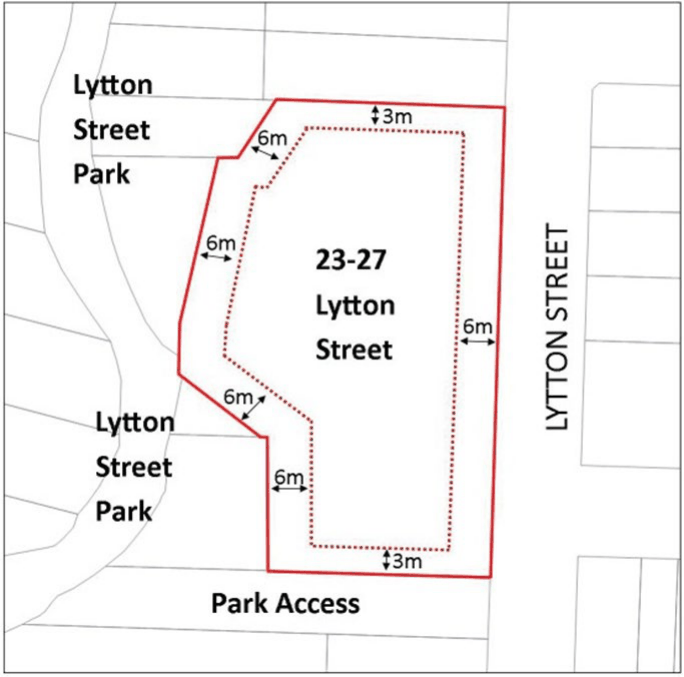
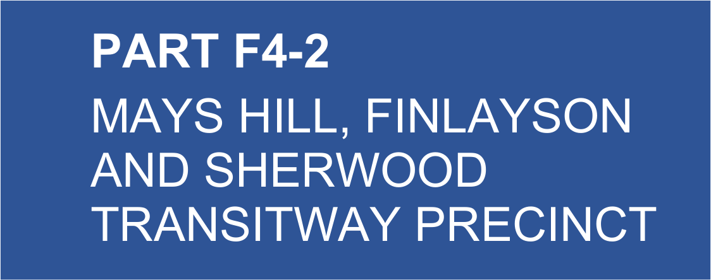

### PART F4-1

23 – 27 LYTTON STREET,

### WENTWORTHVILLE

This page has been left intentionally blank.

## 1. Introduction

### 1.1 Land to which this Section applies

This section applies to the land at 23-27 Lytton Street, Wentworthville, being formally described as Lot

1 DP787784.

## 2. Objectives and controls

#### Objectives

Ensure that any future development on the site provides adequate separation to

adjacent properties the low density development is consistent with that allowed under

the R2 zone of Cumberland LEP 2021.

Protect the amenity of nearby properties and the use of those properties.

#### Controls

Setbacks C1. Any new building on the property is to adhere to the following setbacks from the

identified property boundary:

• minimum of 6m setback from the front (street facing) property boundary. This

setback;

• distance may be reduced in order to align the new building with an existing building

on the property;

• minimum of 6m setback from the rear property boundary;

• minimum of 3m setback from the side property boundary; and

• minimum of 3m setback from the side and from the rear property boundaries to be

applied to basement levels.

Side and Rear Setbacks C2. The land within the rear and side setback areas is to be used for landscaping

(vegetation planting). This landscaping is to provide a level of privacy from, and to

provide a visual interruption to, the building when viewed from either the adjacent open

space areas or the residential properties to the north and south.

Landscaping C3. A minimum of 25% of the site area is to be landscaped.

> [Picture on page 9: a picture, saved as a picture (images/part-f4-special-precincts-page-9-1.gif, 150 dpi).]

Figure 1: Setbacks for 23-27 Lytton Street, Wentworthville (not to scale)

This page has been left intentionally blank.

> [Picture on page 11: a picture, saved as a picture (images/part-f4-special-precincts-page-11-1.gif, 150 dpi).]
