### PART F4-2

### MAYS HILL, FINLAYSON

### AND SHERWOOD

### TRANSITWAY PRECINCT

This page has been left intentionally blank.

## 1. Introduction

This Part of Cumberland Development Control Plan 2021 provides a framework that will guide future

development along the Liverpool to Parramatta Transitway and in particular, the Mays Hill, Finlayson

and Sherwood Precincts. This Part of the DCP applies to all development within the Transitway Precincts of Mays Hill, Finlayson

and Sherwood as shown in Figure 1.

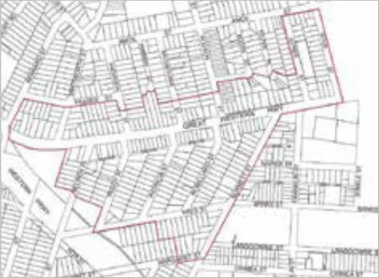

> [Picture on page 13: a picture, saved as a picture (images/part-f4-special-precincts-page-13-7.gif, 150 dpi).]

Figure 1: Mays Hill Transitway Precinct

## 2. Mays Hill Transitway Precinct

#### Vision

### 2.1 Desired Future Character Statement

The desired future character for Mays Hill is an active, urban area which makes full use of its proximity

to public transport and services, as well the Parramatta Central Business District. A mix of uses and good pedestrian access will encourage a fuller utilisation of the interface along the

Great Western Highway. Taller buildings along the highway will include retail and commercial uses at

the ground level, near the Transitway station, to promote an active and safe public domain. Residential

development above will offer convenient access to the Transitway station and precinct. A new laneway

between Burnett Street and Robilliard Street will improve permeability, and allow for rear lane access. Away from the highway, a transition between higher and lower density dwellings will occur. The

surrounding streets will be more domestic in scale that easily accesses the shops and services of

Mays Hill and the extensive open space. The opportunity for social interaction, provided by buildings

directly addressing streets, will promote a sense of community. Existing character, where desirable, will be kept, but a greater range of housing choice will be provided

through the construction of medium density dwellings. Well designed buildings will contribute to the

public domain. Site consolidation will allow more usable open space to be incorporated into new

developments.

### 2.2 Objectives and controls

#### General Objectives

Create an active urban area with a wide range of services and mixed uses in close

proximity to public transport by:

• mix of uses and good pedestrian access along the interface of the Great Western

Highway; and

• allowing taller buildings along the highway that include retail and commercial uses

at ground level; and

• creating a sense of community through retaining the domestic scale in the areas

adjacent to the highway; and

• consolidating sites to allow for more usable open space. Ensure development responds to:

• site opportunities and constraints; and

• the need for concentrated activity, building height and building mass on the

highway, while retaining a suburban feel to the adjacent blocks; and

• the need for high quality building and design. Ensure buildings in the Mays Hill Transitway Station Precinct, regardless of its use or

type, are of a quality design, such that the design:

• responds and contributes to its context being the key natural and built features of

the area;

• provides an appropriate scale in terms of the bulk and height that suits the scale

of the street and the surrounding buildings;

• achieves an appropriate built form for the site and the building’s purpose, in terms

of building alignments, proportions, building type and the manipulation of building

elements;

• has a density appropriate for the site and its context, in terms of floor space yields

(or numbers of units or residents);

• makes efficient use of natural resources, energy and water through the building’s

full life cycle, including construction;

• recognise that together landscape and buildings operate as an integrated and

sustainable system, resulting in greater aesthetic quality and amenity for both

occupants and the adjoining public domain;

• provides amenity through the physical, spatial and environmental quality of the

development;

• optimises safety and security, both internal to the development and for the public

domain;

• responds to the social context and needs for the local community in terms of

lifestyles, affordability, and access to social facilities;

• provides quality aesthetics that

- require an appropriate composition of building elements, textures, materials and

colours; and

- reflect the use, internal design and structure of the development; and

• permits appropriate access to the development that doesn’t compromise the safety

or disrupt the transitway network. Promote the principles of ecologically sustainable development.

Ensure flexible floor plates are provided to allow for mixed uses at ground floor level

fronting primary streets.

Maintain retail, commercial and community activity at street and ground floor level to

deliver an active enterprise corridor and encourage commercial office space or other

suitable non-residential uses at the first floor level of development.

### 2.3 Site Consolidation and Frontage

#### Objectives

Ensure all sites provide the required minimum frontage to adequately provide for

basement car parking.

Ensure all sites achieve the required minimum width to allow for a site configuration

that permits a consistent character and landscaped open space to the rear of sites.

Ensure any site amalgamation pattern does not restrict the development opportunity

of any adjoining site or the ability of adjoining sites to provide basement car parking or

rear open space.

Ensure future redevelopment results in quality streetscapes, amenity, and appropriate

passive surveillance, landscape and open space.

Require a more continuous building form along the Great Western Highway.

Ensure vehicular access for properties facing the Great Western Highway is provided

from secondary streets or laneways.

#### Controls

C1. Amalgamation of lots in accordance with Figure 2 and 3 is required for redevelopment.

C2. Land locking of adjoining sites is not permitted. Properties shall be amalgamated to

ensure the minimum frontage is obtainable without reducing the developability of

adjacent properties.

C3. Notwithstanding C1, the minimum lot frontage for all development fronting the Great

Western Highway shall be 45m.

C4. In instances where amalgamation cannot be achieved, the following information must

be submitted with any development application:

• two written valuations indicating the value of the remaining sites that were to be

developed in conjunction with the applicants properties. These are to be

undertaken by two independent valuers registered with the Australian Valuers

Institute; and

• evidence that a reasonable offer has been made to the owners(s) of the affected

sites to purchase and valuation reports.

C5. Alternative consolidation patterns may be considered by Council if it can be

demonstrated that development controls can be satisfied on the land and adjoining

properties.

C6. Where amalgamation (as required) is not achieved, the applicants must show that the

remaining sites, which are not included in the consolidation, will still be able to achieve

the development outcome prescribed in this DCP, including achieving the required

vehicular access, basement parking and built form.

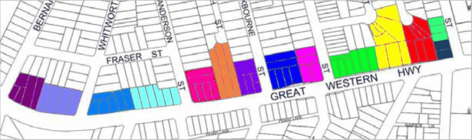

> [Picture on page 16: a picture, saved as a picture (images/part-f4-special-precincts-page-16-1.gif, 150 dpi).]

Figure 2: Lot amalgamation plan – North

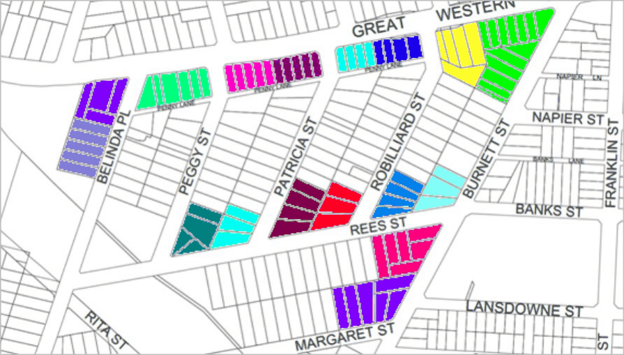

> [Picture on page 16: a picture, saved as a picture (images/part-f4-special-precincts-page-16-3.gif, 150 dpi).]

Figure 3: Lot amalgamation plan – South

### 2.4 Private accessway, laneways and vehicular access

#### Objectives

Ensure buildings fronting the Great Western Highway have vehicular access from the

rear or side of the property to improve vehicular and pedestrian traffic flow, pedestrian

safety, site functionality and reduce impacts on the wider network.

Ensure secondary vehicular access is created, where necessary, to mitigate amenity

and access constraints currently affecting or likely to affect the Mays Hill Transitway

Precinct.

Ensure all developments are able to obtain the required vehicular access and future

developability of sites is not restricted.

Ensure sites utilise existing access ways from the rear of the property for vehicular

access and parking.

Mitigate any impacts of vehicular traffic on residences and the adjoining precinct.

Minimise the visual impact of vehicle entrances to basement car parking through good

design and use of site slope and side setbacks, where appropriate.

Allow improved circulation space for pedestrians and future residents within the

precinct and ensure the creation of clear and direct pedestrian connections.

#### Controls

C1. Vehicular access to properties fronting the Great Western Highway and those within

the B6 zone on Burnett Street and Robilliard Street must be provided from the rear or

side, via laneways or secondary roads.

C2. Vehicular entry points shall be located away from intersections.

C3. Vehicular access from the Great Western Highway is not permitted from properties

identified on Figure 4 and access must be provided from the rear or side via laneways

or secondary roads.

C4. An 8m connecting laneway is required in accordance with Figure 5 for the

redevelopment of properties bounded by the Great Western Highway, Burnett Street

and Robilliard Street.

C5. A 6m wide vehicular accessway shall be provided from Good Street in accordance with

Figure 6.

C6. A pedestrian link shall be provided from Joyner Street that connects with the vehicular

access from Good Street in accordance with Figure 6.

C7. A pedestrian link shall be provided between Telfer Place and the Great Western

Highway in accordance with Figure 7.

C8. Laneways shall be treated as shared spaces to provide unimpeded access from

apartments to common facilities and open space.

C9. Refer to Part G this DCP to ensure that any relevant objectives and controls for

vehicular access are complied with.

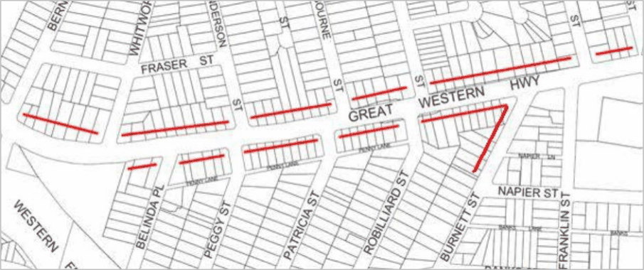

> [Picture on page 18: a picture, saved as a picture (images/part-f4-special-precincts-page-18-1.gif, 150 dpi).]

Figure 4: Properties where vehicular access is not permitted from the Great Western Highway or Burnett

Street

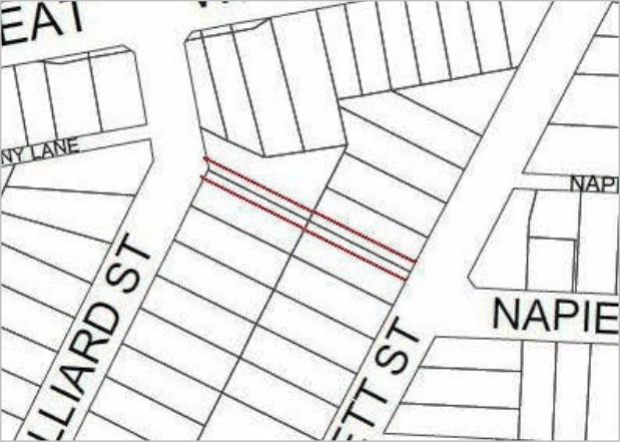

> [Picture on page 18: a picture, saved as a picture (images/part-f4-special-precincts-page-18-4.gif, 150 dpi).]

Figure 5: Proposed laneway

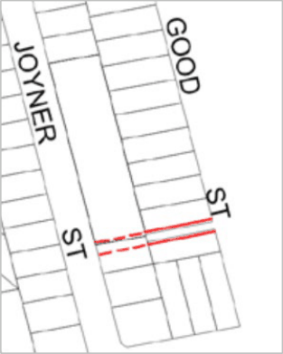

> [Picture on page 19: a picture, saved as a picture (images/part-f4-special-precincts-page-19-1.gif, 150 dpi).]

Figure 6: Proposed vehicular

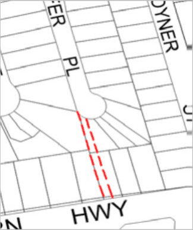

> [Picture on page 19: a picture, saved as a picture (images/part-f4-special-precincts-page-19-3.gif, 150 dpi).]

Figure 7: Proposed pedestrian link

accessway and pedestrian link

### 2.5 Building Height

#### Objectives

Require an appropriate scale relationship between building heights and street width.

Ensure the appropriate management of overshadowing, access to sunlight and

privacy.

Enable flexibility of uses by implementing higher floor to ceiling heights within buildings

for the ground and first floors.

Reduce the visual impact of buildings on the public domain.

Allow activation of the street edge on primary roads.

#### Controls

C1. The maximum height for development within the Mays Hill Transitway Precinct is

detailed within the Cumberland Local Environmental Plan 2021.

C2. The maximum building storey limits are detailed in Figures 8 and 9.

C3. Street wall heights, setbacks and minimum floor to ceiling heights are to be as set out

in Parts B2 and C of this DCP.

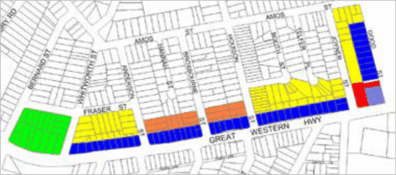

> [Picture on page 20: a picture, saved as a picture (images/part-f4-special-precincts-page-20-1.gif, 150 dpi).]

Figure 8: Building heights – North

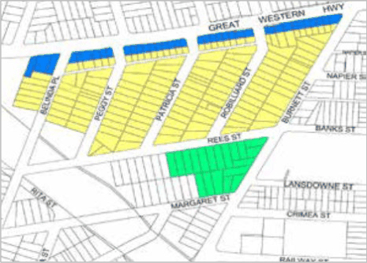

> [Picture on page 20: a picture, saved as a picture (images/part-f4-special-precincts-page-20-3.gif, 150 dpi).]

Figure 9: Building heights – South

### 2.6 Building Setbacks

#### Objectives

Create a clear threshold by providing a transition between public and private space.

Establish the desired spatial proportions of the street.

Ensure a continuous built edge within commercial and mixed use development for

activation of the street edge is achieved.

Ensure visual and acoustic privacy for residential development is enabled

Ensure a landscaped setback character for residential development is retained.

Ensure setbacks that respond appropriately to the building separation requirements

are achieved.

#### Controls

C1. Setbacks shall be in accordance with Figures 10 and 11.

C2. A 4m setback is required for properties fronting the Great Western Highway between

Joyner Street and Good Street to allow for mixed use development to occur and

sufficient space for landscaping.

C3. The residential component of developments fronting the Great Western Highway

between Burnett Street and Robilliard Street shall have a setback of 1m for all levels

above the first floor.

C4. Buildings facing the Great Western Highway are to be built to the boundary of adjoining

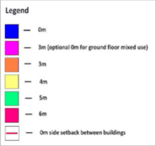

> [Picture on page 21: a picture, saved as a picture (images/part-f4-special-precincts-page-21-5.gif, 150 dpi).]

properties to form a continuous street edge.

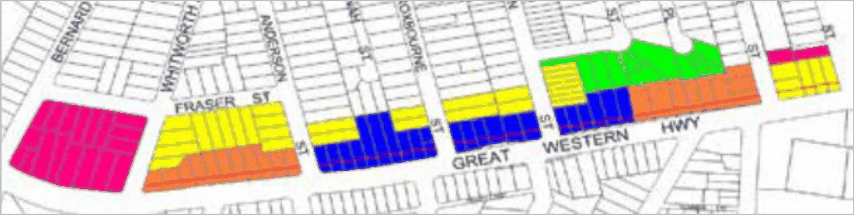

> [Picture on page 21: a picture, saved as a picture (images/part-f4-special-precincts-page-21-7.gif, 150 dpi).]

Figure 10: Building setbacks – South

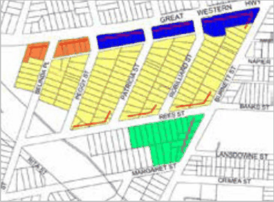

> [Picture on page 21: a picture, saved as a picture (images/part-f4-special-precincts-page-21-9.gif, 150 dpi).]

Figure 11: Building setbacks – North

### 2.7 Site Design and Appearance

#### Objectives

Require development in Good Street to be orientated across the amalgamated sites.

Ensure building design incorporates the use design solutions suitable to the location.

Ensure the articulation of buildings creates a desirable street presentation.

#### Controls

C1. Developments shall be oriented to front boundaries.

C2. Development on properties 84-88 Great Western Highway shall incorporate high

quality, innovative and sustainable design solutions to emphasise and represent their

gateway location.

C3. Vertical articulation and a break in the building facade is required above the fourth

storey for buildings exceeding 25m in length.

### 2.8 Road Widening

#### Objectives

Ensure a minimum width of 5.5m from the kerb to the property boundary is reserved

for the purpose of pedestrian facilities.

Ensure an adequate amount of land is identified for the purpose of future road

widening.

Ensure adequate land is provide for the provision of safe pedestrian and cycling

facilities.

Achieve a more consistent carriageway width along the Great Western Highway.

Provide wider carriageways and footpaths to cater for the increase in vehicular and

pedestrian traffic.

#### Controls

C1. Road widening is required along both sides of the Great Western Highway to result in

a footpath width of 5.5m from the kerb to the property boundary as indicated in Figure

12.

C2. Properties located behind the Transitway stops shall have a 4m separation between

the rear of the bus shelter and the building line to allow for the continuation of the

shared pedestrian/ cycle footpath.

Note: The 5.5m wide setback shall allow for a shared footpath consisting of the following

dimensions:

• a 1.5m verge from the kerb;

• a 2.5m shared path; and

• a 1.5m distance from the shared path to the building line.

Note: The amount of land required to meet the minimum 5.5m reserve is variable and will

depend on each individual property’s existing setback.

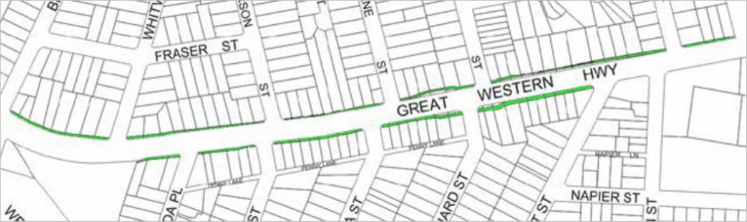

> [Picture on page 22: a picture, saved as a picture (images/part-f4-special-precincts-page-22-26.gif, 150 dpi).]

Figure 12: Properties subject to the 5.5m footpath widening reserve

## 3. Finlayson Transitway Precinct

#### Vision

### 3.1 Desired Future Character Statement

Finlayson station will be a better integrated part of the precinct as higher density residential

development occurs in close proximity to the station. The pedestrian experience will be improved

through increased ground floor activity on the Highway and a sense of connectivity between the two

parts of the precinct created through consistent setbacks and streetscaping. The precinct will continue to serve neighbourhood needs and passing trade captured by the existing

highway uses. The existing commercial area will be expanded, creating an activity zone that includes

the Transitway station. A variety of uses at ground level will create a safe and animated environment.

Taller buildings will be placed to take advantage of a topography which will minimise their impact.

Lower buildings will provide a transition between the precinct and adjoining low rise dwellings and

heritage areas. Site consolidation will allow ample communal open space to be offered to residents. Visitors and

residents will enjoy a pedestrian network that is pleasant convenient while access to nearby parks will

be improved.

## 4. Objectives and controls

### 4.1 Precinct Objectives

Focus new development around the existing commercial precinct of the Finlayson

Transitway Station, that shall consist of:

• where permissible, retail and commercial uses, at ground floor fronting the Great

Western Highway,

• appropriate residential development around the commercial core; and

• facilitating appropriate scale and size of development. Any proposed development in the Finlayson Transitway Precinct responds to:

• site opportunities and constraints; and

• the need for high quality building design Any proposed building in the Finlayson Transitway Station Precinct, regardless of its

use or type, being of a quality design, such that the design:

• responds and contributes to its context, being the key natural and built features of

the area;

• provides an appropriate scale in terms of the bulk and height that suits the scale

of the street and the surrounding buildings;

• achieves an appropriate built form for the site and the building’s purpose, in terms

of building alignments, proportions, building type and the manipulation of building

elements;

• has a density appropriate for the site and its context, in terms of floor space yields

(or numbers of units or residents, and

• makes efficient use of natural resources, energy and water throughout the

building’s full life cycle, including construction;

• recognises that together landscape and buildings operate as an integrated and

sustainable system, resulting in greater aesthetic quality and amenity for both

occupants and the adjoining public domain;

• provides amenity through the physical, spatial and environmental quality of the

development;

• optimises safety and security, both internal to the development and for the public

domain;

• responds to the social context and needs of the local community in terms of

lifestyles, affordability, and access to social facilities;

• provides quality aesthetics that:

o require an appropriate composition of building elements, textures, materials

and colours;

o reflect the use, internal design and structure of the development; and

o all development within the Finlayson Transitway Station Precinct shall be

undertaken in a way that promotes the principles of ecologically sustainable

development.

Ensure any development adjoining a heritage item does not adversely impact upon the

heritage item and/or heritage conservation area.

All development within the Finlayson Transitway Station Precinct shall be undertaken

in a way that promotes the principles of ecologically sustainable development.

Maintain retail, commercial and community activity at street and ground floor level to

deliver an active enterprise corridor and encourage commercial office space or other

suitable non-residential uses at the first floor level of development.

Encourage mixed use development along the enterprise corridor and local business

centre.

### 4.2 Site Consolidation

#### Objectives

Ensure all sites achieve the required minimum width to adequately provide for

basement car parking.

Ensure all sites achieve the required minimum width to allow for a site configuration

that permits a consistent landscaped open space to the rear of sites.

Ensure any site amalgamation pattern does not restrict the development opportunity

of any adjoining site or the ability of adjoining sites to provide basement car parking or

rear open space.

Encourage a more continuous building form.

#### Controls

C1. Amalgamation of lots in accordance with Figure 13 is required for redevelopment.

C2. The minimum lot frontage for all development in Finlayson shall be 30m.

C3. In instances where amalgamation cannot be achieved, the following information must

be submitted with any development application:

• two written valuations indicating the value of the remaining sites that were to be

developed in conjunction with the applicants properties. These are to be

undertaken by two independent valuers registered with the Australian Valuers

Institute, and;

• evidence that a reasonable offer has been made to the owners(s) of the affected

sites to purchase and valuation reports.

C4. Alternative consolidation patterns may be considered by Council if it can be

demonstrated that development controls can be satisfied on the land and adjoining

properties.

C5. Where amalgamation (as required) is not achieved, the applicants must show that the

remaining sites, which are not included in the consolidation, will still be able to achieve

the development outcome prescribed in this DCP, including achieving the required

vehicular access, basement parking and built form.

C6. Sites must not be left such that they are physically unable to develop in accordance

with the prescribed built form outcomes outlined in this DCP.

C7. Properties not identified in Figure 13 shall redevelop in accordance with the

development controls detailed in Part C of this DCP.

Note: Potential value can include, (but is not limited to) the land locked site developed jointly with adjoining properties, or on its own, under Cumberland LEP 2021 and this plan. A reasonable offer shall be a fair market value, and include for all expenses that would be incurred by the owner in the sale of the land locked site. Council will accept as documentary evidence a copy of a written offer delivered by registered mail to the affected owner(s) and dated no more than 3 months prior to the date of lodgment of the development application.

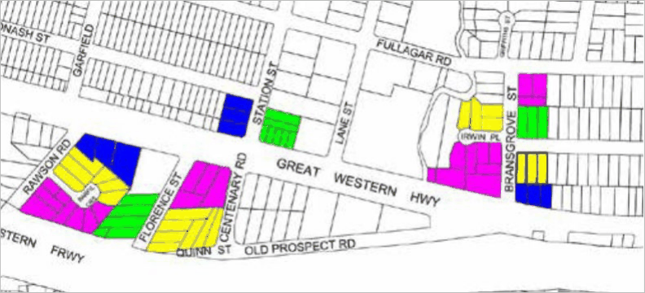

> [Picture on page 25: a picture, saved as a picture (images/part-f4-special-precincts-page-25-15.gif, 150 dpi).]

Figure 13: Lot amalgamation plan

### 4.3 Private accessway, land dedication and vehicular entries

#### Objectives

Require buildings fronting primary roads to have vehicular access from the rear or side

of the property.

Ensure sites utilise existing access ways from the rear of the property for vehicular

access and parking.

Create secondary vehicular access where necessary to mitigate amenity and access

constraints.

Create clear and direct pedestrian connections.

Allow improved circulation space for pedestrians and future residents within the

precinct.

#### Controls

C1. A 12m connecting laneway between Rawson Road and Florence Street is required in

accordance with Figure 14.

C2. A 15m connecting laneway between Florence Street and Quinn Street is required in

accordance with Figure 14.

C3. A pedestrian link is required between Chelmsford Road and Centenary Road as

identified in Figure 15.

C4. Where buildings front the Great Western Highway and Centenary Road, vehicular

access must be provided from the rear or side, via laneways or secondary roads.

C5. Refer to Part G of this DCP to ensure that any relevant objectives and controls for

vehicular access are complied with.

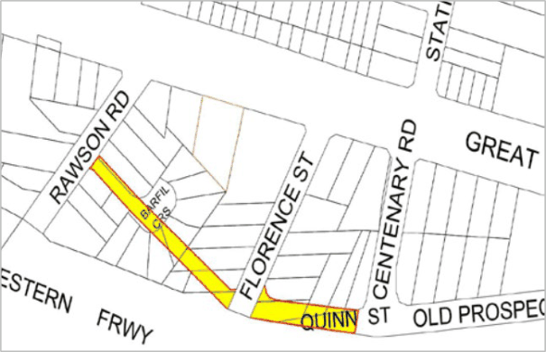

> [Picture on page 26: a picture, saved as a picture (images/part-f4-special-precincts-page-26-9.gif, 150 dpi).]

Figure 14: Proposed laneways

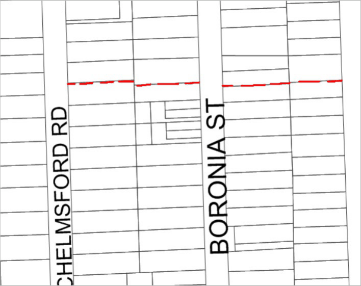

> [Picture on page 27: a picture, saved as a picture (images/part-f4-special-precincts-page-27-1.gif, 150 dpi).]

Figure 15: Proposed pedestrian link

### 4.4 Building Height

#### Objectives

Require an appropriate scale relationship between building heights and street width.

Ensure the appropriate management of overshadowing, access to sunlight and

privacy.

Enable flexibility of uses by implementing higher floor to ceiling heights within buildings

for the ground and first floors.

Reduce the visual impact of buildings on the public domain.

Allow activation of the street edge on primary roads.

#### Controls

C1. The maximum height for development within the Finlayson Transitway Precinct is

detailed within the Cumberland Local Environmental Plan 2021.

C2. The maximum building storey limits are detailed in Figures 16 and 17.

C3. Street wall height, setbacks and minimum floor to ceiling heights are referenced in

Parts B and C of this DCP.

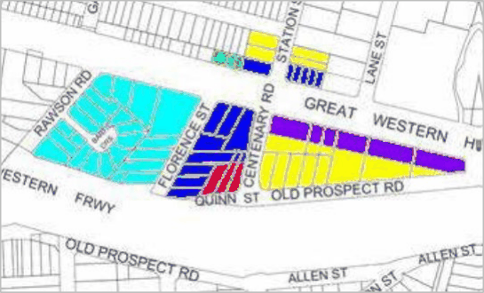

> [Picture on page 28: a picture, saved as a picture (images/part-f4-special-precincts-page-28-1.gif, 150 dpi).]

Figure 16: Building heights – East

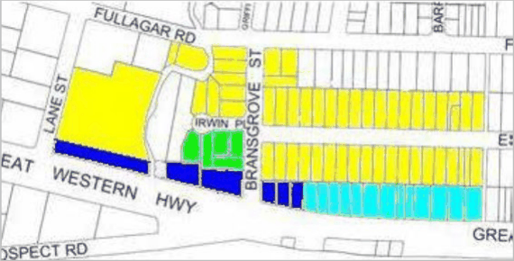

> [Picture on page 28: a picture, saved as a picture (images/part-f4-special-precincts-page-28-3.gif, 150 dpi).]

Figure 17: Building heights - South

### 4.5 Building Setbacks

#### Objectives

Create a clear threshold by providing a transition between public and private space.

Establish the desired spatial proportions of the street.

Require a continuous built edge within commercial and mixed use development for

activation of the street edge.

Enable visual and acoustic privacy for residential development.

Require setbacks which appropriately respond to the building separation requirements.

Retain a landscaped setback character for residential development.

#### Controls

C1. Setbacks shall be in accordance with Figures 18 and 19.

C2. Development along the Great Western Highway between:

• South - Rawson Road and Centenary Road;

• South - Centenary Road, Old Prospect Road and Great Western Highway;

• North - Land Street and Bransgrove Street; and

• North - Intersection of Station Street and Great Western Highway (east and west)

shall be built to the boundary to form a continuous street edge.

Note: Front, side and rear setbacks, unless indicated otherwise in Figures 18 and 19 are to be in

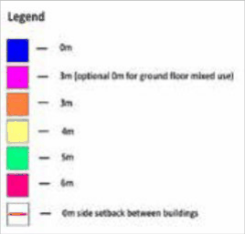

> [Picture on page 29: a picture, saved as a picture (images/part-f4-special-precincts-page-29-2.gif, 150 dpi).]

accordance with setbacks indicated in Part B or Part C of this plan.

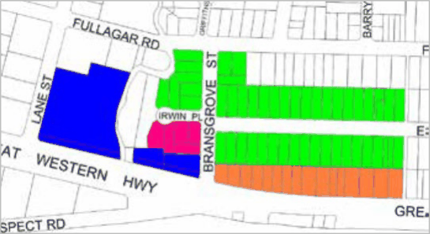

> [Picture on page 29: a picture, saved as a picture (images/part-f4-special-precincts-page-29-4.gif, 150 dpi).]

Figure 18: Setbacks – North

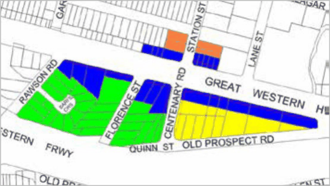

> [Picture on page 29: a picture, saved as a picture (images/part-f4-special-precincts-page-29-6.gif, 150 dpi).]

Figure 19: Building setbacks – South

## 5. Sherwood Transitway Precinct

### 5.1 Desired Future Character Statement

Sherwood will become a compact mixed use centre. It will retain the feel of a neighbourhood, but

higher density residential development will increase housing choice and maximise the use of the

transitway precinct and station. Site consolidation and redevelopment will rationalise land use and

define the precinct. Higher residential densities will be centred around the Transitway station. More consistent setbacks

and more attractive built form will define the street edges and increase residential amenity. New laneways will increase permeability for pedestrians. The compact form of Sherwood will

encourage walking. Services will be available in close proximity to the Transitway station, convenient

for time-poor commuters. Early planning for a supermarket will encourage its integration into the area. “Sleeving” the

supermarket and other large plate facilities will promote activity around it, creating a safe and

interesting environment for pedestrians.

## 6. Objectives and controls

### 6.1 Precinct Objectives

Create an active and vibrant mixed use, transit oriented village by:

• allowing active retail uses to front Sherwood Road;

• where permitted, providing the opportunity for appropriate commercial activity;

• prioritising pedestrians throughout the business core of the precinct; and

• facilitating appropriate scale and size of development. Improvement of vehicular and pedestrian traffic flow in the precinct by:

• restricting vehicular egress and ingress to buildings on Sherwood Road and

Merrylands Road;

• where necessary, the creation of new street connections;

• the creation of clear and direct pedestrian through site links in the business core

of the Precinct; and

• enabling clear and direct pedestrian accessibility to the Sherwood Transitway

station. Any proposed development responds to:

• site opportunities and constraints;

• the prominence of the intersection of Sherwood and Merrylands Roads; and

• the need for high quality building design. Any proposed building in the Sherwood Transitway Station Precinct, regardless of its

use or type, being of a quality design, such that the design:

• responds and contributes to its context, being the key natural and built features of

the area;

• provides an appropriate scale in terms of the bulk and height that suits the scale

of the street and the surrounding buildings;

• achieves an appropriate built form for the site and the buildings purpose, in terms

of building alignments, proportions, building type and the manipulation of building

elements;

• has a density appropriate for the site and its context, in terms of floor space yields

(or numbers of units or residents);

• makes efficient use of natural resources, energy and water throughout the

building’s full life  cycle, including construction;

• recognises that together landscape and buildings operate as an integrated and

sustainable system, resulting in greater aesthetic quality and amenity for both

occupants and the adjoining public domain;

• provides amenity through the physical, spatial and environmental quality of the

development;

• optimises safety and security, both internal to the development and for the public

domain;

• responds to the social context and needs of the local community in terms of

lifestyles, affordability, and access to social facilities;

• provides quality aesthetics that:

- require an appropriate composition of building elements, textures, materials

and colours; and

- reflect the use, internal design and structure of the development.

All development within the Sherwood Transitway Station Precinct shall be undertaken

in a way that promotes the principles of ecologically sustainable development.

Maintain retail, commercial and community activity at street and ground floor level to

deliver an active enterprise corridor and encourage commercial office space or other

suitable non-residential uses at the first floor level of development

### 6.2 Site Consolidation

#### Objectives

Ensure all sites provide the required minimum frontage to adequately provide for

basement car parking.

Ensure all sites achieve the required minimum width to allow for a site configuration

that permits a consistent landscaped open space to the rear of the site.

Ensure any site amalgamation pattern does not restrict the development opportunity

of any adjoining site or the ability of adjoining sites to provide basement car parking or

rear open space.

Establish fine grain shopfronts along primary retail streets.

#### Controls

C1. Amalgamation of lots in accordance with Figure 20 is required for redevelopment

C2. The minimum lot frontage for all development in the Sherwood Precinct shall be 30m.

C3. Where amalgamation cannot be achieved, the following information must be submitted

with any development application:

• two written valuations indicating the value of the remaining sites that were to be

developed in conjunction with the applicants properties. These are to be

undertaken by two independent valuers registered with the Australian Valuers

Institute; and

• evidence that a reasonable offer has been made to the owner(s) of the affected

sites to purchase and valuation reports.

C4. Where amalgamation (as required) is not achieved, the applicants must show that the

remaining sites, which are not included in the consolidation, will still be able to achieve

the development outcome prescribed in this part of the Cumberland DCP 2021,

including achieving the required vehicular access, basement parking and built form.

C5. Sites must not be left such that they are physically unable to develop in accordance

with the prescribed built form outcomes outlined in this DCP.

Note: Potential value can include, (but is not limited to) the land locked site developed jointly with adjoining properties, or on its own, under Cumberland LEP 2021 and this plan. A reasonable offer shall be a fair market value, and include for all expenses that would be incurred by the owner in the sale of the land locked site. Council will accept as documentary evidence a copy of a written offer delivered by registered mail to the affected owner(s) and dated no more than 3 months prior to the date of lodgement of the development application.

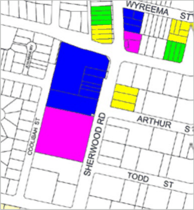

> [Picture on page 32: a picture, saved as a picture (images/part-f4-special-precincts-page-32-8.gif, 150 dpi).]

Figure 20: Lot Amalgamation Plan

### 6.3 Private access ways, vehicular entries and land dedication

#### Objectives

Require buildings fronting primary roads to locate vehicular access at the rear of the

property.

Ensure sites utilise existing access ways from the rear of the property for vehicular

access and parking.

Mitigate any impacts of vehicular traffic on residences and the adjoining precinct.

Allow improved circulation space for pedestrians and future residents within the

precinct.

Ensure pedestrian connections have sufficient width to allow for outdoor dining in

commercial areas.

#### Controls

C1. Where possible, buildings fronting Sherwood, Centenary or Merrylands Roads, must

be provide vehicular access from the rear or side, via laneways or secondary roads.

C2. Dedication of land at all corners of the intersection of Sherwood Road and Merrylands

Road and Centenary Road for public domain improvements is required in accordance

with Figure 21 for development.

C3. A 12m connecting laneway between Merrylands Road and Coolibah Street is required

in accordance with Figure 21.

C4. Vehicular access is to be designed in accordance with relevant objectives and controls

for vehicular access in Part G.

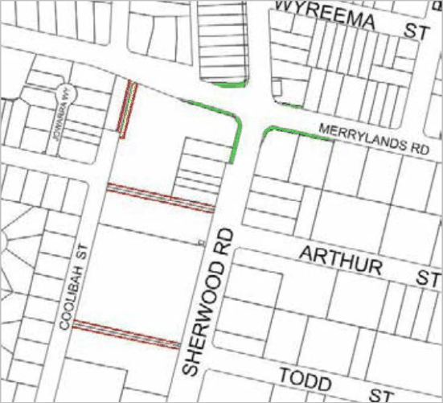

> [Picture on page 33: a picture, saved as a picture (images/part-f4-special-precincts-page-33-3.gif, 150 dpi).]

Figure 21: Proposed laneways and land dedication

### 6.4 Building Height

#### Objectives

Ensure an appropriate scale relationship between building height and street width.

Ensure the appropriate management of overshadowing, access to sunlight and

privacy.

Enable flexibility of uses by implementing higher floor to ceiling heights within buildings

for the ground and first floors.

Reduce the visual impact of buildings on the public domain.

Allow activation of the street edge on primary road.

#### Controls

C1. The maximum height for development within the Sherwood Transitway Precinct is

detailed within the Cumberland Local Environmental Plan 2021.

C2. The maximum building storey limits are detailed in Figure 22.

C3. Street wall height, setbacks and minimum floor to ceiling heights are referenced in

Parts B and C of this DCP.

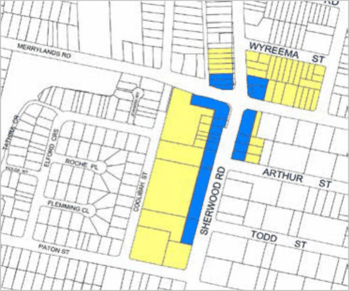

> [Picture on page 34: a picture, saved as a picture (images/part-f4-special-precincts-page-34-16.gif, 150 dpi).]

Figure 22: Building heights

### 6.5 Building Setbacks and Separation

#### Objectives

Create a clear threshold by providing a transition between public and private space.

Establish the desired spatial proportions of the street.

Require a continuous built edge within commercial and mixed use development for

activation of the street edge.

Retain a landscaped setback character for residential development.

Require setbacks which appropriately respond to the building separation requirements.

#### Controls

C1. Setbacks shall be in accordance with Figure 23.

C2. Development along Sherwood Road is to be built to the boundary of adjoining

properties to form a continuous street edge.

Note: Side setbacks, unless indicated otherwise in Figure 23 are to be in accordance with setbacks

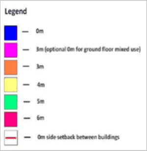

> [Picture on page 35: a picture, saved as a picture (images/part-f4-special-precincts-page-35-8.gif, 150 dpi).]

indicated in Part B or Part C of this plan.

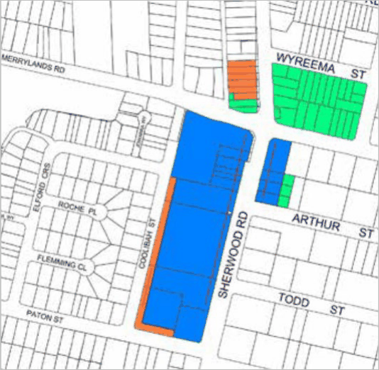

> [Picture on page 35: a picture, saved as a picture (images/part-f4-special-precincts-page-35-10.gif, 150 dpi).]

Figure 23: Setbacks

This page has been left intentionally blank

> [Picture on page 37: a picture, saved as a picture (images/part-f4-special-precincts-page-37-1.gif, 150 dpi).]
