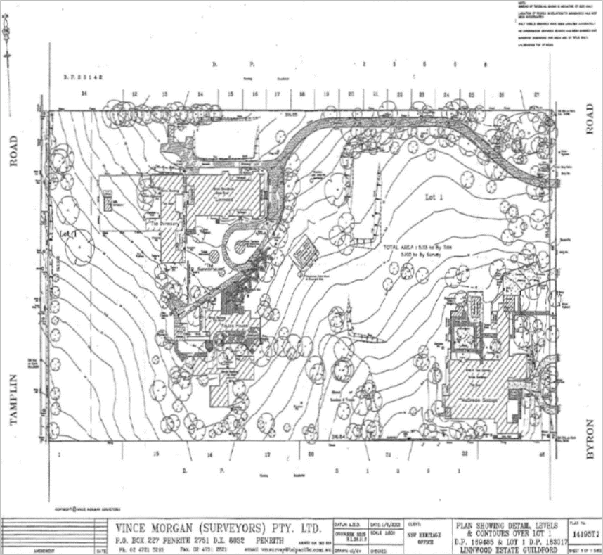
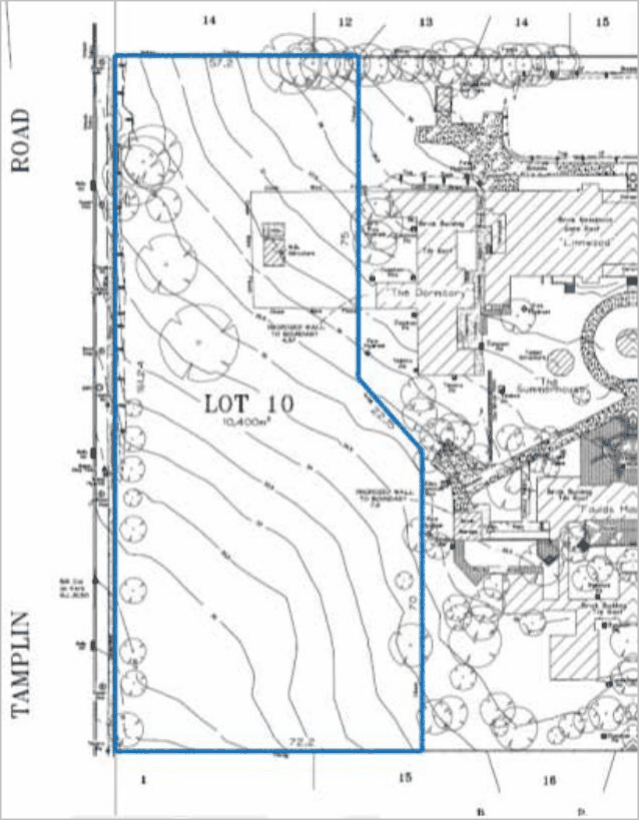
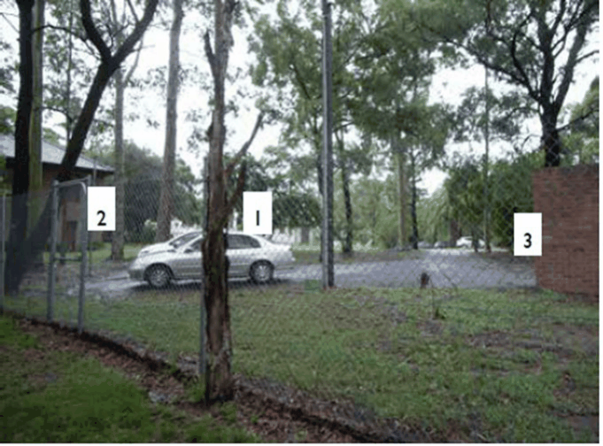
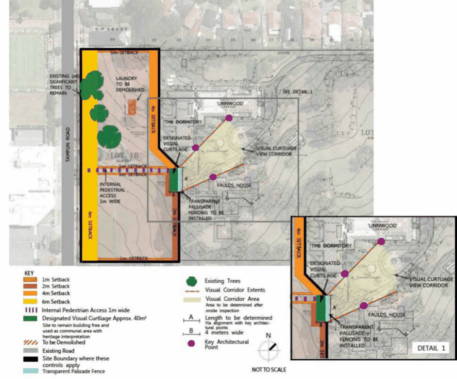

### PART F4-3

### TAMPLIN ROAD

### RESERVE

This page has been left intentionally blank

## 1. Introduction

### 1.1 Land to which this Part applies

This part applies to the land shown on Figure 1 and known as the Tamplin Road Reserve.

### 1.2 Purpose of this Part

This Part shall be read in conjunction with the following Parts of the Cumberland DCP 2021, which

contain objectives and development controls that may relate to development in this part: Part A – Introduction and General Controls Part B – Development in Residential Zones Part C – Development in Business Zones Part E – Other Land Use Based Development Controls Part G - Miscellaneous Development Controls Definitions

## 2. Vision and location

### 2.1 Land to which this Section applies

The historic Linnwood Estate is located in the suburb of Guildford and is bounded by Tamplin and

Byron Roads (refer to Figure 1).

> [Picture on page 40: a picture, saved as a picture (images/part-f4-special-precincts-page-40-1.gif, 150 dpi).]

Figure 1: The original Linnwood Estate allotment, pre subdivision

The Estate comprises of several buildings which are classified as of State heritage significance. These

buildings are located in the central and eastern sections of the site and comprise of the McCredie

Cottage, “Linnwood” the original house, dormitory extensions and Faulds House. This section of the DCP applies to the western portion of the estate or Lot 10, as shown in Figure 2.

The DCP is intended to guide the development on the site to ensure that the recognised heritage

significance and the cultural setting of the Estate’s heritage items are conserved. Development must also be consistent with the recommendations of the Linnwood Conservation Plan

(2004); available at Council. The Linnwood Conservation Plan was prepared for the entire Linnwood

Estate including the subdivided Lot 10.

> [Picture on page 41: a picture, saved as a picture (images/part-f4-special-precincts-page-41-1.gif, 150 dpi).]

Figure 2: Lot 10, the proposed subdivided lot, outlined in blue

## 3. Objectives and controls

#### Objectives

Minimise any negative impact on the State heritage significance of the Linnwood

Estate.

Identify an appropriate heritage curtilage to protect key view corridors.

Maintain and improve the setting of the existing significant trees.

Provide a visual buffer to the Linnwood Estate’s heritage items.

Ensure any proposed development is planned and developed in an environmentally

responsive manner and is consistent with the Conservation Policy recommendations

of the Linnwood Conservation Plan.

#### Controls

Setbacks C1. Setback controls as outlined below and in Figure 4.

C2. Development shall be setback a minimum of 6m from the principal street frontage,

Tamplin Road.

C3. The minimum side setback from the south eastern and north western boundaries of

the site must be at least 1m (refer to Figure 4).

C4. The minimum rear setback from the north eastern boundary must be in accordance

with Figure 4.

Height C5. Development shall have a maximum height of 2 storeys.

C6. Any future development must ensure that the heritage items are not subject to any

unreasonable overshadowing.

Roof Form C7. The roof form of any future development shall have regard to the style, form, pitch and

bulk of the existing heritage items.

C8. Materials to be used shall include terracotta or slate tiles. These materials must be of

a dark uniformed colour (such as black, dark grey or olive).

C9. New roof shapes shall be of a ‘hipped’ style, with a pitch similar to the dormitory building

and Faulds House.

Heritage C10. The laundry building, as shown in Figure 4 and addressed in the Linnwood

Conservation Plan, may be demolished due to its poor physical condition. Any

demolition, will be subject to Council approval.

C11. Any future development must retain the six existing trees, as illustrated in Figure 4 and

within the Linnwood Conservation Plan. These trees are from the original local eucalypt

woodland, known as Cumberland Forest and are of historic significance.

C12. Create a heritage curtilage as shown in Figure 4. This curtilage area is recognised by

the Conservation Plan to ensure the current view corridor to the Linnwood Grounds is

preserved:

• no buildings are to be built within the designated heritage curtilage. Only

recreational structures are allowed and may be in the form of open gazebos, BBQ

facilities, tables or benches;

• a 2m setback must be incorporated along the south eastern and south western

boundaries of the curtilage area as outlined in Figure 4;

• palisade fencing must be used along the north eastern boundary of the curtilage

area in order to retain the view corridor (see Figure 4);

• subject to Council approval existing trees and shrubs within this curtilage area may

be removed and this curtilage area may be planted with low density vegetation and

ground covers only;

• this curtilage area must be used as a communal open space only; and

• the curtilage area should incorporate heritage interpretive panel(s) in accordance

with the Linnwood Conservation Plan. Details should be provided as part of any

future development approval.

C13. The curtilage area and dimensions are outlined in Figure 4 and should be read in

conjunction with Figure 3, which identifies the 3 features which delineate the view

corridor which in turn defines the curtilage area.

• the size of the curtilage area should be approximately 40 sqm;

• ‘Boundary A’ of the curtilage area, as illustrated in Figure 4, must be aligned with

the 3 key architectural points in Figure 3.

• a clear view corridor must be retained between these 3 key features, as they are

of historical importance. These features include the following and as illustrated in

Figure 3:

> [Picture on page 43: a picture, saved as a picture (images/part-f4-special-precincts-page-43-6.gif, 150 dpi).]

Figure 3: Architectural features

(1) The south eastern entry to the porch of ‘Linnwood’ the original house;

(2) The most eastern corner of the dormitory building; and

(3) Parallel to the existing pathway drawn from the south western corner of Faulds house. Colours and Material C14. New buildings are to incorporate a colour scheme and appropriate materials which will

minimise intrusive elements and will contribute to the cohesiveness of the surrounding

area.

C15. Colours and materials must be compatible with the character of the existing

streetscape and should not detract from the original heritage items within the Linnwood

Estate in particular the “Linnwood” House and Fauld House.

C16. To encourage the use of traditional construction materials, the following is

recommended:

• brown or dark red bricks; or

• brickwork which is rendered in a soft colour scheme.

C17. Full details of colours and materials should be provided with any future DA.

Pedestrian Walkway C18. Create a shared pedestrian walkway from Tamplin Road to the designated heritage

curtilage area as shown in Figure 4. This pathway will provide common access to the

heritage curtilage area and also a common view corridor for occupants of the

development.

• this pathway shall be a private pathway for use by the occupants of the new

development only;

• this pathway must be a least 1m wide;

• a minimum building setback of 1m , either side of the pathway, must be

implemented; and

• the area contained in this setback may consist of low density vegetation and

ground covers only.

C19. The location of the pathway is flexible and can be altered in accordance with the future

development of the land, however the pathway must connect the curtilage area to

Tamplin Road, and provide common access for all occupants of the development.

C20. Future built form must be separated into at least 2 building blocks on either side of the

pedestrian walkway. This will allow the construction of the shared pedestrian pathway.

Fences C21. Front fences and gates along Tamplin Road, should be of a Palisade style as they are

appropriate to the existing character of the heritage items:

• palisade fences have panels of cast iron with shaped tops, connected by a

horizontal rail; and

• front Fences should be a maximum of 1500mm high.

C22. Palisade fencing must also be used along the north eastern boundary of the curtilage

area, in order to retain the view corridor into the Linnwood Estate.

C23. Boundary fences along the side and rear boundary of the site should be constructed

using timber materials:

• side and rear boundary fences should be a maximum of 1800mm high.

> [Picture on page 45: a picture, saved as a picture (images/part-f4-special-precincts-page-45-1.gif, 150 dpi).]

Figure 4: Lot 10, the proposed subdivided- identifying the site’s development controls

This page has been left intentionally blank

> [Picture on page 47: a picture, saved as a picture (images/part-f4-special-precincts-page-47-1.gif, 150 dpi).]
