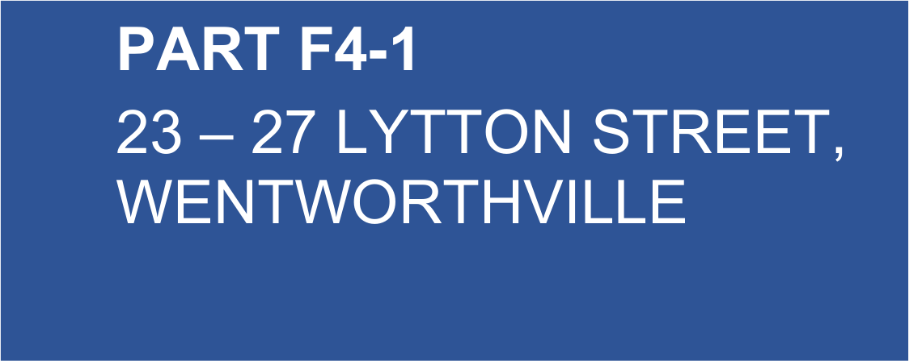

# Cumberland Development Control Plan 2021 - Part F4 Special Precincts

> This chapter is split into 4 section file(s), one per sub-part heading, in the order they appear in the PDF.

Source PDF: [Cumberland DCP 2021 Part F4 - Updated.pdf](Cumberland%20DCP%202021%20Part%20F4%20-%20Updated.pdf)

> [Picture on page 1: a picture, saved as a picture (images/part-f4-special-precincts-page-1-1.gif, 150 dpi).]

### PART F4

### SPECIAL PRECINCTS

This page has been left intentionally blank.

### Part F4 Contents

| PART F4-1 | 23-27 LYTTON STREET, WENTWORTHVILLE | F4 - 6 |
|---|---|---|
| 1. Introduction |  | F4 - 8 |
| 2. Objectives and controls |  | F4 - 8 |
| PART F4-2 MAYS HILL, FINLAYSON AND SHERWOOD TRANSITWAY PRECINCT |  | F4 - 11 |
| 1. Introduction |  | F4 - 13 |
| 2. Mays Hill Transitway Precinct |  |  |
| 2.1 | Desired Future Character Statement | F4 - 13 |
| 2.2 | Objectives and controls | F4 - 14 |
| 2.3 | Site Consolidation and Frontage | F4 - 15 |
| 2.4 | Private Accessway, Laneways and Vehicular Access | F4 - 16 |
| 2.5 | Building Height | F4 - 19 |
| 2.6 | Building Setbacks | F4 - 20 |
| 2.7 | Site Design and Appearance | F4 - 21 |
| 2.8 | Road Widening | F4 - 22 |
| 3. Finlayson Transitway Precinct |  |  |
| 3.1 | Desired Future Character Statement | F4 - 23 |
| 4. Objectives and controls |  |  |
| 4.1 | Precinct Objectives | F4 - 23 |
| 4.2 | Site Consolidation | F4 - 24 |
| 4.3 | Private Accessway, Land Dedication and Vehicular Entries | F4 - 25 |
| 4.4 | Building Height | F4 - 27 |
| 4.5 | Building Setbacks | F4 - 28 |
| 5. Sherwood Transitway Precinct |  |  |
| 5.1 | Desired Future Character Statement | F4 - 30 |
| 6. Objectives and controls |  |  |
| 6.1 | Precinct Objectives | F4 - 30 |
| 6.2 | Site Consolidation | F4 - 31 |
| 6.3 | Private access ways, vehicular entries and land dedication | F4 - 32 |
| 6.4 | Building Height | F4 - 34 |
| 6.5 | Building Setbacks and Separation | F4 - 34 |

| PART F4-3 TAMPLIN ROAD RESERVE |  | F4 - 37 |
|---|---|---|
| 1. Introduction |  | F4 - 39 |
| 2. Vision and location |  | F4 - 39 |
| 3. Objectives and controls |  | F4 – 41 |
| PART F4-4 Woodville Road Corridor |  | F4 – 47 |
| 1. Introduction |  | F4 – 49 |
| 1.1 | Land to which this part applies | F4 – 49 |
| 1.2 | Relationship to other parts of Cumberland DCP 2021 | F4 – 50 |
| 1.3 | Purpose of this part | F4 – 50 |
| 2. Vision and Desired Future Character |  | F4 – 50 |
| 2.1 | Vision | F4 – 50 |
| 2.2 | Desired future character | F4 – 51 |
| 3. Corridor Objectives and Controls |  | F4 – 52 |
| 3.1 | Lot consolidation and minimum street frontage | F4 – 52 |
| 3.2 | Building height | F4 – 56 |
| 3.3 | Building setbacks | F4 – 56 |
| 3.4 | Street wall height and upper-level setbacks | F4 – 63 |
| 3.5 | Building elements | F4 – 64 |
| 3.6 | Active street frontage | F4 – 66 |
| 3.7 | Awnings | F4 – 70 |
| 3.8 | Access and movement | F4 – 70 |
| 3.9 | Air quality, noise and vibration | F4 – 77 |
| 3.10 | Public domain | F4 – 78 |
| 3.11 | Heritage conservation | F4 – 79 |
| 3.12 | Flood control | F4 – 82 |
| 3.13 | Contamination | F4 – 82 |
| 4. Site Specific Controls and Block Control Diagrams for the Woodville North |  | F4 – 83 |
| Precinct |  |  |
| 4.1 | Land to which this clause applies | F4 – 83 |
| 4.2 | Site specific controls and block control diagrams | F4 – 85 |
| 5. Site Specific Controls and Block Control Diagrams for the Merrylands East |  | F4 - 102 |
| Precinct |  |  |
| 5.1 | Land to which this clause applies | F4 – 102 |
| 5.2 | Site specific controls and block control diagrams | F4 – 102 |

| 6. | Site Specific Controls and Block Control Diagrams for the Woodville South Precinct 6.1 Land to which this clause applies 6.2 Site specific controls and block control diagrams | F4 – 109 F4 – 109 F4 – 109 |
|---|---|---|

> [Picture on page 6: a picture, saved as a picture (images/part-f4-special-precincts-page-6-1.gif, 150 dpi).]

<!-- sections -->
## Sections

1. [Part F4-1 23 – 27 LYTTON STREET, WENTWORTHVILLE](01-f4-1-23-27-lytton-street-wentworthville.md)
2. [Part F4-2 MAYS HILL, FINLAYSON AND SHERWOOD TRANSITWAY PRECINCT](02-f4-2-mays-hill-finlayson-and-sherwood-transitway.md)
3. [Part F4-3 TAMPLIN ROAD RESERVE](03-f4-3-tamplin-road-reserve.md)
4. [Part F4-4 WOODVILLE ROAD CORRIDOR](04-f4-4-woodville-road-corridor.md)
