### PART G2

### HERITAGE

This page has been left intentionally blank.

## 1. Introduction

Heritage includes places and landscapes of historic, cultural, social, spiritual, natural, archaeological, architectural or aesthetic significance.

### 1.1 Land to which this Part applies

This Part applies includes land identified under Cumberland LEP 2021 as a heritage item, heritage conservation area and archaeological site. This Part also applies to land within the vicinity of heritage items, conservation areas and archaeological sites. In the event of any inconsistency between the general objectives and controls and the objectives and controls listed in specific heritage conservation areas, the specific controls will take precedence.

### 1.2 Other listings

State Listed heritage items are also subject to the requirements of the Heritage Act 1977 (or any subsequent legislation) as well as any associated documentation, such as a conservation management plan, for the item.

Development in the vicinity of Old Government House and Domain in Parramatta (also known as Parramatta Park), that is a World Heritage Site and a National Heritage Site, are to address the associate heritage values and requirements of those listings and potential impacts including to the view and setting.

### 1.3 Heritage Conservation Areas

Heritage Conservation Areas are integral to the historical significance of those places. The heritage value of a conservation area lies not just with the heritage significance of individual buildings, but with other factors, including the landform, subdivision pattern and the history of development. The following Heritage Conservation Areas are specifically covered by this DCP:

• Blaxcell Estate Conservation Area

• Fullagar Road Conservation Area

• Granville Civic Precinct Conservation Area

• Granville Residential Precinct Conservation Area

• Tooheys Estate Conservation Area

This DCP identifies existing buildings that collectively demonstrate the history of a conservation area and contribute to its significance. These are known as contributory items.

Contributory items may not be individually listed as heritage items but, by virtue of their age, scale, materials, details, design style or intactness, make a significant contribution to the character of the heritage conservation area.

Non-contributory items may be described as neutral or intrusive. In the event of any inconsistency between the general objectives and controls and the objectives and controls listed in specific heritage conservation areas, the specific controls will take precedence.

## 2. Objectives and controls

### 2.1 Development requirements for environmental heritage

#### Objectives

Identify development that is considered minor by Council as it relates to environmental heritage, including heritage items and heritage conservation areas.

Assist in the preservation of the integrity of any item of environmental heritage identified in the Cumberland Local Environmental Plan 2021 or a Conservation Instrument under the Environmental Planning and Assessment Act 1979 and/or Heritage Act 1977.

Promote sympathetic redevelopment of, or surrounding, a heritage item that complements the style and character of any item of environmental heritage.

#### Control

Contributory items are required to be retained.

Non-contributory items not identified are not required to be retained.

Documentation

Council may waive the need for applicants to submit a Heritage Impact Statement as may be required under the LEP, if it deems the development and its potential impacts are minor in nature.

A Conservation Policy or Conservation Management Plan may be required, depending on the significance of the item, the proposed works and the need for strategies for the retention of the significance of the heritage item.

Development applications and their assisting documentation shall be prepared in accordance with the Burra Charter.

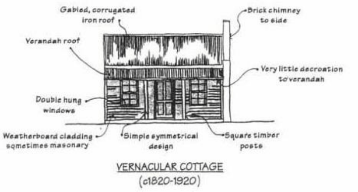

> [Picture on page 16: a picture, saved as a picture (images/part-g-miscellaneous-development-controls-page-16-23.gif, 150 dpi).]

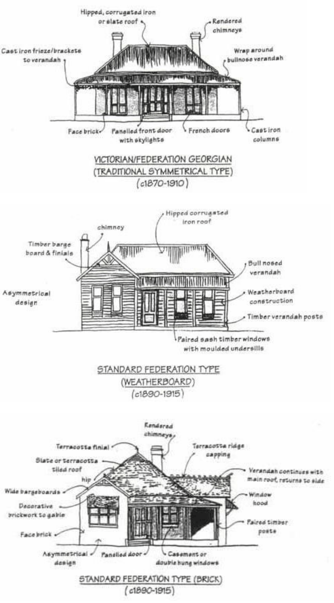

> [Picture on page 17: a picture, saved as a picture (images/part-g-miscellaneous-development-controls-page-17-1.gif, 150 dpi).]

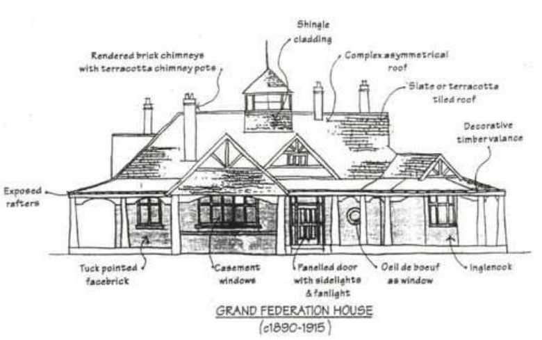

> [Picture on page 18: a picture, saved as a picture (images/part-g-miscellaneous-development-controls-page-18-1.gif, 150 dpi).]

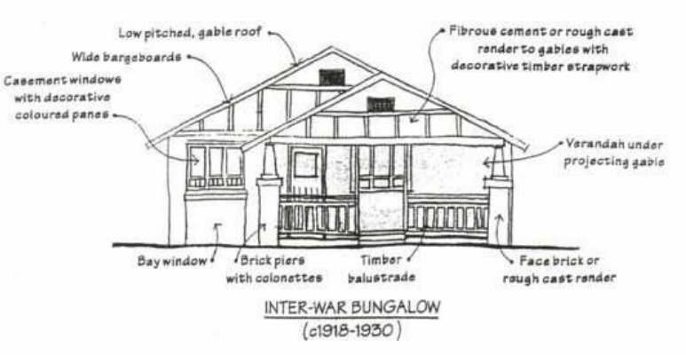

> [Picture on page 18: a picture, saved as a picture (images/part-g-miscellaneous-development-controls-page-18-2.gif, 150 dpi).]

### 2.2 Conservation and development works on heritage items

#### Objectives

Ensure that development does not damage the heritage item or heritage conservation area.

Ensure development reinforces the established character of the item/conservation area through appropriate built form and design.

Allow heritage items to be adaptively reused with minimal and acceptable changes to building fabric, with a proposal that shall incorporate the use of unobtrusive and well-designed signage, lighting and external treatments.

#### Controls

New development should be consistent with the guidelines and policies of any relevant conservation plan adopted by Council, and where appropriate, with State government requirements.

New dwellings on sites occupied by an item of environmental heritage shall be designed and constructed in a manner that does not detract from the historic significance of that item or the area.

Ensure that conservation or maintenance works on a heritage item use materials, detailing, features, and design elements that are appropriate to the style and age of the heritage item.

Additions and/or extensions to heritage items:

• are to be located and designed to complement the existing scale, character and amenity of the streetscape;

• are not to dominate the appearance of the heritage item from the street; and

• are to consistent with the style of the heritage item.

All new development within the curtilage of a heritage item is to be suitably located and retains the visual dominance of the heritage item, with minimal impact upon the fabric and significant landscaping associated with the item.

Garages and carports are designed and located to ensure that they do not impact upon the appearance or fabric of the heritage item and its setting, and comfortably fit with the character of the area.

Alterations or additions to existing commercial or civic heritage items are to be designed to respect the scale and form of the existing building and are located to have minimal visual impact from the street and on the significant fabric of the building.

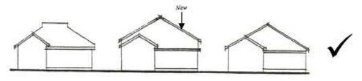

> [Picture on page 19: a picture, saved as a picture (images/part-g-miscellaneous-development-controls-page-19-25.gif, 150 dpi).]

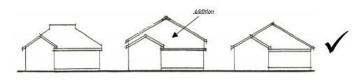

> [Picture on page 19: a picture, saved as a picture (images/part-g-miscellaneous-development-controls-page-19-26.gif, 150 dpi).]

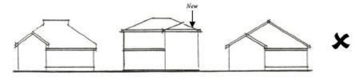

> [Picture on page 19: a picture, saved as a picture (images/part-g-miscellaneous-development-controls-page-19-27.gif, 150 dpi).]

Figure 1: Example of alterations or additions to existing or commercial heritage items

General conservation and maintenance works

When undertaking any form of development, conservation, maintenance or construction works on a heritage item, the materials, colours, maintenance and construction techniques used shall be appropriate to the heritage item.

Original face brick should generally not be rendered as it removes and covers over the original colours and textures of the building.

New roofing materials should match or be sympathetic in style and colour to the appearance of original materials.

When undertaking works on a heritage item, the design of building detailing such as windows or doors, should be in keeping with the age and style of the heritage item.

Where original design features of heritage items, such as bullnosed verandahs, have been removed, these should be replaced where possible as they are important to the design and appearance of the building and generally serve a useful function.

Where original gates and fences still remain as part of a heritage property, these should be retained. Where this is not possible, the use of replacement fences and gates should be in a style appropriate to the design and style of the building.

Where original gates and fences still remain as part of a heritage property, these should be retained. Where this is not possible, the use of replacement fences and gates should be in a style appropriate to the design and style of the building.

Residential alterations and extensions

When undertaking extensions or alterations to a heritage item, the design of the proposed extensions or alterations should be compatible with the style of the heritage item and its height, scale and proportion.

In general, where an extension is proposed to a single storey dwelling, the extension should also be single storey and should be located to the side or rear of the property, so as not to affect the streetscape appearance of the item.

Rear second storey additions should use recessive colours and should not visually dominate the existing building to the front.

Any proposed roof extensions should be carefully designed to ensure that it is compatible with the original building. Roofs of additions should be consistent with the existing roof in terms of its form, pitch, eaves and ridge height, and should be in proportion to the existing building.

Design details

The treatment of design details, such as verandah posts, doors or windows, on new extensions to heritage items should be sympathetic with those of the original building where possible. It may be appropriate to use a simpler version of the design details used in the original building, so that the new additions are in keeping with, yet still able to be differentiated, from the original structure.

Garages and carports

When adding a new garage to a heritage item, open-sided carports are generally more acceptable and less intrusive than solid structures as they do not affect the fabric and streetscape appearance of the heritage item.

If a solid garage is proposed for a heritage item, the garage should be located away from (i.e. detached from) the main house structure

Where possible, solid garages should be set back from the front, side and rear of the property boundary.

Garage or carport designs should use design detailing, materials and colours that refer to, and are compatible with, the original building.

Landscaping and gardens

The siting of buildings should retain any significant trees and gardens identified on the site.

Curtilage development

Where proposing development within the curtilage of a heritage item, the new development should be designed so that the heritage item retains its visual prominence.

The colours and materials used within the new development shall be recessive and complement the colours and materials of the heritage item.

Where new development is proposed within the curtilage of a heritage item, a reasonable “buffer” space should be provided between the original building and the new development.

Significant gardens should be retained as part of any works within a curtilage, where possible.

New development within the curtilage should not adversely impact upon the significant fabric of a heritage item.

The height of new buildings shall not exceed that of the original heritage building.

The new development shall be massed so that lower-scale buildings act as a transition between the new and the old.

New development within the curtilage of a heritage item should not block the sight lines from public areas to the original building.

Civic, commercial development and adaptive reuse

Retention of the original streetscape facades is required, with extensions or redevelopment to be located to the rear of the property.

Development should be compatible with the existing height, scale, massing and detailing and setbacks and orientation of existing development within the streetscape. New extensions should be recessive to the original building.

Colours and materials should be carefully selected so that they do not visually dominate, or overly contrast with, that of the existing heritage item. New development shall utilise compatible colour schemes and materials with the original building.

For development involving churches or schools, the removal of more recent structures is considered acceptable where it is demonstrated that they are not critical to the heritage significance of the property.

New development should be located to the side or rear of the heritage item and the original building should visually dominate.

Development should not impact upon the sight lines from public areas to the original building.

Development should minimise any changes to the significant fabric of the building and, in particular, to the streetscape appearance of the heritage item.

Signage, lighting, materials and colours used should be unobtrusive and compatible with the overall style and design of the building.

### 2.3 Specific development controls for Heritage Conservation Areas

#### Objectives

Ensure that contributory items are retained and improved.

Ensure that new development is sympathetic to the identified heritage values.

Ensure that development respects the original built form, architectural style and character of the area.

#### Controls

General

New dwellings on sites occupied by, adjoining or in the vicinity of an item of environmental heritage, and/or within a Heritage Conservation Area, shall be designed and constructed in a manner that does not detract from the historic significance of that item or the area.

When undertaking conservation or maintenance works on a building within a conservation area, the materials, colours and maintenance techniques used should be appropriate to the style and age and the context of the building.

Works relating to a heritage conservation area should avoid high retaining walls and changes of land produced by cut and fill which in turn produces buildings of disparate height.

The design of the building detailing, such as windows or doors, should be in keeping with the age and style of the building and to the overall character of the conservation area.

Fences

Properties within conservation areas should, where possible, retain original gates and fences that contribute to heritage significance of the area.

Any new fences or gates are to use a style and materials that are appropriate to the age of the building and to the character of the conservation area.

Garages

Open-sided carports or hardstand areas are preferred where new on-site parking is proposed. Where solid structures (ie enclosed garages) are proposed, these should g be located away from the main house structure,

Where solid structures (i.e. enclosed garages) are proposed, where possible, these should be setback from the front, side and rear of the property boundary.

Alterations, additions and extensions

Where any alterations, additions or extensions are proposed to a building within a conservation area, these should:

• be carefully designed to continue the specific scale and form of the building and the overall character of the conservation area;

• consider the accurate reinstatement of building features and other works shown in historical photographs;

• avoid painting, rendering or re-skinning of original brick walls; and

• make use of pavilions or skillion extensions.

Additions or extensions to buildings within a conservation area should be located away from the street frontage and side boundaries and are to be designed to complement the materiality, scale, form, style of the building and character of the conservation area.

Subdivision

Works within a heritage conservation area should maintain the historical pattern of subdivision.

Subdivision must not adversely impact on the established form, shape and size of the development or the existing pattern and scale of development.

Siting, setbacks and garden area

Works within a heritage conservation area should maintain amenity and privacy of gardens.

Works should investigate archaeological potential of areas where new buildings are sited.

Garages/carports should be placed in backyards and separate from existing buildings, where possible.

Works should respect any significant trees and gardens identified on the site.

Streetscape character

New development should make reference to, and be sympathetic to the predominant:

• height;

• scale;

• roof form, line and pitch;

• proportion;

• setbacks;

• design details (including parapets, verandahs, awnings and string courses); and

• features of adjoining development and of any adjacent conservation areas.

New development should be compatible with heritage items in terms of its scale and massing, overall bulk and composition. New buildings should not dominate their surroundings.

Conservation areas

Buildings located within the Fullagar Road Heritage Conservation Area, Toohey’s Palm Estate Group Heritage Conservation Area, Granville Civic and Granville Residential Conservation Areas, and Blaxcell Conservation Area shall retain their original materials, features and detailing where appropriate and practical and support by a heritage impact statement.

Works located within the former Lidcombe Hospital Conservation Area are to address the State legislative requirements and listing information, and the conservation management plan.

### 2.4 Specific controls for development in the vicinity of a heritage item

#### Objectives

Ensure that new development is sympathetic to the identified heritage values.

For new development to be designed to maintain the existing streetscape character and is compatible with its particular heritage themes.

Ensure that new development is carefully sited to avoid causing physical damage to any heritage item or building within a conservation area, as well as ensuring it does not overshadow or affect the curtilage, landscaping, setting, solar access or views associated with any heritage item.

#### Controls

New dwellings on sites adjoining or in the vicinity of an item of environmental heritage shall be designed and constructed in a manner that does not detract from the historic significance of that item.

Context

The development shall be designed having regard to its environmental and built context, to the existing streetscape character and to any heritage items or conservation areas that may be located nearby.

Streetscape character

New development should make reference to, and be sympathetic to the predominant:

• height;

• scale;

• roof form, line and pitch;

• proportion;

• setbacks;

• design details (including parapets, verandahs, awnings and string courses); and,

• features of adjoining development and of any adjacent heritage items.

New development should be compatible with heritage items in terms of its scale and massing, overall bulk and composition. New buildings should not dominate their surroundings.

Where a residential flat building is proposed adjoining or adjacent to a heritage item, any height and scale differences between a heritage item and new development should be minimised by stepping the height or locating the bulk of the new development away from the heritage item.

Window and door openings, building lines and building massing of new development should also be designed in the context of its adjoining development.

Where a particular heritage character predominates within a street, the design of new development should be compatible with this heritage character.

Setbacks and orientation

New development shall be carefully sited so that it is consistent with the predominant street and boundary setbacks. This may be varied where an increased or decreased front or side setback will assist in ensuring that a new development does not visually dominate any adjoining heritage items.

New buildings within an existing streetscape should not be oriented across sites contrary to the established pattern.

Where a new development is proposed adjoining a significant heritage feature, new development should continue the primary orientation and should provide an appropriate entry design and setback treatment along that frontage.

Siting and location

The siting of new development should not affect the structure of, or otherwise cause physical damage to, any heritage item.

New development should be located so that it does not adversely impact upon the identified curtilage, setting or landscaping, solar access or any significant views to or from a heritage item.

Visual impact

The design of the street elevation should be relatively uncomplicated and consist of simple forms that do not visually compete with the heritage item.

New development adjoining/adjacent to a heritage item should avoid incorporating large unbroken wall areas.

Where new development is necessarily larger than its surrounding development, the bulk can be reduced by breaking long walls into bays or by arranging the openings in the wall so that their size and shape reflect the structure and the openings of its neighbours.

Landscaping should be used to minimise the visual appearance of large wall areas in new development adjoining a heritage item.

Where new development is proposed adjoining a heritage item or conservation area, the development should incorporate the use of colours and materials that are recessive

so that they do not visually dominate the heritage item. Darker colours and simple facade treatments can assist in minimising the visual impact of new development on adjoining heritage items.

Buildings in the vicinity of heritage items or conservation areas should use a style and material of fencing (and gates) that are appropriate to the age and style of the heritage item and/or to the character of the conservation area.

### 2.5 Specific conservation area controls

#### 2.5.1 Blaxcell Estate

History

The land on which this conservation area is situated had been privately acquired and subdivided as early as 1922, but very few of the lots had sold. The Commission bought the estate, kept the proposed street pattern, re-subdivided the lots, leaving a few private lots (all at the end of streets). This was the first of the Commission’s group developments in New South Wales and the buildings in Montgomery Street were completed in December 1944. They were constructed in full double brick with Marseilles tiled roofs, decorative use of bricks around front porches and identical front fences.

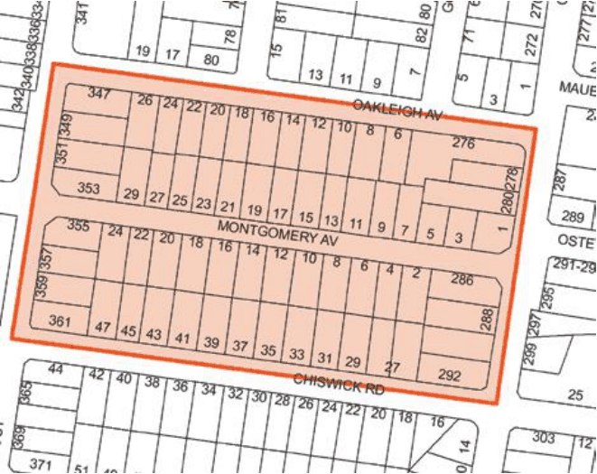

> [Picture on page 26: a picture, saved as a picture (images/part-g-miscellaneous-development-controls-page-26-17.gif, 150 dpi).]

Figure 2: Blaxcell Estate, South Granville

Distinctive Characteristics

• flat to gently undulating clay land which drains slowly to the east and Duck Creek

• regular sized allotments, mostly

• 20m x 34m

• single storey freestanding houses separated from the street and neighbours by large garden space, with lawn and shrubs

• spaciousness of the area created by:

- width of each allotment

- wide side boundaries

- background view to large remaining eucalypts

- backyard placement of garages and carports

• houses standing parallel to the street

• intact street character and a remarkable number of the houses, most of which have very few alterations or additions

• consistent age of the houses - almost all date from 1944 - 1950 with a few from the 1960s

• uniform building shape (form), scale and setbacks

• one chimney per house

• uniform building materials - bricks and tiles to Montgomery Street; fibro and tiles to the other street, with the occasional timber clad house and brick corner houses in Oakleigh Ave

• uniform brick fences to Montgomery Street and few fences throughout the rest of the

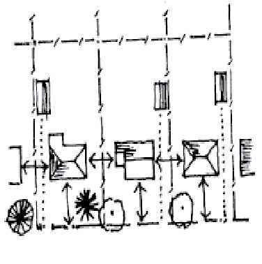

> [Picture on page 27: a picture, saved as a picture (images/part-g-miscellaneous-development-controls-page-27-16.gif, 150 dpi).]

area

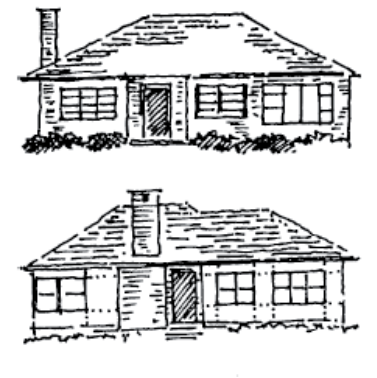

> [Picture on page 27: a picture, saved as a picture (images/part-g-miscellaneous-development-controls-page-27-18.gif, 150 dpi).]

Figure 3: Distinctive Characteristics

Statement of significance

This area comprises the first group development in NSW constructed in 1944 by the newly formed Housing Commission, having taken over a privately developed subdivision. The area is remarkable for its totally intact core area of Montgomery Street which has kept all its fencing and all original houses without second storey additions. The brick houses demonstrate the ideals with which the Commission commenced its charter, while the fibro houses are the result of the cost effective measures undertaken soon after to produce the quantity of houses needed at that time. The consistent scale, siting, materials and fences of the development provides a cohesive 1940s suburban character, and the fibro housing is a particularly good example of the very extensive Housing Commission development throughout Parramatta.

#### Objectives

Protect the area’s single storey residential character, especially its 1944 face brick houses and fences.

Maintain front and side garden spaces.

#### Controls

Landform / natural characteristics

Keep remaining eucalypts and encourage their replanting on rear boundaries of private gardens.

Subdivision pattern

Maintain the 1944 pattern of subdivision.

Avoid re-subdivision by amalgamation of back garden space.

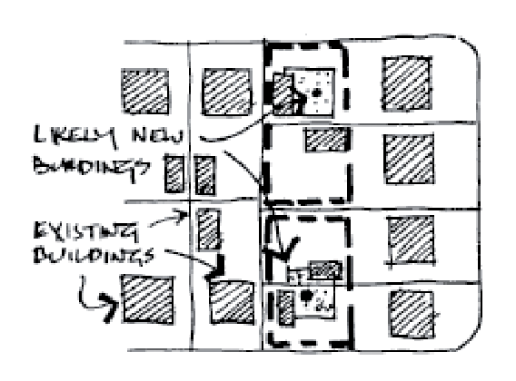

> [Picture on page 28: a picture, saved as a picture (images/part-g-miscellaneous-development-controls-page-28-8.gif, 150 dpi).]

Figure 4: Subdivision pattern

Siting, setbacks and garden area

Maintain the existing pattern of development, of individual single storey houses on wide parcels of land surrounded and separated by garden space.

Keep views and space between buildings and maintain amenity and privacy of back gardens.

Keep at least 50% of the site for garden area.

Ensure similar side boundary setbacks to those existing.

Avoid additions to the front or side of an existing house.

Avoid establishing any new building or structure standing closer to the front street alignment than existing houses.

Second storey additions will not be supported.

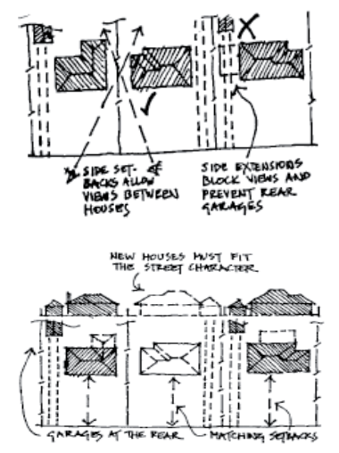

> [Picture on page 29: a picture, saved as a picture (images/part-g-miscellaneous-development-controls-page-29-1.gif, 150 dpi).]

Figure 5: Side setbacks and garden areas

Alterations and additions

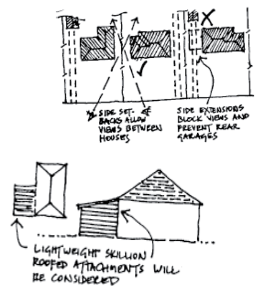

> [Picture on page 29: a picture, saved as a picture (images/part-g-miscellaneous-development-controls-page-29-4.gif, 150 dpi).]

Extra rooms above the existing main body of the house which require alteration of existing roof shape are not permissible. Rooms in roof may be considered but only where they are ventilated by flat, in-plane skylights on the back slope of the roof.

Avoid new dormer windows, mansard roofs or large bulky additions visible from the street.

Linked pavilions under a separate roof form, or skillion extensions both to the back of the house are supported.

Keep all existing chimneys.

Painting, plastering or re-skinning of brick houses or fences in Montgomery Street or Oakleigh Street is not desirable.

Avoid recladding of existing fibro buildings (including garages and other ancillary buildings) in brick as this would confuse the history of the area. Recladding in other lightweight materials, such as fibro-cement, timber or imitation timber is acceptable.

Avoid re-roofing of main body of the existing house except to match original materials, maintaining the existing balance of red and blue tiles.

New development

Repeat single storey scale for houses with maximum wall height the same as existing houses.

Hipped pitched house roofs should not exceed the pitch of existing house roofs.

Setbacks should be the same as original houses in the street.

Access to garages and carports should be by a side driveway beside house to the backyard.

Materials for any new house facing Montgomery Street to be of face or common bricks with Marseilles tile roof.

Materials for main part of any new house in other streets to be of timber, fibro or imitation timber cladding, with terra cotta tile roofs.

Materials for utility buildings and garages in lightweight materials such as fibro, imitation timber cladding or ‘corrugated iron’.

In Montgomery Street, avoid use of hearted, speckled, multicoloured or textured bricks in light colours.

Roofing materials other than terracotta tiles are not desirable.

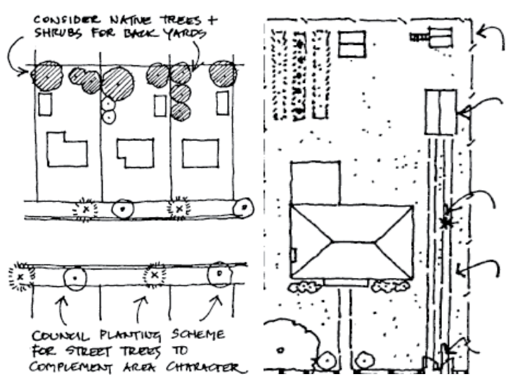

> [Picture on page 30: a picture, saved as a picture (images/part-g-miscellaneous-development-controls-page-30-13.gif, 150 dpi).]

Figure 6: New development

Fences

The following fences must be kept:

• Clyde Street: Nos 286 and 288; and

• Montgomery Street: Nos 2 - 24 and Nos 9 - 25 and 29.

Keep the existing street character, with fenceless street alignments for all properties other than those listed in the above control.

Public lands

Maintain and reinstate those elements of the public domain which contribute to an understanding of the history of the area.

Improve the residential amenity and enjoyment of the public street area.

Prepare a uniform planting scheme for the streets of this area to complement the formal 1940s character of the houses. Plantings such as crepe myrtle (which is bare in winter) or clipped pine are the most suitable.

Street plantings of native shrubs or trees are not suitable to the formal line of the streets and the house setbacks.

Plant on or near side boundary alignment to minimise effect of tree shade on front wall of house.

Existing significant buildings

Keep all buildings and other structures that explain the history of the area and contribute to its significance.

Keep all the following buildings, which together demonstrate the history of the area and contribute to its significance, with their present form and roof shape:

• Blaxcell Street: Nos 347 - 361

• Chiswick Street: Nos 27- 47

• Clyde Street: Nos 270 - 280 and 286, 288.

• Cordon Street: Nos 69, 71 and 82

• Montgomery Street: Nos 2 - 24 and Nos 7 - 29

• Pegler Street: Nos 76, 78, 79, 80, 81

• Oakleigh Street: Nos. 4 - 16 and 20 - 26 and 1 - 7 and 11 – 17

#### 2.5.2 Granville Civic and Residential Precincts

History

The character of the Civic and Residential Precinct conservation areas is largely determined by the development that occurred during the 1880s. This was stimulated by the relocation of a number of large manufacturing industries close to the railway. The 1880s saw the construction of new houses, including both workers’ cottages and more substantial residences for the managers and factory owners, and a complete community quickly established itself. For 25 years from 1905, when Clyde Engineering was awarded large contracts to build locomotives, Granville saw another great period of development, with the appearance of: new small industries, new housing, new shops and businesses.

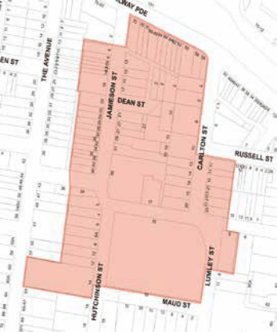

> [Picture on page 32: a picture, saved as a picture (images/part-g-miscellaneous-development-controls-page-32-1.gif, 150 dpi).]

Civic Precinct

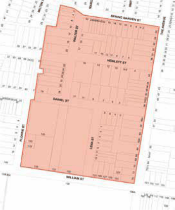

> [Picture on page 32: a picture, saved as a picture (images/part-g-miscellaneous-development-controls-page-32-3.gif, 150 dpi).]

Residential Precinct

Figure 7: Civic and Residential Precincts

Distinctive Characteristics

• Varied subdivision patterns and allotment sizes with consequential varied building forms.

• Predominantly residential in character, with some larger scaled civic, religious, commercial and educational buildings.

• In the Residential Precinct, low scale development and a sense of space.

• Variety of residential buildings - single and two storey freestanding suburban houses, pairs of attached dwellings and terraces, separated from the street by garden space.

• Early buildings stand close to front fence.

• Buildings stand parallel to the street, with the space between the building line and front fence generally free of structures such as garages or carports.

• Predominance of brick as a building material with tile, slate or iron roofs but with interest and variety provided by occasional use of other materials - stone, rendered and ashlared brick, timber.

• Front garden space visible from the street mostly over low front fences built of varied materials, many of which respond to the materials and importance of the building behind brick, timber and wire on timber frame.

• In the Civic Precinct Conservation Area, the total garden area is generally about 40% of the site.

• Remnants of street tree planting of brush box and silky oak which frame and unify the street space and cool pavements in summer.

• Remnants of sandstone kerbs and gutters in important civic and residential streets - in the Residential Precinct Conservation Area these have sometimes been removed to form garden edges around recent central street tree planting.

• Predominance of buildings from 1880s - 1930s which collectively show how the area has grown and provide the historic significance and character of the area.

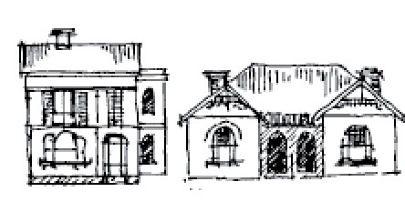

> [Picture on page 33: a picture, saved as a picture (images/part-g-miscellaneous-development-controls-page-33-1.gif, 150 dpi).]

Figure 8: Streetscape character

Statement of significance

The Civic Precinct Conservation Area is at the civic, religious and residential heart of Granville together with the Residential Precinct Conservation Area and collectively represent its great periods of growth and prosperity. The area is predominantly residential in character with some larger scaled civic, religious, commercial and educational buildings. Through their street planting and edging, their civic, commercial, educational and religious buildings, and their range of housing types, age and size, these areas reflect the substantial role played by Granville in the development of western Sydney, the way in which it developed and the nature of its social

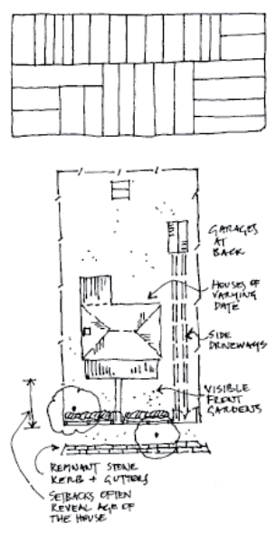

> [Picture on page 33: a picture, saved as a picture (images/part-g-miscellaneous-development-controls-page-33-11.gif, 150 dpi).]

structure.

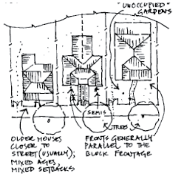

> [Picture on page 33: a picture, saved as a picture (images/part-g-miscellaneous-development-controls-page-33-13.gif, 150 dpi).]

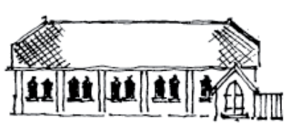

> [Picture on page 33: a picture, saved as a picture (images/part-g-miscellaneous-development-controls-page-33-14.gif, 150 dpi).]

Figure 9: Significant characteristics

#### Objectives

Retain all the attributes that contribute to the heritage value and character of the Granville Civic and Residential Precincts.

#### Controls

Landform / natural characteristics

High retaining walls and buildings of disparate height are not permitted.

Maintain the natural shape of landform.

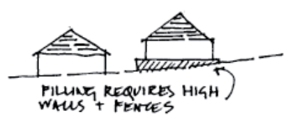

> [Picture on page 34: a picture, saved as a picture (images/part-g-miscellaneous-development-controls-page-34-8.gif, 150 dpi).]

Figure 10: Landform / natural characteristics

Subdivision

Re-subdivision along the length of the allotment may be considered and, in line with past practice, re-subdivision across the line of corner allotments may be considered, but only where the resultant development would not have the potential to detrimentally affect the setting of a building listed below as an Existing Significant Building or disturb the

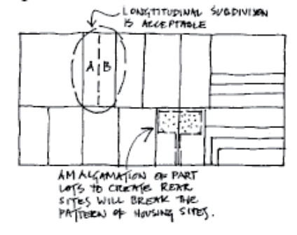

> [Picture on page 34: a picture, saved as a picture (images/part-g-miscellaneous-development-controls-page-34-15.gif, 150 dpi).]

existing streetscape.

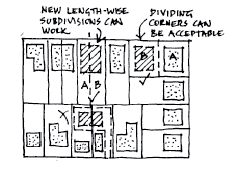

> [Picture on page 34: a picture, saved as a picture (images/part-g-miscellaneous-development-controls-page-34-17.gif, 150 dpi).]

Figure 11: Subdivision

Siting and garden area

Maintain the historical pattern of development where individual dwellings are established on separate parcels of land.

Maintain amenity and privacy of back garden space to residential buildings.

Keep existing side driveway access for cars to rear garden garage/carports.

Continue parallel alignment of new buildings to the street.

Dual occupancy development is not permitted, except where it can be accommodated in a modest attached addition to the rear of an existing house.

For commercial areas, 40% of the site be retained for garden area and 50% for residential areas.

Alterations and additions

Development should complement heritage without imitation so that the new work does not compete with historic buildings in the area or detract from the area’s visual consistency and amenity.

Additions are permitted at the rear of the building or within the existing roof form only and are to be modest. Rooms in the roof will be considered but only where they are ventilated by flat in-plane skylights. Additions which change the shape of the original roof or the character of the building are not permitted.

Additions to the side of an existing building are not permissible where they would prevent side driveway access to rear garages/carports.

Avoid dormer windows and mansard roofs.

In the Civic Precinct Conservation Area, corrugated iron may be used as a cladding for extensions to an existing house.

Brick walls are not to be repainted or reskinned.

Avoid additions higher than the ridgeline of the house.

New buildings

New buildings should not compete in height or scale with existing significant buildings listed under ‘Existing Significant Buildings’ at the end of this Section.

Avoid establishing new buildings closer to the front street alignment than nearby pre- 1930 buildings.

The maximum wall height of new buildings in the Civic Precinct Conservation Area is

7.2 metres, provided that there is no competition in presentation with existing significant buildings.

Hipped or gabled pitched roofs must not exceed 32 degrees. Rooms in the roof may be considered but only where they are ventilated by flat, in-plane skylights on the rear face of the roof.

Materials for new buildings should be face or common bricks, timber or rendered masonry, with slate, terracotta tile or corrugated iron roof cladding.

Boundary-to-boundary development is not appropriate as it does not allow garages and other ancillary structures to be located at the rear of the development. In exceptional cases, where the lot is less than 10m wide, a front garage may be integrated with a new house, providing that it is set back from the front wall of the house by a minimum of 1m and its design and construction avoid negative impact on the streetscape.

Do not use imitation slate or obtrusively coloured roofing materials.

Imitation architectural details from earlier styles are not appropriate.

Garages, carports and other ancillary buildings

Maintain the uncluttered space between the building line and the front fence as an important part of the street character - this space should be free of garages, carports and other structures.

In residential locations of the conservation areas, garages and carports should not be integrated into the house except where the allotment is less than 10m wide.

Keep garages and carports as secondary utilitarian buildings.

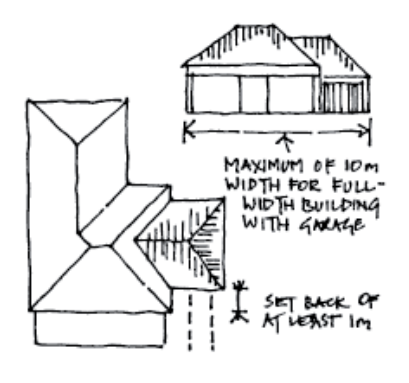

> [Picture on page 36: a picture, saved as a picture (images/part-g-miscellaneous-development-controls-page-36-10.gif, 150 dpi).]

Figure 12: Garages

Front fences

Every effort should be made to keep and maintain the front fences at the following addresses, which are a most important part of the history and character of the area:

Table 1: Conservation Areas and Residential Precincts Areas

| Civic Precinct Conservation Area | Residential Precinct Conservation Area |
|---|---|
| Carlton Street: No 12 Jamieson Street: Nos 17* (timber), 30*, 39* (stone) Railway Parade: Nos 62*, 64*, 72 *Heritage Item | Daniel Street: No 17 Hewlett Street: No 18* The Avenue: Nos 58*, 66* |

Avoid fences higher than 1.2 metres.

Keep fences made of materials such as timber or wire frame on timber mesh with hedge, if desired. In some cases a new brick fence may be acceptable.

Avoid high front privacy walls of brick, timber or brush.

Avoid timber picket front fences unless to replace a known original picket fence.

Avoid new brick front fences, except where there is evidence of an earlier brick fence, lost or changed since its construction.

For side and back boundaries, continue the use of timber pailing fences.

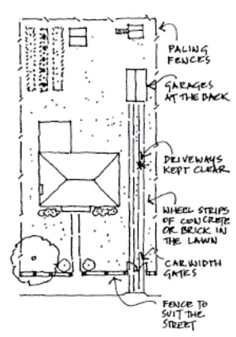

> [Picture on page 37: a picture, saved as a picture (images/part-g-miscellaneous-development-controls-page-37-6.gif, 150 dpi).]

Figure 13: Fencing and Garages

Existing significant buildings

The following significant buildings, which together demonstrate the history of the area and contribute to its significance, must be retained:

Civic Precinct Conservation Area

Buildings from the 1880s - 1890s:

• Carlton Street: No 10* (town hall)

• Hutchinson Street: Nos 6, 10 - 12* (police station), 14* (church)

• Jamieson Street: Nos 6 - 14* (terrace), 29*, 39* (church, hall and rectory)

• Mary Street: No 8*

Buildings from c1905 - c1930:

• Carlton Street: No 10* (town hall)

• Hutchinson Street: Nos 6, 10 - 12* (police station), 14* (church)

• Jamieson Street: Nos 6 - 14* (terrace), 29*, 39* (church, hall and rectory)

• Mary Street: No 8*

Residential Precinct Conservation Area

Buildings from the 1870s:

• The Avenue: Nos 36*, 52*, 54*

Buildings from the 1880s - 1890s:

• Hewlett Street: No 4*

• Spring Garden Street: Nos 2, 4, 12, 14*, 20, 22, 24*, 26*, 28*, 30*

• The Avenue: Nos 42*, 58*, 60*

• William Street, Nos 123*, 133* (public school)

• Walter Street: Nos 4*, 30*, 32*

Buildings from c1905 - c1930:

• Daniel Street: Nos 3, 4, 5, 6, 7, 9, 11*, 17

• Hewlett Street: Nos 6*, 7, 8*, 9, 10,11, 13, 18*, 20, 21, 23

• The Avenue: Nos 28*, 30, 32, 34, 44, 46, 48, 50, 56, 61, 66*, 70, 72, 74*

• Spring Garden Street: Nos 10, 16, 18

• Walter Street: Nos 8, 10, 11, 20, 22, 24, 26, 28

\* Heritage item

#### 2.5.3 Fullagar Road Conservation Road

The Fullagar Road War Service Homes group has both local and state-wide historic, social and aesthetic significance. Within Holroyd, the group is the largest and most intact representative example of Inter-War service homes, and provides evidence of contemporary social and architectural attitudes to housing ex-service personnel in the years immediately following World War I. The buildings are significant individually and as a group, as fine and largely intact examples of the Inter-War Georgian style constructed in quality materials with good layouts and style. Within the state context the group is one of the earliest War Service homes estates so far to the west of Sydney, and one of the few groups which were constructed in this distinctive style.

#### Objective

Buildings located within the Fullagar Road Heritage Conservation Area shall retain their original materials, features and detailing.

#### Controls

Any proposed works on a building which has been identified as a heritage item within this conservation area should be designed to retain the original classical detailing as well as the fenestrations (arrangement of windows in a wall) which are characteristic of buildings within this conservation area).

Where works are proposed to a building that is currently face brick, the building should remain unpainted or unrendered.

Where additions and extensions are proposed, these should be single storey only, and are to be located to the rear or side of the building so that they do not impact upon the presentation of the building from the street.

Alterations and extensions should not alter the form or fabric of the roof. In general, roofs of single storey additions in this conservation area should be consistent with the existing roof in terms of form, pitch, eaves and ridge height.

#### 2.5.4 Toohey’s Palm Estate Group Conservation Area

The Moree Avenue bungalow group has local historic significance arising from the evidence it provides of the pattern of suburban development in Holroyd in the interwar period. Built as part of the Toohey’s Palm Estate, a planned subdivision which used a distinctive pattern of palm tree street planting to give a unified identity and character to the newly created group of allotments, these early residences retain much of their original character and fabric and thus provide evidence of the social, economic and architectural forces which accompanied the burgeoning of new residential development in this period.

#### Objective

Buildings located within the Toohey’s Palm Estate Group Heritage Conservation Area shall retain their original materials, features and detailing.

#### Controls

Any proposed works on a building within this conservation area should be designed to retain and conserve all original detailing, design features and materials.

Any proposed works on a building which has been identified as a heritage item within this conservation area should be designed to retain the original front and side curtilage of the building, which is characteristic of buildings within this Conservation Area.

Where works are proposed to a building that is currently face brick, the building should remain unpainted or unrendered.

Where additions and extensions are proposed, these should be single storey only, and are to be located to the rear or side of the building so that they do not impact upon the presentation of the building from the street.

Where alterations and extensions are proposed, these should not alter the overall form or fabric of the roof. In general, roofs of single storey additions in this conservation area should be consistent with the existing roof in terms of form, pitch, eaves and ridge height.

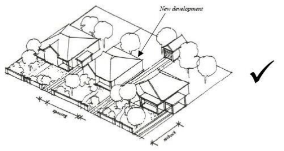

> [Picture on page 39: a picture, saved as a picture (images/part-g-miscellaneous-development-controls-page-39-26.gif, 150 dpi).]

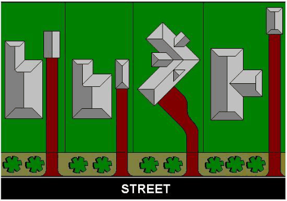

> [Picture on page 40: a picture, saved as a picture (images/part-g-miscellaneous-development-controls-page-40-1.gif, 150 dpi).]

Figure 14: Examples of good and poor streetscape orientation and setback

### 2.6 Conservation Incentives

#### Objectives

O1. To provide incentives for the restoration and maintenance of heritage listed items in Cumberland.

O2. To ensure that conservation incentives are provided where restoration and maintenance will be compliant with the objectives of this part of the DCP

O3. To ensure that any variations to the development controls within this development control plan for a proposed development involving a heritage item does not affect the heritage significance of the heritage item or conservation area.

O4. To ensure that the amenity of a streetscape and surrounding neighbourhood is not detrimentally affected by any variations to controls within this development control plan.

#### Controls

C1. Conservation incentives may apply for heritage items that are listed within Cumberland Local Environmental Plan 2021.

C2. When considering a development application for works involving a heritage item, Council may consider variations to development controls contained within Council’s adopted Development Control Plan, provided the Council is satisfied that:

• The proposed development complies with all of the heritage design controls contained within this Part of Cumberland Development Control Plan 2021,

• The proposed development will not adversely affect the heritage significance of the heritage item or its setting,

• The proposed development will involve a complete and full restoration of the heritage item, if this is deemed necessary by the Council, and

• The proposed development will not adversely affect the amenity of the surrounding area

C3. When considering an application for consent to erect a building on land on which there is situated a heritage item, Council may for the purpose of determining the number of car parking spaces to be provided on the site, exclude from its calculation of the gross floor area of the buildings erected on the land part or all of the gross floor area of the

heritage item, but only if the Council is satisfied this will facilitate the conservation of the heritage item.

Note:

Council can provide general information on design outcomes, colour schemes, building materials and fences for owners of properties listed as heritage items in the Local Environmental Plan 2021.

If your property is listed on a state or national heritage register, owners may also be eligible for special State funding to help with the maintenance of your property

This page has been left intentionally blank.

> [Picture on page 43: a picture, saved as a picture (images/part-g-miscellaneous-development-controls-page-43-1.gif, 150 dpi).]
