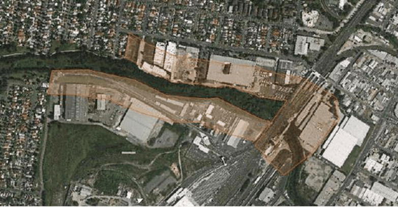
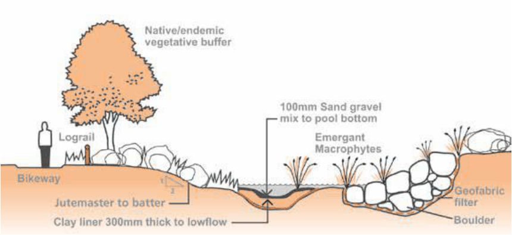

### PART G5

SUSTAINABILITY,

### BIODIVERSITY AND ENVIRONMENTAL MANAGEMENT

This page has been left intentionally blank.

## 1. Introduction

### 1.1 Land to which this Part applies

This Part applies to development applications on all land within Cumberland City.

### 1.2 Purpose of this Part

This Part provides objectives and controls for all aspects of a development concerning sustainability, biodiversity and environmental management.

Council’s sustainability, biodiversity and environmental management provisions aim to:

• provide direction for protecting and enhancing Cumberland City’s natural areas and environment; and

• to encourage sustainable design and measures to be incorporated in all forms of development.

### 1.3 Relationship to other Parts

Where relevant, this Part of the DCP should be read in conjunction with the following Parts of the DCP:

• Part A - Introduction;

• Part B - Development in Residential Zones;

• Part C - Development in Business Zones;

• Part D - Development in Industrial Zones;

• Part E - Other Land Use Development Controls; and

• Part F - Precinct and Site Specific Development Controls.

## 2. Objectives and controls

### 2.1 Groundwater

#### Objective

Protect groundwater quality, flows and drainage patterns during demolition, construction and ongoing operation phases of a development.

#### Controls

Operating practices and technology, including dewatering, shall not contaminate groundwater or adversely impact on adjoining properties and infrastructure. Any dewatering activities may require concurrence from the NSW Government. Any application to discharge ground and surface water to Council’s stormwater system must be accompanied by a Dewatering Management Plan.

Groundwater is to be recharged, where possible, while still protecting and/or enhancing groundwater quality, using water sensitive urban design.

Protection measures for groundwater are to be proportional to the risk the development poses. Where the potential risk to groundwater is high, a separate Groundwater Impact and Management Report will be required.

The applicant must demonstrate that there will be no adverse impacts on surrounding or adjacent properties, infrastructure or groundwater dependant ecosystems as a result of:

• changes in the behaviour of groundwater created by the method of construction chosen; and/or

• changes to the behaviour of groundwater of the surrounding area, created by the nature of the constructed form and groundwater management system used.

### 2.2 Surface water

#### Controls

All developments that have the potential to impact on stormwater quality must be consistent with the principles of water-sensitive urban design (WSUD).

With respect to applications involving soil disturbance, the consent authority may request a management plan to be submitted detailing how surface water impacts will be managed in accordance with the NSW DEC’s Managing Urban Stormwater series (2006). The specific type of plan will depend on the volume of soil disturbance that is proposed:

• developments involving 250 – 2500m2: an erosion and sediment control plan (ESCP) must be provided, in accordance with NSW DEC’s Managing urban stormwater – Soils and Construction Volume 1 (2006);

• developments involving >2500m2: a soil and water management plan (SWMP) must be provided, in accordance with NSW DEC’s Managing Urban Stormwater – Soils and Construction Volume 1 (2006).

For sites with <250m2 disturbance, applications will be assessed on a merit basis to determine if a management plan is required.

### 2.3 Land contamination

#### Objectives

Ascertain the extent of contamination of existing undeveloped areas on site.

Ensure that changes of land use will not increase the risk to public health or the environment.

Ensure that any redevelopment of land for sensitive uses considers the potential contamination of the land.

Avoid inappropriate restrictions on land that could otherwise be remediated.

Consider the likelihood of land contamination as early as possible in the planning process.

Link decisions about the development of land with the information available about contamination.

#### Controls

Development applications

Prior to the submission of a development application, an assessment is to be made by the applicant under Clause 7 of SEPP No. 55 as to whether the subject land is

contaminated prepared in accordance with the relevant Department of Planning, Industry and Environment Guidelines and the Guideline to Asbestos Management in Cumberland Council 2018.

In accordance with Clause 7 (1) of SEPP No. 55 Council will not consent to development unless it has considered whether land is contaminated, and if the land is contaminated is suitable for the proposed purpose or is satisfied that the land will be appropriately remediated. Where land is proposed to be subject to remediation, adequate documentation is to be submitted to Council supporting the categorisation.

Development consent for remediation work

Development consent is required for remediation work in sensitive areas (Category 1 remediation works) under Clause 8 (2) of SEPP No. 55.

Development consent is not required for other remediation work (Category 2 remediation work) under Clause 8 (2) of SEPP No. 55. However, under Section 16 of the SEPP, notice is required to be given of the proposed work to Council before commencement of works.

Activities that may cause contamination

Some activities that are likely to cause land contamination are shown in Table 1, as well as various types of Designated Development as outlined in Environmental Planning and Assessment Regulation 2000. For further information, refer to the Managing Land Contamination Planning Guidelines, Department of Urban Affairs and Planning and EPA, 1998.

Table 1: Activities that may cause contamination

| Some activities that may cause contamination |  |
|---|---|
| 1. acid/alkali plant and formulation 2. agricultural/horticultural activities 3. airports 4. asbestos production and disposal 5. chemicals manufacture and formulation 6. defence works 7. drum re-conditioning works 8. dry cleaning establishments 9. electrical manufacturing (transformers) 10. electroplating and heat treatment premises 11. engine works 12. explosives industry 13. gas works | 14. iron and steel works 15. metal treatment 16. mining and extractive industries 17. oil production and storage 18. paint formulation and manufacture 19. pesticide manufacture and formulation 20. power stations 21. railway yards 22. scrap yards 23. service stations 24. sheep and cattle dips 25. smelting and refining 26. tanning and associated trades 27. waste storage and treatment 28. wood preservation |

### 2.4 Air quality

#### Objectives

Protect air quality and enhance environmental amenity.

Minimise air pollution emissions and impacts on the environment associated with machinery or processes.

#### Controls

Any machinery or processes used should not result in air pollution emissions that have a detrimental impact on the environment.

Details of any equipment, processes and air pollution control or monitoring equipment shall be submitted to Council with a development application.

Development that is likely to result in the emission of atmospheric pollutants, including odours, is to include operating practices and technology to ensure that the development does not contribute to increased air pollution.

Effective site controls during and after demolition and construction are to ensure that development does not contribute to increased air pollution.

Wood heaters/fireplaces in private homes shall comply with Australian Standard 4013 to minimise production of pollution.

Discharge from premises of any matter, whether solid, liquid or gaseous is required to conform to the Protection of the Environment Operations Act 1997 and its Regulations, or a pollution control approval issued by the NSW Office of Environment and Heritage for Scheduled Premises.

### 2.5 Biodiversity

#### Objectives

Apply the biodiversity mitigation hierarchy to:

• avoid activities that lead to loss of biodiversity;

• minimise actions that harm biodiversity;

• rehabilitate areas that have been degraded; and

• offset loss of biodiversity.

Respond to Biodiversity Management Principles in Section 2.2 of Council’s Cumberland Biodiversity Strategy 2019.

Protect and enhance network of green infrastructure (e.g. Green Grid opportunities, tree corridors, parks, reserves, water sensitive urban design).

Minimise the impact of development on biodiversity in Cumberland City by:

• minimising the removal of indigenous vegetation and naturally occurring soils;

• conserving existing significant indigenous and native trees;

• encouraging planting of indigenous and native plants and trees on private property; and

• promoting measures to mitigate any adverse effects of the proposed development on the species, populations or ecological communities.

Retain and protect areas of existing biodiversity value, particularly biodiversity within the Duck River and Prospect Creek corridors to retain vegetation and fauna links to the Western Sydney Parklands and Parramatta River.

Minimise impacts of development on any habitat or wildlife corridor.

#### Controls

Development is to be sited and designed to minimise the impact on indigenous flora and fauna, including canopy trees and understorey vegetation, and on remnant native ground cover species.

Development that impacts threatened species listed under the Threatened Species Conservation Act 1995 must undergo an assessment of significance, which will determine the need for a species impact statement.

New planting is to consist of species indigenous to the local vegetation community of the Cumberland Plain Woodland.

Select species that minimise water use and drought tolerant.

Preference is to be given to landscaping elements that provide/promote faunal habitat.

Pruning or removal of trees must be in accordance with Council’s Tree Management Plan (Refer also to DCP Part G- Tree Management and Landscaping).

The Grey-headed Flying-Fox colony along Duck River, Clyde, is to be protected and preserved.

A buffer of at least 25m from the boundary of the Grey-headed Flying-fox camp excludes vertical structures over 2m being built.

An additional non-residential zoning buffer of at least 100m (from the Flying Fox Camp property boundary) exists on the land surrounding the camp (refer to Figure 1).

> [Picture on page 85: a picture, saved as a picture (images/part-g-miscellaneous-development-controls-page-85-1.gif, 150 dpi).]

Figure 1: Suggested buffer (100m) non-residential. Source: Duck River Grey-Headed Flying-Fox Camp Management Plan

Development within these buffer zones should also make reference to the strategic guidance within the Duck River Grey-Headed Flying Fox Camp Management Plan. This document will be provided by Council upon request.

### 2.6 Energy efficiency and renewables

#### Objectives

Promote ecologically sustainable development principles to promote energy efficiency and minimise the use of non-renewable energy in the construction and ongoing use of buildings.

Ensure that development contributes to an overall reduction in energy consumption and greenhouse gas emissions.

Encourage site planning and building design that optimises site conditions to achieve energy efficiency.

#### Control

New development shall implement energy efficient design and promote renewable energy sources through the inclusion of solar panels, skylights, cross ventilation and other such measures.

Residential development

Where applicable, development is to demonstrate compliance with the design principles embodied in the Building Sustainability Index (BASIX).

The principles and properties of thermal mass, glazing, insulation and solar energy are to be recognised and incorporated into the design of residential development which are not subject to BASIX.

Non-residential development

Design heating/cooling systems to target only those spaces that require heating or cooling, not the whole building.

Improve the efficiency of hot water systems through:

• the use of solar powered hot water systems. Solar and heat pump systems must be eligible for at least 24 Renewable Energy Certificates (RECs) and domestic type gas systems must have a minimum 3.5 star energy efficiency rating;

• insulating hot water systems; and

• installing water saving devices, such as flow regulators, 3 stars Water Efficiency Labelling and Standards Scheme (WELS Scheme) rated shower heads, dual flush toilets and tap aerators.

Reduce reliance on artificial lighting and design lighting systems to target only those spaces which require lighting at any particular ‘off-peak’ time, not the whole building. Incorporate a timing system to automatically control the use of lighting throughout the building.

All non-residential development Class 5-9 will need to comply with the Building Code of Australia energy efficiency provisions.

An Energy Efficiency Report from a suitably qualified consultant that demonstrates a commitment to achieve no less than 4 stars under the Australian Building Greenhouse Rating Scheme (or equivalent) must be provided for all commercial and industrial development with a construction cost of over $5 million.

### 2.7 Protection of waterways

#### Objective

Ensure development contributes to the protection and rehabilitation of waterways in order to improve waterway health and to develop and maintain ecologically sustainable waterways.

#### Controls

Development is to make provision for buffer areas for the preservation and maintenance of floodway, riparian corridors and habitat protection. Refer to Clause 6.11 Foreshore Building Line and Clause 6.17 Riparian Land and Watercourse in the Cumberland LEP 2021.

Development on land subject to Clause 6.17 Riparian Land and Watercourse in the Cumberland LEP 2021 or that abuts a waterway is to be landscaped with local indigenous species, to protect bushland and wildlife corridors and soften the interface between the natural landscape and the urban environment. Riparian vegetation also plays an important role in stabilising bed and banks and attenuating flood flows.

The piping, enclosing or artificial channelling of natural watercourses and drainage channels is not permitted. Consideration is to be given to re-opening piped or lined drainage systems wherever feasible.

Development is to ensure that natural channel design principles are incorporated in any works on or in waterways (refer to Figure 2).

Ongoing maintenance costs are to be considered in the design of any waterway protection features.

> [Picture on page 87: a picture, saved as a picture (images/part-g-miscellaneous-development-controls-page-87-3.gif, 150 dpi).]

Figure 2: Elements of the Natural Drainage System. Sources: Stormwater outlets in parks and waterways (Brisbane City Council, 2001).

### 2.8 Development on land abutting the E2 Environmental Protection zone and W1 Natural Waterways zone

#### Objective

Protect and preserve bushland and ecological communities in the E2 Environmental Protection and W1 Natural Waterways zones.

#### Control

Development on land abutting land within the E2 Environmental Protection zone and

W1 Natural Waterways zone must take into consideration all of the following:

• the need to retain any bushland on the land;

• the effect of the proposed development on bushland within or adjacent to the land, including the erosion of soils, the siltation of streams and waterways and the spread of weeds and exotic plants within the bushland, overshadowing, overland flows and stormwater runoff, and the removal or degradation of existing vegetation;

• the requirement for provision of a buffer zone on the abutting land to protect the bushland area;

• the protection of endangered ecological communities and recovery plans prepared and approved under the Biodiversity Conservation Act 2016; and

• any other matters which are relevant to the protection and preservation of the bushland area.

### 2.9 Prospect Creek

Prospect Creek – Land Fronting Pine Road, Dursey Road and Fairfield Road, Yennora with a Boundary to Prospect Creek.

The area occupied by and immediately adjoining Prospect Creek fulfils the role of a valuable open space and ecologically sensitive linkage. It benefits by supporting a fragile ecosystem as well as performing the role of a natural watercourse which requires regular maintenance. Within

Cumberland LEP 2021, this corridor has been zoned E2 Environmental Conservation, and where it forms part of the bank of Prospect Creek is identified on the Biodiversity map, the Endangered Ecological Communities map and the Riparian Land and Waterways map. Local clause 6.5 Biodiversity, and local clause 6.6 Riparian land and watercourses.

#### Control

In addition to the requirements for land within the Environmental Conservation zone and the local clauses of the Cumberland LEP 2021, such land shall not be used for the erection or use of any building or the carrying out or use of any work other than for landscaping, bush fire hazard reduction, subdivision, drainage or installation of underground utility services. Further details can be gained by contacting Council.

### 2.10 Urban heat management

Reference to the Green Star Design and As Built Submission Guidelines (V1.2) developed by Green Building Council of Australia and WSROC Turn Down the Heat Strategy and Action Plan 2018.

#### Objectives

O1. Encourage residential development that is designed to reduce the ‘heat island effect’.

O2. Encourage developments to incorporate green infrastructure, water and cool materials to reduce urban heat.

#### Controls

General

Residential development is to include one or a combination of the following:

• vegetation and trees;

• green roofs;

- for roof pitched<15◦ - a three-year SRI of a minimum 64; or

- for roof pitched>15◦ - a three-year SRI of minimum 34.

• only where the three-year Solar Reflectance Index (SRI) of minimum 34 or an initial SRI of minimum 39;

- for roof pitched<15◦ - an initial SRI of minimum 82; or

- for roof pitched>15◦ - an initial SRI of minimum 39.

• unshaded hard-scaping elements with a three year SRI of minimum 34 or an initial SRI of minimum 39;

• hardscaping elements shaded by overhanging vegetation of roof structures, including solar hot water panels and photovoltaic panels;

• water sensitive urban design, water bodies and/or water courses;

• using cool materials in construction which have high solar reflectivity and high emissivity value e.g. in roofs, pavements and hard surfaces; or

• areas directly to the south of vertical building elements, including green walls and areas shaded by these elements at the summer solstice.

A development application for new low-density development is to include evidence to demonstrate how the above urban heat management will be addressed.

Materials and finishes

#### Objective

O3. Mitigate the urban heat island effect through materiality and finishes.

#### Controls

Roofs shall be constructed from high albedo, low solar absorptance or a high solar reflectance material.

Pavements shall be predominantly light colours and incorporate permeable paving where possible.

Improvements to local green infrastructure (such as the urban tree canopy) on public or private land is encouraged.

Water Sensitive Urban Design (WSUD) measures that are incorporated into dwelling, private open space and streetscape design are encouraged, and may include:

• water efficient fittings and appliances;

• rainwater tanks; and,

• bio-retention systems.

This page has been left intentionally blank.

> [Picture on page 91: a picture, saved as a picture (images/part-g-miscellaneous-development-controls-page-91-1.gif, 150 dpi).]
