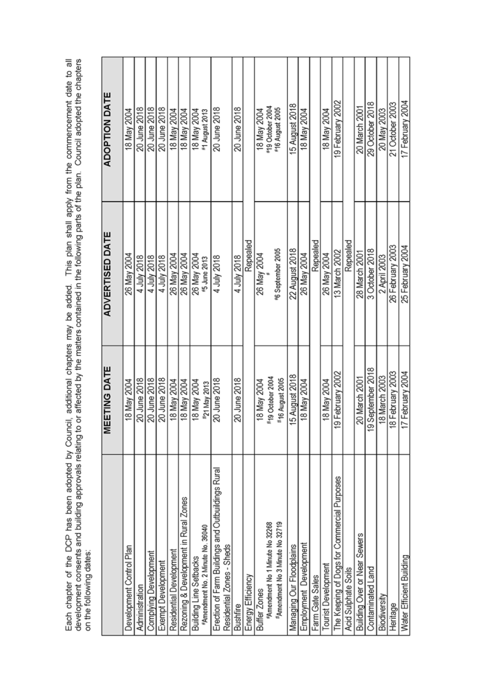

### 1.5 RELATIONSHIP TO PREVIOUS DEVELOPMENT CONTROL PLANS

This DCP repeals, condenses and replaces the following chapters in  the Dungog Shire‐ wide DCP No. 1:

| Replaces: | New Chapter: |
|---|---|
| Part A ‐ General Information | Administration |
| Part C ‐ Chapter 4‐ Erection of Rural Sheds | Erection of Farm Buildings and/or Domestic Sheds |
| Part D ‐ Chapter 7 Count Street, Paterson | Boulton Drive, Paterson |
| Amends |  |
| Part B ‐ Chapter 1 – Complying Development |  |
| Part B ‐ Chapter 2 – Exempt Development |  |
| Part C ‐ Chapter 8 Boatfalls Rural Residential Estate |  |
| Part C ‐ Chapter 5 Bushfire |  |
| Part C ‐ Chapter 8 Managing Our Floodplains |  |
| Repeals |  |
| Part C ‐ Chapter 10 Farm Gate Sales |  |
| Part C ‐ Chapter 13 Acid Sulfate Soils |  |
| Insert new chapters |  |
| Part C ‐ Chapter 23‐ On‐Site Sewerage Management |  |
| Part C ‐ Chapter 24 – Site Waste Minimisation and Management |  |

Please  Note:    All  other  Chapters  currently  contained  in  the  Dungog  Development Control Plan No. 1 remain in force.

> [Picture on page 6: a picture, saved as a picture (images/part-a-administration-page-6-1.gif, 150 dpi).]

9 July 2005

27 July 2005

9 July2005

20 May2008

28 May2008

20 May2008

20 June 2018

4 July 2018

20 June 2018

20 June 2018

4 July 2018

20 June 2018

7 June 2003

25 June 2003

18 February 2003

15 March 2005

23 March 2005

17 May 2005

16 Aug us! 2005

24 August 2005

16 August 2005

15 November 2005

23 November 2005

15 November 2005

20 July 2004

11 January 2006

16May2006

20 June 2018

4 July 2018

20 June 2018

19 Apr ii 2005

27 April 2005

15 August 2006

20 June 2018

4 July 2018

20 June 2018

#### CHAPTER

#### MEETING DATE

#### ADVERTISED DATE

#### ADOPTION DATE

\*Note the Clarence Town Local Area Plan was repealed 18 June 2025

Boatfalls Rural Residential Estate

Boulton Drive, Paterson

Paterson Local Area Plan Cangon Park Rural Residential Estate

18 March 2020

1 April 2020

18 March 2020

Srte Waste Minimisation and Management

On Site Sewage Management

Signage

Off Street Parking

Gresford Local Area Plan Wind Energy Generation Facility

South Vacy Village

Clarence Town Local Area Plan*

Vacy Local A.ea Plan
