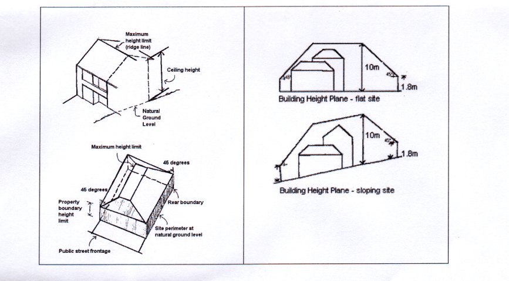

### 1.2  BUILDING HEIGHT PLANE

The building height plane, in combination with building height limits prescribed in the current instruments, forms the maximum building envelope for all residential development except as provided in clause 2.1 Exemptions.

Council's objectives in this regard are to ensure that a residential development will not significantly:

(a) increase the overshadowing of adjoining properties;

(b) reduce the level of privacy enjoyed by adjoining properties or;

(c) obstruct views from adjacent existing buildings,

and that the occupants of the building or buildings will enjoy the optimum use of winter sunlight and summer shade.

In this clause, a reference to a building or development includes any point on the external walls of the building, but may exclude climate control elements which are of an open character and form part of the landscape treatment of the building.  Pergolas, verandahs and lattice walls are examples of such elements.

#### 1.2.1 EXEMPTIONS

For single dwelling houses the building height plan will be applied only in relation to western and southern boundaries or those boundaries which face nearest to east and north.

An exemption from the building height plane may also be considered in relation to one or more boundaries, in the following circumstances:

(a) where clear advantages are achieved in other aspects of the design;

(b) on an existing narrow allotment; or

(c) where the floor level is required to be significantly above ground level for the purpose of flood protection in a locality.

Building height planes in residential zones shall comply with Council's Energy Smart Homes Policy for solar access or an envelope that extends vertically from natural ground level at 1.8m and projected from that point 45 degrees to the centre of the lot, the height plane at any point inside the envelope shall not exceed 9m above the natural ground level. Note the building height planes shall follow the natural ground slope. The Building Height Plane may require modification in the event that solar access to an adjoining property is detrimentally affected. See figure 1.

Figure 1 Building Height Plane

> [Picture on page 3: a picture, saved as a picture (images/part-c1-residential-development-page-3-2.gif, 150 dpi).]
