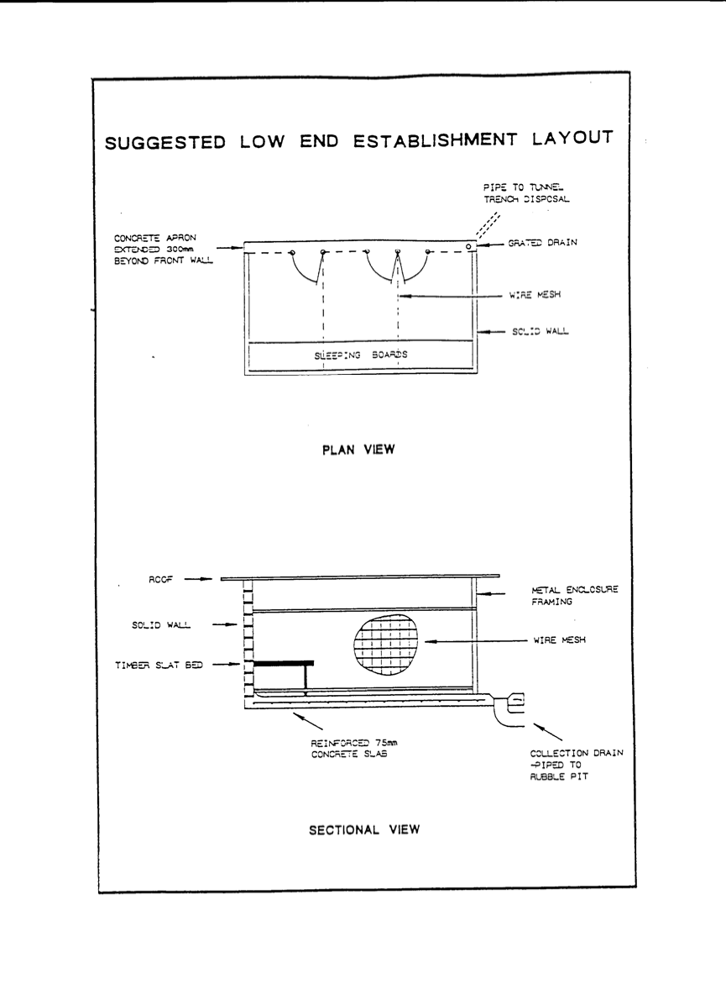

### 12.10. LOW END ESTABLISHMENTS

#### 12.10.1 AESTHETICS

Kennels must be fully screened from the view of adjacent premises and roadways. This may be achieved by: -

• A carefully planted screen of trees and bushes.

• Wire mesh fencing over which a vine or creeper of a non-irritating nature is grown.

• A solid wall.

• A metal fence which is permanently colour treated and in good order.

• Other similar methods may be considered.

#### 12.10.2 CONTAINMENT

Yards to be fully enclosed to eliminate escape of animal. Screening as mentioned above may achieve this. Other methods of containment are provided in “Construction” below.

#### 12.10.3 NOISE CONTROL

Where noise impact on surrounding properties is of concern, an Acoustic Engineers Report may be required.

• The primary reason for screening from views is to prevent dogs barking at parking cars, pedestrians and animals.

• Dogs must be enclosed at night in kennels to prevent barking at distractions eg. Cats. Soundproofing of kennels may be considered.

• After dark, all yard lights to be switched off.

• Soundproofing of kennels will assist in keeping neighbourhood noise out.

• A separately screened facility should be available to separate noisy dogs from others.

#### 12.10.4 CONSTRUCTION AND LAYOUT OF KENNELS AND HOUSING

Any construction must take into account the welfare of the animal and will be subject to the provision of the Prevention of Cruelty to Animals Act 1979 and the NSW Department of Agriculture published Welfare Codes.

#### 12.10.4.1 FLOOR

75mm minimum thickness concrete finish with wooden float graded to a catchment drain which has fall to the outlet trap. Concrete to extend for 300mm beyond the plane of the kennel walls. Alternative impervious floor construction may be approved by Council.

#### 12.10.4.2 WALLS

To be of a solid impervious type being capable of easy cleaning. If masonry to be smooth rendered internally to a height of 1200mm. Base of wall is to be coved to the floor. If of timber frame construction bottom plates are to be secured to a raised impervious hob of minimum height of 450mm (hob may be constructed of brick work rendered internally) which is coved at its junction with the floor.

#### 12.10.4.3 DRAINAGE

Ample provision to be made for disposal of surface and roof drainage so as not to interfere with adjacent premises. Floor wastes and other wastes from washing down shall be disposed of to a properly constructed absorption trench after first passing through a disconnection gully with grating.

#### 12.10.4.4 YARD AREAS

Low end facilities require an ample fenced grassed area for dog exercise (suggest

100m2 ). Faeces to be removed manually.

#### 12.10.4.5 BEDDING AND SLEEPING AREAS

To be raised timber slats, hessian or equivalent, capable of being removed for cleaning purposes. Means of suspending bedding whilst cleaning should be provided.

#### 12.10.4.6 DIVIDING WALLS

Dividing walls of cages are to be of solid material such as masonry and steel mesh. Small mesh needed to avoid nose biting.

#### 12.10.4.7 VENTILATION

Condensation must not form on inside surfaces. Low end facilities to be passively ventilated through air spaces such as windows (located a minimum of 2m above floor level) beneath doors or simple roof or wall mounted vents.

#### 12.10.5 HYGIENE

Cleaning of kennels and yard areas: Kennels shall be cleaned daily and all food scraps, bones and manure removed. Water shall be replenished daily and care should be taken to ensure the storage receptacles for water do not provide a breeding ground for mosquitoes.

Yard area shall be raked clean of all scraps and manure and grass shall be kept short mown.

Disposal of manure and scraps: This shall be carried out to ensure that nuisance does not arise from the breeding of flies or offensive odours. Suitable plans should be provided outlining management and disposal. Burning of manure on site is strictly prohibited. Distances of kennels and yard areas from surrounding dwellings should be considered and showing development application plans.

> [Picture on page 7: a picture, saved as a picture (images/part-c12-keeping-of-dogs-for-commercial-purposes-page-7-1.gif, 150 dpi).]
