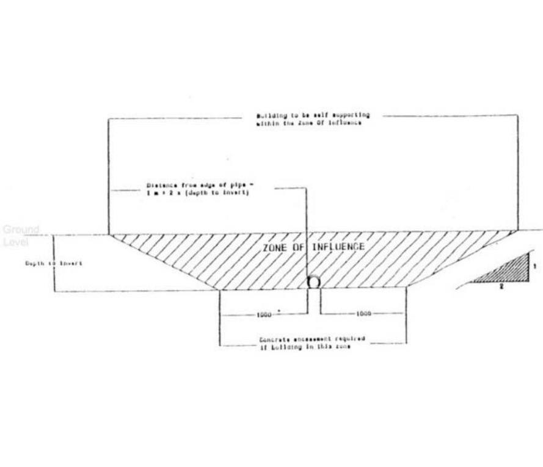
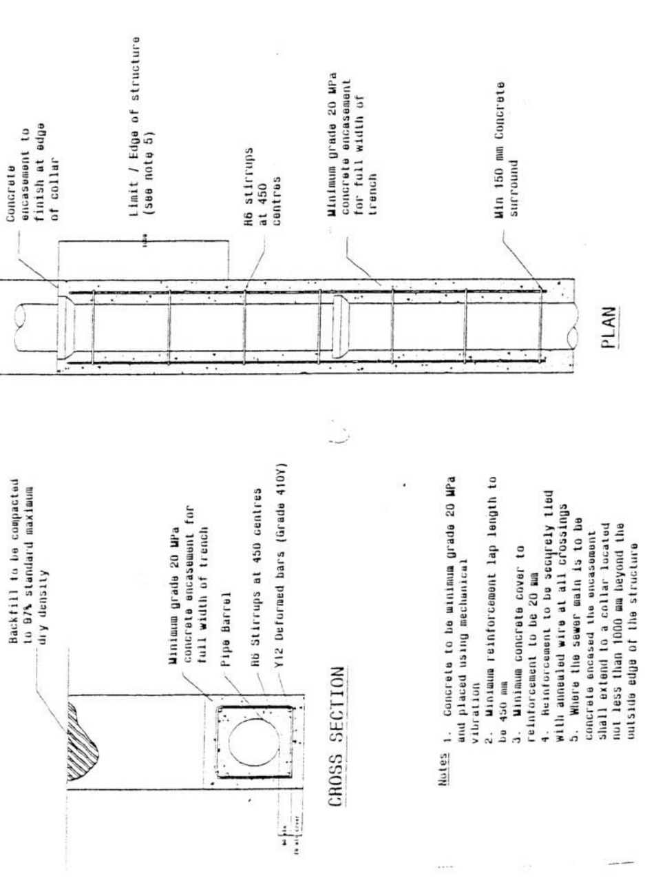
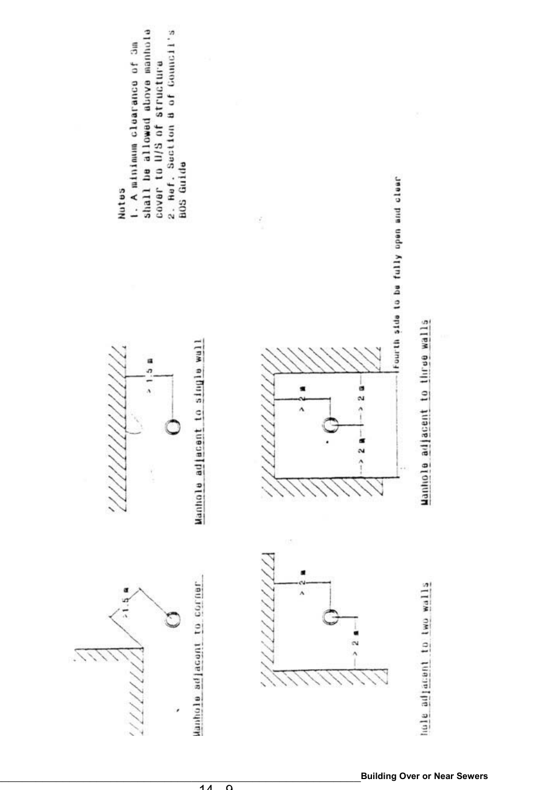
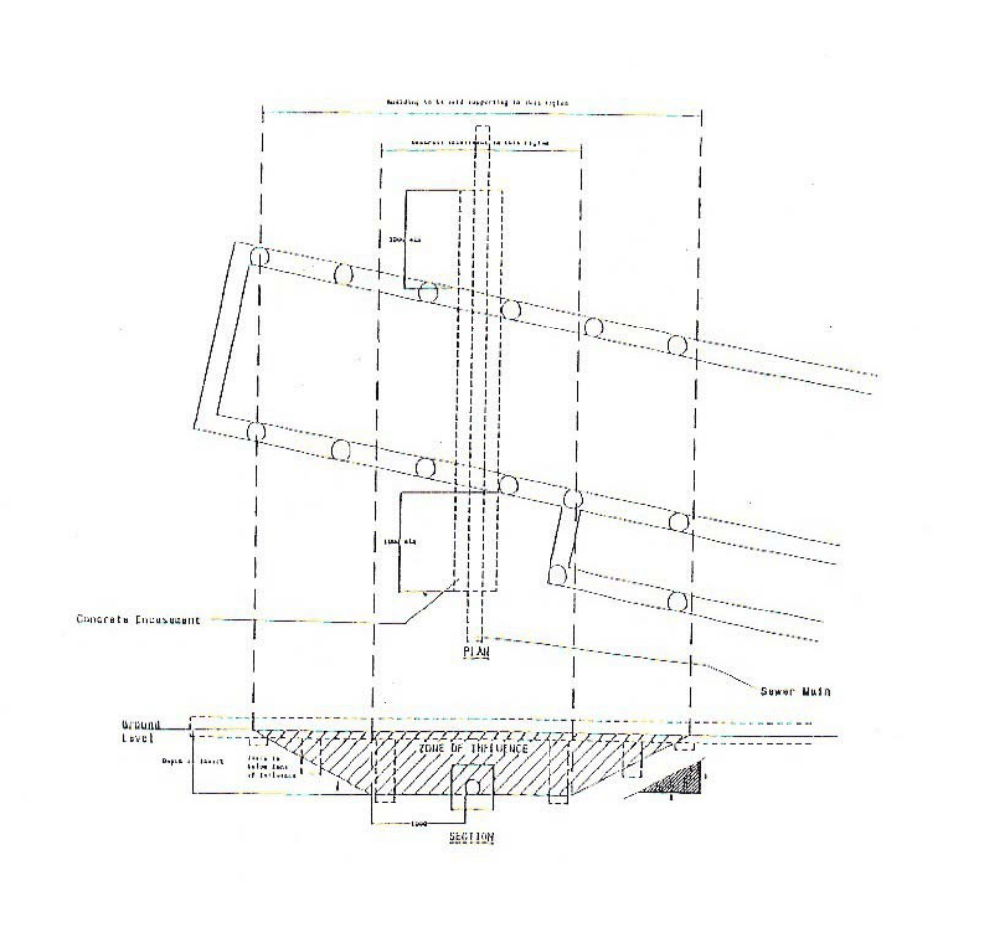

### 14.10 SUBMISSION OF DRAWINGS

14.10.1 This section sets out the details that will generally be required for the erection or construction

of a structure located within the zone of influence of a sewer main. Drawings shall be certified by the applicant’s Engineer.

1410.2 The following information shall be shown on drawings:-

(i) Plan view of the proposed building(s) in the region of the sewer main, the extent of any excavation and the pier locations and their depths;

(ii) Centreline of sewer on plan view;

(iii) Limits of the Zone of Influence of main;

(iv) Typical sections across Zone of Influence of main;

(v) Section across Zone of Influence at the closet point between the main and foundation if it is different to the typical cross section;

(vi) Engineering details of structural suitability dimensioned;

(vii) Certification by the applicant’s engineer as follows:-

“I, ……………., certify that the footings of this building as designed are adequate to support and protect the building from damage in the event that the sewer main is excavated or disturbance or settlement occurs within the Zone of Influence.”

Signed …………………..

(viii) A certification from a practising geotechnical engineer, if the applicant proposes to modify the Zone of Influence.

NOTES TO DRAWING NO. See Attachment 4.

STANDARD SPECIFICATION FOR THE PROTECTION OF SEWER MAINS

INSPECTION

Three (3) working days notice shall be given prior to the commencement of any work.

Before any concrete work is commenced, the sewer main is to be located and uncovered.  Care shall be taken to avoid damage to the main and should any such damage occur, it will be repaired at the owner/applicant’s cost.

Prior to placement of any concrete and after placement of reinforcement, the owner/applicant shall give at least one (1) working day’s notice of the need for an inspection.

No concrete is to be placed until Council’s representative has inspected and approved the reinforcement, the prepared trench and the support of the sewer main.

A final inspection of the work will be carried out by Council’s representative after placement and curing of the concrete.

CONCRETE

All concrete work shall comply with the requirements of Australian Standard AS 1480-1982 as amended. All concrete shall have a minimum F’c of 20 MPa at twenty eight (28) days.

All concrete is to be placed in such a manner to ensure satisfactory compaction with the absence of segregation.

After completion of pouring the concrete shall, unless otherwise approved by Council’s representative, be covered with an approved impermeable membrane and kept in a moist condition for a minimum of three (3) days.

No filling or building work will be carried out in the vicinity of the main during this period.

#### REINFORCEMENT

Reinforcement shall be as detailed on the attached sketch.

Minimum lap length shall be 450 mm.

Minimum concrete cover to reinforcement shall be 70 mm.

Reinforcement shall be securely tied with annealed wire at all crossings.

#### INSPECTIONS

To arrange inspections, Council’s Sewerage Engineer can be contacted at the Council Office on 4992 1224.

#### ATTACHMENT 1

> [Picture on page 7: a picture, saved as a picture (images/part-c14-building-over-or-near-sewers-page-7-2.gif, 150 dpi).]

> [Picture on page 8: a picture, saved as a picture (images/part-c14-building-over-or-near-sewers-page-8-1.gif, 150 dpi).]

> [Picture on page 9: a picture, saved as a picture (images/part-c14-building-over-or-near-sewers-page-9-1.gif, 150 dpi).]

> [Picture on page 10: a picture, saved as a picture (images/part-c14-building-over-or-near-sewers-page-10-1.gif, 150 dpi).]
