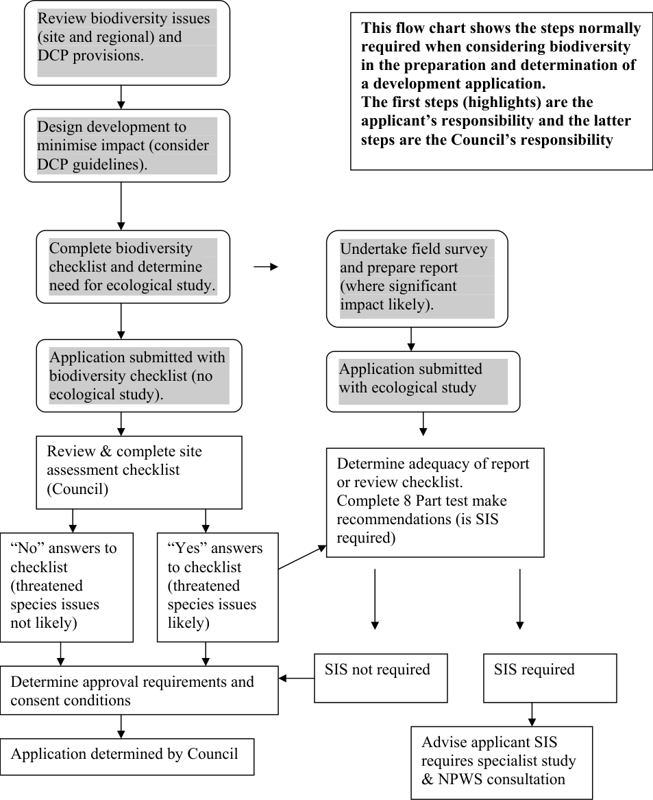

#### 16. BIODIVERSITY

This plan, which may be cited at “Dungog Development Control Plan No. 1” – Biodiversity, constitutes a Development Control Plan as provided by Section 72 of the Environmental Planning and Assessment Act, 1979.

#### BACKGROUND INFORMATION

• Introduction - Why is biodiversity important?

• What does the DCP do?

• What is Dungog Council policy on biodiversity?

• Review of biodiversity information

• Biodiversity issues in Dungog

• How to use the DCP

• New development and biodiversity

• Existing development and activities

• Frequent questions

• Finding out more information

#### DEVELOPMENT CONTROL PLAN DOCUMENT

## PART 1: INTRODUCTION

### 1.1 Title

### 1.2 Commencement

### 1.3 Purpose of Plan

### 1.4 Aims and objectives

### 1.5 Land to which Plan applies

### 1.6 Definitions

## PART 2: MAKING DEVELOPMENT APPLICATIONS

### 2.1. Information to accompany applications

### 2.2 Matters for consideration in determining applications

### 2.3 Application of principles and guidelines

### 2.4 Approvals required by other agencies

## PART 3: DESIGN AND MANAGEMENT PRINCIPLES

3.1 Biodiversity conservation principles for design and management

### 3.2 Application of principles

## PART 4: DEVELOPMENT AND MANAGEMENT GUIDELINES

### 4.1 Application of Guidelines

### 4.2 Guidelines for Settlement Structure

### 4.3 Guidelines for Biodiversity

### 4.4 Guidelines for Land and Water

### 4.5 Guidelines for Environmental Design

## PART 5: SCHEDULES

1 Noxious weeds list 2 Environmental weeds list 3 Native species of importance in Dungog LGA 4 Plant nurseries propagating locally indigenous plants 5 Summary of references relating to biodiversity in Dungog LGA 6 Development checklists - biodiversity and threatened species 7 Threatened species assessment checklist (8 part test)

#### BACKGROUND INFORMATION

#### INTRODUCTION - WHY IS BIODIVERSITY IMPORTANT?

Biodiversity is a matter that should be taken into account in undertaking development, in a similar way that road access, services and other natural resource constraints (eg bush fires and flooding) are considered.

Biodiversity refers to the variety of life and supporting processes. Biodiversity includes the native plants, animals, ecosystems and landscapes that characterise the area and make it special. A number of rare and listed threatened species form part of the Shire’s biodiversity. Biodiversity includes fungi, plants, insects, fish, amphibians, birds, reptiles, and mammals.

Conservation of biodiversity is an essential principle underpinning ecologically sustainable development and is part of council’s charter under the Local Government Act 1993. Dungog Shire Council has a policy of achieving ecologically sustainable development.

Council is required to consider the potential for impact biodiversity and on threatened species, populations and ecological communities arising from ALL development applications. The level of assessment required depends on the likelihood of impacts, based on a number of key indicators.

To fulfill its responsibilities under the Threatened Species Conservation Act 1995 and Fisheries Management Act 1994, Council must closely examine the characteristics of the subject land and surrounds, and the attributes of a proposal, to determine the potential effects of development on threatened species, populations, ecological communities or their habitats.

#### WHAT DOES THE DCP DO?

A development control plan (DCP) is a plan prepared and formally adopted by the Council following a process of public consultation. It outlines the Council’s policy and guidelines for development proposals and management of land, and is required to be taken into account in the consideration of development applications.

Development Control Plan 31 - Biodiversity aims to ensure that biodiversity issues are properly taken into account in the undertaking of development and activities within Dungog Shire. The plan will assist the Council to implement its legislative responsibilities for biodiversity conservation.

Development Control Plan 31 - Biodiversity fulfils the following roles:

• Outlines the council’s policy on biodiversity

• Reviews biodiversity information within the Shire

• Identifies issues to be considered in carrying out development and activities

• Outlines the process for taking into account biodiversity in development projects, including applicant information requirements

• Provides information and references to assist conservation of biodiversity affected by existing activities

#### WHAT IS DUNGOG COUNCIL POLICY ON BIODIVERSITY?

Dungog Council’s policy in relation to biodiversity is outlined in the DCP. The DCP primarily provides a framework for the assessment and determination of development proposals, but the provisions of the document also support the Dungog Rural Settlement Strategy.

In adopting the DCP, the Council is giving effect to its legislative responsibilities to support biodiversity conservation. Biodiversity is able to co-exist with agriculture and other rural uses, and the intention of the plan is not to inhibit other rural uses, but to ensure that biodiversity impacts are adequately, properly considered and integrated in development and land management activities.

The Council recognises that biodiversity within the local government area is affected by a wide range of programs and activities. The guidelines and principles outlined within the DCP are intended to be applied in a range of Council programs where relevant.

The Council’s policy takes into account legislative requirements to consider the conservation of biodiversity included within the Environmental Planning and Assessment Act 1979, Fisheries Management Act 1994,Threatened Species Conservation Act 1995 and Native Vegetation Conservation Act 1997.

The Council recognises that much biodiversity within the area occurs on private land, and it is the responsibility of landholders to be aware of likely habitat for threatened species on their land, and to protect and appropriately manage such habitat. In fulfilling its responsibilities under the Environmental Planning and Assessment Act 1979, the Council will have regard to the financial implications that may arise where actions are taken to protect biodiversity on land.

Incentives may be provided where the Council is satisfied that biodiversity values can be protected in the long term. For example, where developments provide for the protection of biodiversity or are required to prepare and implement a management plan, the Council may consider supporting applications for funding from external sources (such as rural assistance grants, Greening Australia, Hunter Catchment Management Trust) or other options. The Biodiversity Planning Guide for NSW Local Government (Fallding et al. 2001) provides more information about opportunities that are available.

#### REVIEW OF BIODIVERSITY INFORMATION

The DCP has been prepared following a review of biodiversity information that currently exists for the Dungog local government area. A brief review of this information is provided as background to the plan. The available information is primarily at the landscape (regional) scale and for a limited number of site specific locations. It should be used to inform development design and assessment.

The Dungog Council area is located within the NSW North Coast bioregion identified in the Interim Biogeographic Regionalisation of Australia (Thackway & Cresswell 1995). This means that Dungog has generally similar characteristics (and threatened species) to the north coast of NSW, and this region provides a context for determination of the conservation status of species and ecosystems within the Council area. It is important that many plant species are at the limit of their southern distribution within the Dungog Council area.

A substantial part of the biodiversity of the Council are occurs on private land.

Approximately 22% of the local government area comprises native vegetation within National Parks and State Forests and it is estimated that around 50% of the area is covered with greater than 20% canopy cover.

Schedules 3 and 4 to this plan identify plant and animal species recognised as of importance within the Council area. These identify 35 species of plants and 35 species of animals, including threatened species listed under the Threatened Species Conservation Act 1995 and others at the limit of their natural geographic range. The Dungog State of the Environment Report (Dungog Shire Council 2000) noted 25 species of plants in the Council area which are listed as threatened (11) or rare (10), 17 at the edge of their natural geographic range, 3 are bioregional endemics, and 3 are disjunct populations. Fourteen are nationally rare or threatened. Of the 25 species, only 7 are recorded as protected in reserves, and a number of species have very restricted distributions. There are 2 rare and threatened Eucalypt species in the area, E. glaucina and E. largeana. These Schedules are subject to amendment over time as further information becomes available, and the most up to date information available should be referred to when considering a development proposal.

A wide range of habitat types occur within the Council area, ranging from sub-alpine woodland, rainforests, moist forests, woodlands, riparian vegetation and aquatic ecosystems. This range of habitats combines to give important biodiversity values. To date, there has been no comprehensive documentation or mapping of the biodiversity within the Shire, although detailed studies exist within some National Park and State Forest areas, and on some specific private lands. The Paterson and Clarence Town studies commissioned by the council provide biodiversity information for those areas, and the North East Regional Forest Assessment process has generated substantial predictive modeled biodiversity data for the Shire, including information included in Schedules 3 and 4. Some groups of species within the area are relatively unknown, while others such as amphibians have been poorly documented and require study (ERM Mitchell McCotter 1997b).

Although there are substantial areas of conservation reserve existing within the Council area, these areas are not representative of all the habitat types occurring, and do not adequately conserve the majority of the threatened species that occur. .

#### BIODIVERSITY ISSUES IN DUNGOG

Biodiversity within the Dungog Council area is probably continuing to decline in line with regional and national trends. Decline is directly associated with development and land use.

Processes threatening biodiversity in NSW are identified and listed under the provisions of the Threatened Species Conservation Act 1995 and Fisheries Management Act 1994. These threatening processes should be taken into account in the design and assessment of development applications.

Local threats to biodiversity are outlined in the following table. Key issues contributing to biodiversity decline in Dungog are primarily the clearing of large mature trees and understorey vegetation, removal of dead trees, riparian vegetation, bush fire management practices, weed invasion and forestry.

#### Checklist of local threats to Dungog’s biodiversity

| Threat | Solutions |
|---|---|
| Clearing of native vegetation | Clearing controls; financial incentives for retaining and |
| Building construction and design | managing native vegetation; biodiversity assessment and design at early stages of planning and development; ecologically sustainable land management practices; regeneration of fragmented habitat Appropriate site selection, urban consolidation and |
| Land filling and earthworks | alternative urban form; design to minimise paving and increase pavement permeability; smaller building footprint Alternative building and subdivision design; appropriate |
| Bush fire management | site selection; education for construction industry; prevention of development on unsuitable land Design and siting of development to minimise bush fire |
| Stock grazing | risk; appropriate fire management and vegetation monitoring Protection of remnant bushland by fencing, alternative |
| Pollution and land contamination | grazing strategies Reduction in use of persistent artificial chemicals; |
| improved land management practices Alteration to hydrological systems; increased nutrients; salinity |  |
| Climate change and global warming | Reduced development runoff, water sensitive urban design, management and environmental assessment; reduced fertiliser use; education; retain native vegetation Reduction in land clearing and fossil fuel use, efficient |
| Roads and traffic | energy use; integrated planning of land use and transport Appropriate location; design standards; community |
| Soil erosion, sedimentation and Compaction | Education Site capability planning; better site design, management and assessment; implementation of erosion and |
| Waste disposal and rubbish dumping Introduction of non-native plants | sediment control policies Education; enforcement of legislation; cultural change Education programs; regulation; use locally indigenous |
| Introduction of non-native animals | landscaping species; maintain resilient natural ecosystems; weed control, incorporation of management practices (eg washing of earthmoving plant) to prevent spread of weed seeds. Education; regulation; predator control; responsible pet ownership |

Note: Whilst some of the above threats and solutions are beyond local government control, there is considerable scope for the council to influence decisions made by other levels of government or by the local community.

#### HOW TO USE THE DCP

This development control plan (DCP) includes matters for site specific DA consideration pursuant to section 79 of the Environmental Planning and Assessment Act 1979. This is used by council when determining applications and includes a checklist of matters to be consideration, and consent conditions which may be applied where relevant.

This DCP must be read in conjunction with other planning documents and other DCP documents that may apply. This DCP highlights situations where this may to occur.

Biodiversity and threatened species issues should be considered:

• In ALL development proposals (including subdivisions).

• In carrying out land management activities arising from a development. In preparing and making a development application, applicants are required to consider the biodiversity impacts of a proposal. This will assist the determination of the proposal by the Council. Applicants are required to complete a checklist where a development is likely to result in the clearing of native vegetation, or may impact upon threatened species or other biodiversity values. Depending on the type and location of a development, and its scale, a field survey may be desirable, and a report to accompany the development application may be required. It is the applicant’s responsibility to prepare these reports. The accompanying diagram outlines the steps involved in the assessment of biodiversity issues in development applications by the Council. The Plan outlines issues affecting biodiversity which are relevant to the consideration and determination of development applications. Relevant issues are grouped as follows: Settlement structure issues - These are issues relevant when considering the location, appropriateness and feasibility of a development proposal. They are mainly associated with strategic planning, local environmental plan provisions and Dungog Rural Settlement Strategy and include preferred land uses, subdivision layout and road and access design. Biodiversity issues - These are issues relevant to understanding the regional and landscape context of site biodiversity, design, approval and survey and assessment requirements. This plan provides guidelines for bushland, streams, natural wetlands, native fauna, non-native fauna, weeds, threatened species, habitat corridors and Koala habitat. Land and water issues - These are complementary landscape design and management issues directly related to biodiversity, including streams and stormwater, erosion, sediment and dust control, excavation and filling, land rehabilitation and bush fires. Environmental design issues - These are issues relevant to the design, construction and ongoing management of development and activities. Generally they are relevant at

the site specific level and the detailed design and construction stage of development, including paving, construction works, tree preservation, landscape design, waste disposal, cultural and historic sites and roadside vegetation management.

### Flow chart - biodiversity assessment of development

### applications

> [Picture on page 7: a map, saved as a picture (images/part-c16-biodiversity-page-7-3.gif, 150 dpi); the street names and other small labels are on the picture.]
> Words printed on the picture (title and legend, copied from the PDF):
> Review biodiversity issues
> (site and regional) and
> Design development to
> minimise impact (consider
> checklist and determine
> need for ecological study.
> Undertake field survey
> and prepare report
> with ecological study
> Application submitted with
> biodiversity checklist (no
> Review & complete site
> Determine adequacy of report
> or review checklist.
> Complete 8 Part test make
> recommendations (is SIS
> “No” answers to
> SIS not required SIS required
> Determine approval requirements and
> Application determined by Council
> Advise applicant SIS
> requires specialist study
> & NPWS consultation

This flow chart shows the steps normally required when considering biodiversity in the preparation and determination of a development application. The first steps (highlights) are the applicant’s responsibility and the latter steps are the Council’s responsibility

The following table provides a general indication of required information to accompany

development applications.

#### Indicative requirements for development types

| Type of development | Biodiversity planning and assessment requirement |
|---|---|
| Subdivision of land (other than readjustment of existing boundaries and consolidation) | Requires completion of biodiversity checklist and site plan. Design and layout should consider biodiversity. May require field survey and fauna and flora review by ecologist where threatened species are likely. |
| Dwellings on existing subdivided Allotments | Applicants required to complete checklist. |
| Commercial development (eg industrial, tourist, or intensive agriculture) | Development guidelines for biodiversity to be considered in design of proposal. Checklist to be completed, and a fauna and flora review. Field survey may be required where threatened species are likely. |
| Major developments (eg mines or large subdivisions) | Development guidelines for biodiversity to be considered in design of proposal. Specialist surveys should be undertaken and species impact statement likely. Plan of management for site should be prepared. |
| Development including clearing or disturbance to more than 1ha of natural bushland | Development should avoid natural bushland areas. Field survey for threatened species is likely to be required for development proposals. |
| Roads | Requires completion of biodiversity checklist. Design and layout should consider biodiversity. May require field survey and fauna and flora review by ecologist where threatened species are likely. Forestry Compliance with Native Vegetation Conservation Act 1997 requirements (See Department of Land and Water Conservation). |
| Development of urban or industrial zoned land | No requirements. Threatened species issues must be considered where appropriate. |
| Development of grazing or cultivated Land | Applicants required to complete checklist. Impacts on riparian areas need to be considered. |
| Development on land adjoining conservation reserves or natural bushland | Development must ensure buffer areas around conservation reserves, and be designed to minimise potential impacts. Applicants required to complete checklist. |

#### NEW DEVELOPMENT AND BIODIVERSITY

New development proposals are required to take into account biodiversity issues. This means that developers make an assessment of the regional biodiversity context of the site and site specific habitat attributes. If important biodiversity values are likely to occur, then site specific survey may be required, and a proposed development may require modification, redesign or relocation.

Dungog Shire Council is required to make an assessment of the adequacy of the proposed development and accompanying information. Applications may be refused if adequate supporting information is not provided or if the location of a proposed development is not suitable.

The Council is responsible for assessing the biodiversity impacts of development applications and for determining whether a significant effect on threatened species is likely to occur. This forms part of the approval process and will be reflected in conditions of development consent

#### EXISTING DEVELOPMENT AND ACTIVITIES

The requirements of this Plan do not apply to existing development and activities. The Plan does provide advisory information relating to ongoing land management and desirable principles (criteria) which may be applied by landowners. These are suggestions for actions that will support the biodiversity objectives of Council. The Plan provisions will be taken into account by Council in its approval of activities under Part 5 of the Environmental Planning and Assessment Act 1979, and may also be referred to by other agencies.

Developers may wish to consider applying measures over and above those normally required by Council as appropriate for the site.

#### FREQUENT QUESTIONS

Answers to some important questions are outlined below:

#### What do applicants for development projects need to be aware of?

All applicants need to be aware that: ΠApplicants have responsibilities for providing information to accompany development applications in relation to remnant native vegetation and biodiversity on a site.

ΠBiodiversity and threatened species are an important consideration by Council in the determination of development applications.

ΠWhere a proposed development application is likely to have a significant effect on threatened species, endangered ecological communities, or populations listed under the Threatened Species Conservation Act 1995 or Fisheries Management Act 1994, a species impact statement (SIS) may be required to accompany the application.

ΠApplicants are responsible for obtaining separate Commonwealth approval under the Environment Protection and Biodiversity Conservation Act 1999 where an activity may have a significant effect on a nationally listed threatened species, endangered ecological community or migratory species.

#### What are the requirements for single dwellings on individual blocks?

Applicants are required to consider biodiversity in all development proposals. However, no additional requirements will normally apply for single dwellings on existing subdivided lots in previously cleared locations.

#### What requirements will apply for larger developments?

Most large developments will require a flora and fauna study to be carried out by a qualified and experienced ecological consultant. The specific requirements depend on the type and scale of the development, the location, and the extent to which the guidelines in this Plan have been applied in the design of the development.

#### What is the council trying to achieve?

In this Plan, the Council is seeking to ensure that biodiversity and ecological sustainability are considered in all development proposals, and that the Council’s legal responsibilities are fulfilled. This will provide community benefits and certainty to developers.

#### How do I identify the biodiversity on my property?

Biodiversity refers to the range of natural species occurring. On a site this is best done by observation by persons familiar with biodiversity. Reference books and other material can provide a guide as to the species that are likely to occur. Specialists may be required to identify rare or threatened species, since many of these species are difficult to find.

#### What are threatened species?

Threatened species are native species listed in the Threatened Species Conservation Act 1995 and Fisheries Management Act 1994 as endangered or vulnerable to extinction. Note that biodiversity is more than just threatened species, and includes the variety of life forms and ecological processes upon which threatened species rely for their survival.

#### What is a threatening process?

Processes leading to the decline of threatened species are listed in the Threatened Species Conservation Act 1995 and Fisheries Management Act 1994. These processes include spread of introduced pest or weed species such as the Red Fox and Bitou Bush, frequent fire, bushrock removal, clearing of native vegetation, introduction of fish to fresh waters within a river catchment outside their natural range, and degradation of native riparian vegetation along New South Wales water courses. Up to date listings are available on the NSW National Parks and Wildlife Service and NSW Fisheries websites.

#### What is meant by clearing?

The Plan defines clearing as any removal or disturbance to native vegetation. See the exact definition in the Plan for clarification of what clearing includes.

#### Does underscrubbing affect biodiversity values?

Underscrubbing is the clearing of undergrowth and understorey vegetation, leaving individual trees and groundcover plants. Underscrubbing of shrubs removes important habitat for threatened species and has adverse effects on natural ecosystems, often leading to increased weed infestation. In general, underscrubbing should not be undertaken without undertaking a review of biodiversity effects.

#### If I am going to do undertake a development what do I need to do?

The first thing to do is to recognise that any remnant vegetation on the land may have biodiversity value and may provide habitat for threatened species from time to time. Native vegetation may also have important corridor values. Any development or land management activities should be designed to minimise disturbance to natural habitats by using the guidelines in this Plan. Where development is to occur in sensitive or important locations, specialist assessment and field survey may be required.

What is acceptable/unacceptable in terms of clearing or cutting of trees (for firewood, views, agriculture, etc)?

In general, the removal of large, old or dead native trees for any purpose is unacceptable except for safety reasons, since these are important for the conservation of biodiversity within the Council area. Isolated paddock trees should also be protected, since they have corridor value, especially for birds. Underscrubbing or clearing of understorey vegetation in bushland areas is unacceptable. Development should be sited to avoid the requirement for future clearing of native vegetation. Cutting of trees should be restricted to regrowth or trees that have been planted.

Is there a map showing significant areas of biodiversity within the Council area?

Large areas of natural vegetation occurring within the Council area (such as National Parks and State Forests) have been mapped. However, much important biodiversity is site specific or occurs in small patches (eg rainforests, pockets of remnant grassland or individual large paddock trees with hollows). Therefore, it is not possible to identify site specific important elements of biodiversity throughout the Council area. Most properties still retain some important biodiversity values, and these are best identified on a site survey.

#### How should the guidelines in the DCP be applied?

The guidelines provide guidance and will not apply in all circumstances. They can be used a checklist in the design and approval of development proposals. Specific guidelines need to be taken into account for each individual site as appropriate. These guidelines may be applied as conditions of development consent, and therefore a development requirement.

Who determines if a field biodiversity survey and report is required prior to the lodgement of a development application?

This is based on a review of biodiversity information for the locality and an inspection of the site, and any native vegetation that may occur. The DCP provisions give guidance as to important species that may occur and settings where impacts may be important. Although any survey and report is the responsibility of an applicant, the Council is ultimately responsible for determining the level of biodiversity survey or assessment that may be required and may require submission of additional information.

#### When do you need to prepare a SIS?

A species impact statement (SIS) is required where the Council considers it is likely that a development will have a significant effect on threatened species. Advice regarding the requirements for a SIS can be obtained from the NSW National Parks and Wildlife Service.

Do you need to review the likely occurrence of threatened species occurring on the site?

Yes. Information on species identified as of importance in the Council area (including threatened species) is included in this plan, and provides the context for the review. An assessment of the potential for these species to occur should be undertaken, and the presence of suitable habitat on the site evaluated. In most cases you are unlikely to require a detailed field survey?

#### When is a field biodiversity survey likely to be required?

Field survey by a specialist ecologist is likely to be required where threatened species are likely to occur on land, or suitable habitat is present, or when a site contains vegetation that is identified as an endangered ecological community.

Specialist ecological surveys and reports are required when:

ΠA development is likely to result in clearing or adverse effects to important areas of native vegetation (eg larger than 1 ha in area).

ΠThe Council has determined that a development is likely to have a significant adverse effect on threatened species, endangered ecological communities or populations, and a SIS is required.

#### When is a biodiversity survey required for subdivision?

Where threatened species exist or are likely to occur, adjoining conservation reserves such as national parks, where land contains areas of native vegetation of importance.

If I am planting trees or landscaping, should I plant locally indigenous species?

Yes. Locally indigenous species are suited to the locality and many species may be available from local nurseries. When specifying species to plant, check to make sure that these are sourced from local seed or plant material (referred to as local provenance). A list of nurseries with local plant material is included in the Plan.

What happens if the biodiversity DCP conflicts with other considerations such as bush fire hazard reduction requirements?

The DCP outlines matters for consideration in the determination of development applications. Where there are conflicting guidelines or requirements, it is the responsibility of the Council to determine which requirement is more important in the circumstances of the case. This requires that each application be determined on its merits.

#### What biodiversity issues need to be considered at the subdivision stage?

The main biodiversity issues to be considered in subdivision relate to the location of property boundaries, access roads, measures to protect important areas of native vegetation, and land capability and suitability. In many cases it will be appropriate to prepare a plan of management for the future use of the land to accompany an application for subdivision.

How does this DCP relate to clearing controls under the Native Vegetation Conservation Act 1997?

This Plan applies to development applications made under the Environmental Planning and Assessment Act 1979. It does not specifically relate to development applications for clearing under the Native Vegetation Conservation Act 1997 but may be taken into account in determining such applications.

#### FINDING OUT MORE INFORMATION

The Plan includes a reference list of biodiversity information within the Council area. Additional site specific information also may exist, such as environmental impact statements or scientific surveys or papers.

More information is available from ...

ΠNSW National Parks and Wildlife Service (for threatened species and endangered ecological community listings) - www.npws.nsw.gov.au

ΠNSW Fisheries (for marine and aquatic threatened species and endangered community listings) - www.fisheries.nsw.gov.au

ΠEnvironment Australia (for Commonwealth threatened species and endangered ecological community listings) - www.ea.gov.au

ΠCommunity Access to Natural Resources Information (CANRI) allows internet access to NSW natural resources information - www.canri.nsw.gov.au

The Biodiversity Planning Guide for NSW Local Government includes useful reference material relating to biodiversity and planning which may assist with the formulation of plans and proposals. This is available from the NSW National Parks and Wildlife Service and can be accessed at www.npws.gov.au and www.lgov.nsw.gov.au

## PART 1: INTRODUCTION

### 1.1 TITLE

This Plan is called Dungog Development Control Plan No 31 —Biodiversity, Habitat Corridors and Tree Preservation.

### 1.2  COMMENCEMENT

This Plan commences on a date to be notified by the Council.

Note: The plan was approved by the Council on ............…........., and commenced on .................. (see Minute No. ………… Public notice of the Council's approval of the plan appeared in the …………………… on ……………….

### 1.3  PURPOSE OF PLAN

The purpose of this Plan is to:

Πprovide more detailed guidelines on the implementation of Dungog Local Environmental Plan 2003, and

Πto specify matters to be considered in the determination of development applications made under the Environmental Planning and Assessment Act 1979.

This plan is a policy document which the Council will take into account in considering development and subdivision applications.

The plan principles and guidelines should also be taken into account in the consideration of approvals for activities under Part 5 of the Environmental Planning and Assessment Act 1979. For example, the guidelines in the plan should be considered in undertaking roadworks under the Roads Act 1993, bush fire hazard reduction works and other activities carried out under the Rural Fires Act 1997, and carrying out of other infrastructure projects by Council or other agencies.

### 1.4  AIMS AND OBJECTIVES

The principal objectives of this Plan are to:

Πprotect and preserve native vegetation and biodiversity in the Dungog Council area

Πretain native vegetation in parcels of a size and configuration which will enable the existing plant and animal communities to survive in the long term

Πprotect and enhance habitat for threatened species, populations and ecological communities

Πmaintain and enhance corridors for fauna and flora.

### 1.5 LAND TO WHICH PLAN APPLIES

This plan applies to all land within the Dungog Council area, but in general is not applicable within urban areas.

### 1.6 DEFINITIONS

The definitions within Dungog Local Environmental Plan 2003 apply to this plan. Where not inconsistent with the Dungog Local Environmental Plan 2003, the definitions in the Biodiversity Planning Guide for NSW Local Government are adopted for reference purposes.

## PART 2: MAKING DEVELOPMENT APPLICATIONS

### 2.1 INFORMATION REQUIRED TO ACCOMPANY DEVELOPMENT APPLICATIONS

Information to accompany applications for development must be adequate to fully describe the nature of the development. In addition, where native vegetation is proposed to be cleared, or will be cleared as a direct consequence of the development, the checklist in Schedule 6 to this plan must be completed.

Where a development may affect native vegetation the following information may be required to accompany a development application or may assist in its determination by the Council:

Πvegetation survey of the land undertaken by a qualified person Πfauna survey of the site undertaken by a qualified person Πspecies impact statement (if the development is likely to significantly affect a threatened species, population or ecological community)

Πa management plan for the land outlining how the land is proposed to be managed in the future.

The Council may specify additional requirements or guidelines for undertaking adequate fauna or vegetation surveys. Surveys shall take into account any survey standards or guidelines published by the NSW National Parks and Wildlife Service.

Any developments that are expected to disturb more than 1 ha of land, all subdivisions creating more than 5 additional lots, and all development for extractive industries, require the carrying out of a biodiversity survey to accompany the development application.

### 2.2 MATTERS FOR CONSIDERATION IN DETERMINING APPLICATIONS

The matters required to be considered in determining development applications are specified in the Environmental Planning and Assessment Act 1979.

The Council is responsible for considering a wide range of impacts from development, including the effect on protected and threatened species of native fauna and flora and natural ecosystems.

The Council is required to consider whether there is likely to be a significant effect on threatened species, populations or communities. If there is likely to be a significant effect then a species impact statement is required for the development. In determining whether there is likely to be a significant effect, the following matters identified in the Act must be taken into account:

Πin the case of a threatened species, whether the life cycle of the species is likely to be disrupted such that a viable local population of the species is likely to be placed at risk of extinction,

Πin the case of an endangered population, whether the life cycle of the species that constitutes the endangered population is likely to be disrupted such that the viability of the population is likely to be significantly compromised,

Πin relation to the regional distribution of the habitat of a threatened species, population or ecological community, whether a significant area of known habitat is to be modified or removed,

Πwhether an area of known habitat is likely to become isolated from currently interconnecting or proximate areas of habitat for a threatened species, population or ecological community

Πwhether critical habitat will be affected, Πwhether a threatened species, population or ecological community, or their habitats, are adequately represented in conservation reserves (or other similar protected areas) in the region,

Πwhether the development or activity proposed is of a class of development or activity that is recognised as a threatening process,

Πwhether any threatened species, population or ecological community is at the limit of its known distribution.

### 2.3 APPLICATION OF PRINCIPLES AND GUIDELINES

The principles and guidelines specified in this plan apply to all development proposals, except where it can be shown that they are not appropriate. The principles and guidelines are to be considered by the Council when assessing whether or not development proposals should be approved, and in determining what conditions of approval (if any) should apply.

### 2.4 APPROVALS REQUIRED BY OTHER AGENCIES

In some cases, additional approvals may be required from other agencies before a development can proceed. Dungog Development Control Plan 31 – Biodiversity Draft 27 February 2003

## PART 3: DESIGN & MANAGEMENT PRINCIPLES

### 3.1 BIODIVERSITY CONSERVATION PRINCIPLES FOR DESIGN AND MANAGEMENT

The following principles are to be used in designing and assessing development proposals. The principles have been derived from the Biodiversity Planning Guide for NSW Local Government.

#### Principles for site scale design and management

#### Principle

Protect all natural areas, not only those of identified highest value Protect whole communities and ecosystems, and the natural processes that support them Maintain and enhance existing biodiversity by applying a policy of ‘no net loss’ Minimise landscape fragmentation

Recognise the different habitat requirements of individual species Conserve biodiversity in-situ in its natural environment Ensure that development minimises disturbance to natural systems Promote native species and avoid introducing non-native species Protect rare and ecologically important species (including rare and threatened species) Protect unique or sensitive environments (such as rainforests, riparian areas and steep slopes) Monitor biodiversity impacts over time, and link monitoring to ongoing management Apply a precautionary approach where a proposal might lead to irreversible consequences

### 3.2  APPLICATION OF PRINCIPLES

The objectives of the Dungog Local Environmental Plan 2003 and this Plan shall be considered in the determination of any development application within the Dungog Council area.

The principles identified in section 3.1 of the Plan are to be used to assess and determine the adequacy of information accompanying a development application, and can be applied as criteria for the determination of development proposals under the Environmental Planning and Assessment Act 1979 and Native Vegetation Conservation Act 1997.

## PART 4: DEVELOPMENT & MANAGEMENT GUIDELINES

This part of the Plan identifies biodiversity objectives and performance standards for development. Note that guidelines are not requirements. Not all guidelines will be relevant in all cases. When using the development and management guidelines, it is important to determine which issues are relevant to the specific site or development proposal..

This part of the Plan should be used as a checklist to determine:

Πissues relevant for consideration in the proposal Πthe biodiversity objectives that should be met Πrelevant practice guidelines for carrying out development Πsample consent conditions that may be applied where appropriate

The development and management guidelines in this part should be taken into account by applicants in preparing development proposals and the Council when considering development applications.

### 4.1 APPLICATION OF GUIDELINES

The following guidelines apply and shall be taken into account in considering proposed development within the Council area. These have been developed for specific issues that generally apply throughout the Council area. Specific area based guidelines may apply in addition to the generic guidelines.

Guidelines are included in this plan for the following issues:

#### Settlement structure

ΠPreferred land uses

ΠSubdivision layout ΠRoads and access

#### Biodiversity

ΠBushland ΠStreams ΠNatural wetlands ΠNative fauna ΠNon-native fauna ΠWeeds ΠThreatened species ΠHabitat corridors ΠKoala habitat

#### Land and water

ΠStreams and stormwater ΠErosion, sediment and dust control ΠExcavation and filling ΠLand rehabilitation ΠBush fires

#### Environmental design

ΠPaving ΠConstruction works ΠTree preservation ΠLandscape design ΠWaste disposal ΠCultural and historic sites ΠRoadside vegetation management

### 4.2 GUIDELINES FOR SETTLEMENT STRUCTURE

#### 4.2.1 PREFERRED LAND USES

OBJECTIVE

To ensure appropriate uses of land with biodiversity values, and protection of natural habitats from inappropriate development.

To ensure compatability of new development with adjoining or adjacent land with a priority for biodiversity conservation (such as National Parks, Nature Reserves, State Forests, and land subject to conservation agreements).

To protect regional habitat links by ensuring incompatible development does not occur.

GUIDELINES, ACCEPTABLE PRACTICE & STANDARD CONDITIONS

Subdivision lot sizes should have regard to land use and biodiversity values.

Proposed developments around the perimeter of State Forests, National Parks and Nature Reserves should ensure that the integrity of these areas as conservation units is maintained, and a suitable buffer of natural land is provided and habitat linkages between conservation reserves are maintained and enhanced.

No subdivisions will be permitted on land enclosed within conservation reserves, or where subdivisions and subsequent land uses could impact on buffer areas surrounding

reserves.

The Council will consult with the National Parks and Wildlife Service in regard to any proposal likely to affect areas within the jurisdiction of that agency, especially in regard to access and potentially adverse effects on water quality.

Any new roads shall be designed to minimise unauthorised vehicular access to conservation reserves.

Clearing of native vegetation (other than regrowth on agricultural land) is generally not supported except where this can be demonstrated to be essential for the economic use of land.

#### 4.2.2 SUBDIVISION LAYOUT

OBJECTIVE

To ensure that subdivision design takes into account biodiversity considerations and facilitates minimum impact development to protect any remnant native vegetation on the site and on adjoining land.

Allotment layouts should ensure important areas of vegetation are not fragmented by lot boundaries, roads or fences.

GUIDELINES, ACCEPTABLE PRACTICE & STANDARD CONDITIONS

On lots directly fronting bushland it is necessary to have on-site drainage controls to prevent nutrient and erosion impacts on the bushland. On-site fuel reduction zones should also be provided to minimise bushfire hazards. Both must be located within a bushland setback zone having a minimum width of 10 metres from adjoining bushland.

Development should maximise the conservation of the natural features of the site (including rock outcrops, cliffs, soil profiles, watercourses, important fauna habitats and rare or threatened plant habitats).

Perimeter roads are desirable from the point of view of bushfire control but may not always be feasible if site disturbance is to be minimised.

In recognition of the desirability of limiting additional riparian rights resulting from land subdivision, the number of allotments with river frontage is to be minimised.

Riparian areas along river banks should be revegetated and fenced from grazing stock with appropriate weed management.

In giving approvals for the subdivision of new allotments, the Council recognises that on land where biodiversity issues are an important consideration in development, areas of native vegetation should be retained in blocks of not less than 5 hectares and a desirable minimum of 30% of the area of each lot should be protected for biodiversity conservation. (Note that this provision does not apply to lots with an area of less than 2 hectares, and applies primarily to land having an area of more than 10 hectares)

Approvals may conditional upon the preparation of a plan of management to provide for conservation of biodiversity on land proposed for subdivision. Such a plan may be required prior to the release of the final plan of subdivision. This plan of management may be linked to conservation or property agreements, covenants or development

entitlements.

Areas of native vegetation in subdivision areas may be included in common property or reserves.

Subdivision boundaries should follow an alignment suitable for fence lines, taking into account the need to clear and maintain fence lines, and bush fire hazard reduction measures that may be required in future along boundary fences (eg 6 metres clearing).

#### 4.2.3 ROADS AND ACCESS

OBJECTIVE

To ensure that impacts of biodiversity as a result of the location and construction of new roads and access is minimised

GUIDELINES, ACCEPTABLE PRACTICE & STANDARD CONDITIONS

The length of new roads is to be minimised. Where possible, road alignments are to be designed to avoid stream crossings, steep slopes and areas of remnant native vegetation.

Roads are to be designed to meet Council’s normal road construction standards, and shall comply with soil erosion and sediment control requirements.

### 4.3 GUIDELINES FOR BIODIVERSITY

#### 4.3.1 BUSHLAND

OBJECTIVES

To maintain (and where possible increase) the current area of bushland, and to retain the natural species diversity of bushland as far as possible.

GUIDELINES, ACCEPTABLE PRACTICE & STANDARD CONDITIONS

Before any activity with significant potential to disturb native vegetation or bushland is carried out (eg development with a total footprint of more than 1 ha), a plant survey is to be undertaken to establish an inventory of the species present, any specific management requirements for particular plants, to determine the importance of the bushland on the site (in conjunction with any adjoining bushland), and the range of possible conservation alternatives. This requirement does not apply to the erection of single dwellings on existing allotments approved by Council.

Measures are to be taken to prevent disturbance to existing vegetation, including roots, hydrological regime, and surrounding soil.

Management of bushland and adjoining land should retain dominant native species and allow natural processes to continue. Natural vegetation communities are self sustaining and may change over time according to changes in environmental factors such as climate, bushfires and other disturbance.

Where land disturbance occurs, natural regeneration is the preferred method of rehabilitation.

Management of bushland should have regard to the value of the vegetation as fauna

habitat. In particular, old trees (both living and dead), fallen logs, bushrock and a diverse vegetation structure including understorey species should be maintained for fauna habitat.

Native vegetation is not to be removed from habitat corridors or adjoining land. Nonnative vegetation removed from the site is to be disposed of away from bushland to avoid spread of seed, or introduction of additional nutrients. Trees may be removed or cut only where they are hazardous to public safety, or where they are a weed or nonnative species.

Locally indigenous species should be used for revegetation and restoration of bushland. Appropriate rehabilitation measures should be taken such as reusing seed banks in topsoil, using local mulch, etc.

#### 4.3.2  STREAMS

OBJECTIVE

To facilitate water quality and flow conditions in streams and their catchments to allow stream biodiversity to be retained, and where possible, to return stream biodiversity to pre-development levels.

GUIDELINES, ACCEPTABLE PRACTICE & STANDARD CONDITIONS

Development should minimise disturbance to existing natural vegetation, watercourses, wetlands and overland flow paths.

Building or site development is to maintain pre-development surface and groundwater flows.

In the case of development in the vicinity of streams (or likely to have a significant effect on streams), monitoring of stream conditions should be undertaken prior to, during and after any approval to ensure compliance with stream biodiversity objectives.

Riparian vegetation is natural vegetation along streams, stream banks and floodplains. Where practical, this vegetation should be fenced off from grazing stock and allowed to regenerate, and may be included as a condition of any approval for subdivision of land where appropriate.

Any developments along streams must take into account impacts upon threatened aquatic species listed under the Fisheries Management Act 1994.

#### 4.3.3  NATURAL WETLANDS

OBJECTIVE

To protect natural wetlands and ensure that development within wetland catchment areas does not cause adverse effects.

GUIDELINES, ACCEPTABLE PRACTICE & STANDARD CONDITIONS

Any activity undertaken is to result in no net loss of wetland area. Measures must be taken to ensure that there is no degradation of the quality of wetlands.

Reclamation, filling, draining or other works that result in any loss of, or disturbance to wetlands or other associated natural habitat must not be carried out.

Each individual wetland site is different and contains a unique combination of plants, animals, and geological characteristics. Where any activities or works are proposed which drain directly to the wetland, an evaluation of the specific information relating to the site is to be compiled and taken into consideration.

To protect wetland ecosystems, grazing of natural wetlands by domestic stock should not occur unless restricted and carried out on an intermittent basis.

#### 4.3.4  NATIVE FAUNA

OBJECTIVE

To protect and maintain native fauna populations and their habitats, and where appropriate, to take steps to increase and enhance fauna habitat.

GUIDELINES, ACCEPTABLE PRACTICE & STANDARD CONDITIONS

Impacts on fauna and flora and habitat are to be taken into consideration whenever any development or management activity is proposed.

Fauna surveys must be undertaken prior to any significant development works likely to affect the habitat of any threatened native fauna.

Re-introduction and release of native fauna should only be carried out where it is reasonably likely that the land forms part of the individual's expected home range. The proponent should consult with the NPWS regarding licensing requirements.

Exercising or training of domestic animals (eg horses, dogs, cats, etc) is an activity which is incompatible with the protection and management of native fauna and habitat.

Trees and shrubs should be encouraged to regenerate along road verges to make it easier for fauna species to cross roads, provided that road safety standards and requirements are met.

Areas of vegetation (desirable minimum width 150 metres), with a width-to-length ratio as small as possible, should be retained or allowed to naturally regenerate so as to provide fauna habitat. Old trees, whether living or dead, and fallen timber, leaf litter, and bushrock should be retained to provide fauna habitat, except within fuel reduced zones required for bush fire hazard mitigation.

A greater diversity of vegetation and a mix of habitat types is likely to provide for a greater range of native species.

Removal of bushrock, or the cutting or removal of dead trees, fallen trees or branches from the site, must not be carried out unless undertaken as part of bushfire hazard reduction works.

#### 4.3.5  NON-NATIVE FAUNA

OBJECTIVE

To facilitate the control of pest animals (foxes, wild dogs, feral cats, etc) within all areas of native vegetation.

GUIDELINES, ACCEPTABLE PRACTICE & STANDARD CONDITIONS

Domestic pets such as dogs and cats should not be kept on identified properties directly adjoining bushland, or should be confined within buildings.

#### 4.3.6  WEEDS

OBJECTIVES

To facilitate the implementation of weed control and management measures that act upon the processes causing weed invasion of natural areas.

GUIDELINES, ACCEPTABLE PRACTICE & STANDARD CONDITIONS

Weed control refers to control of non-indigenous native plants, particularly invasive species. Important elements of weed control is gaining an understanding of the causes of weed invasion, and taking measures to minimise these causes.

Weed control techniques are to be carried out in a manner that minimises negative environmental impacts. Different techniques are required in varying situations, especially along watercourses, which are very sensitive to pollution impacts. Regular monitoring of weeds is to be carried out on an ongoing basis so as to identify and respond to the occurrence of new plant species that pose a potential threat to native vegetation.

Weed invasion occurs in native vegetation mainly as a result of the following factors:

Πphysical site disturbance Πincreased soil moisture due to runoff from adjacent areas Πincreased nutrients from runoff or waste dumping Πincreased light levels due to clearing or dieback Πincrease in weed propagules and seed dispersal agents.

Measures are to be taken to prevent the occurrence of factors leading to weed invasion.

Noxious weeds, declared under the Noxious Weeds Act 1993, are plants posing a threat to agriculture, the environment or the community. Noxious weeds listed for Dungog Council area are listed in Schedule 1 of the Plan. Noxious weeds identified as W1 and

W2 are to be removed as soon as possible. There is a legal obligation on all landowners to remove these plants from their properties and to control their spread, as appropriate.

#### 4.3.7  THREATENED SPECIES

OBJECTIVE

To facilitate the assessment of development proposals likely to have a significant effect on threatened species or their habitat in accordance with the threatened species provisions of the Environmental Planning and Assessment Act 1979 and the Fisheries Management Act 1994.

GUIDELINES, ACCEPTABLE PRACTICE & STANDARD CONDITIONS

Where a development proposal is likely to have a significant effect on threatened species, populations or ecological communities, a species impact statement must be

submitted with the development application. The criteria for determining whether there is likely to be a significant effect is contained in section 5A of the Environmental Planning and Assessment Act 1979. Determining whether a species impact statement is required will normally require applicants to carry out a fauna and flora survey of the affected land.

Fauna and flora surveys should be undertaken to identify presence, absence and likelihood of threatened species being present on, or utilising the site. Such surveys should, as far as possible, comply with any accepted standards or Council guidelines for surveys.

Specific requirements apply within the Council area for some species such as koalas, and species for which a recovery plan has or is being prepared.

#### 4.3.8  HABITAT CORRIDORS

OBJECTIVE

To promote the establishment and retention of habitat corridors that will contribute to the long-term survival of native fauna and flora species in the area.

GUIDELINES, ACCEPTABLE PRACTICE & STANDARD CONDITIONS

Measures are to be taken to avoid fragmentation of vegetation in habitat corridors by roads, tracks, services, and the like. As far as possible, habitat corridors should be retained in contiguous areas which are as large as possible, with the smallest possible perimeter-to-area ratio.

The preferred use for habitat corridors is conservation of native vegetation within a conservation reserve, or development which is compatible with the retention of native vegetation.

No clearing of native vegetation should occur within habitat corridors identified on the

map. Identified corridors should not be further fragmented by roads or other development.

Road signs should be erected where habitat corridors cross roads to alert motorists to the significance of fauna at these sites.

Non-essential roads and tracks in habitat corridors are to be closed and rehabilitated.

Horse riding can cause damage to tracks and native vegetation, spread weeds and introduces nutrients, and should not occur in habitat corridors. Designated horse riding tracks must not to be located in undisturbed bushland areas. Regular maintenance is required for existing tracks, especially to control track damage and erosion.

#### 4.3.9  KOALA HABITAT

OBJECTIVE

To promote the retention of Koala habitat within the Council area. To co-operate with adjoining Council areas in maintaining and enhancing Koala habitat.

GUIDELINES, ACCEPTABLE PRACTICE & STANDARD CONDITIONS

Measures are to be taken to avoid fragmentation of vegetation in known and potential Koala habitat.

Any development proposals likely to affect Koalas or potential Koala habitat must take into account the Koala management requirements and the provisions of State Environmental Planning Policy No 44

In approving development likely to affect Koalas, the Council will have regard to guidelines outlined in Port Stephens Council Comprehensive Koala Plan of Management (Port Stephens Council 2000).

### 4.4 GUIDELINES FOR LAND AND WATER

#### 4.4.1  STREAMS AND STORMWATER

OBJECTIVE

To promote the retention of native vegetation and natural hydrological processes along watercourses.

GUIDELINES, ACCEPTABLE PRACTICE & STANDARD CONDITIONS

Continuous native vegetation should be retained along streams. The preferred use for land adjacent to streams is protection and rehabilitation of native vegetation so as to maintain a riparian buffer.

The desirable setback from perennial streams to development or site disturbance is 40 metres, measured from the top bank. No site disturbance should occur within 10 metres from the top bank of a non-perennial stream or significant natural drainage line.

Revegetation of streams should be undertaken with suitable locally indigenous species. The Hunter Catchment Management Trust has available a list of such species.

Roofwater and rainwater from paved surfaces on development sites is to be discharged on the site. Any off-site dispersal is to be via natural drainage lines or in existing drainage channels.

Existing ground levels on the site are not to be altered to accommodate buildings other than to allow minor changes to surface levels to assist in drainage. Cut and fill for roads in subdivisions is to be minimised.

Sediment and biological nutrient filter basins are to be provided above the 1-in-100 year flood level of the watercourse to the satisfaction of the Council. All weather access is to be available to such basins. An open drainage system is to be provided for the disposal of water from the sediment and biological nutrient filter basins to the existing watercourses.

A comprehensive survey of the main watercourse, and a detailed drainage investigation which establishes the estimated 1-in-100 year flood level, is to be submitted with the development application.

All sediment, erosion and nutrient control facilities are to be installed and regularly maintained by the applicant during the period of construction. Suitable arrangements

must be made for long-term maintenance of control facilities.

The water quality of the main watercourse is to be monitored for pollutants prior to the commencement of works, and at regular intervals during construction. The monitoring is to be undertaken in accordance with Environment Protection Authority guidelines. Irrigation is to be minimised on any lawns or mowed areas to avoid runoff and a raised water table.

Landscaping should comprise drought-resistant native plants, to reduce the amount of water required.

Natural hydrological processes are to be maintained where possible, including natural vegetation and the flow regimes to maintain creek line stability and health of terrestrial and aquatic plant communities.

Measures will be taken to minimise and to control nutrients entering watercourses, water bodies or groundwater.

Water quality entering natural areas is to be maintained at a level which is acceptable for sustainable natural area management, as far as possible, at pre-development levels. Additional runoff must not be discharged into bushland areas. Special design requirements apply for pipe discharges into bushland, including measures to ensure dissipation of stormwater velocity. Permeable ground surfaces are to be maintained as far as possible, and where suitable soil conditions exist, stormwater is to be infiltrated on-site.

#### 4.4.2  EROSION, SEDIMENT AND DUST CONTROL

Note: This section should be read in conjunction with regionally adopted erosion and sediment control guidelines. OBJECTIVE

To control erosion, sediment and dust to maintain amenity and protect water quality.

GUIDELINES, ACCEPTABLE PRACTICE & STANDARD CONDITIONS

An erosion and sediment control plan is to be prepared and submitted to Council for approval prior to physical commencement of the development. The plan is to specify the measures proposed to be taken to minimise soil erosion. These measures are to be complied with during the carrying out of the development.

Trees and ground covers other than in the area of roads, drainage and access works shall not be disturbed. Details of methods and extent of site clearing and disposal of spoil and vegetation shall be included in the erosion and sediment control plan.

Those areas of the site that do not need to be disturbed during the construction phase are to be fenced off with star pickets and wire fencing prior to work commencing.

All mulch used in rehabilitation works is to be obtained from clean native vegetation removed from the site during construction. No outside mulch is to be introduced to the site.

#### 4.4.3  EXCAVATION AND FILLING

OBJECTIVE

Land excavation and filling is to be minimised to reduce disturbance and consequent environmental impacts.

GUIDELINES, ACCEPTABLE PRACTICE & STANDARD CONDITIONS

Development is to consider the impacts of filling which substantially changes the level of land and its character.

Filling within 10 metres of adjoining bushland must not be carried out. Any filling in the vicinity of bushland must only use local material (in order to minimise spread of weeds), and must be carried out in a manner that does not cause adverse impacts to surrounding properties, local drainage systems and existing vegetation. Material which is likely to have an adverse environmental effect due to it being combustible, toxic, hazardous or dangerous, must not be used.

Full details are to be provided with a development application, including proposed fill material, level of finished fill, extent of proposed fill in relation to adjoining property, methods of controlling erosion and siltation, effect of fill on adjoining property, particularly in relation to water flow, and material to be used and compaction method.

#### 4.4.4 LAND REHABILITATION

OBJECTIVE

To promote the rehabilitation of disturbed land using appropriate techniques, and where possible, to increase the extent of bushland and fauna and flora habitat in the area.

GUIDELINES, ACCEPTABLE PRACTICE & STANDARD CONDITIONS

Local genetic material (preferably collected on-site) is to be used for all revegetation and restoration work in natural areas. It is to be collected, identified and stored by a suitably qualified person in accordance with applicable guidelines

A qualified bush regeneration team is to be employed for at least 12 months following the completion of the works to undertake the removal of weeds and the maintenance of the adjacent bushland.

Natural regeneration is to be encouraged, primarily by fencing and total exclusion of non-native grazing stock.

To compensate for the loss of vegetation on the site, the applicant is to revegetate a suitable nominated alternative area of land with locally indigenous species to the satisfaction of the council. Any degraded areas should be rehabilitated to increase their value to fauna.

Where land disturbance occurs, bush regeneration or bush reconstruction is the preferred method of rehabilitation.

Locally indigenous plants may be available for landscaping and rehabilitation. Schedule 6 of the Plan provides contact details for nurseries who provided locally sourced plants.

#### 4.4.5 BUSH FIRES

Note: This section includes general guidelines relevant to biodiversity. It should be read in conjunction with other guidelines on planning for bush fires which require consideration in development proposals.

OBJECTIVES

To minimise hazards from bush fires to life and property, and to have regard to the consequences of bush fires for bushland management and biodiversity conservation in the area.

To take into account and ensure consistency with bushfire risk management plans whilst having regard to ecological considerations.

GUIDELINES, ACCEPTABLE PRACTICE & STANDARD CONDITIONS

All buildings and improvements should be located so as to minimise the risk of loss from wildfire, and so as to minimise the need for bushfire hazard reduction. Suitable hazard reduction measures should be taken as advised by the Rural Fire Service.

Different species have varying sensitivity to fire and may require varying fire frequencies and intensities for survival, and these requirements are to be considered in undertaking any management activities involving the use of fire.

Regrowth and scrub is to be thinned for an appropriate distance around each building, but native trees above 10 metres height and native groundcovers are to be retained.

A fuel reduction zone (firebreak) of at least 10 metres is to be established and maintained around the perimeter of the lot, to be established with minimum of soil disturbance.

Adequate water reserves for firefighting are to be provided.

Sub-floor areas of buildings are to be bricked in or otherwise enclosed.

Metal flywire screens are to be fitted to all doors, windows and openings on buildings.

Construction of buildings is to be carried out in accordance with Australian Standard AS3959-1991 - Construction of Buildings in Bushfire Prone Areas.

Broad scale hazard reduction burns should be conducted in a manner that retains patches of unburnt vegetation to provide a mosaic of different treatments.

Periodic weed monitoring and control should be undertaken after bushfires and hazard reduction burning.

As far as possible, the frequency, time of year and intensity of bushfires in native vegetation is to approximate the natural conditions, so as to maintain the species diversity and vegetation structure present before European settlement.

In managing natural vegetation, developments and associated land management practices are to have regard to the desirable bush fire regime that may be appropriate to the vegetation occurring on the site. Where more specific site specific information is available, this should be used in preference to the information included within the table shown below.

#### Table of indicative bush fire regimes

| Vegetation Community | Indicative fire regime | Comments |
|---|---|---|
| Rainforest | No fire | Rainforest community boundaries are often determined by fire, and edges may be subject to periodic burning followed by recolonisation |
| Moist forests | Min interval 50? years, max interval 200? Years | Moist Eucalypt forests should be subject to infrequent periodic fire |
| Woodlands and forests | Not less than 12 year frequency, with maximum interval of 100? Years | Woodlands and forests are subject to periodic burning. Should have mosaic burning pattern |
| Grasslands | Not specified | Grasslands can withstand burning at 2 - 5 year intervals, but frequent burns affect species composition |

### 4.5 GUIDELINES FOR ENVIRONMENTAL DESIGN

#### 4.5.1 PAVING

OBJECTIVE

To limit the extent of paving on development sites so as to minimise impacts on streams and bushland, and to maintain or restore hydrological conditions similar to those existing prior to development of the site.

GUIDELINES, ACCEPTABLE PRACTICE & STANDARD CONDITIONS

Impermeable paved surfaces should be limited to minimise off-site discharge of stormwater and nutrients onto bushland.

#### 4.5.2 CONSTRUCTION WORKS

OBJECTIVE

To control construction works in a manner that minimises environmental impacts, especially on water quality, bushland and native fauna and flora.

GUIDELINES, ACCEPTABLE PRACTICE & STANDARD CONDITIONS

Suitable controls shall be imposed on development such that impacts during the construction period can be adequately managed.

Measures are to be taken to control soil erosion, sedimentation and stormwater runoff during and following the construction period to prevent the spread of weeds and exotic plants and siltation of watercourses.

All plant operators and supervisors should be briefed on the conditions which are to apply in relation to the development. This is to be undertaken prior to the commencement of works.

Roads should be constructed with minimal earthworks and in such a manner as to allow sediment and weed control structures in accessible locations.

Encroachment onto bushland in public reserves, Crown lands or national parks for access, stockpiling of materials or dumping of refuse is not permitted. Spoil or fill must not encroach upon adjacent bushland or public reserves during the duration of works.

All works must be carried out so as not to cause any interference to flows in the watercourse.

All temporary drainage, silt and sediment control devices are to be removed at the completion of construction works and disturbed areas restored in accordance with the approved construction plans.

During the construction period, a sign of approximately 2 metres by 2 metres is to be erected to display particulars relating to the proposed works, including the name of the subdivider, the project supervisor, the contractor, a contact number for complaints or inquiries, and the hours of work. The sign is to be maintained in good condition during the construction period.

During the period of construction, suitable barriers are to be erected around all trees located within 3 metres of the work site. Suitable barriers would include 2 metre high hardwood posts 100 mm X 50 mm secured by 8 gauge wires at 300 mm centres.

Progressive site stabilisation and restoration must be carried out during the construction process

Measures are to be taken to minimise the compaction of soil by heavy machinery, such as by fencing off all undisturbed areas of vegetation.

Works are to be completed in stages (clearing, topsoil stripping, relocation of topsoil, mulching, planting, etc) and are to follow the principle of isolating stockpiles of different materials to prevent contamination.

As far as possible, no fill material is to be introduced from off the site. Off-site soil material may only be used where it has a minimal weed content.

Following construction, all areas immediately adjoining native vegetation are to be restored, and as far as possible, reinstate the species, structure and dynamics plant communities that would naturally occur on the site. Strategies should be adopted which maximise the natural recovery of those plant communities. Restoration shall be carried out so as to minimise weed invasion of nearby natural areas.

Drainage works shall only be undertaken where these do not adversely affect the natural drainage patterns on the land, and where the works are essential to protect roads, services, buildings or other improvements on the land.

Earthworks are to be minimised as far as possible, and are to be undertaken in a manner that minimises the necessity for rehabilitation works.

Materials (including concrete, gravel, topsoil, etc) shall be stockpiled in such a way as to prevent nutrients from leaching into watercourses or into groundwater systems.

Measures are to be taken to prevent damage and disturbance to tree roots by cutting of roots, loss of water, soil compaction or build up of soil.

#### 4.5.3 TREE PRESERVATION

OBJECTIVE

To ensure that tree preservation controls take into account impacts on native fauna and flora.

GUIDELINES, ACCEPTABLE PRACTICE & STANDARD CONDITIONS

All measures shall be taken to prevent damage to trees and root systems during site works and construction.

All trees on the site, except those specifically shown and approved for removal on the road construction drawings, are to be retained and no tree is to be removed or in any way damaged without consent of the Council.

#### 4.5.4 LANDSCAPE DESIGN

OBJECTIVE

To promote landscape design that responds to fauna and flora issues and the significance of native vegetation, and which seeks to incorporate elements of the locally indigenous vegetation.

GUIDELINES, ACCEPTABLE PRACTICE & STANDARD CONDITIONS

Landscaping should, as far as possible, include local indigenous plant species that have been propagated using local genetic material.

A detailed landscape plan indicating species, areas of planting, and mature heights is to be submitted with the development application.

Noxious and exotic plants which occur on the site are to be removed prior to the completion of works

Formal gardens and cultivation are not compatible with retention of natural vegetation. New gardens with non-indigenous plants should not be established in habitat corridors, on land where the main objective is to retain native vegetation or land adjoining bushland.

#### 4.5.5 WASTE DISPOSAL

OBJECTIVE

To ensure that waste disposal does not adversely affect biodiversity values or habitat corridors.

GUIDELINES, ACCEPTABLE PRACTICE & STANDARD CONDITIONS

Rubbish dumping (including garden waste) is not permitted. Lawn clippings are to be disposed of off-site or in a manner that does not affect natural vegetation, or encourage the spread of weeds.

Waste that could affect groundwater quality or nutrients must be disposed of in an

approved manner.

#### 4.5.6 CULTURAL AND HISTORIC SITES

OBJECTIVE

To recognise that bushland and native fauna and flora are an important component of the cultural heritage of the area and to recognise and protect important sites.

GUIDELINES, ACCEPTABLE PRACTICE & STANDARD CONDITIONS

The cultural significance of bushland areas is to be considered in the evaluation of development proposals.

Vegetation associated with items of the built heritage is to be managed so as to ensure that invasive species are controlled and, where consistent with the conservation of cultural heritage, replaced with non-invasive species.

#### 4.5.7  ROADSIDE VEGETATION MANAGEMENT

OBJECTIVE

To recognise that bushland and native fauna and flora are an important component of the cultural heritage of the area and to recognise and protect important sites. To implement the Draft Dungog Roadside Environment Management Plan in road maintenance and development along roadsides.

GUIDELINES, ACCEPTABLE PRACTICE & STANDARD CONDITIONS

The conservation importance of roadsides is to be recognised in any proposed development and activities along roadsides.

Erosion and sediment controls along roadsides are to be applied to protect biodiversity values.

Road sides are important for the dispersal and spread of noxious and environmental weeds, and should be priority areas for weed control.

## PART 5:  SCHEDULES

SCHEDULE 1 - LIST OF NOXIOUS WEEDS IN DUNGOG COUNCIL AREA DECLARED UNDER THE NOXIOUS WEEDS ACT 1993

| Scientific name Common name | Comments |
|---|---|
| Category W1 - Notifiable, and must be fully and continually suppressed and destroyed |  |
| Acacia karoo Karoo Thorn |  |
| Alternanthera philoxeroides Alligator Weed |  |
| Chromolaena odorata Siam Weed |  |
| Equisetum spp. Horsetail |  |
| Gymnocoronis spilanthoides Senegal Tea Plant |  |
| Hieracium spp. Hawkweeds |  |
| Kochia scoparia except K. scoparia Kochia subsp. Tricophylla |  |
| Lagarosiphon major Lagarosiphon |  |
| Parthenium hysterophorus Parthenium Weed |  |
| Pistia stratiotes Water Lettuce |  |
| Category W2 - Must be fully and continuously suppressed and destroyed |  |
| Bryophyllum delagoense Mother-of-millions |  |
| Carduus nutens Nodding thistle |  |
| Cenchrus incertus Spiny Burrgrass |  |
| Cenchrus longispinus Spiny Burrgrass |  |
| Cortaderia spp. Pampas Grass |  |
| Cuscuta campestris Dodder |  |
| Cytisus scoparisu Scotch/English Broom |  |
| Hypericum perforatum St Johns Wort |  |
| Lycium ferocissimum African Boxthorn |  |
| Nassella trichotoma Serrated Tussock |  |
| Salvinia molesta Salvinia |  |
| Sorghum X almum Columbus Grass |  |
| Sorghum halepense Johnson Grass |  |
| Sporobulus indicus var. major Giant Parramatta Grass |  |
| Toxicodendron succedaneum Rhus Tree |  |
| Category W3 - Prevent spread, reduce distribution and numbers |  |
| Cestrum parqui Green Cestrum |  |
| Echium spp. Paterson’s Curse, Vipers/Italian |  |
| Bugloss |  |
| Eichhornia crassipes Water Hyacinth |  |
| Emex australis Spiny Emex |  |
| Homeria spp. Cape Tulip |  |
| Rubus fruticosus (agg. spp.) Blackberry |  |
| Xanthium spp. Bathurst/Noogoora/Californian/Cockle Burrs |  |
| Category W4F - Not to be sold, propagated or knowingly distributed |  |
| Harrisia spp. Harrisia Cactus |  |
| Opuntia spp. Prickly Pear |  |
| Category W4G - Not to be sold, propagated or knowingly distributed |  |
| Cabomba spp. (except Cabomba furcata) Cabomba (except Pink Cabomba) |  |
| Salix spp. (except S. babylonica, S. Willows reichardtii and S. calodendron) |  |

SCHEDULE 2 - LIST OF UNDESIRABLE PLANTS IN DUNGOG COUNCIL AREA

Apart from declared noxious weeds, a comprehensive list of undesirable plants has not currently been identified. However, species such as Lantana, Privet and Camphor Laurel are generally considered undesirable and should be removed where possible.

A provisional list of 20 plant species considered by officers of the Lower Hunter and Central Coast Weeds Advisory Committee to be weeds of regional significance for the Hunter and Central Coast region, including Dungog. The selection criteria for these species are their threat to biodiversity, level of invasiveness, threat to public and animal health, threat to water quality, economic burden, distribution and ease of control. The following species are identified by common name as significant and should be removed where possible (* Indicates declared noxious plants in Dungog, # Indicates regional weed management plans developed and operational):

\*# Blackberry Crofton Weed *# Alligator Weed Lantana *#Salvinia *# Water Hyacinth # Bitou Bush *# Green Cestrum Morning Glory Privet Pampas Grass Giant Parramatta grass Mother of Millions Camphor Laurel Bridal Creeper Mexican Clover Madeira Vine Paterson’s Curse Wild Olive St Johns Wort

SCHEDULE 3 - LIST OF IDENTIFIED NATIVE SPECIES OF IMPORTANCE WITHIN DUNGOG LGA (SEPTEMBER 2001)

Schedule 3 includes a list of indigenous species recorded within Dungog LGA or considered likely to occur. The list is based on a review of literature and details of the references are included. Species are identified in Schedule 3 where they have been listed as threatened species in the schedules to the TSC Act, or are considered important within the LGA because they are listed as ROTAP plants, are at or near the limit of their geographic distribution, or are locally or regionally rare. Separate lists are outlined below for plants and fauna.

Note that the lists are preliminary and indicative only, with records not having been individually verified. Only records within the area are included. Additional species of importance are expected to occur. Up to date references and databases such as the NSW National Parks and Wildlife Service wildlife atlas should be used in conjunction with this list. Note that some of these species are also identified as of national environmental significance under the Environment Protection and Biodiversity Conservation Act 1999.

PRELIMINARY INDICATIVE LIST OF IMPORTANT PLANT SPECIES OCCURRING WITHIN DUNGOG LGA

Note that the following list is an inclusive list compiled from other records. There may be inaccuracies in the records which should be checked before the information is relied upon.

| Scientific name | Common name | Location Comments & reference |
|---|---|---|
| Adenochilus Nortonii |  | Barrington Tops NPWS atlas record, northern limit State Forest |
| Backhousia Sciadophora |  | Clarence Town Southern limit at Mt Douglas, ERM PD, Paterson PD Mitchell McCotter 1997b |
| Blechnum fluviatile |  | NPWS atlas record, northern limit |
| Cardamine gunni |  | NPWS atlas record, northern limit |
| Chiloglottis Sphrynoides |  | 3KC, Dowling 2000 |
| Coprosma nitida |  | NPWS atlas record, southern limit |
| Cynanchum elegans |  | Listed under TSC Act and considered likely to occur, ERM Mitchell McCotter 1997b |
| Dendrobium Speciosum |  | NPWS atlas record, northern limit |
| Diuris aurea |  | NPWS atlas record, southern limit |
| Diuris pallens |  | Paterson PD ERM Mitchell McCotter 1997a |
| Diuris pedunculata (= pallens?) |  | Paterson ROTAP species considered to be extinct in area ERM Mitchell McCotter 1997b, NPWS atlas record, 2E, Dowling 2000 |
| Diuris venosa |  | Barrington Tops Greenwood 1999, NPWS atlas record, National Park 2VC |
| Dodonea megazyga |  | ‘Eaglereach’ resort Uncommon species, probably of local importance, ERM Mitchell McCotter 1997b, NPWS atlas record |
| Elattostachys Nervosa |  | Paterson PD Southern limit at Moonabung Falls, ERM Mitchell McCotter 1997a |
| Eucalyptus Glaucina | Slaty Red Gum | Throughout Dungog Listed as vulnerable, TSC Act, especially Gresford, Greenwood 1999, NPWS atlas record, Paterson & Dungog 3VCa, northern limit, Dowling 2000 PDs |
| Eucalyptus |  | 3KC, Dowling 2000 |

| fergusonii ssp. fergusonii? |  |  |
|---|---|---|
| Eucalyptus Largeana |  | Chichester State NPWS atlas record, 3R northern limit Forest |
| Euphrasia ciliolate |  | Barrington Tops NPWS atlas record, 2KC, northern National Park limit & Barrington Tops State Forest |
| Gymnema Pleiadenium |  | Paterson PD Southern limit at Moonabung Falls, ERM Mitchell McCotter 1997a |
| Heritiera Actinophyllum |  | Dungog PD Southern limit Dowling 2000 |
| Macrozamia flexulosa |  | Clarence Town PD 2KC, Dowling 2000 |
| Marsdenia liisae |  | Gresford PD NPWS atlas record, 3RC, northern limit, Dowling 2000 |
| Marsdenia Longiloba |  | Gresford PD Greenwood 1999, NPWS record, 3RC, southern limit, Dowling 2000 |
| Morinda acutifolia |  | Paterson PD Southern limit at Moonabung Falls, ERM Mitchell McCotter 1997a |
| Myosotis exarrhena |  | NPWS atlas record, northern limit |
| Oreomyrris ciliata |  | NPWS atlas record, northern limit |
| Parsonsia velutina |  | Paterson PD Southern limit at Moonabung Falls, ERM Mitchell McCotter 1997a |
| Plantago Cladarophylla |  | Barrington Tops NPWS atlas record, 2RC National Park |
| Plantago palustris |  | Barrington Tops NPWS atlas record, 2RC Park |
| Pomaderris costata |  | NPWS atlas record, 3RC |
| Pteris sp. aff. Comans |  | NPWS atlas record, 3RC |
| Pterostylis laxa |  | NPWS atlas record |
| Senecio squarrosus? |  | Greenwood 1999 |
| Senna acclinis |  | Dungog PD Greenwood 1999, NPWS atlas record, 3RC, Dowling 2000 |
| Syzygium Paniculatum |  | Dungog PD NPWS atlas record, 3VCi, northern limit, Dowling 2000 |
| Tasmannia | Broad-leaved | Greenwood 1999, NPWS atlas record, |
| purpurascens, | Pepperbush | 3VC-t, Dowling 2000 |
| Tasmannia Glaucifolia |  | Greenwood 1999, Dowling 2000 |
| Tetratheca juncea | Black-eyed Susan | Wallarobba and Listed as vulnerable TSC Act, Wallaroo State Greenwood 1999, Dowling 2000 Forests |
| Tylophora woolsii |  | Dungog PD 2E, Dowling 2000 |
| Tripladenia Cunninghamii |  | Paterson PD Southern limit at Rosewood Gully, ERM Mitchell McCotter 1997a |

Preliminary indicative list of important fauna species occurring within Dungog LGA

Most of these species are listed as threatened under the Threatened Species Conservation Act 1995. Note that additional threatened aquatic fauna species occur within Dungog Council area and are listed under the Fisheries Management Act 1994. Information presented in the table is based on a compilation of records and may have errors. The information should be checked before being relied upon. Species are listed in groups and are in alphabetical order according to common name.

| Common name | Scientific name | Location | Comments & reference |
|---|---|---|---|
| Amphibians |  |  |  |
| Sphagnum Frog | Philoria loveridgei |  | NPWS atlas record, Sch 2- Vulnerable |
| Stuttering Frog | Mixophes balbus |  | NPWS atlas record, Sch 2- Vulnerable |
| Reptiles |  |  |  |
| Stephens’ Banded Snake | Hoplocephalus stephensii |  | NPWS atlas record, Sch 2- Vulnerable |
| Birds |  |  |  |
| Australasian Bittern | Botaurus poiciloptilus | Clarence Town PD, Paterson PD | ERM Mitchell McCotter 1997a,b |
| Barking Owl | Ninox connivens | Dungog | Sch 2-Vulnerable, Dowling 2000 |
| Black-necked Stork? | Ephippiorhynchus Asiaticus | Clarence Town PD, Paterson PD | ERM Mitchell McCotter 1997a,b, Sch 1 - Endangered |
| Bush Stone-curlew/ Thick knee | Burhinus grallarius | Clarence Town PD, Paterson PD | ERM Mitchell McCotter 1997a,b, NPWS atlas record |
| Comb crested Jacana? | Irediparra Gallinacean | Clarence Town PD, Paterson PD | ERM Mitchell McCotter 1997a,b, Sch 2 - Vulnerable |
| Freckled Duck | Stictonetta naevosa |  | ERM Mitchell McCotter 1997a, Sch 2-Vulnerable |
| Glossy Black Cockatoo | Calyptorhynchus lathami | Paterson PD | ERM Mitchell McCotter 1997a, NPWS atlas record, Sch 2-Vulnerable |
| Grey Falcon | Falco hypoleucos | Clarence Town PD, Paterson PD | ERM Mitchell McCotter 1997a,b, NPWS atlas record |
| Masked Owl | Tyto novaehollandiae | Clarence Town PD, Paterson PD | ERM Mitchell McCotter 1997a,b, NPWS atlas record |
| Olive Whistler | Pachycephala Inornata |  | NPWS atlas record, Sch 2- Vulnerable |
| Powerful Owl | Ninox strenua | Clarence Town PD, Paterson PD | ERM Mitchell McCotter 1997a,b, NPWS atlas record, Sch 2-Vulnerable |
| Regent Honeyeater | Xanthomyza phrygia | Clarence Town PD, Paterson PD | ERM Mitchell McCotter 1997a,b, NPWS atlas record |
| Rufous Scrub-bird | Atrichornis rufescens |  | NPWS atlas record, Sch 2- Vulnerable |
| Sooty Owl | Tyto tenebricosa |  | NPWS atlas record, Sch 2- Vulnerable |
| Swift Parrot | Lathumus discolor | Paterson PD | ERM Mitchell McCotter 1997a, Sch 1-Endangered |
| Wompoo Fruitdove | Ptilinopus Magnificans |  | NPWS atlas record, Sch 2- Vulnerable |
| Mammals |  |  |  |
| Broad-toothed Rat | Mastacomys fuscus |  | NPWS atlas record, Sch 2- Vulnerable |
| Brush-tailed Phascogale | Phascogale tapaotafa | Clarence Town PD, Paterson PD | ERM Mitchell McCotter 1997a,b, NPWS atlas record |
| Brush-tailed Rock Wallaby | Petrogale penicillata | Paterson PD | ERM Mitchell McCotter 1997a, NPWS atlas record, Sch 2-Vulnerable |
| Common Bentwing | Miniopterus |  | NPWS atlas record, Sch 2- |

| Bat | schreibersii |  | Vulnerable |
|---|---|---|---|
| Eastern False | Falsistrellus |  | NPWS atlas record, Sch 2- |
| Pipistrelle | tasmaniensis |  | Vulnerable |
| Eastern Quoll | Dasyurus viverrinus |  | NPWS atlas record, Sch 1- Endangered, presumed extinct |
| Golden-tipped Bat | Icerivoula papuensis |  | NPWS atlas record, Sch 2- Vulnerable |
| Greater Broadnosed Bat | Scoteanax rueppellii |  | NPWS atlas record, Sch 2- Vulnerable |
| Koala | Phascolarctos cinereus | Clarence Town PD, Paterson PD | ERM Mitchell McCotter 1997a,b, NPWS atlas record |
| Large-footed Myotis | Myotis adversus |  | NPWS atlas record, Sch 2- Vulnerable |
| Little Bent-wing Bat | Miniopterus australi | Clarence Town PD | ERM Mitchell McCotter 1997b, NPWS atlas record |
| Long-nosed Potoroo | Potorous tridactylus |  | NPWS atlas record, Sch 2- Vulnerable |
| Parma Wallaby | Macropus parma |  | NPWS atlas record, Sch 2- Vulnerable |
| Red-legged Pademelon | Thylogale stigmatia |  | NPWS atlas record, Sch 2- Vulnerable |
| Rufous Bettong | Aepyprymnus rufescent |  | NPWS atlas record, Sch 2- Vulnerable |
| Squirrel Glider | Petaurus norfolcensis | Clarence Town PD, Paterson PD | ERM Mitchell McCotter 1997a,b, NPWS atlas record, Sch 2-Vulnerable |
| Spotted-tailed Quoll | Dasyurus maculatus | Clarence Town PD, Paterson PD | ERM Mitchell McCotter 1997a,b, NPWS atlas record |
| Yellow-bellied Glider | Petaurus australis | Dungog PD | Dowling 2000 |
