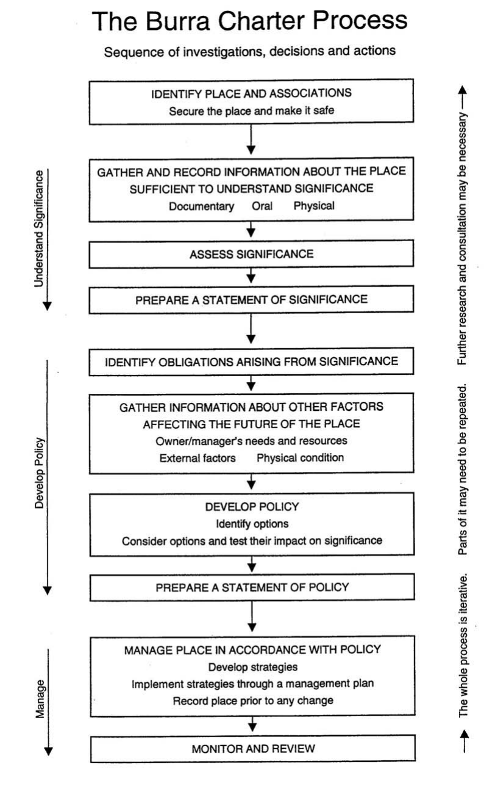
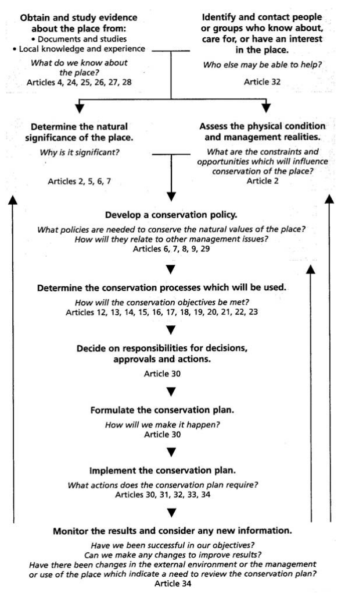

### 22.2 New work should be readily identifiable as such

. . Article 21 Adaption may involve the introduction of new services, or a new use, or changes to safeguard the place. Adaption must be limited to that which is essential to a use for the place determined in accordance with Articles 6 and 7

22.1 New work may be sympathetic if its siting, bulk, form, scale, character, colour, texture and material are similar to the existing fabric, but imitation should be avoided

#### Article 23 Conserving use

Continuing, modifying or reinstating a significant use may be appropriate and preferred forms of conservation

#### Article 24 Retaining associations and meanings

24.1 Significant associations between people and a place should be respected, retained and not obscured. Opportunities for the interpretation, commemoration and celebration of these associations should be investigated and implemented.

24.2 Significant meanings, including spiritual values, of a place should be respected. Opportunities for the continuation or revival of these meanings should be investigated and implemented.

#### Article 25 Interpretation

The cultural significance of many places is not readily apparent, and should be explained by interpretation. Interpretation should enhance understanding and enjoyment, and be culturally appropriate.

Article 23 These may require changes to significant fabric but they should be minimised. In some cases, continuing a significant use or practice may involve substantial new work

24.1 For many places associations will be linked to use.

#### D CONSERVATION PRACTICE Article 26 Applying the Burra Charter process

26.1 Work on a place should be preceded by studies to understand the place which should include analysis of physical, documentary, oral and other evidence, drawing on appropriate knowledge, skills and disciplines.

26.2 Written statements of cultural significance and policy for the place should be prepared, justified and accompanied by supporting evidence. The statements of significance and policy should be incorporated into a management plan for the place. .

26.1 The results of studies should be up to date, regularly reviewed and revised as necessary.

26.2 Statements of significance and policy should be kept up to date by regular review and revision as necessary. The management plan may deal with other matters related to the management of the place

26.3 Groups and individuals with associations with a place as well as those involved in its management should be provided with opportunities to contribute to and participate in understanding the cultural significance of the place. Where appropriate they should also have opportunities to participate in its conservation and management.

#### Article 27 Managing change

27.1 The impact of proposed changes on the cultural significance of a place should be analysed with reference to the statement of significance and the policy for managing the place. It may be necessary to modify proposed changes following analysis to better retain cultural significance.

27.2 Existing fabric, use, associations and meanings should be adequately recorded before any changes are made to the place.

#### Article 28 Disturbance of fabric

28.1 Disturbance of significant fabric for study, or to obtain evidence, should be minimised. Study of a place by any disturbance of the fabric, including archaeological excavation, should only be undertaken to provide data essential for decisions on the conservation of the place, or to obtain important evidence about to be lost or made inaccessible.

28.2 Investigation of a place which requires disturbance of the fabric, apart from that necessary to make decisions, may be appropriate provided that it is consistent with the policy for the place. Such investigation should be based on important research questions which have potential to substantially add to knowledge, which cannot be answered in other ways and which minimises disturbance of significant fabric.

#### Article 29 Responsibility for decisions

The organisations and individuals responsible for management decisions should be named and specific responsibility taken for each such decision.

#### Article 30 Direction, supervision and implementation

Competent direction and supervision should be maintained at all stages, and any changes should be implemented by people with appropriate knowledge and skills.

#### Article 31 Documenting evidence and decisions

A log of new evidence and additional decisions should be kept.

#### Article 32 Records

32.1 The records associated with the conservation of a place should be placed in a permanent archive and made publicly available, subject to requirements of security and privacy, and where this is culturally appropriate.

32.2 Records about the history of a place should be protected and made publicly available, subject to requirements of security and privacy, and where this is culturally appropriate

#### Article 33  Removed fabric

Significant fabric which has been removed from a place including contents, fixtures and objects, should be catalogued, and protected in accordance with its cultural significance. Where possible and culturally appropriate, removed significant fabric including contents, fixtures and objects, should be kept at the place.

#### Article 34 Resources

Adequate resources should be provided for conservation.

Words in italics are defined in Article 1 Article 34. The best conservation often involves the least work and can be inexpensive.

#### BACKGROUND

Australia ICOMOS Burra Charter has recently been through an extensive process of review that has resulted in a revised version of the document. The purpose of this revision was to bring it up to date with best practice.

The revisions take account of advances in conservation practice that have occurred over the decade since the Charter was last updated

Prominent among the changes are the recognition of less tangible aspects of cultural significance including those embodied in the use of heritage places, associations with a place and the meanings that places have for people

The Charter recognises the need to involve people in the decision-making process, particularly those that have strong associations with a place. These might be as patrons of the corner store, as workers in a factory or as community guardians of places of special value, whether of indigenous or European origin.

The planning process that guides decision-making for heritage places has been much improved, with a flowchart included in the document to make it clearer.

With the adoption of the 1999 revisions, the previous (1988) version of the Charter has now been superseded and joins the 1981 and 1979 versions as archival documents recording the development of conservation philosophy in Australia.

Initial references to the Burra Charter should be in the form of the Australia ICOMOS Burra Charter, 1999 after which the short form (Burra Charter) will suffice

#### SCHEDULE 2

> [Picture on page 12: a picture, saved as a picture (images/part-c17-heritage-page-12-2.gif, 150 dpi).]

SCHEDULE 2

Intergenerational equity means that the present generation should ensure that the health, diversity and productivity of the environment is maintained or enhanced for the benefit of future generations.

The principle of existence value is that living organisms, earth processes and ecosystems may have value beyond the social, economic or cultural values held by humans.

The principle of uncertainty accepts that our knowledge of natural heritage and the processes affecting it is incomplete, and that the full potential significance or value of natural heritage remains unknown because of this uncertain state of knowledge.

The precautionary principle is that where there are threats or potential threats of serious or irreversible environmental damage, lack of full scientific certainty should not be used as a reason for postponing measures to prevent environmental degradation.

Natural heritage incorporates a spectrum of values, ranging from existence value at one end through to socially-based values at the other. The fundamental concept of natural heritage, which most clearly differentiates it from cultural heritage, is that of dynamic ecological processes, ongoing natural evolution, and the ability of ecosystems to be self-perpetuating. At the cultural end of the spectrum, clear separation of cultural and natural values can be difficult, and more than one layer of values may apply to the same place.

The concept of natural heritage used here recognises the role Indigenous people have played in Australian landscapes for at least 50 000 years and possibly much longer.

THE AUSTRALIAN NATURAL HERITAGE CHARTER

AUSTRALIAN

STANDARDS AND PRINCIPLES FOR THE CONSERVATION OF PLACES OF NATURAL HERITAGE SIGNIFICANCE

PREAMBLE

The Australian Natural Heritage Charter was adopted in December 1996 following a two-year period of extensive national consultation. At that time the Australian Committee for IUCN accepted responsibility for the promotion, promulgation, administration and future review of the Charter. The Charter is for use by all Australian organisations and individuals . IUCN (the International Union for the Conservation of Nature and Natural Resources) is now known as the World Conservation Union.

Purpose

The purpose of this Charter is to assist everyone with an interest in the significance and conservation of natural heritage to make soundly-based decisions on conservation of that heritage. It is intended to achieve a uniform approach to conservation of places of natural significance in Australia that can be applied to public and privately-owned places, to terrestrial, marine or freshwater areas, and to protected and unprotected areas.

The Charter is not intended to provide a detailed process for describing places for the purpose of listing them on heritage registers.

Ethos of the Charter ARTER This Charter encompasses a wide interpretation of natural heritage and is based on respect for that heritage. It acknowledges the principles of intergenerational equity, existence value, uncertainty and precaution.

#### HOW TO USE THEAUSTRALIAN NATURAL HERITAGE CHARTER

The definitions, conservation principles and conservation processes described in Parts A, B and C of the Charter provide the basis for conservation decisions.  Part D draws these elements together to describe the procedure for conservation practice.

#### IMPORTANT

ƒ The steps need to be taken in this order ƒ Each step is a discrete stage ƒ Monitoring is a fundamental element of conservation practice.

#### ARTICLES DEFINITIONS

Article 1.  For the purpose of the Charter the following definitions apply.

#### General

1.1 Place means a site or area with associated ecosystems, which are the sum of its geodiversity, biological diversity and natural processes.

> [Picture on page 14: a picture, saved as a picture (images/part-c17-heritage-page-14-16.gif, 150 dpi).]

1.3 This definition is essentially the same as that used in 'The National Strategy for the Conservation of Australia's Biodiversity' to which all Australian Governments are signatory
