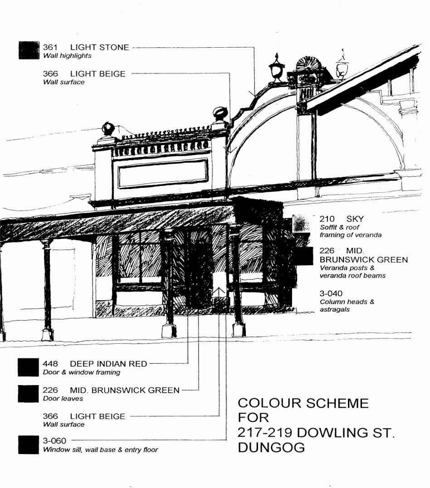
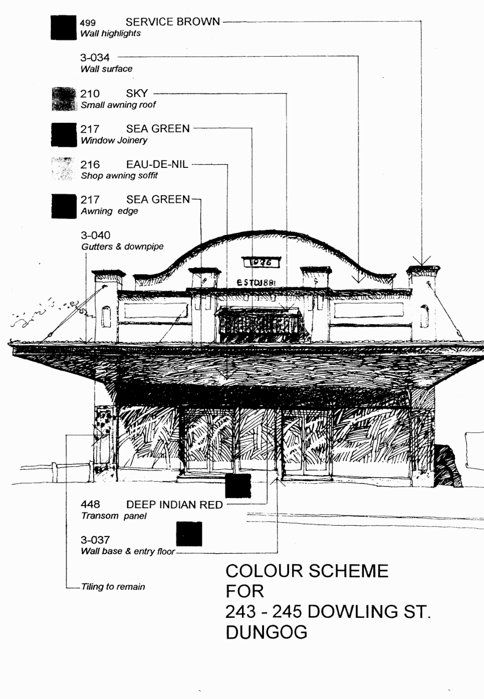

### 3.8 PAINT SCHEMES

The aim of providing guidelines for the re-painting of buildings along Dowling Street is to enhance the visual quality of individual buildings as well as the overall character of the street.

Historic. Contributory Buildings

Where the existing historic fabric is largely intact, it is recommended that the building would benefit from an appropriate heritage colour scheme.

If the original colour scheme can be determined by paint scraping, then the reinstatement of the original scheme is an option. The results of any investigation should always be recorded for further research.

Historic photographs are helpful in providing a guide to the use of contrasting colours and the general tonality of colours used. They are also useful in showing particular detailing which may have been picked out to enhance the facade.

While historic colour schemes seem to have a limited palette of colours, they were individually mixed, giving a range of colours within the palette.

The individual interpretation of the appropriate colour scheme for a building is strongly recommended to show a personal preference and to give a variety to the streetscape's visual quality.

Where a single building straddles a different number of property lots in different ownership, the colour scheme should be consistent across the entire building to unify the facade. Street level colour schemes should be appropriate to the overall colour scheme of the building.

In contributory buildings, surfaces that were originally unpainted should not be painted. Where the original masonry surface has been painted, the removal of the paint is recommended if strippng techniques do not damage the original face of the material.

Awnings and verandahs to commercial buildings should be considered in the overall colour scheme and appropriately painted to complement the building.

Generally, exterior surfaces are painted in flat or low sheen paint and joinery in a gloss paint.

GUIDELINES TO HISTORIC COLOUR SCHEMES EXTERIOR (Colour Schemes for Old Australian Houses, Evans, Lucas, Stapleton)

1860-1880 MID-VICTORIAN.

- WALLS

The buildings from this period often had rendered walls marked out to simulate stone and were commonly painted in shades that ranged from beige to salmon pink.

- JOINERY

Window sashes and doors were usually painted in dark colours such as deep Brunswick green or dark crimson. The frames were often painted in contrasting colours such as beige or cream.

External timber work was often painted in colours that ranged in shades from off-white to stone to deep buff.

- GUTTERS & DOWNPIPES

Were often painted in the dark shades employed on the doors and windows.

- CAST IRON VERANDAH POSTS AND BALUSTRADING

Was usually painted deep bronze green.

- VERANDAH ROOFS

During this early Victorian period the underside of verandah roofs began to be painted in eau-de-nil or opaline green, a practice that continued until about 1910.

LATE VICTORIAN. 1880-1900

The Victorians used a rich colour palette where external decoration was characterised by a fashion for 'picking out' different elements in a variety of colours.

- WALLS

Rendered walls were painted in two tones of colour ranging from beige to pink to deep buff and also strong colours such as dark brown, deep crimson, terracotta, dark earth and drab. Small mouldings were often picked out in a third colour such as dark crimson, off-white or pale pink.

- JOINERY

Doors were often painted in two tones, such as venetian red and cream, Brunswick green and biscuit or dark crimson and beige.

External woodwork was picked out in two shades of cream or buff with the dark joinery colour used for small mouldings such as the lip mould under the verandah edge.

- GUTTERS & DOWNPIPES

Were painted in the same dark colour as used for the verandah joinery trim.

- CAST IRON VERANDAH POSTS & BALUSTRADING

Were painted a deep bronze green or dark crimson and floral or other motifs picked out in cream, sage green or pink.

EDWARDIAN. 1900-1915

- WALLS

Red face brick walls were firmly in fashion in this period and as a result the use of paint on exterior wall surfaces diminished. During this period the two predominant colour schemes were shades of green or shades of cream to

buff. Deep Indian red was used on masonry such as window sills to simulate dark, well-fired bricks.

- ROOFS

If corrugated iron was used as the roofing material it was often painted tile red.

- JOINERY

Window frames were often painted cream with red oxide or forest green doors and frames. A combination of mid-buff and beige was just as common. Other external timberwork was painted in the same way.

Exposed rafters and large areas of timber were usually painted in the lighter colour while the darker shade was used on smaller areas and framing timbers such as small items of trim moulding on barge boards.

Verandah brackets were sometimes picked out in off-white.

- GUTTERS AND DOWNPIPES

Were often painted in a darker shade of paint from the colour scheme.

THE TWENTIES. 1915-1930

The bungalow residences were characterised by a restrained colour scheme during this period.

The exterior colour scheme of buildings from this period usually consisted of no more than two colours. Typical schemes were mid Brunswick green contrasted with pale cream or red oxide and pale cream.

- WALLS

Rendered walls were painted a restrained off-white, grey, beige or pale cream.

- JOINERY

Window sashes and frames were often painted cream and sometimes the external storm mould was painted in the darker shade. Doors and frames were normally painted in the darker shade. Mission Green was a common colour. Face brick walls had dark brown or green joinery such as Apple Green.

Elaborate timber work was not used on the exterior of houses in this period. Shingles, posts and trim were painted in the darker shade of the chosen colour scheme and rafters, fascia boards, barge boards, soffits and panels were all painted in the lighter colour.

Buildings built in the Modern Style of the period often had white walls with black or russet brown metal windows, the only spot of colour being reserved for the front door, such as vermilion, emerald or apple green, daffodil yellow or sky blue.

NEW BUILDINGS & BUILDINGS THAT HAVE UNDERGONE ALTERATIONS

There are existing buildings along Dowling Street that would greatly benefit from a new paint scheme. Where there are existing buildings that have been greatly altered, they need not be painted to an historic colour scheme but rather could be painted in an appropriate sympathetic contemporary colour scheme that takes the individual building's character into account as well as the general streetscape's quality. New buildings should be treated in a similar manner.

> [Picture on page 46: a picture, saved as a picture (images/part-c17-heritage-page-46-8.gif, 150 dpi).]

> [Picture on page 47: a picture, saved as a picture (images/part-c17-heritage-page-47-1.gif, 150 dpi).]
