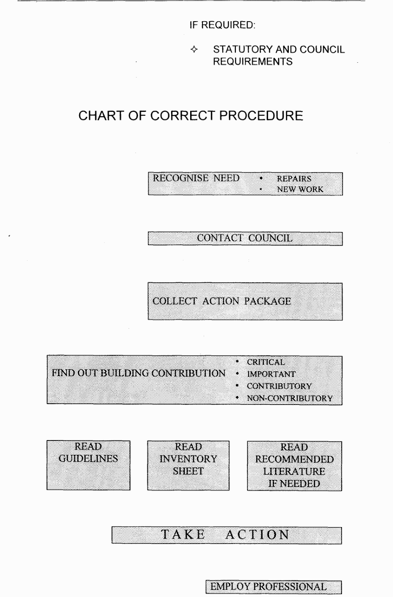

### 3.10 COUNCIL CHAMBERS

The Council's current office was built in 1958 on an elevated prominent corner site of Dowling Street and Brown Street, making the location visible from the major part of

town. The site offers a rare opportunity for creating a landmark civic building, right in the centre of town along the main street.

Sadly, none of the opportunities offered were exploited by the final design of the Chambers. The building is a late example of the Austerity Modern style, popular after World War 11. It is essentially a single storey, utilitarian building, presenting a bland, unwelcoming facade to the main street. The entrance is tucked away into the side, off Brown Street. The proportions and massing of the building conflict with its fine Victorian neighbour. The comparison between the former Council Chambers in Lord Street and the new office creates a very unfavourable response for the new building. The 1980's additions have done nothing to alleviate this situation.

The building's place in the streetscape is also detrimental; its scale, size, detailing and materials are alien and discordant. As the majority of the buildings in the main street are characterised by either strong roof forms or elaborate stepped parapets, the Council building, with its flat roof, emphasised by the deep overhangs, is very much out of character. Its impact on the streetscape is strongly non-contributory.

As a Council Chambers is a physical embodiment of a community's civic pride, it is critically important, not only for the benefit of the main street but for that of the whole

town, that major improvements are made to the Council Chambers to enable it to take advantage of its location and to fulfil its role as the focus of the community.

This study identified a number of guidelines which were generated by examination of the locality and the context of the main street. These guidelines should be incorporated into a comprehensive design brief for the improvement of the shire office.

The guidelines are as follows:

1\) The flat roof should be removed to improve its contextual relationship.

2\) The building should be enlarged in the vertical direction as this would

a) help celebrate its corner location

b) give the building a physical presence and importance it currently lacks.

3\) The vertical enlargement should be in the form of either

a)   a large hip roof over the existing building, incorporating additions within an attic-like arrangement; or

b)    a parapet raised above first floor level to form a balustrade and a first floor addition     formed behind this parapet, possibly incorporating a verandah.

4\) A straightforward first floor addition, extending the existing wall line the full height of an additional floor, is undesirable as this would destroy the delicate relationship the office has with its fine Victorian neighbour.

5\) The prominence of the corner location and the civic nature of the building strongly suggest the incorporation of a landmark element which the town lacks. This should be in the form of a tower-like structure positioned near the intersection. This element would serve as a beacon. It could be used as a clock-tower or a look-out.

6\) The entrance should be given a more prominent position by bringing it forward to the main street. Consideration should be given to incorporating the landmark element with the more prominent position for the entry point.

The accompanying sketches only serve to illustrate the ideas represented in the guidelines and they are not to be read as design solutions.

It must be emphasised that any proposed development should be undertaken only after a comprehensive design brief has been laid down, which sets out functional, operational and financial requirements as well. The brief should also make a deeper and more thorough analysis of the guidelines for the shire office, sketched out in this study.

Given the crucial role the building should play in Dungog's civic context, the appropriate method for obtaining the best design solution would be to hold a small design competition involving a group of selected architectural professionals.

Section 4

ACTION PACKAGE

INTRODUCTION

The purpose of this action package is:

- to raise community awareness of heritage

- to assist owners and tenants to understand the qualities of their buildings

- to help identify areas of buildings that need attention

- to assist owners and tenants to make the right decisions when carrying out building work

- to help in elevating individual buildings into higher categories of street contribution.

CHECK LIST OF PACKAGE

\*

INTRODUCTION 1 CHECK LIST

\*                  PROCEDURE CHART

\*                  CONTRIBUTION LIST OF PROPERTIES

\* GUIDELINES FOR BUILDING WORK

\* INDIVIDUAL INVENTORY SHEET

\* LIST OF RECOMMENDED FURTHER READING

> [Picture on page 53: a picture, saved as a picture (images/part-c17-heritage-page-53-1.gif, 150 dpi).]

RECOMMENDED READING LIST

GENERAL

Peter Cuffley Australian Houses of the 20's & 30's Ian Evans Caring for Old Houses Ian Evans Restoring Old Houses Ian Evans The Federation House M. Fraser The Federation House,

Australia's Own Style

Ian Stapleton How to Restore the Old Aussie House

COLOURS

Ian Evans, Clive Lucas, Ian Stapleton:

COLOUR SCHEMES FOR OLD AUSTRALIAN HOUSES

JOINERY/FENCES Dept. of Planning GETTING THE DETAILS RIGHT

ROOFS National Trust CONSERVATION AND RESTORATION OF BUILDINGS - CONSERVATION OF

ROOFS

SIGNAGE National Trust Technical Bulletin No. 21 Lettering & Signs on Building c.1850-1900

#### SCHEDULE 5
