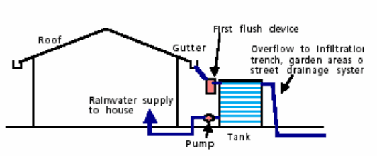
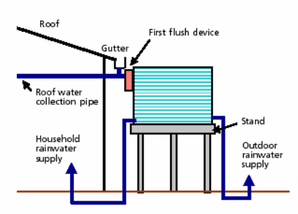
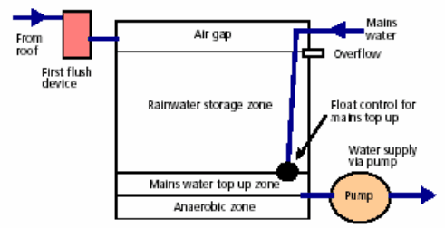
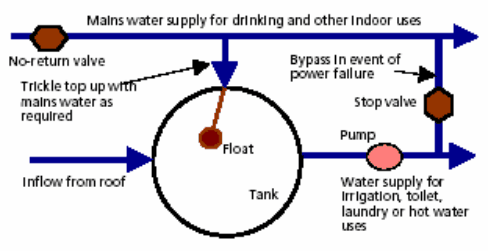
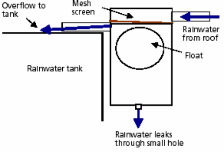

### 18.5 DESIGN PRINCIPLES AND PERFORMANCE CRITERIA

#### 18.5.1 Water Usage

#### Design Principles

• The use of water efficient fixtures in both the bathroom and kitchens of a household will result in substantial reductions in water use.

#### Performance Criteria

• The most efficient water fixtures are: o AAA rated or better water efficient shower heads. o AAA rated or better flow regulators for bathroom basins and kitchen sinks.

• Fixtures with AAA rating must achieve the following flow rates: o Shower heads – 9 litres or less per minute. o Basins – 6 litres or less per minute. o Kitchen Sinks – 9 litres or less per minute.

• Dual flush toilets should be used, and are required if new or replacement toilets are to be used.

• AAA rated or better washing machines and dishwashers are recommended.

• Piping between hot water sources and taps should be insulated.

#### 18.5.2 RAINWATER TANK

#### Rainwater Tanks – Design Principles

• Rainwater is a valuable natural resource that should be collected for household use.

• The use of a rainwater collection system is a way of conserving potable water supplies, as it can provide a water source for a range of household tasks, including toilet flushing, laundry and external uses such as garden watering, topping up swimming pools and car washing.

• Using rainwater will reduce water bills and reduce community infrastructure costs.

• Using rainwater can also aid self-sufficiency, providing a back-up supply in case of water restrictions caused by drought, peak supply shortage, or water quality problems.

• Rainwater tanks provide for on-site detention of stormwater, which lowers the storm run-off and so decreases local flooding.

• Rainwater tanks can supply water during emergencies such as fire.

#### Rainwater tanks – Performance Criteria

Rainwater tanks – General requirements

• The rainwater tank is to be attached to a physical structure that has a roof that will discharge into the tank.

• The rainwater tank shall be of an earth tone colour and blends into the surroundings. The rainwater tank shall be non-reflective.

• Rainwater tanks are to be placed behind the dwelling house unless suitably screened from the road.

• Tank stands shall have a maximum height of 450mm above ground. Area below shall not be enclosed or used for storage.

• Maximum installed height above ground level of 1.8 metres, including any stand if less than 900mm from side boundary, otherwise maximum height is 3 metres.

• All tanks and associated structures, including stands shall be installed in accordance with manufacturer’s/designer’s specifications.

• Tank stands shall not rest on footing of building or rely upon wall for support.

• Design of the rainwater tank should make provision for: o a rainwater storage volume, and o an air space for additional stormwater management, which will be 15% of the capacity of the tank.

• An upper overflow equal to the inflow in capacity is to be installed at the top of the tank and a middle outlet of 20 mm diameter set at the point representing 85% of the capacity of the tank.  To allow for the emptying of 15% of the tank as detention water.

• The overflow is to be piped to the stormwater reticulation system, being the street or interallotment drainage.  Where no stormwater reticulation system exists disposal is to be to a rubble drain prior to disposal in the natural water drainage.  The rubble drainage (trench) shall have a cross sectional area of 600mm x 600mm and being one (1) metre long for every 25m2 of roof area drained thereto.  Trenches are to be located three (3) metres clear of any building or lot boundary.

• Overflow connections are to be at sufficient height to ensure backflow does not occur and shall be vermin proofed.

• Any required pump is to be enclosed in a noise attenuating enclosure and shall not create a noise problem, which is typically regarded as being 5 dB above background noise levels.  The pump must not be audible at the nearest residential property boundary between the hours of 8.00 pm and 7.00 am Monday to Saturday and 8.00 pm and 8.00 am Sundays and public holidays.

Rainwater tanks (internally plumbed) – Additional requirements

• The tank must be fitted with a ‘first flush’ diversion to remove surface contamination, and a facility for periodic de-sludging.

• Lilac coloured polypipe is to be used for internal plumbing of rainwater.

• The tank must have sufficient capacity and be connected so as to supplement water for the following services on the site: o toilet flushing; o laundry; o garden irrigation; and o external washing (cars, paved areas, etc).

• All plumbing works shall be in conformance with the Committee on Uniformity of Plumbing and Drainage Regulations in NSW (CUPDR) Circular P&D No 18, which is referred to as “Guidelines for Plumbing Associated with Rainwater Tanks in Urban Areas”.  This circular specifies the requirements of cross connection control and backflow prevention, installation requirements, proximity to other services, marking and labelling, and maintenance.

• Supplemental inflow should not take place until the tank is at least 80% empty. This allows for the tank to buffer stormwater flows to local drainage.  Topping up should not exceed 50% of the tank capacity and it is preferable that it be less than 35% (20%).  The supplemental inflow is to be automated.

• All rainwater tanks internally plumbed shall be registered with Council.  Rainwater tanks (used for external uses only) – do not require registration with Council although

SEPP4 stipulates that rainwater tanks greater than 10,000 L in capacity require a DA. Schematic diagrams of all plumbing is to be included in registration documents.

#### 18.5.3 HARDSTAND

#### Design Principles

By limiting the hardstand area of a development (that is concrete and roofed surfaces that do not allow water penetration into the ground), stormwater run-off is lowered and water can infiltrate into the soil of the site. This lowers the impact of the development on local drainage infrastructure, and decreases impacts on the environment through the reduction of surface runoff.

#### Performance Criteria

Hardstand areas (refer to definition):

• shall be limited to a maximum of 65% of the lot area; and

• hardstand areas within the front setback shall not exceed 40% of the setback area. Porous concrete or plastic modular pavers placed on a sand base are recommended for car parks, car wash area, driveways, paths and courtyards.  Such materials will not be included in the calculation of hardstand area for the lot. On-Site Detention (OSD)

#### Design Principles

A rainwater tank can be designed to provide water supply and stormwater management benefits to the individual and community. The performance of OSD is dependant on the size of the impervious area contributing to the storage. Sizing of the site storage component should be related to impervious areas rather than allotment areas.

The effectiveness of rainwater tanks as a stormwater management measure increases with housing density due to greater proportions of the site area (roofs) contributing to rainwater tanks.

Additionally, OSD will be used on larger developments, such as villas, townhouses and residential units to provide temporary storage of stormwater on-site for re-use or gradual disposal to the stormwater system.

#### Performance Criteria

• All rainwater tanks installed on properties with single dwellings shall have a minimum 15% of the tank capacity as airspace to provide OSD.

• All other properties shall provide OSD in accordance with Council requirements and shall be designed by an appropriately qualified person.

Web Links http://www.lhccrems.nsw.gov.au/projects/wsud/

#### Appendix – Diagrams Showing Connection Detail Options

Dungog Development Control Plan________________________________________________________________________

Key elements of a domestic rainwater system:

> [Picture on page 8: a picture, saved as a picture (images/part-c18-water-efficiency-page-8-3.gif, 150 dpi).]

Configuration of a gravity system:

> [Picture on page 8: a picture, saved as a picture (images/part-c18-water-efficiency-page-8-5.gif, 150 dpi).]

Storage components of a dual supply system:

> [Picture on page 8: a picture, saved as a picture (images/part-c18-water-efficiency-page-8-7.gif, 150 dpi).]

Configuration of a dual supply system:

> [Picture on page 8: a picture, saved as a picture (images/part-c18-water-efficiency-page-8-9.gif, 150 dpi).]

Note that the non-return valve is to be a testable backflow prevention valve.

Basic design features of a first flush device:

________________________________________________________________________________________Water Efficiency

Dungog Development Control Plan________________________________________________________________________

> [Picture on page 9: a picture, saved as a picture (images/part-c18-water-efficiency-page-9-2.gif, 150 dpi).]

Suggested plumbing configuration for rainwater tanks in urban areas with a reticulated supply

– direct connection with potable supply.

________________________________________________________________________________________Water Efficiency
