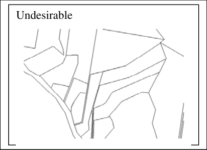
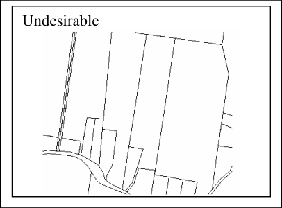
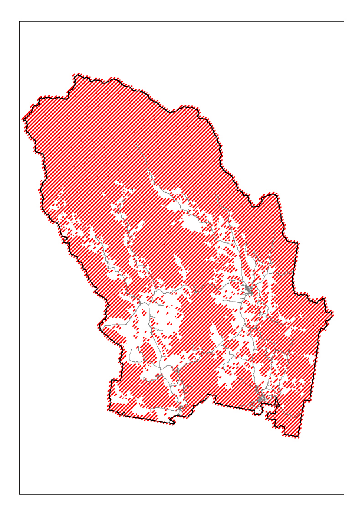

### 2.2 PLANNING FOR RURAL RESIDENTIAL DEVELOPMENT

Key issues identified are:

ƒ Roads and road access ƒ Pedestrian and cycle access ƒ Existing pattern of land subdivision ƒ Need to protect habitat ƒ The need to protect the waterways ƒ Flooding ƒ The need to retain the rural character of the area and protect areas of high visual significance.

Many of these issues are specific to individual settlements and are considered in the relevant Local Area Plans.

#### Roads and Road Access

Planning Approach

In new subdivisions, access to the collector roads will be by properly formed local roads and appropriately designed and sited intersections.  Existing intersections may need to be upgraded or relocated.  There will be no new direct driveway or right of way access from private dwellings to collector roads.  Where required, access ways for emergency access may be permitted.

In designing subdivisions, careful consideration needs to be given to the internal road network.  Roads, unlike land uses or buildings, tend to become permanent features of a settlement.   As such it is important that the road layout be conducive to the long term sustainability of the area.

For local roads within subdivisions, preference is for through, connecting roads rather than cul-de-sacs and right-of ways.  A connected road network will minimise driving distances and provide for more than one entry-exit point within each subdivision.  This is important particularly in areas potentially subject to bush fire or flooding.    A connected road network will also facilitate development of bus routes, including school bus routes, as the need emerges.

Desired Outcomes

ƒ Reducing vehicular conflict and the potential for conflict through a significant reduction in the number of driveway access points to collector roads.

ƒ To deliver a high level of access and permeability via a network of inter-connecting roads in and between subdivisions, not a series of cul-de-sac roads or right-of-ways.

ƒ To deliver a road network that will support closer settlement in the future.

#### Pedestrian and Cycle Access

The Issue

There is no public transport in Dungog Shire to provide access to the shopping centre for people living in outlying areas.  In addition, there has been no provision for pedestrians or cyclists along the collector roads. Due to the narrow, unformed verges and speed limits (80 to 100km), the collector roads are not designed to provide a safe or a desirable environment for pedestrians and cyclists.

Planning Approach

Where feasible, to incorporate shared pedestrian and cycle pathways within new subdivisions and the provision to link these routes between adjoining subdivisions.  In some areas the design intent will be to establish a shared pathway link to the nearby settlement.

Desired Outcome

ƒ A network of shared pathways providing safe pedestrian and cycle access in and between subdivisions and, where feasible, between the subdivisions and the nearby settlement.

#### Existing Pattern of Subdivision

The Issue

Under previous planning schemes subdivision of rural land was undertaken on an ad hoc, uncoordinated basis.  This has resulted in significant fragmentation in land holdings.   In order to provide access to existing roads and/or river frontage, many of the lots created were long and narrow or of battleaxe or irregular shape.  Further sub-division of these existing lots would increase fragmentation and is not considered desirable.  Fragmentation also creates long term access and servicing problems.

Planning Approach

Emphasis is on creating a coordinated and integrated approach to subdivision design within the Development Zones. The Local Area Plans do not permit further subdivision of individual lots where the lots are small, irregular in shape and/or where the width to depth ratio of the lot is less than 1:3.  These lots are identified in the LAP.

Subdivision of these identified lots may only be permissible through (consolidation) amalgamation of adjoining lots and/or co-operation with adjoining land-owners to form a viable subdivision design area.  Masterplans may need to be prepared for subdivision design

> [Picture on page 7: a picture, saved as a picture (images/part-c2-development-in-rural-residential-zones-page-7-21.gif, 150 dpi).]
> Words printed on the picture (title and legend, copied from the PDF):
> Undesirable

areas.

> [Picture on page 7: a picture, saved as a picture (images/part-c2-development-in-rural-residential-zones-page-7-23.gif, 150 dpi).]
> Words printed on the picture (title and legend, copied from the PDF):
> Undesirable

The Masterplan will detail the road network, lot layout and provision for open space, habitat corridors, environmental and scenic protection zones and shared pedestrian and cycle pathways within the subdivision design area.

Where there are lots suitable for subdivision that do not have existing public road frontage, then the subdivision design for the adjoining lots with road frontage must ensure that provision is made for road and shared pathway access to the adjoining land.  This will prevent the sterilisation of developable land.

Desired Outcomes

ƒ No further fragmentation or ad hoc subdivision of land.

ƒ Co-ordinated approach which results in masterplans that demonstrate staged subdivision and land release and avoid sterilisation of adjoining properties.

ƒ Create the opportunity for the development of an integrated community, not a series of separate enclaves.

ƒ To create a strong network of pedestrian, cycle and open space links within subdivisions, to adjoining subdivisions and between the new subdivisions and the nearby village.

#### Habitat Protection

Within the some locations there are significant areas of vegetation that support a range of rare and endangered species.  These areas are to be preserved and protected from development.

Planning Approach

Habitat, flora and fauna assessments need to be undertaken as part of the development process.   Strategies for managing areas identified as having habitat value must be identified. These strategies may include the protection of significant habitat areas as open space or environmental protection areas, provision of buffer zones and set-backs, increasing the minimum lots size, minimising clearing and avoiding structures or development in habitat areas.

Desired Outcomes

ƒ Preservation and protection of habitat that supports viable wildlife communities, particularly rare and endangered species.

ƒ Establishment of a network of interconnected wildlife corridors not isolated protection zones or remote 'islands' of habitat.

ƒ Protection of watercourses and the vegetation along these watercourses.

#### Bushfire

The Issue

There are areas that are prone to bushfire.  These areas are identified on the 'Dungog Shire Bushfire Prone Land ' Map and shown in Map 2.

Planning Approach

All subdivision planning must comply with the provisions of the NSW Rural Fire Service requirements as specified in the 'Planning for Bushfire Protection 2001’, and/or other relevant bushfire regulations.

Desired Outcome

ƒ To minimise the risk to people and property from the impacts of bushfire.

### DUNGOG SHIRE

### MAP 1 – BUSHFIRE PRONE AREAS

> [Picture on page 9: a picture, saved as a picture (images/part-c2-development-in-rural-residential-zones-page-9-3.gif, 150 dpi).]

#### Waterways – River Foreshores

The Issues

A number of rivers and other watercourses play an important role within the Dungog Shire

area.  These watercourses contribute to the sustainability of agriculture, recreation, tourism, water supply, habitat and bio-diversity and to the microclimate of the area.  In addition these watercourses contribute significantly to the local character of the villages in the Shire.

Issues include:

ƒ The cumulative negative impacts of development. ƒ Preventing pollution from effluent and stormwater runoff and other activities. ƒ Maintaining water quality and the flow of the rivers by limiting the pumping of river water. ƒ Minimising impacts from development on the ecology associated with watercourses and wetlands.

Flooding is also an issue in the Shire with areas becoming isolated due to floodwaters.

Planning Approach

The planning approach incorporates:

ƒ Protecting watercourse ecology ƒ Maintaining water quality and water flow ƒ Providing for public access to the waterways ƒ Minimising the impacts of flooding

This can be achieved by:

ƒ Providing adequate buffers and set-backs from watercourses, as per the DCP. ƒ Ensuring that no further riparian rights are created, as required by the LEP and DCP. ƒ Prohibiting further subdivision of the river foreshore areas – new lots with river frontage cannot be created. ƒ Encouraging foreshore areas to be kept in one title and zoned appropriately. ƒ Providing public access to foreshore areas. ƒ Encouraging the installation of package sewage treatment plants rather than on-site septic disposal systems.

Desired Outcomes

ƒ Protection of riparian vegetation. ƒ Maintenance of water quality and water flow. ƒ Providing public or community access to the river foreshore areas. ƒ Minimising the impact of flooding on people and property.

#### Visual Impact

The Issue

ƒ Retention of the rural character and appearance of the settlements is very important to both the local community and Shire residents. ƒ This applies to both hillsides and river valleys.

Planning Approach

Emphasis is on protecting the character and visual identity of the area. The DCP identifies areas where a visual and view shed analysis will be required as part of the planning process.

Design criteria for development with areas of high scenic value may include:

ƒ Limiting or not permitting further subdivision and development in areas of high scenic value. ƒ Increasing the minimum lot size to avoid impact of dwellings and structures within significant view sheds. ƒ Appropriate siting and setbacks of new development, as per the DCP. ƒ Use of landscaped buffers.  Buffers along collector roads will need to be in one ownership (eg dedicated to Council or as 'Community Land') to ensure effective management and control. ƒ Siting dwellings so that they front collector roads.  Backyards must not have frontage to collector roads ƒ Height limits on buildings, including limiting dwellings to single storey.

Desired Outcomes

ƒ Retention of the rural character and setting of the Shire.

ƒ Retention  of areas of high scenic value, including hills, the river valleys and the rural vistas on the access roads into villages.

ƒ Minimise visual impact of rural residential development from the main routes through villages.  New development will be appropriately sited with landscaped buffers to these main routes.

ƒ Through landscaping, establish entry statements (eg corridor of trees) to the villages along the main access roads to create a sense of arrival to a destination point.

#### Future Growth of Settlements

The Issue

There is already pressure within some settlements for additional residential lots.  Growth has been constrained by the lack of access to sewerage.

As the population in and around the settlements increases, there will also be demand for the provision of additional facilities and services, including recreation and aged care facilities, as well as demand for employment generating activities (eg service and light industries).

Under the provisions of the LEP little land has been identified or zoned to provide for the future expansion of the villages.   Some land within or surrounding them has been zoned 9(a) Investigation Area and identified as potentially suitable for urban purposes.

Planning Approach

Subject to availability of sewer and town water and lack of environmental or flooding constrains, existing rural lifestyle lots within the settlements may be able to be rezoned and subdivided for residential or village uses.

Further investigation of these lots is required to determine their suitability for future uses in the settlements’ development.  In particular, it needs to be determined whether these lots could be connected to the town water supply and sewered - either through connection to a town sewage system or via an on-site package treatment plant.

Following these investigations, an area or areas, should be identified for future urban uses. These areas could be land-banked for this purpose or subdivided and developed in such a way that they can be further subdivided in the future as required.  For example, the subdivision could be designed as a residential subdivision with a number of residential lots then grouped together and sold in parcels as rural lifestyle lots. On the other hand, land-banking is the preservation of land from less intensive uses, until such time in the future when the land is sewered and can then be developed for its highest and best use by future generations.

Desired Outcome Land bank to be identified to accommodate future growth of the settlements.
