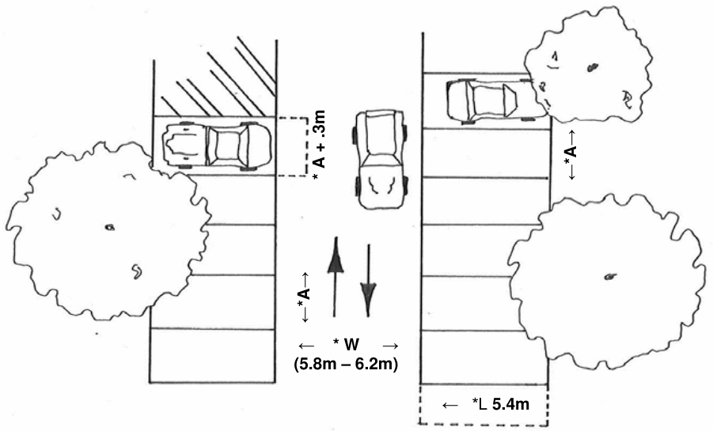

## 5. Design Standards

a. This plan shall apply to all traffic generating development within the Dungog Local Government area.

b. Any car parking matters not considered in this plan shall be in accordance with “Policies guidelines and procedures for Traffic Generating Development” from the Roads and Traffic Authority of New South Wales and the latest relevant Australian Standard (AS).

### 5.1 Location of On Site Parking

I. Parking facilities are to be located so that their use is encouraged and evident from the street, particularly visitor and customer parking.

II. Parking spaces for employees and for longer duration parking should be located more remotely from the street.

III. So as to achieve an acceptable level of amenity and a satisfactory relationship between adjoining land uses, the location of the parking area(s) within the site shall have regard to:

i Site conditions such as slope, vegetation and drainage;

ii The relationship of the building to the parking area; and

iii The proximity of the parking area to any neighbouring residential areas.

IV Off-street parking shall be located on the site of the development, and in places where readily accessible to principal staff and/or customer entrances.

V Council may be prepared to accept car parking on adjoining or nearby land owned by the applicant provided that the adjoining or nearby land is appropriately zoned.

VI In residential zones all car parking and maneuvering areas shall be located behind the building line and suitably screened.

### 5.2 Parking Spaces and Driveway Standards

I. The dimensional requirements for on-site car parking spaces and driveways giving access to parking spaces shall generally be as set out in accordance with the latest Australian Standard - AS

2890.1 except where the requirements are specifically defined in this plan.

II. The grade on any driveway within a development site shall not exceed 1 in 5 (20%) provided that a transitional grade not exceeding 1 in 10 (10%) shall be provided for a distance of 3 metres at either end of the grade, which exceeds 1 in 10.

III. The minimum dimension for a covered car space (i.e. carport or garage) serving a residential development shall be:

3m x 6m clear internal dimension, except where there is a physical restriction to both sides of the space, in which case the width of the space shall be not less than 3.2m.

IV. Where a covered car space is provided in association with a residential development, at or near right angle to the driveway from which access is gained, the following minimum dimensions shall apply:

| Minimum clear width of opening | Minimum distance of outside edge of driveway from opening |  |  |
|---|---|---|---|
|  | Driveway not greater than 12% slope | Driveway greater than 12% but not greater than 20% slope | Driveway greater than 20% slope |
| 2.6 m | 6.5 m | 7.0 m | 7.5 m |
| 2.8 m | 6.0 m | 6.5 m | 7.0 m |
| 3.3 m | 5.5 m | 6.0 m | 6.5 m |
| 3.7 m | 5.0 m | 5.5 m | 6.0 m |

Provided that:

a the edge of any driveway adjacent to a property boundary shall be measured not less than 0.2 m from the boundary.

b a driveway for a single dwelling shall not be less than 3m wide. This may be reduced to 2.7 m provided 0.3m either side remains unobstructed.

c the slope of the driveway for the purpose of this sub clause shall be the maximum gradient within the vicinity of the car parking space into which the vehicle will be required to make a turning movement.

d the car parking space shall be of such width that the vehicle shall come to rest in the centre of the space.

e a driveway which has a slope greater than 12% shall have a surface treatment which minimizes wheel-skid in wet conditions.

V. Where a covered space is not at or near right angles to the driveway from which vehicles gain access, the requirements for driveway widths, minimum openings, etc. shall be determined by the Executive Manager – Infrastructure and Assets.

VI. Development plans are to show the following information:

a Vehicular swept paths and dimensions of clear manoeuvring areas;

b a longitudinal section through the centerline of the driveway from the kerb to the proposed garages, showing grades and suitable transition at changes of grade; - at CC stage only

c drainage pits and pipes;

d a pavement design prepared by a suitably qualified engineer

– At CC stage only

### 5.3 Directional Signs and Marking

I. Clear and precise marking of a parking area is of prime importance in the prevention of choking of the aisles and for the general ease of use of the facility. Details of all proposed signposting and marking for parking areas are to be submitted with the development application for council's determination.

II. Entry/Exit points must be clearly marked so as to avoid any confusion. Within the car park, signs should be located at regular locations so that drivers attempting to exit the car park may do so by the most efficient route. Signposting should be easily seen and understood.

III. One-way markings must be clearly set out on the pavement in such a manner as to be easily readable and understandable to the users of the car park.

IV. In certain situations, the installation of signs to Council's satisfaction may be required over and above the normal requirements.

V. Yellow paint is difficult to see under adverse lighting conditions. It is considered that white paint is the most suitable colour for use as a pavement marking.

VI. All parking bay delineation, arrows and other information for the driver, painted on the pavement are to be marked using white paint. Delineation should not be less than 75mm or greater than 100mm wide.

6\. Layout

a. The layout of parking areas shall be designed so that parking spaces remain available and accessible, have unrestricted access to a road by way of a corridor provided within the lot boundaries. Building design must not lead to closure of such access.

b. Parking areas except for single residences and dual occupancy buildings shall be designed so that all vehicles enter and leave the subject land in a forward direction.

c. The location and width of all driveways shall conform with the requirements of Council. Driveways shall be located to the street with the lowest traffic volume. In particular, driveways shall not be located:

I. opposite a ‘T’ intersection II. closer than 6m to an intersecting street as measured from property boundary, but preferably 9 metres to an intersecting street as measured from the property boundary.

d. Parking bays for the disabled shall be provided in accordance with the current AS 2890.1 – “Parking Facilities – Off Street Car Parking” at the time of development.

e. Adequate drainage of surface waters off parking areas shall be provided and disposed of to a Council drainage system.

f. Pedestrian flow in car parking areas shall be an integral part of the design and pedestrians should be separated from vehicular traffic wherever possible. Use of lighting should be considered where night use is involved.

g. The minimum height in undercover parking areas shall be 2.2 metres.

h. Car and truck turning areas shall be in accordance with the current version of AS 2890.2 – “Off-street commercial vehicle facilities” at the time of development.

i. Consideration should be given to the use of speed humps in larger parking areas. Such humps shall be designed in accordance with Traffic Authority Guidelines.

> [Picture on page 15: a picture, saved as a picture (images/part-c20-off-street-parking-page-15-24.gif, 150 dpi).]
> Words printed on the picture (title and legend, copied from the PDF):
> \* A + .3m
> ←*A→
> ←*A→
> ←    * W     →
> (5.8m – 6.2m)
> ←   *L 5.4m

#### EXAMPLE OF A TYPICAL LAYOUT

\*   ‘W’ = 5.8m and ‘A’ = 2.4m for residential, domestic and all day staff parking (3 point turn required for entry and exit). Where possible ‘W’ of 6.2m is recommended and shall be provided (single turn entry and exit). *   Customer parking ‘W’ = 6.2m; ‘A’ = 2.5m (2.6 to 2.7m in shopping centres) ‘L’ = 5.4m.

For additional information including other uses and layouts consult AS 2890. Note:

#### ‘W’ = aisle width ‘A’ = width of car parking space ‘L’ = length of car space
