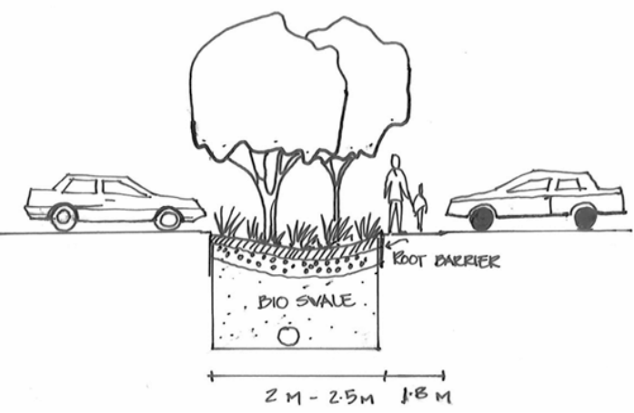
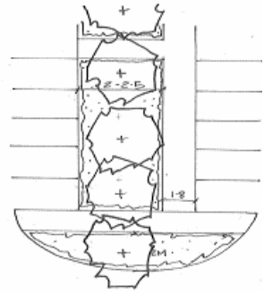

## 7. Landscaping

The landscaping of a surface carpark is an important feature, which serves to reduce the harsh effect often created by large open asphalt or concrete areas. Landscaping design should be an integral part of the layout. Landscaped areas should be used throughout the car park rather than placed only in the perimeters. They can often be used in conjunction with the provision of pedestrian through areas and in separation of conflicting traffic movements. As a guide the following points should be considered when designing the landscaping of the carpark:

I. A minimum of 10% of the total area of the carpark shall be appropriately landscaped.

II. Long stretches of parking bays are to be dispersed with screen planting. A typical ration includes no more than 10 parking bays before breaking to include planting.

III. Plants should be selected and located to avoid maintenance problems such as interference with overhead wires, underground conduits, damage to paved areas by root systems, and leaf and branch litter.

IV. Trees with large surface roots, excessive girths, brittle limbs, fruits, sap or residue that drop and trees which attract large numbers of birds should be avoided in parking areas.

V. Landscaping must be maintained in perpetuity

> [Picture on page 16: a picture, saved as a picture (images/part-c20-off-street-parking-page-16-31.gif, 150 dpi).]

#### EXAMPLE OF LANDSCAPING

> [Picture on page 17: a picture, saved as a picture (images/part-c20-off-street-parking-page-17-2.gif, 150 dpi).]
