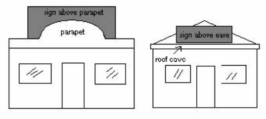

## 5. Site and Building

• Is the proposal compatible with the scale, proportion and other characteristics of the site or building, or both, on which the proposed signage is to be located?

• Does the proposal respect important features of the site or building, or both?

• Does the proposal show innovation and imagination in its relationship to the site or building, or both?

> [Picture on page 6: a picture, saved as a picture (images/part-c22-signage-page-6-18.gif, 150 dpi).]

Examples of unacceptable signs that project above the parapet or roof eave lines
