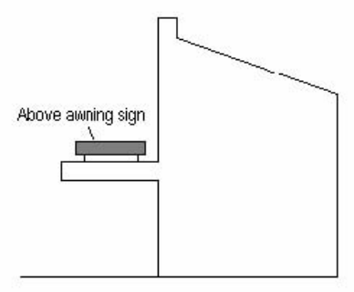
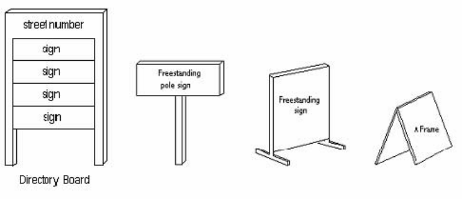
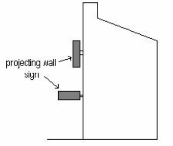
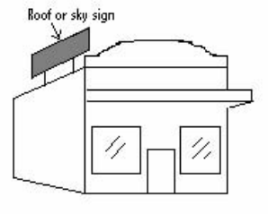
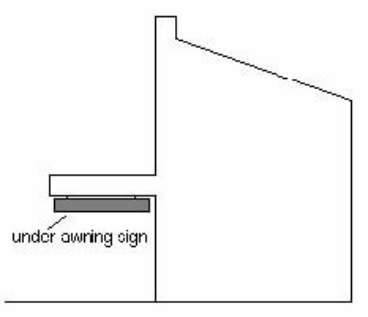

## 8. Safety

• Would the proposal reduce the safety for any public road?

• Would the proposal reduce the safety for pedestrians or bicyclists?

• Would the proposal reduce the safety for pedestrians, particularly children, by obscuring sightlines from public areas?

APPENDIX ONE EXEMPT DEVELOPMENT - STANDARDS FOR EXEMPTION Advertising structures and signs

(a) The advertisement is within a building, including signs behind the glass line of a shop window, and is less than 50% of the area of the shop front.

(b) The advertisement is within a site and is not visible from outside that site.

(c) The advertisement replaces one of the same, or a larger size lawfully displayed on the same structures.

Business identification signs.

(a) Provides information relating to the goods or services provided at the premises or place.

(b) Maximum area of 0.75m2 in business zone.

(c) A maximum of 10 m2 in an employment zone.

(d) One advertisement per premises.

(e) Must be attached to the front wall or fence within the boundary.

(f) Must not be illuminated

(g) Must not display a trade or brand name.

#### Fascia signs

(a) Wholly contained within the fascia.

(b) Securely fixed.

(c) Not internally illuminated.

Public notice, an advertisement displaying public information

(a) Displayed or erected for or by a public authority.

(b) Providing information or directions about a service.

Real estate signs on land for sale or lease

(a) In residential and rural areas must not exceed 2.5m2.

(b) Must be erected on or within the boundary of the subject property

(c) On commercial or industrial premises areas must not exceed 4.5m2 in area.

(d) Holiday letting agent advertisements – as per requirements of a business identification sign.

(e) Must be removed within 7 days of the successful letting or sale of the subject property.

Street signs comprising information, town entry and directional signs, name plates and advance traffic warning signs.

These signs are described in the adopted Uniform Signage Strategy, and

(a) Construction by or for Council.

(b) Must be structurally sound.

(c) To be designed, fabricated and installed in accordance with the relevant standards of Standards Australia.

Temporary signs (means an advertisement of a temporary nature)

(a) The sign is not erected over a public road.

(b) Where located on a public road reserve, the placement of a sign is not to obstruct vehicular and /or pedestrian passage.

(c) The sign is for a religious, social, cultural, educational, recreational or political event.

(d) No commercial advertising other than the sponsor’s name (max. 25% of sign area for this purpose).

(e) Is displayed no earlier than 28 days before the event and is removed within 7 days after the event.

(f) A maximum number of 5 signs per event within the Shire.

(g) The top of the sign/advertising structure is not to exceed 2.4m above the ground.

(i) Not to be fixed to any building or structure without the permission of the owner, including in the case of pubic infrastructure the permission of the relevant authority.

(j) Must not be erected on public land (without the written approval of Council) or affixed to trees, lighting standards (other than on lighting standard specifically designed and approved for the purpose), guide posts or power poles in road reserves

(j) Not exceeding an area of 10 m2

Note: If you are intending to erect temporary signs along roads controlled by the Roads and Traffic Authority (RTA), please contact the RTA to see if such signs are permitted

#### Under awning signs

(a) Maximum length of 2.5m and height of 0.5m.

(b) Top and bottom edges horizontal to the ground with a minimum height of 2.6m above the ground.

(c) Not to extend beyond awning.

(d) Securely fixed.

(e) May be illuminated.

(f) One under awning sign per premises.

#### Advertisement on a motor vehicle

(a) The advertisement is an integral part of the vehicle.

(b) The vehicle can be moved lawfully with the advertisement in place.

(c) The vehicle is not standing unattended on public land only for the purposes of displaying the advertisement.

#### Alterations to existing signs

The sign is the alteration of a legally erected advertisement where the nature, size and specifications remain generally unaltered.

#### Heritage Areas

No signs are exempt if proposed on a heritage item or in a heritage conservation area and all signs require development consent from Council.

(Refer to Dungog Local Environment Plan 2006, schedule 3, Heritage items and Heritage conservation areas )

#### Electoral matter relating to Federal, State or local government elections

The display of any poster that contains electoral matter in relation to an election is exempt development if the poster:

(a)   is no larger than 8 square metres, and

(b)   is displayed by or on behalf of a candidate at the election or the party (if any) of any such candidate, and

(c) is displayed in accordance with any requirements of the Act under which the election is held, and

(d)   is displayed only during the relevant period. election means an election held under the Commonwealth Electoral Act 1918 of the Commonwealth, the Parliamentary Electorates and Elections Act 1912 or the Local Government Act 1993. electoral matter means:

(a) any matter that is intended or calculated or likely to affect (or is capable of affecting) the result of an election or that is intended or calculated or likely to influence (or is capable of influencing) an elector in relation to the casting of his or her vote at an election, and

(b)   the picture of a candidate at an election, along with the candidate’s name and the name of the party (if any) of any such candidate.

relevant period, in relation to an election, means the period comprising the following:

(a)   the period of 5 weeks immediately preceding the day on which the election is held,

(b)   the election day,

(c) the period of 1 week immediately following the election day.

#### APPENDIX TWO

#### DEFINITIONS

1\) “Above awning sign” means a sign attached to the upper side of an awning (other than the fascia, return end or wall sign).

> [Picture on page 11: a picture, saved as a picture (images/part-c22-signage-page-11-5.gif, 150 dpi).]

Figure 1: Above awning sign

2\) "Advertisement" or “advertising” means the display of symbols, messages or other devices that advertise products, goods or services, whether or not the display includes the erection of a structure or the carrying out of a work. “Advertisement” or “advertising” does not include:

(a) business identification signs,

(b) building identification signs,

(c) Signs on vehicles where the vehicle is used principally for the conveyance of goods or passengers.

3\) "Awning fascia sign" means a sign attached to the fascia or return of an awning.

Figure 2: Awning fascia sign

4\) “Building identification sign” means a sign that identifies or names a building, and that may include the name of a business or building, the street number of a building, the nature of the business and a logo or other symbol that identifies the business, but that does not include general advertising of products, goods or services.

5\) "Business identification sign" means a sign:

(a) Which indicates:

(i) the name of the person, and

(ii) the business carried on by the person, at the premises or place at which the sign is displayed, and;

(b) Which may include the address of the premises or place, and a logo or other symbol that identifies the business, but does not include general advertising of products, goods or services or any advertising relating to a person who does not carry on business at the premises or place?

6\) "Floodlit sign" means a sign illuminated by any external light source.

7\) “Freestanding sign” means a sign that is displayed on a sign structure that is mounted on the ground on one or more supports and includes A-frame, directory boards and pole signs.

> [Picture on page 12: a picture, saved as a picture (images/part-c22-signage-page-12-14.gif, 150 dpi).]

Figure 3: Examples of freestanding signs

8\) “Home employment" means an activity carried out under the following circumstances:

o the activity is carried out within a dwelling or the curtilage of a dwelling used as the residence of at least one of the people carrying on the activity or on land adjoining that land which is in the same ownership, and

o the activity causes minimal interference to the amenity of the area, and o the activity is in character with the scale and ambience of other activities within the immediate area, and

o any goods offered for sale at the place at which the activity is carried on have been either produced on the site of the activity or relate directly to the activities taking place on the site, and

o there are never more than 3 people carrying out the activity on the site who do not live in the dwelling, and

o the activity does not occupy more than 60 square metres of the building in which it is located.

9\) “Home occupation” means an occupation carried on in a dwelling, or in a building ancillary to a dwelling, by one or more permanent residents of the dwelling that does not involve:

o the employment of persons other than those residents, or

o interference with the amenity of the neighbourhood by reason of the emission of noise, vibration, smell, fumes, smoke, vapour, steam, soot, ash, dust, waste water, waste products, grit or oil, traffic generation or otherwise, or

o the display of goods, whether in a window or otherwise, or o the exhibition of any  notice, advertisement or sign (other  than  a

notice, advertisement or sign exhibited on that dwelling to indicate the

name of the resident and the occupation carried on in the dwelling), or

o the sale of items (whether goods or materials), or the exposure or offer

for sale of items, by retail, but does  not include  bed and breakfast

accommodation  or home  occupation (sex services).

10\) “Projecting wall sign” means a sign attached to the wall of a building (other than the transom of a doorway or display window) and projecting more than

> [Picture on page 13: a picture, saved as a picture (images/part-c22-signage-page-13-18.gif, 150 dpi).]

300mm from the wall.

Figure 4: Projecting wall sign

11\) “Roof or sky sign” means a sign erected on or above the roof of a building.

> [Picture on page 13: a picture, saved as a picture (images/part-c22-signage-page-13-22.gif, 150 dpi).]

Figure 5: Example of a roof or sky sign

12\) “Sign display area” means the area of one side of a sign or sign structure including lettering, symbols and background around lettering, but does not include the sign structure itself or flat colour areas of blank walls. Where more than one side of the sign display area is visible from any view, the entire area visible shall be calculated.

13\) "Sign structure" means a structure used or to be used to support a sign.

14\) “Under awning sign” means a sign attached to the underside of an awning (other than the fascia, return end or wall sign).

> [Picture on page 14: a picture, saved as a picture (images/part-c22-signage-page-14-9.gif, 150 dpi).]

Figure 6: Under awning sign

15\) “Wall sign” means a sign that is painted on or fixed flat to the wall of a building, but does not include a special promotional advertisement.

Figure 7: Wall sign

16\) “Window sign” means a sign attached to, or painted on, the shop window.

Figure 8: Window sign
