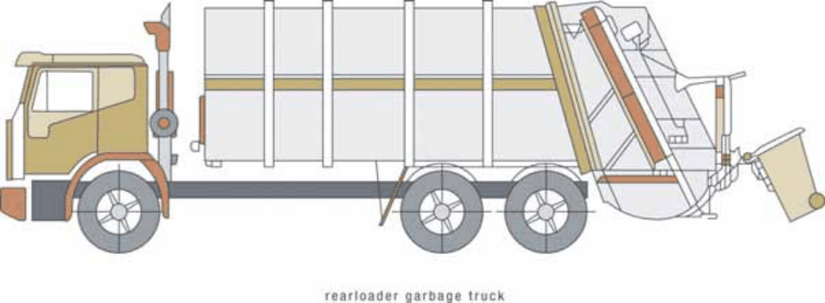
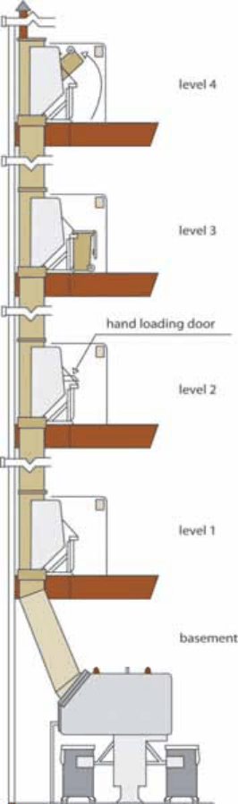

#### 4. Read the Appendices — Further Information

This section provides useful information in interpreting this Chapter, understanding the  waste  minimisation  and  management  environment  and  documenting  the central  submission  requirement  –  a  Site  Waste  Minimisation  and  Management Plan.

#### STEP 1

Understand the context, aims and objectives

#### STEP 2

Familiarise yourself with the application (submission requirements)

#### STEP 3

Prepare a Site Waste Minimisation and Management Plan

#### STEP 4

Liaise with Council prior to lodging your application

#### STEP 5

Submit your application

#### 24.8.3 Steps in the Preparation and Submission of an Application

The  actions  involved  in  preparing  and  submitting  a  development  application,  which satisfactorily addresses waste minimisation and management obligations are summarised in the following chart.

## PART 2 – SUBMISSION/APPLICATION REQUIREMENTS

### 24.9 DOCUMENTATION TO BE SUBMITTED TO COMPLY WITH THE REQUIREMENTS

#### OF THIS CHAPTER

All applications for development, including demolition, construction and the ongoing use of a site/premise, must be accompanied by a Statement of Environmental Effects (SEE). This Statement is to include a SWMMP as the central document of compliance with this Chapter’s requirements.

In  addition  to  submission  of  a  SWMMP  (as  part  of  the  SEE),  the  waste  management facilities proposed as part of the development, shall be clearly illustrated on the plans of the proposed development, accompanying the development application (DA).

### 24.10  SITE WASTE MINIMISATION AND MANAGEMENT PLANS

A  Site  Waste  Minimisation  and  Management  Plan  (SWMMP)  outlines  measures  to minimise and manage waste generated during: demolition construction ongoing use of the site/premises.

In doing so, the SWMMP nominates: volume and type of waste and recyclables to be generated storage and treatment of waste and recyclables on site disposal of residual waste and recyclables operational procedures for ongoing waste management once the development is

complete.

The SWMMP highlights the method of recycling or disposal and the waste management service provider.

Appendix A provides a template for the compilation of a SWMMP.

### 24.11  SUBMISSION OF A SWMMP

#### 24.11.1 Development Generally

A  SWMMP  must  be  submitted  for  all  types  of  development  including  demolition, construction and ongoing use of the site/premises; including local development, integrated development  and  state  significant/major  project  development  (as  defined  by  the Environmental Planning and Assessment Act and Amendments). More details are required in  SWMMPs  for  larger  and  more  complex  developments.  The  amount  of  supporting information and diagrams also increases.

Where a DA is required, with or without the need for a Construction Certificate (CC), a SWMMP must be  submitted  at  development  application  stage.  Where  only  a  CC  is  required,  a  SWMMP  shall  be submitted  at  the  construction  certificate  stage.    Maximum  waste  minimisation  and  management benefits are achieved when the SWWP is considered from the earliest stages of the development.

It is for this reason that a SWMMP is required with the earliest approval application. If a builder is not selected until after the Approval stage, Council may consider submission of the SWMMP at CC Stage

#### 24.11.2 Complying Development

A Site Waste Minimisation and Management Plan (SWMMP) is required for development identified as  Complying  Development  in  accordance  with  Council’s  adopted  Exempt  and  Complying Development criteria. Site waste minimisation and management must be carried out in accordance with an approved SWMMP, and dockets retained on site to show to where any construction and or demolition waste has been transported.

#### 24.11.3 Exempt Development

A SWMMP is not required in association with Exempt Development carried out in accordance with Council’s adopted Exempt and Complying Development criteria.

However, a person carrying out exempt development should seek to minimise the generation of waste  in  the  construction  and  operation  of  any  such  use  or  activity  and  deal  with  any  waste generated in accordance with the objectives herein.

### 24.12  WASTE/RECYCLING GENERATION RATES

In the absence of project specific calculations, the rates specified in Appendix B Waste/Recycling Generation Rates and Council’s current rate of provision of services to residential properties can be used to inform the compilation of a SWMMP.

## PART 3 – ASSESSMENT CRITERIA/CONTROLS FOR ALL DEVELOPMENT

### 24.13  DEMOLITION OF BUILDINGS OR STRUCTURES

#### 24.13.1 General

The demolition stage provides great scope for waste minimisation. Proponents are actively encouraged to consider possible adaptive reuse opportunities of existing buildings/structures, reuse of materials or parts thereof.

#### 24.13.2 Aim

The principal aim of managing this activity is to maximise resource recovery and minimise residual waste from demolition activities.

#### 24.13.3 Objectives

Optimise adaptive reuse opportunities of existing building/structures. Maximise reuse and recycling of materials. Minimise waste generation. Ensure appropriate storage and collection of waste. Minimise the environmental impacts associated with waste management. Avoid illegal dumping. Promote improved project management.

#### 24.13.4 Controls/Requirements

A  completed  Site  Waste  Minimisation  and  Management  Plan  (SWMMP)  shall accompany the demolition application. Pursue adaptive reuse opportunities of buildings/structures. Identify all waste likely to result from the demolition, and opportunities for reuse of materials. Refer to Figure 1. Facilitate  reuse/recycling  by  using  the  process of  'deconstruction',  where  various materials are carefully dismantled and sorted. Reuse or recycle salvaged materials onsite where possible. Allocate an area for the storage of materials for use, recycling and disposal (giving consideration  to  slope,  drainage,  location  of  waterways,  stormwater  outlets, vegetation, and access and handling requirements). Provide separate collection bins or areas for the storage of residual waste. Clearly ’signpost’ the purpose and content of the bins and storage areas.

Implement measures to prevent damage by the elements, odour and health risks, and windborne litter. Minimise site disturbance, limiting unnecessary excavation.

When implementing the SWMMP the applicant must ensure: Footpaths, public reserves, street gutters are not used as places to store demolition waste or materials of any kind without Council approval. Any material moved offsite is transported in accordance with the requirements of the Protection of the Environment Operations Act (1997). Waste is only transported to a place that can lawfully be used as a waste facility. Generation, storage, treatment and disposal of hazardous waste and special waste (including  asbestos)  is  conducted  in  accordance  with  relevant  waste  legislation administered  by  the  EPA  and  relevant  Work  Health  and  Safety  legislation administered by Safework NSW. Evidence such as weighbridge dockets and invoices for waste disposal or recycling services are retained.

Note: Materials that have an existing reuse or recycling market should not be disposed of in a landfill. Figure 1 provides a list of some potential reuse/recycling options. Reuse and recycling  opportunities  are  decreased  when  asbestos  is  not  carefully  removed  and segregated from other waste streams.

| Material | Reuse/recycling potential |
|---|---|
| Concrete | Reused for filling, levelling or road base |
| Bricks and Pavers | Can be cleaned for reuse or rendered over or crushed for use in landscaping and driveways |
| Roof Tiles | Can be cleaned and reused or crushed for use in landscaping and driveways |
| Untreated Timber | Reused as floorboards, fencing, furniture, mulched or sent to second hand timber suppliers |
| Treated Timber | Reused as formwork, bridging, blocking and propping, or sent to second hand timber suppliers |
| Doors, Windows, Fittings | Sent to second hand suppliers |
| Glass | Reused as glazing or aggregate for concrete production |
| Metals (fittings, appliances and wiring) | Removal for recycling |
| Synthetic Rubber (carpet underlay) | Reprocessed for use in safety devices and speed humps |
| Significant Trees | Relocated either onsite or offsite |
| Overburden | Power screened and used as topsoil |
| Garden Waste | Mulched, composted |
| Carpet | Can be sent to recyclers or reused in landscaping |
| Plasterboard | Removal for recycling, return to supplier |

Figure 1: Examples of demolition materials and potential reuse/recycling opportunities (based on the Combined Sydney Regional Organisation of Councils Model DCP 1997)

### 24.14  CONSTRUCTION OF BUILDINGS OR STRUCTURES

#### 24.14.1 General

Attention to design, estimating of materials and waste sensitive construction techniques and management practices can achieve significant rewards in managing waste.

#### 24.14.2 Aim

The principal aim of managing this activity is to maximise resource recovery and minimise residual waste from construction activities.

#### 24.14.3 Objectives

Maximise reuse and recycling of materials. Minimise waste generation. Ensure appropriate collection and storage of waste. Minimise the environmental impacts associated with waste management. Avoid illegal dumping. Promote improved project management. Optimise adaptive reuse opportunities of existing building/structures.

#### 24.14.4 Controls / Requirements

A  completed  Site  Waste  Minimisation  and  Management  Plan  (SWMMP)  shall accompany the application.

Note:  The  type  of  construction  determines  whether  a  development  application, construction certificate or complying development statement is required. In all cases a SWMMP must be completed. Maximum waste minimisation and management benefits are  achieved  when  the  SWMMP  is  considered  from  the  earliest  stages  of  the development. Estimate  volumes  of  materials  to  be  used  and  incorporate  these  volumes  into  a purchasing  policy  so  that  the  correct  quantities  are  purchased.  For  small‐scale building projects see the rates in Appendix B Waste/Recycling Generation Rates for a guide. Identify potential reuse/recycling opportunities of excess construction materials. Incorporate the use of prefabricated components and recycled materials. Arrange for the delivery of materials so that materials are delivered ’as needed’ to prevent the degradation of materials through weathering and moisture damage. Consider organising to return excess materials to the supplier or manufacturer. Allocate an area for the storage of materials for use, recycling and disposal (considering slope, drainage, location of waterways, stormwater outlets and vegetation). Arrange  contractors  for  the  transport,  processing  and  disposal  of  waste  and recycling.  Ensure  that  all  contractors  are  aware  of  the  legal  requirements  for disposing of waste.

Promote separate collection bins or areas for the storage of residual waste. Clearly ’signpost’ the purpose and content of the bins and storage areas. Implement measures to prevent damage by the elements, odour and health risks, and windborne litter. Minimise site disturbance and limit unnecessary excavation. Ensure that all waste is transported to a place that can lawfully be used as a waste facility.

Retain  all  records  demonstrating  lawful  disposal  of  waste  and  keep  them  readily accessible  for  inspection  by  regulatory  authorities  such  as  council,  OEH  or  Safework NSW.

## PART 4 – DEVELOPMENT SPECIFIC ASSESSMENT CRITERIA/CONTROLS

### 24.15  SINGLE DWELLINGS, SEMI‐DETACHED AND DUAL OCCUPANCY

#### 24.15.1 General

The design of waste and recyclables storage areas within the home and property affect ease of use, amenity, the movement and handling of waste for the life of the development.

#### 24.15.2 Aim

To  encourage  source  separation  of  waste,  reuse,  and  recycling  by  ensuring  appropriate storage and collection facilities for waste, and quality design of waste facilities.

#### 24.15.3 Objectives

Maximise reuse and recycling of materials. Minimise waste generation. Ensure appropriate collection and storage of waste. Minimise the environmental impacts associated with waste management. Avoid illegal dumping

#### 24.15.4 Controls/Requirements

A  completed  Site  Waste  Minimisation  and  Management  Plan  (SWMMP)  shall accompany the application.

Note:  The  type  of  construction  determines  whether  a  development  application, construction  certificate  or  complying  development  statement  is  required.  In  all  cases  a SWMMP must be completed. Maximum waste minimisation and management benefits are achieved when the SWMMP is considered from the earliest stages of the development.

Plans submitted with the SWMMP must show:

The location of an indoor waste/recycling cupboard (or other appropriate storage space) for each dwelling. The  location  of  an  onsite  waste/recycling  storage  area  for  each  dwelling, that  is  of  sufficient  size  to  accommodate  Council’s  waste,  recycling  and garden waste bins. Indicative bin sizes are shown in Appendix C Indicative

#### Bin Sizes.

An identified onsite location for a compost container. An  identified  kerbside  collection  point  for  the  collection  and  emptying  of Council’s waste, recycling and garden waste bins.

Waste containers are to be stored in a suitable location so as to avoid vandalism, nuisance and adverse visual impacts.

A designated area for composting that should not impact on adjoining properties. Where possible, the waste/recycling storage area should be located in the rear yard and minimise the distance of travel to the collection point. The waste storage area is to be easily accessible and have unobstructed access to Council’s usual collection point. There should be sufficient space within the kitchen (or an alternate location) for the interim storage of waste and recyclables. The  placement  of  bins  for  collection  at  the  nominated  collection  point  should ensure adequate traffic and pedestrian safety is maintained. Note: It is the responsibility of dwelling occupants to move bins to the identified collection point no earlier than the evening before collection day and to then return the bins to their storage area no later than the evening of collection day. Bins are to remain in their on‐site storage area at all other times.

### 24.16  MULTI‐UNIT DWELLINGS (TOWN HOUSES, FLATS AND VILLAS)

#### 24.16.1 General

The design of waste and recycling storage areas within the unit and property affects ease of use, amenity, movement and handling of waste for the life of the development.  Multiple households within the property increase challenges with regard to waste volumes, ease of access  and  operation  of  waste  sorting  and  removal  systems.  Resources  such  as  the  Better Practice Guide for Waste Management in Multi‐Unit Dwellings should be used to inform design of multi‐unit dwellings.

The Better Practice Guide for Waste Management in Multi‐Unit Dwellings gives detailed information about waste recycling/storage rooms and facilities. The Guide was substantially reviewed in 2007 and is  available  on  the  Office  of  Environment  and  heritage  website  (www.environment.nsw.gov.au). Further  updates  will  be  published  as  information  from  social  research  and  waste  stream  audits become available.

#### 24.16.2 Aim

To  encourage  source  separation  of  waste,  reuse,  and  recycling  by  ensuring  appropriate storage and collection facilities for waste, and quality design of waste facilities.

#### 24.16.3 Objectives

Ensure appropriate waste storage and collection facilities. Maximise source separation and recovery of recyclables. Ensure waste management systems are as intuitive for occupants as possible and are readily accessible. Ensure appropriate resourcing of waste management systems, including servicing. Minimise risk to health and safety associated with handling and disposal of waste and recycled material, and ensure optimum hygiene. Minimise adverse environmental impacts associated with waste management. Discourage illegal dumping by providing on site storage, and removal services.

#### 24.16.4 Controls/Requirements

> [Picture text on page 15 is stored in the PDF without readable letters (no character map), so it could not be copied; see the original PDF.]

A  completed  Site  Waste  Minimisation  and  Management  Plan  (SWMMP)  shall accompany the development application. Plans submitted with a development application must show: The location of an indoor waste/recycling cupboard (or other appropriate storage space) for each dwelling. The  location  of  individual  waste/recycling  storage  areas  (such  as  for townhouses and villas) or a communal waste/recycling storage room(s) able to accommodate Council’s waste, recycling and garden waste bins. The  location  of  any  garbage  chute(s)  and  interim  storage  facilities  for recyclable materials. The location of any service rooms (for accessing a garbage chute) on each floor of the building. The location of any waste compaction equipment. An  identified  location  for  individual  compost  containers  or  communal compost container. An identified collection point for the collection and emptying of Council’s waste, recycling and garden waste bins. The path of travel for moving bins from the storage area to the identified collection point (if collection is to occur away from the storage area). The on‐site path of travel for collection vehicles (if collection is to occur on‐ site), taking into account accessibility, width, height and grade.

Systems  should  be  designed  to  maximise  source  separation  and  recovery  of recyclables.

Waste  management  systems  should  be  designed  and  operated  to  prevent  the potential risk or injury or illness associated with the collection, storage and disposal of wastes.

The following minimum collection and storage facilities shall be provided: Each dwelling unit should be provided with an indoor waste/recycling cupboard (or other appropriate storage space) for the interim storage of a minimum one day’s garbage and recycling generation. Residential flat buildings must include communal waste/recycling storage facilities in the form of a waste/recycling storage room (or rooms) designed in accordance with Appendix D Waste Recycling/Storage Rooms in Multi‐Unit Dwellings and the Better Practice Guide for Waste Management in Multi‐Unit Dwellings. Multi‐unit  housing  in  the  form  of  townhouses  and  villas  must  include  either individual waste/recycling storage areas for each dwelling or a communal facility in the form of a waste/recycling storage room (or rooms) designed in accordance with Appendix  D  Waste  Recycling/Storage  Rooms  in  Multi‐Unit  Dwellings  and  the Better Practice Guide for Waste Management in Multi‐Unit Dwellings. Space must be provided for an individual compost container for each dwelling (such as in townhouse and villa developments) or for a communal compost container; the

siting of which will have regard to potential amenity impacts. The  waste/recycling  storage  area(s)  or  room(s)  must  be  of  a  size  that  can comfortably  accommodate  separate  garbage,  recycling  and  garden  waste containers at the rate of Council provision. For  multi‐storey  developments  that  include  ten  or  more  dwellings,  a  dedicated room or caged area must be provided for the temporary storage of discarded bulky items which are awaiting removal. The storage area must be readily accessible to all residents and must be located close to the main waste storage room or area.

The following location and design criteria shall apply to collection and storage facilities:

In townhouse and villa developments with individual waste/recycling storage areas, such  areas  should  be  located  and  designed  in  a  manner  which  reduces  adverse impacts upon neighbouring properties and upon the appearance of the premises.

There must be an unobstructed and Continuous Accessible Path of Travel (as per Australian  Standard  1428  Design  for  Access  and  Mobility  ‐  2001)  from  the waste/recycling storage area(s) or room(s) to:

#### - the  entry  to  any  Adaptable  Housing  (as  per  Australian  Standard  4299

Adaptable Housing ‐ 1995)

- the principal entrance to each residential flat building - the point at which bins are collected/emptied. In instances where a proposal does not comply with these requirements, Council will consider alternative proposals that seek to achieve a reasonable level of access to waste/recycling storage area(s) or room(s). Communal waste storage areas should have adequate space to accommodate and manoeuvre Council’s required number of waste and recycling containers. Each service room and storage area must be located for convenient access by users and must be well ventilated and well lit. Where site characteristics, number of bins and length of street frontage allow, bins may be collected from a kerbside location. In instances where kerbside bin collection is not appropriate, bins must be collected onsite. Bins that are collected onsite are to be collected either from their usual storage point or from an onsite temporary holding area located inside the property boundary and close to a property entrance. Where bins cannot be collected from a kerbside location or from a temporary holding area  located  immediately  inside  the  property  boundary,  the  development  must  be designed  to  allow  for  on‐site  access  by  garbage  collection  vehicles  (of  dimensions detailed at Appendix E Garbage Truck Dimensions for Residential Waste Collection). In these instances, the site must be configured so as to allow collection vehicles to enter and exit the site in a forward direction and so that collection vehicles do not impede  general access  to,  from  or within  the  site.  Access  driveways  to  be  used by collection vehicles must be of sufficient strength to support such vehicles. Note:  As  a  minimum  requirement  for  collection  vehicle  access,  Council  will  require indemnity against claims for loss or damage to the pavement or other driving surface. Council may also require indemnity against liabilities, losses, damages and any other demands arising from any on‐site collection service. In all cases, a hazard assessment will need to be conducted prior to Council agreeing to undertake the service.

Should a collection vehicle be required to enter a property, access driveways and internal  roads  must  be  designed  in  accordance  with  Australian  Standard  2890.2 Parking Facilities – Off‐Street Commercial Vehicle Facilities – 2002. If Council waste collectors and/or waste collection vehicles are required to enter a site for the purpose of emptying bins, then site specific arrangements must be in place and written agreements between waste contractor and applicant are to be provided. If  bins  need  to  be  moved  from  normal  storage  areas  to  a  different  location  for collection purposes, it is the responsibility of agents of the owners’ corporation to move the bins to the collection point no earlier than the evening before collection day and to then return the bins to their storage areas no later than the evening of collection day. Bins are to remain in their on‐site storage areas at all other times. Residents should have access to a cold water supply for the cleaning of bins and the waste  storage  areas.  Storage  areas  should  be  constructed  and  designed  to  be weather proof and easy to clean, with wastewater discharged to sewer. The  design  and  location  of  waste  storage  areas/facilities  should  be  such  that  they compliment the design of both the development and the surrounding streetscape. Developments containing four or more storeys should be provided with a suitable system for the transportation of waste and recyclables from each storey to waste storage/collection areas. Garbage chutes must be designed in accordance with Appendix F Garbage Chutes, the Building Code of Australia and Better Practice Guide for Waste Management in Multi‐ Unit Dwellings. Garbage chutes are not suitable for recyclable materials and must be clearly labelled to discourage improper use. Alternative interim disposal facilities for recyclables should be provided at each point of access to the garbage chute system.

The following management responsibilities shall be addressed:

Agents of the owners’ corporation must take responsibility for the management of waste and recyclable materials generated upon the site. Arrangements must be in place  in  regards  to  the  management,  maintenance  and  cleaning  of  all waste/recycling management facilities.

### 24.17  COMMERCIAL  DEVELOPMENTS  AND  CHANGE  OF  USE  (SHOPS,  OFFICES,  FOOD

PREMISES,  HOTELS,  MOTELS,  LICENSED  CLUBS,  EDUCATION  ESTABLISHMENTS,

#### ENTERTAINMENT FACILITIES AND HOSPITALS)

#### 24.17.1 General

A range of non‐residential uses present an array of unique waste minimisation opportunities and management requirements. Flexibility in size and layout is often required to cater for the different needs of multiple tenants as well as future changes in use.

Note: Storage and disposal of liquid waste, such as oils and chemicals, are not covered by this Site Waste Minimisation and Management Chapter.

#### 24.17.2 Aim

To  ensure  new  developments  and  changes  to  existing  developments  are  designed  to maximise resource recovery (through waste avoidance, source separation and recycling); and to ensure appropriate well‐designed storage and collection facilities are accessible to occupants and service providers.

#### 24.17.3 Objectives

Ensure appropriate waste storage and collection facilities. Maximise source separation and recovery of recyclables. Ensure waste management systems are as intuitive for occupants as possible and readily accessible to occupants and service providers. Ensure appropriate resourcing of waste management systems, including servicing. Minimise risk to health and safety associated with handling and disposal of waste and recycled material and ensure optimum hygiene. Minimise adverse environmental impacts associated with waste management. Discourage illegal dumping by providing on site storage, and removal services.

#### 24.17.4 Controls/Requirements

A  completed  Site  Waste  Minimisation  and  Management  Plan  (SWMMP)  shall accompany the application. Note: The nature of the development or change in use will determine whether a development  application  or  construction  certificate  is  required.  In  all  cases  a SWMMP  must  be  completed.  Maximum  waste  minimisation  and  management benefits are achieved when the SWMMP is considered from the earliest stages of the development.

Plans submitted with the SWMMP must show:

The location of the designated waste and recycling storage room(s) or areas, sized to meet the waste and recycling needs of all tenants. The  location  of  temporary  waste  and  recycling  storage  areas  within  each tenancy. These are to be of sufficient size to store a minimum of one day’s worth of waste. An  identified  collection  point  for  the  collection  and  emptying  of  waste, recycling and garden waste bins. The path of travel for moving bins from the storage area to the identified collection point (if collection is to occur away from the storage area). The on‐site path of travel for collection vehicles (if collection is to occur on‐ site).

There must be convenient access from each tenancy to the waste/recycling storage room(s) or area(s). There must be step‐free access between the point at which bins are collected/emptied and the waste/recycling storage room(s) or area(s).

Every  development  must  include  a  designated  waste/recycling  storage  area  or room(s)  (designed  in  accordance  with  Appendix  G  Commercial/Industrial  Waste and Recycling Storage Areas). Depending  upon  the  size  and  type  of  the  development,  it  may  be  necessary  to include a separate waste/recycling storage room/area for each tenancy. All commercial tenants must keep written evidence on site of a valid contract with a licensed waste contractor for the regular collection and disposal of the waste and recyclables that are generated on site. Between collection periods, all waste/recyclable materials generated on site must be kept in enclosed bins with securely fitting lids so the contents are not able to leak or overflow. Bins must be stored in the designated waste/recycling storage room(s) or area(s). Arrangements must be in all parts of the development for the separation of recyclable materials from general waste. Arrangements must be in all parts of the development for  the  movement  of  recyclable  materials  and  general  waste  to  the  main waste/recycling storage room/area. For multiple storey buildings, this might involve the use of a goods lift. The waste/recycling storage room/area must be able to accommodate bins that are of  sufficient  volume  to  contain  the  quantity  of  waste  generated  (at  the  rate described in Appendix B Waste/Recycling Generation Rates) between collections. The waste/recycling storage room/area must provide separate containers for the separation  of  recyclable  materials  from  general  waste.    Standard  and  consistent signage on how to use the waste management facilities should be clearly displayed. The  type  and  volume  of  containers  used  to  hold  waste  and  recyclable  materials must  be  compatible  with  the  collection  practices  of  the  nominated  waste contractor. Waste management facilities must be suitably enclosed, covered and maintained so as to prevent polluted wastewater runoff from entering the stormwater system. Where  possible,  waste/recycling  containers  should  be  collected  from  a  rear  lane access point. Consideration should be given to the time of day at which containers are  collected  so  as  to  minimise  adverse  impacts  upon  residential  amenity, pedestrian movements and vehicle movements. The size and layout of the waste/recycling storage room/area must be capable of accommodating reasonable future changes in use of the development. A waste/recycling cupboard must be provided for each and every kitchen area in a development, including kitchen areas in hotel rooms, motel rooms and staff food preparation areas. Each waste/recycling cupboard must be of sufficient size to hold a  minimum  of  a  single  day’s  waste  and  to  hold  separate  containers  for  general waste and recyclable materials. Premises  that  discharge  trade  wastewater  must  do  so  only  in  accordance  with  a written agreement from the local sewer authority. In the Sydney Metropolitan Area (SMA) this is Sydney Water. Sydney Water defines trade wastewater as “any liquid, and any substance contained in it, which may be produced at the premises in an industrial and commercial activity, but does not include domestic wastewater (e.g. from hand‐ basins, showers and toilets).”

Premises  which  generate  at  least  50  litres  per  day  of  meat,  seafood  or  poultry waste must have that waste collected on a daily basis or must store that waste in a dedicated and refrigerated waste storage area until collection. Arrangements must be in place regarding the regular maintenance and cleaning of waste  management  facilities.  Tenants  and  cleaners  must  be  aware  of  their obligations in regards to these matters. Any  garbage  chutes  must  be  designed  in  accordance  with  the  requirements  of Appendix  F  Garbage  Chutes,  the  Building  Code  of  Australia  and  Better  Practice Guide  for  Waste  Management  in  Multi‐Unit  Dwellings.  Garbage  chutes  are  not suitable  for  recyclable  materials  and  must  be  clearly  labelled  to  discourage improper use.

### 24.18  MIXED USE DEVELOPMENTS (RESIDENTIAL/NON‐RESIDENTIAL)

#### 24.18.1 General

Where residential and commercial land uses occur within the one building or development waste  management  will  necessitate  a  balancing  of  variable  demands,  including preservation of residential amenity.

#### 24.18.2 Aim

To  ensure  new  developments  and  changes  to  existing  development  are  designed  to maximise resource recovery (through waste avoidance, source separation and recycling) and to ensure appropriate, well‐designed storage and collection facilities are accessible to occupants and service providers.

#### 24.18.3 Objectives

Ensure appropriate waste storage and collection facilities. Maximise source separation and recovery of recyclables. Ensure waste management facilities are safely and easily accessible to occupants and service providers. Ensure appropriate resourcing of waste management systems, including servicing. Minimise risk to health and safety associated with handling and disposal of waste and recycled material and ensure optimum hygiene. Minimise adverse environmental impacts associated with waste management. Discourage illegal dumping by providing on site storage, and removal services.

#### 24.18.4 Controls/ Requirements

A completed Site Waste Minimisation and Management Plan (SWMMP) shall accompany the application.

The controls at Section 4.2.4 Multi‐Unit Dwellings apply to the residential component of mixed‐use development.

The  controls  at  Section  4.3.4  Commercial  Developments  apply  to  the  non‐residential component of mixed‐use development.

Mixed Use development must incorporate separate and self‐contained waste management systems for the residential component and the non‐residential component. In particular, the development must incorporate separate waste/recycling storage rooms/areas for the residential and non‐residential components. Commercial tenants must be prevented (via signage and other means), from using the residential waste/recycling bins and vice versa.

The  residential  waste  management  system  and  the  non‐residential  waste  management system must be designed so that they can efficiently operate without conflict. Conflict may potentially occur between residential and non‐residential storage, collection and removal systems,  and  between  these  systems  and  the  surrounding  land  uses.  For  example, collection vehicles disrupting peak residential and commercial traffic flows or causing noise issues when residents are sleeping.

### 24.19  INDUSTRIAL

#### 24.19.2 General

Industrial developments typically produce a diverse range of waste products. Some of these waste products may be hazardous and require compliance with established laws/protocols that are additional to this Chapter. Other waste products are similar in nature to commercial and  domestic  waste  streams.  Mixing  waste  products  limits  potential  reuse  and  recycling opportunities and may distribute toxic material through a larger volume of wastes.

#### 24.19.2 Aim

To  ensure  new  developments  and  changes  to  existing  developments  are  designed  to  maximise resource  recovery  (through  waste  avoidance,  source  separation  and  recycling)  and  to  ensure appropriate, well‐designed storage and collection facilities are accessible to occupants and service providers.

#### 24.19.3 Objectives

Ensure appropriate waste storage and collection facilities. Maximise source separation and recovery of recyclables. Ensure waste management facilities are as intuitive for occupants as possible and readily accessible to occupants and service providers. Ensure appropriate resourcing of waste management systems, including servicing. Minimise  risk  to  health  and  safety  associated  with  handling  and  disposal  of  waste  and recycled material and ensure optimum hygiene. Minimise adverse environmental impacts associated with waste management. Discourage illegal dumping by providing on site storage, and removal services.

#### 24.19.4 Controls/Requirements

A  completed  Site  Waste  Minimisation  and  Management  Plan  (SWMMP)  shall accompany the application. Plans submitted with the SWMMP must show: The location of designated waste and recycling storage room(s) or areas sized to  meet  the  waste  and  recycling  needs  of  all  tenants.    Waste  should  be separated into at least 4 streams, paper/cardboard, recyclables, general waste, industrial process type wastes.

The on‐site path of travel for collection vehicles. Evidence  of  compliance  with  any  specific  industrial  waste  laws/protocols.  For example,  those  related  to  production,  storage  and  disposal  of  industrial  and hazardous wastes as defined by the Protection of the Environment Operations Act 1997. There must be convenient access from each tenancy and/or larger waste producing area of the development to the waste/recycling storage room(s) or area(s). There must be step‐free access between the point at which bins are collected/emptied and the waste/recycling storage room(s) or area(s). Every development must include a designated general waste/recycling storage area or room(s) (designed in accordance with Appendix G Commercial/Industrial Waste & Recycling Storage Areas), as well as designated storage areas for industrial waste streams (designed in accordance with specific waste laws/protocols). Depending  upon  the  size  and  type  of  the  development,  it  might  need  to  include separate  waste/recycling  storage  room/area  for  each  tenancy  and/or  larger  waste producing areas. All tenants must keep written evidence on site of a valid contract with a licensed waste contractor for the regular collection and disposal of all the waste streams and recyclables which are generated on site. Between collection periods, all waste/recyclable materials generated on site must be kept in enclosed bins with securely fitted lids so the contents are not able to leak or overflow. Bins must be stored in the designated waste/recycling storage room(s) or area(s). Arrangements must be in place in all parts of the development for the separation of recyclable materials from general waste. Arrangements must be in place in all parts of the development for the movement of recyclable materials and general waste to the main waste/recycling storage room/area. The waste/recycling storage room/areas must be able to accommodate bins that are  of  sufficient  volume  to  contain  the  quantity  of  waste  generated  between collections. The  type  and  volume  of  containers  used  to  hold  waste  and  recyclable  materials must  be  compatible  with  the  collection  practices  of  the  nominated  waste contractor. Waste management storage rooms/areas must be suitably enclosed, covered and maintained  so  as  to  prevent  polluted  wastewater  runoff  from  entering  the stormwater system.

A waste/recycling cupboard must be provided for each and every kitchen area in the development. Each waste/recycling cupboard must be of sufficient size to hold a  minimum  of  a  single  day’s  waste  and  to  hold  separate  containers  for  general waste and recyclable materials. Premises that discharge trade wastewater must do so only in accordance with a written agreement from the local sewer authority (Hunter Water). In the Hunter Water defines trade wastewater as 'any liquid, and any substance contained in it, which may be produced at the premises in an industrial and commercial activity, but  does  not  include  domestic  wastewater  (e.g.  from  hand‐basins,  showers  and toilets).' Arrangements must be in place regarding the regular maintenance and cleaning of waste  management  facilities.  Tenants  and  cleaners  must  be  aware  of  their obligations in regards to these matters. Production,  storage  and  disposal  of  hazardous  wastes  (such  as  contaminated  or toxic material or products) require particular attention. The appropriate laws and protocols should be observed.

Appendix A: Site Waste Minimisation and

### Management Plan Template

| Applicant and Project Details (All Developments) |
|---|
| Applicant Details |
| Application No. |
| Name |
| Address |
| Phone number(s) |
| Email |
| Project Details |
| Address of |
| development |
| Existing buildings and |
| other structures |
| currently on the site |
| Description of proposed |
| development |

This development achieves the waste objectives set out in the DCP. The details on this form are the provisions and intentions for minimising waste relating to this project. All records demonstrating lawful disposal of waste will  be  retained  and  kept  readily  accessible  for  inspection  by  regulatory  authorities  such  as  council,  OEH  or Safework NSW.

Name

Signature

Date

#### Demolition  (All Types of Developments)

#### Address of development:

Refer to Section 3.1 of the DCP for objectives regarding demolition waste.

most favourable

least  favourable

|  | Reuse | Recycling | Disposal |  |
|---|---|---|---|---|
| Type of waste generated | Estimate Volume (m3) or Weight (t) | Estimate Volume (m3) or Weight (t) | Estimate Volume (m3) or Weight (t) | Specify method of on site reuse, contractor and recycling outlet and /or waste depot to be used |
| Excavation material |  |  |  |  |
| Timber (specify) |  |  |  |  |
| Concrete |  |  |  |  |
| Bricks/pavers |  |  |  |  |
| Tiles |  |  |  |  |
| Metal (specify) |  |  |  |  |
| Glass |  |  |  |  |
| Furniture |  |  |  |  |
| Fixtures and fittings |  |  |  |  |
| Floor coverings |  |  |  |  |
| Packaging (used pallets, pallet wrap) |  |  |  |  |
| Garden organics |  |  |  |  |
| Containers (cans, plastic, glass) |  |  |  |  |
| Paper/cardboard |  |  |  |  |
| Residual waste |  |  |  |  |
| Hazardous/special waste e.g. asbestos (specify) |  |  |  |  |
| Other (specify) |  |  |  |  |

#### Construction (All Types of Developments)

#### Address of development: ____________________________________________________

Refer to Section 3.2 of the DCP for objectives regarding construction

most favourable                                   least  favourable

|  | Reuse | Recycling | Disposal |  |
|---|---|---|---|---|
| Type of waste generated | Estimate Volume (m3) or Weight (t) | Estimate Volume (m3) or Weight (t) | Estimate Volume (m3) or Weight (t) | Specify method of on site reuse, contractor and recycling outlet and/or waste depot to be used |
| Excavation material |  |  |  |  |
| Timber (specify) |  |  |  |  |
| Concrete |  |  |  |  |
| Bricks |  |  |  |  |
| Tiles |  |  |  |  |
| Metal (specify) |  |  |  |  |
| Glass |  |  |  |  |
| Plasterboard (offcuts) |  |  |  |  |
| Fixtures and fittings |  |  |  |  |
| Floor coverings |  |  |  |  |
| Packaging (used pallets, pallet wrap) |  |  |  |  |
| Garden organics |  |  |  |  |
| Containers (cans, plastic, glass) |  |  |  |  |
| Paper/cardboard |  |  |  |  |
| Residual waste |  |  |  |  |
| Hazardous/special waste (specify) |  |  |  |  |

#### Ongoing Operation (Residential, Multi Unit, Commercial, Mixed Use and Industrial)

#### Address of development:

Show the total volume of waste expected to be generated by the development and the associated waste storage requirements.

| Recyclables | Compostables | Residual waste* | Other |
|---|---|---|---|
| Paper/ cardboard | Metals/ plastics/glass |  |  |
| Amount generated (L per unit per day) |  |  |  |
| Amount generated (L per development per week) |  |  |  |
| Any reduction due to compacting equipment |  |  |  |
| Frequency of collections (per week) |  |  |  |
| Number and size of storage bins required |  |  |  |
| Floor area required for storage bins (m2) |  |  |  |
| Floor area required for maneuverability (m2) |  |  |  |
| Height required for maneuverability (m) |  |  |  |

\*   Current “non‐recyclables” waste generation rates typically include food waste that might be further separated for composting.

#### Construction Design   (All Types of  Developments)

Outline how measures for waste avoidance have been incorporated into the design, material purchasing and construction techniques of the development (refer to Section 3.2 of the DCP):

#### Materials

#### Lifecycle

Detail the arrangements that would be appropriate for the ongoing use of waste facilities as provided in the development. Identify each stage of waste transfer between residents’ units/commercial tenancies and loading into the collection vehicle, detailing the responsibility for and location and frequency of, transfer and collection.

#### Plans and Drawings (All Developments)

The following checklists are designed to help ensure SWMMPs are accompanied by sufficient information to allow assessment of the application.

Drawings are to be submitted to scale, clearly indicating the location of and provisions for the storage and collection of waste and recyclables during:

demolition

construction

ongoing operation.

#### Demolition

Refer to Section 3.1 of the DCP for specific objectives and measures. Do the site plans detail/indicate:

| Tick Yes |
|---|
| Size and location(s) of waste storage area(s) |
| Access for waste collection vehicles |
| Areas to be excavated |
| Types and numbers of storage bins likely to be required |
| Signage required to facilitate correct use of storage facilities |

#### Construction

Refer to Section 3.2 of the DCP for specific objectives and measures. Do the site plans detail/indicate:

| Tick Yes |
|---|
| Size and location(s) of waste storage area(s) |
| Access for waste collection vehicles |
| Areas to be excavated |
| Types and numbers of storage bins likely to be required |
| Signage required to facilitate correct use of storage facilities |

#### Ongoing Operation

Refer to Section 4 of the DCP for specific objectives and measures. Do the site plans detail/indicate:

| Tick Yes |
|---|
| Space |
| Size and location(s) of waste storage areas |
| Recycling bins placed next to residual waste bins |
| Space provided for access to and the maneuvering of bins/equipment |
| Any additional facilities |
| Access |
| Access route(s) to deposit waste in storage room/area |
| Access route(s) to collect waste from storage room/area |
| Bin carting grade |
| Location of final collection point |
| Clearance, geometric design and strength of internal access driveways and roads |
| Direction of traffic flow for internal access driveways and roads |
| Amenity |
| Aesthetic design of waste storage areas |
| Signage – type and location |
| Construction details of storage rooms/areas (including floor, walls, doors, ceiling design, sewer connection, lighting, ventilation, security, wash down provisions etc) |

### Appendix B:   Waste/Recycling Generation Rates

#### Construction Waste

‘Rule of Thumb’ for renovations and small home building

Timber 5‐7% of material ordered Plasterboard 5‐20% of material ordered Concrete 3‐5% of material ordered Bricks 5‐10% of material ordered Tiles 2‐5% of material ordered

Source: Waste Planning Guide for Development Application, Inner Sydney Waste Board, 1998

#### Ongoing Operation

| Premises type | Waste generation | Recyclable material generation |
|---|---|---|
| Backpackers’ Hostel | 40L/occupant space/week | 20L/occupant space/week |
| Boarding House, Guest House | 60L/occupant space/week | 20L/occupant space/week |
| Food premises: Butcher Delicatessen Fish Shop Greengrocer Restaurant, Café Supermarket Takeaway food shop | 80L/100m2 floor area/day 80L/100m2 floor area/day 80L/100m2 floor area/day 240L/100m2 floor area/day 10L/1.5m2 floor area/day 240L/100m2 floor area/day 80L/100m2 floor area/day | Variable Variable Variable 120L/100m2 floor area/day 2L/1.5m2 floor area/day 240L/100m2 floor area/day Variable |
| Hairdresser, Beauty Salon | 60L/100m2 floor area/week | Variable |
| Hotel, Licensed Club, Motel | 5L/bed space/day 50L/100m2 bar area/day 10L/1.5m2 dining area/day | 1L/bed space/day 50L/100m2 bar area/day 50L/100m2 dining area/day |
| Offices | 10L/100m2 floor area/day | 10L/100m2 floor area/day |
| Shop less than 100m2 floor area Shop greater than 100m2 floor area | 50L/100m2 floor area/day 50L/100m2 floor area/day | 25L/100m2 floor area/day 50L/100m2 floor area/day |
| Showroom | 40L/100m2 floor area/day | 10L/100m2 floor area/day |
| Multi‐Unit Dwellings1 | 80L/unit/week | 40L/unit/week |

Sources: Adapted from Waverley Council Code for the Storage and Handling of Waste. 1 Appendix A, Better Practice Guide For Waste Management In Multi‐Unit Dwellings 2007

### Appendix C: Indicative Bin Sizes

#### Note to Council Planners:

| Bin type | Height | Depth | Width |
|---|---|---|---|
| 80 Litre Bin | 870mm | 530mm | 450mm |
| 120 Litre Bin | 940mm | 560mm | 485mm |
| 140 Litre Bin | 1065mm | 540mm | 500mm |
| 240 Litre Bin | 1080mm | 735mm | 580mm |

These dimensions are only a guide and differ slightly according to manufacturer, if bins have flat or dome lids and are used with different lifting devices.

### Appendix D: Waste Recycling/Storage Rooms in Multi–Unit Dwellings

#### Building Code of Australia

Waste/recycling storage rooms must be constructed in accordance with the requirements of the Building Code of Australia (BCA).

#### Location and Appearance

Waste/recycling  storage  rooms  must  be  integrated  into  the  design  of  the  overall development.  It  is  preferable  that  such  rooms  be  located  behind  the  front  building  line. Wherever  possible,  the  room  should  be  in  a  basement  location  within  the  main  building envelope (rather than a separate stand‐alone structure). Materials and finishes visible from outside should be similar in style and quality to the external materials used in the rest of the development.

Waste/recycling  storage  rooms  must  be  located  and  designed  in  a  manner  that  reduces adverse impacts upon the inhabitants of any dwellings on the site and upon neighbouring properties. The location and design of the room should minimise adverse impacts associated with:

the proximity of the room to any dwellings

the visibility of the room

noise generated by any equipment located within the room

noise generated by the movement of bins into and out of the room

noise generated by collection vehicles accessing the site; and

odours emanating from the room.

#### Size

Waste/recycling  storage  rooms  must  be  of  adequate  size  to  comfortably  accommodate  all waste and recycling bins associated with the development.

#### Layout

The gradient of waste/recycling storage room floors and the gradient of any associated access ramps must  be  sufficiently  level  so  that  access  for  the  purpose  of  emptying  containers  can  occur  in accordance with Safework NSW Work Health and Safety requirements.

Within  waste/recycling  storage  rooms,  containers  used  for  the  storage  of  recyclable  materials should be kept separate from (but close to) general waste containers – so that the potential for contamination of recyclable materials is minimized.

Appendix E:   Garbage Truck Dimensions for

### Residential Waste Collection

This page includes information regarding the dimensions of garbage trucks that are typically used for the collection of residential waste. Developments that require Council garbage trucks to enter the site for the collection of residential waste must be designed to accommodate on‐site truck movement.

Requirements  regarding  vehicle  turning  circles  and  driveway  width/gradient  are  contained  in Australian Standard 2890.2 2002/Planning Facilities — off street commercial vehicles.

It is recommended that an applicant speak with Council’s Environmental Services Department in regards  to  the  design  of  development  proposals  that  involve  garbage  trucks  entering  the  site. Services will not be provided where there are undue risks.

| Typical Council Garbage Truck used for Domestic Waste Collection |  |
|---|---|
| Length overall | 8.0 metres |
| Width overall | 2.5 metres |
| Operational height | 4.3 metres |
| Travel height | 4.3 metres |
| Weight (vehicle and load) | 22.5 tonnes |
| Weight (vehicle only) | 13 tonnes |
| Turning Circle | 25.0 metres |

> [Picture on page 34: a picture, saved as a picture (images/part-c24-site-waste-minimisation-and-management-page-34-13.gif, 150 dpi).]

Example of a Council garbage truck. Source of diagram: Better Practice Guide for Waste Management in Multi‐Unit Dwellings, DECC 2008.

### Appendix F:   Garbage Chutes

#### Garbage chute design

> [Picture text on page 35 is stored in the PDF without readable letters (no character map), so it could not be copied; see the original PDF.]

Garbage chutes must be constructed in accordance with the requirements of the Building Code of Australia (BCA).

Garbage chutes must be located and insulated in a manner that reduces noise impacts.

Chutes, service openings and charging devices must be constructed of material (such as metal) that is smooth, durable, impervious, non‐corrosive and fire resistant.

Chutes, service openings and charging devices must be capable of being easily cleaned.

Chutes must be cylindrical and should have a diameter of at least 500mm.

There must not be any bends (or sections of reduced diameter) in the main shaft of the chute.

Internal overlaps in the chute must follow the direction of waste flow.

Chutes  must  deposit  rubbish  directly  into  a  bin  or  compactor  located  within  a waste/recycling storage room.

A cut‐off device must be located at or near the base of the chute so that the bottom of the chute can be closed when the bin or compacting device at the bottom of the chute is withdrawn or being replaced.

The upper end of a chute should extend above the roofline of the building.

The upper end of a chute should be weather protected in a manner that doesn’t impede the upward movement of air out of the chute.

#### Garbage chute service room design

The  service opening  (for  depositing  rubbish  into  the  main chute)  on  each  floor  of  the building must be located in a dedicated service room.

The charging device for each service opening must be self‐closing and must not project into the main chute.

Branches connecting service openings to the main chute are to be no more than 1m long.

Each service room must include containers for the storage of recyclable materials. Signage regarding the materials that can be recycled should be displayed near these containers.

Each  service  room  must  be  located  for  convenient  access  by  users  and  must  be  well ventilated and well lit. The  floors,  walls  and  ceilings  of  service  rooms  must  be  finished  with  smooth,  durable materials that are capable of being easily cleaned.

Service rooms must include signage that clearly describes the types of materials that can be  deposited  into  the  garbage  chute  and  the  types  of  materials  which  should  be deposited into recycling bins.

#### Management

Garbage chutes are not to be used for the disposal of recyclable materials. Signage to this effect should be displayed near service openings.

Arrangements  must  be  in  place  for  the  regular  maintenance  and  cleaning  of  garbage chutes and any associated service rooms, service openings and charging devices.

Arrangements must be in place for the regular transferral of recyclable materials (which are stored in service rooms) to the main waste/recycling storage room.

> [Picture on page 36: a picture, saved as a picture (images/part-c24-site-waste-minimisation-and-management-page-36-8.gif, 150 dpi).]

Example of a garbage chute system. Source: Better Practice Guide for Waste Management in Multi‐Unit Dwellings, DECC, 2008.

Appendix G:   Commercial/Industrial Waste and

### Recycling Storage Areas

#### Building Code of Australia

Waste/recycling storage areas must be constructed in accordance with the requirements of the Building Code of Australia (BCA).

#### Location and appearance

Waste/recycling  storage  areas  must  be  integrated  into  the  design  of  the  overall development.  Materials  and  finishes  that  are  visible  from  outside  should  be  similar  in style and quality to the external materials used in the rest of the development.

Waste/recycling storage areas must be located and designed in a manner that reduces adverse  impacts  upon  neighbouring  properties  and  the  streetscape.  The  location  and design of the areas should minimise adverse impacts associated with:

the proximity of the area to dwellings the visibility of the area noise generated by any equipment located within the area noise generated by the movement of bins into and out of the area noise generated by collection vehicles accessing the site; and odours emanating from the area.

#### Size

Waste/recycling storage areas must be of adequate size to comfortably accommodate all waste and recycling bins associated with the development.

Waste/recycling storage areas must be able to accommodate separate general waste bins and  recycling  bins  which  are  of  sufficient  volume  to  contain  the  quantity  of  waste generated (at the rate described in Appendix B) between collections.

#### Layout

The gradient of waste/recycling storage area floors and the gradient of any associated access  ramps  must  be  sufficiently  level  so  that  access  for  the  purpose  of  emptying containers  can  occur  in  accordance  with  Safework  NSW  Work  Health  and  Safety requirements.

Within  waste/recycling  storage  areas,  containers  used  for  the  storage  of  recyclable materials should be kept separate from (but close to) general waste containers — so that the potential for contamination of recyclable materials is minimised.

#### Access: waste/recycling collection

The  development  must  be  designed  to  allow  access  by  collection  vehicles  used  by  the nominated  waste  contractor.  Wherever  possible,  the  site  must  be  configured  to  allow collection vehicles to enter and exit the site in a forward direction and so collection vehicles do not impede general access to, from and within the site. Access driveways to be used by collection vehicles must be of sufficient strength to support such vehicles.

Servicing arrangements for the emptying of bins must be compatible with the operation of any other loading/unloading facilities on‐site.

Access for the purpose of emptying waste/recycling storage containers must be able to occur in accordance with Safework NSW Work Health and Safety requirements.

#### Access: general

In  commercial  development,  public  buildings  and  industrial  development,  there  must convenient access from each tenancy to the waste/recycling storage area(s). There must be  step‐free  access  between  the  point  at  which  bins  are  collected/emptied  and  the waste/recycling storage area(s).

Arrangements must be in place so that the waste/recycling storage area is not accessible to the general public.

Vermin must be prevented from entering the waste/recycling storage area.

#### Surfaces

Waste/recycling storage areas must have a smooth, durable floor and must be enclosed with  durable  walls/fences  that  extend  to  the  height  of  any  containers  which  are  kept within.

#### Doors/gates

Doors/gates  to  waste/recycling  storage  areas  must  be  durable.  There  must  be  a  sign adjacent to the door/gate that indicates that the door/gate is to remain closed when not in use.  All doors/gates are to be openable from both inside and outside the storage area and must be wide enough to allow for the easy passage of waste/recycling containers.

#### Services

Waste/recycling storage areas must be serviced by hot and cold water provided through a centralised mixing valve. The hose cock must be protected from the waste containers and must be located in a position that is easily accessible when the area is filled with waste containers.

The floor must be graded so that any water is directed to a sewer authority approved drainage connection located upon the site. In Dungog Shire this is Hunter Water.

#### Signage

Waste/recycling storage areas must include signage that clearly describes the types of materials that can be deposited into recycling bins and general garbage bins.

#### Management

Arrangements  must  be  in  place  for  the  regular  maintenance  and  cleaning  of  waste/recycling storage  areas.  Waste/recycling  containers  must  only  be  washed  in  an  area  which  drains  to  a sewer authority approved drainage connection.

The  Better  Practice  Guide  for  Waste  Management  in  Multi‐Unit  Dwellings  gives  detailed information  about  waste  recycling/storage  rooms  and  facilities.  The  Guide  was  substantially reviewed in 2007 and is available on the Department of Environment and Climate Change NSW website  (www.environment.nsw.gov.au).  Further  updates  will  be  published  as  further information from social research and waste stream audits becomes available.
