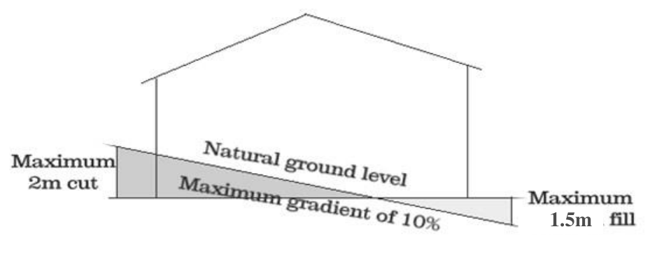

### 4.4 SITING AND ORIENTATION

#### 4.4.1  Objectives

To ensure that farm buildings and outbuildings/sheds:

Complement the character of the area and are not visually dominant, Have minimal impacts on the removal of native vegetation, Take into consideration the natural features of the land, and Take into consideration existing and potential uses of the land.

#### 4.4.2  Development Principles

1\. Farm  buildings  and  outbuildings/sheds  should  be  clustered  in  one  location  on  the property. Where possible, this should be close to dwellings, but not where this will result in land use conflict.

2\. Farm buildings and outbuildings/sheds are to be sited and orientated to minimise their visual dominance and impact on the streetscape. In particular:

i) Ridgeline or hilltops locations should be avoided.

ii) On  smaller  allotments  with  limited  width  the  narrow  elevation  of  the building should face the primary street frontage.

3\. Farm  buildings  and  outbuildings/sheds  as  well  as  related  driveways,  manoeuvring areas and filled areas are to be positioned on the land so as to minimise the removal of any native vegetation.

4\. Farm Buildings or Outbuildings/sheds on properties which contain or are adjacent to a heritage item will be assessed on merit. Development applications shall be supported by  an  assessment  against  clause  5.10  Heritage  conservation  of  the  LEP  and  Part  C Chapter 17 Heritage conservation of the DCP.

5\. Cut and fill for buildings, manoeuvring areas, fill batters and access driveways should be limited to a maximum 2 metres of cut and 1.5 metres of fill. (Figure 1)

#### 1.5m

6\. Farm buildings and outbuildings should not be erected on land having a slope in excess of 10%.

7\. Farm buildings and outbuildings should be set back a minimum of 40 metres away from any watercourse

> [Picture on page 4: a picture, saved as a picture (images/part-c4-erection-of-farm-buildings-and-outbuildings-sheds-page-4-6.gif, 150 dpi).]

#### Figure 1: Cut and fill
