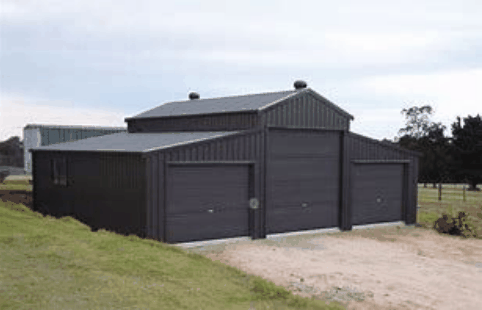

### 4.5 BUILDING DESIGN AND FORM

#### 4.5.1  Objective

To encourage attractive developments that blend in with the character of the locality, surrounding development and landscaping.

#### 4.5.2  Development Principles

1\. Roof forms should provide visual relief to the building in order to reduce the building’s

bulk. Barn style roof forms that are less bulky in appearance are encouraged in rural and environmental protection areas. (Figure 2)

2\. Building facades that can be readily viewed from adjacent roads should be articulated with  suitable  features  such  as  windows,  awnings  and  verandahs  to  minimise  their

> [Picture on page 4: a picture, saved as a picture (images/part-c4-erection-of-farm-buildings-and-outbuildings-sheds-page-4-18.gif, 150 dpi).]

visual bulk.
