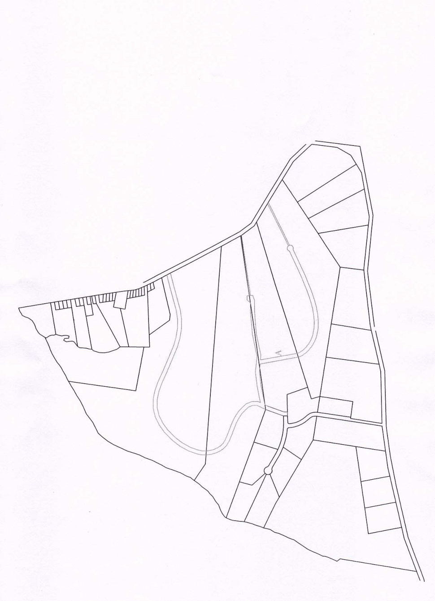

### 1.9 LANDSCAPING

Subdividers shall re-establish flora corridors throughout the subdivision.  The corridors shall consist of two components, a five (5) metre wide strip inside all resulting lots adjacent to road reserves and access paths, and the unformed portion of road reserves.  The corridors within the road reserve shall be constructed to comply with road clear zone requirements and minimising maintenance costs for Council, particular attention is to be focused upon stormwater management and sediment control.  Landscaping plans shall be submitted to Council for approval.

> [Picture on page 4: a picture, saved as a picture (images/part-d1-south-vacy-village-page-4-1.gif, 150 dpi).]
