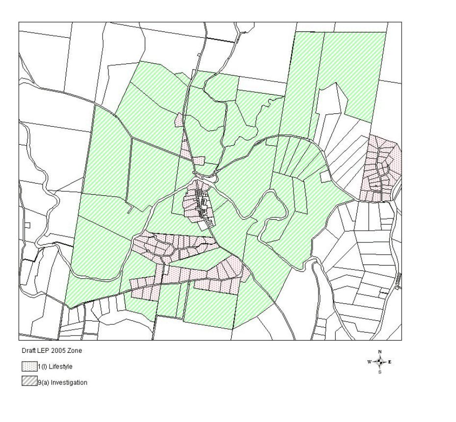

## 2.   VACY LOCAL AREA PLAN

### 2.1 INTRODUCTION

#### Citation

This Plan is titled the 'Vacy Local Area Plan 2004'.   It is referred to in this document as the Vacy LAP.

#### Land to which this Plan applies

The Vacy Local Area Plan applies to all land in and adjoining the Village of Vacy which is zoned 9(a) Investigation Zone or Rural Lifestyle 1(l) under the provisions of the Dungog Shire Local Environmental Plan 2003.   This area is shown on Map 1.

#### Objectives of this Plan

The objectives of the Vacy LAP are:

1\. To ensure that development within the Investigation Zone is consistent with and promotes the principles of environmentally sustainable development.

2\. To promote coordinated development that will produce sustainable subdivision patterns to allow for closer settlement and/or changes in land uses in the future.

3\. To ensure that development within the Investigation Zone is sensitive to the topographic and environmental characteristics of the land.

4\. To safeguard indigenous vegetation, habitats and water courses.

5\. To retain and protect the rural character of the area and areas with high visual significance.

6\. To provide a network of safe access roads and shared pedestrian and cycle pathways within and between areas developed within the Investigation Zone.

7\. To minimise the cost to the community of providing, extending and maintaining public amenities and services.

8\. To ensure that development within the Investigation Zone does not prejudice the interests of agriculture within the zone and adjoining areas.

### VACY LOCAL AREA PLAN 2004

### MAP 1 – VACY INVESTIGATION ZONE

> [Picture on page 9: a picture, saved as a picture (images/part-d3-vacy-local-area-plan-page-9-3.gif, 150 dpi).]
