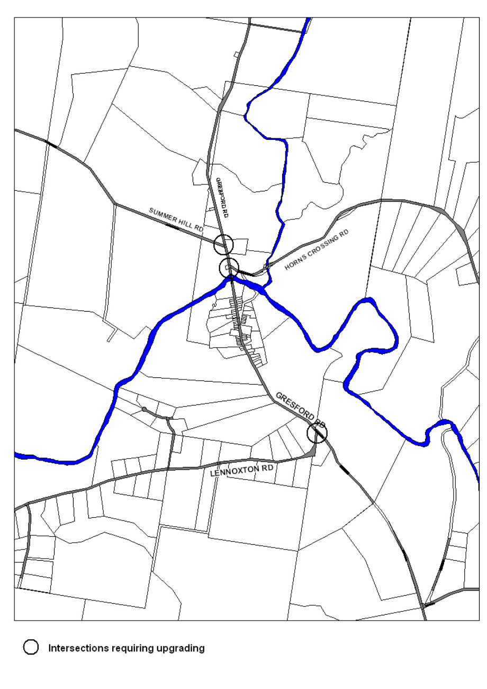
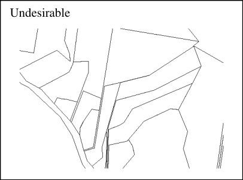
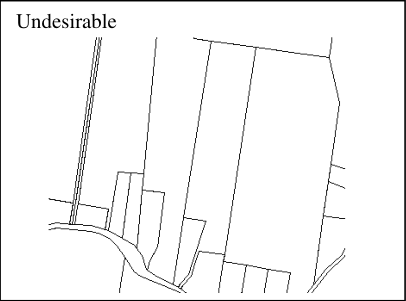
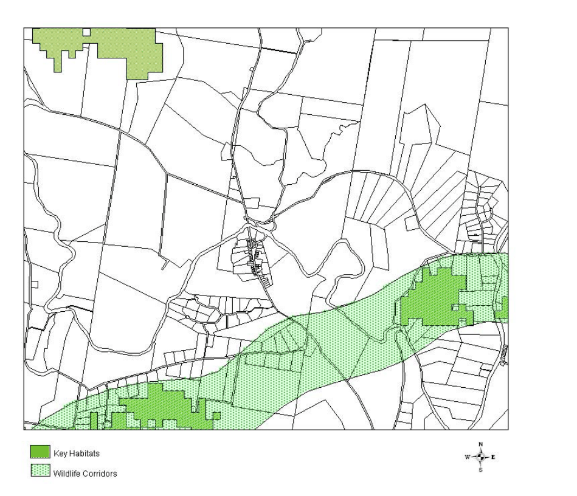
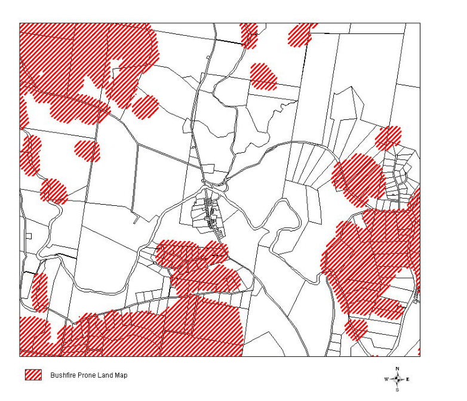
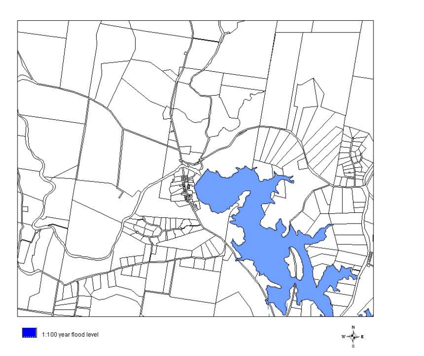
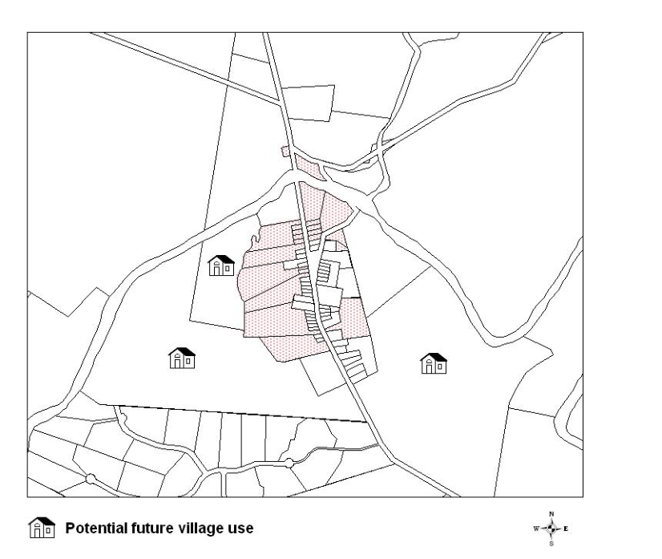

### 2.2 PLANNING FOR VACY

Key issues identified during the study process and community consultation are addressed in the Vacy LAP.

Roads and road access Pedestrian and cycle access Existing pattern of land subdivision Need to protect habitat The need to protect the waterways Flooding along the Allyn and Paterson Rivers The need to retain the rural character of the area and protect areas of high visual significance.

#### Roads and Road Access

The Issues

The Gresford Road is a major thoroughfare within the Shire, with a significant proportion of traffic on this road being through traffic.  This road has a 100 kilometre speed limit in the sections to the north and south of the village.    There is already some conflict between local and through traffic and, if not appropriately managed, there is potential for the level of conflict to increase as the population of the Vacy and Gresford areas grow and tourism in the Shire increases.

Traffic is also increasing on the roads connecting Vacy to other areas within the Shire.

Under previous patterns of subdivision, lots with frontage to the main and collector roads were permitted driveway access from these roads.  The continued use of private driveway access off collector roads is highly undesirable given the potential conflict between the siting of driveways and through traffic.  The conflict is compounded by narrow roads and verges combined with limited site lines and, in some cases, 80 to 100 kilometre speed limits.

The LAP contains design criteria for new subdivisions that restrict direct access to collector roads from private driveways. Increased use of existing driveways to service new battle-axe lots is also prohibited in this Plan.

The collector roads in the Vacy Investigation Area are:

Gresford Road (MR 101) Lennoxton Road Summer Hill Road Horns Crossing Road

Within the Investigation Zone, Dungog Council has identified the corner of Lennoxton and Gresford Road as needing upgrading prior to, or in conjunction with further development of land serviced by Lennoxton Road.

### VACY LOCAL AREA PLAN 2004

### MAP 2 – COLLECTOR ROADS

> [Picture on page 11: a picture, saved as a picture (images/part-d3-vacy-local-area-plan-page-11-3.gif, 150 dpi).]

Planning Approach

In new subdivisions access to the collector roads will be by properly formed local roads and appropriately designed and sited intersections.  Existing intersections may need to be upgraded or relocated.  There will be no new direct driveway or right of way access from private dwellings to collector roads.  Where required, access ways for emergency access will be permitted.

In designing subdivisions, careful consideration needs to be given to the internal road network.  Roads, unlike land uses or buildings, tend to become permanent features of a settlement.   As such it is important that the road layout be conducive to the long term sustainability of the area.

For local roads within subdivisions, preference is for through, connecting roads rather than cul-de-sacs and right-of ways.  A connected road network will minimise driving distances and provide for more than one entry-exit point within each subdivision.  This is important particularly in areas potentially subject to bush fire or flooding.    A connected road network will also encourage community interaction and facilitate development of bus routes, including school bus routes, as the need emerges.

Desired Outcomes

Reducing vehicular conflict and the potential for conflict through a significant reduction in the number of driveway access points to collector roads.

To deliver a high level of access and permeability via a network of inter-connecting roads in and between subdivisions, not a series of cul-de-sac roads or right-of-ways.

To deliver a road network that will support closer settlement in the future.

#### Pedestrian and Cycle Access

The Issue

There is no public transport in Vacy to provide access to the village for people living in outlying areas.  In addition, there has been no provision for pedestrians or cycle routes along the collector roads. Due to the narrow, unformed verges and, in some cases, higher speed limits (80 to 100km), the collector roads do not provide a desirable environment for pedestrians and cyclists.

Vacy Bridge is a historic bridge that forms part of the character of the town.  The bridge is very narrow and lack of space for safe pedestrian and cycle access is an issue that needs to be addressed by the RTA in conjunction with Council.

Planning Approach

Where feasible, to incorporate shared pedestrian and cycle pathways within new subdivisions and to link these routes with adjoining subdivisions.  In some areas the design intent will be to establish a shared pathway link to the Vacy village centre.

Desired Outcome A network of shared pathways providing safe pedestrian and cycle access in and between subdivisions and, where feasible, to create links between subdivisions and Vacy village.

#### Existing Pattern of Subdivision

The Issue

Under previous planning schemes subdivision of rural land in some areas within the Shire was undertaken on an adhoc, uncoordinated basis.  This has resulted in significant fragmentation in land holdings.   In order to provide access to existing roads and/or river frontage, some of the lots created were long and narrow and/or with battleaxe or highly irregular shape.

Most of the area within the Vacy Investigation Zone is still held in relatively large holdings. There has been some smaller lot subdivision in Lennoxton and Horns Crossing Road. Further adhoc sub-division of these smaller existing lots would increase fragmentation and is not considered desirable.  Fragmentation also creates long term access and servicing problems.

Planning Approach

Emphasis is on creating a coordinated and integrated approach to subdivision design within the Investigation Zones. The Vacy LAP does not permit further subdivision of individual lots where the lots are small, irregular in shape and/or where the width to depth ratio of the lot is less than 1:3.  These lots are identified in the LAP.

Subdivision of these identified lots may only be permissible if it can be achieved through consolidation of adjoining lots and/or co-operation with adjoining land-owners to form a viable subdivision design area.  Masterplans may need to be prepared for subdivision

> [Picture on page 13: a picture, saved as a picture (images/part-d3-vacy-local-area-plan-page-13-21.gif, 150 dpi).]
> Words printed on the picture (title and legend, copied from the PDF):
> Undesirable

design areas.

> [Picture on page 13: a picture, saved as a picture (images/part-d3-vacy-local-area-plan-page-13-23.gif, 150 dpi).]
> Words printed on the picture (title and legend, copied from the PDF):
> Undesirable

The Masterplan will detail the road network, lot layout, provision for open space, habitat corridors, environmental and scenic protection zones and shared pedestrian and cycle pathways within the subdivision design area.

Where there are lots suitable for subdivision that do not have existing public road frontage, the subdivision design for the adjoining lots with road frontage must ensure that provision is made for road and shared pathway access to the adjoining land.  This will prevent the sterilisation of developable land.

Desired Outcomes

No fragmentation and adhoc subdivision of land.

A co-ordinated and integrated pattern of subdivision which is suitable for closer settlement patterns in the future to meet the needs of the Vacy village.

A co-ordinated approach to staged subdivision and land release.

To avoid sterilisation of adjoining or 'land-locked' properties.

Creation of the opportunity for the development of an integrated community, not a series of separate enclaves.

Creation of a strong network of pedestrian, cycle and open space links throughout all subdivisions and, where required by Council, to Vacy village.

#### Habitat Protection

Information on the vegetation types in the Vacy Investigation Area is contained within the ERM Mitchell McCotter (1998) report on the Biological Diversity Study for the Paterson Planning District and the ME Greenwood (1999) Dungog Vegetation & Biodiversity Study report.  The Vacy Investigation Area lies within the Paterson Planning District.

Four vegetation types have been identified within the Vacy Investigation Area:

Open forest - in the area between the village and Lennoxton Road and on the southern side of Lennoxton Road on the foothills and slopes of the Mount Johnstone Range. Woodland - small pockets of woodland are found to the north and east of Vacy. Riverine Forest - narrow corridors along the Paterson river, Allyn Rivar and Mirari Creek. Rainforest - small pockets in the sheltered gullies surrounding Mt Johnson.

A number of rare and endangered flora and fauna species have been sighted in the Vacy Investigation Area.  These include Eucalyptus glaucina, phasocogales, koalas and broadnose bats.

Within the Vacy Investigation Zone, the Mount Johnstone range to the south of Lennoxton Road has been identified as a key habitat area.  As shown in Map 3, there is a wildlife corridor extending along this range, through to and across the Paterson River.

The Native Vegetation Act 2003 and the accompanying Native Vegetation Regulations 2005, (which are expected to come into force in mid-2005), restrict the clearing of native vegetation.  Under the proposed Regulations, a Property Vegetation Plan (PVP) is to be prepared for properties that have native vegetation.  The PVP will require the approval of the Local Catchment Management Authority before any clearing of native vegetation (including mature stand-alone trees) can occur.    The provisions of the Native Vegetation Act and Regulations must be addressed as part of the planning and assessment process for land within the Investigation Zone. Information on the Native Vegetation Act and Regulations is available from Dungog Shire Council.

Planning Approach

Habitat, flora and fauna assessments are to be undertaken as part of the rezoning process. This must include addressing the requirements of the Native Vegetation Act 2003 and Regulations 2005.  At the rezoning stage strategies for managing areas identified as having habitat value must be identified.  These strategies may include rezoning significant habitat areas as open space or environmental protection zones, provision of protective

buffers and set-backs, increasing the minimum lots size, minimising clearing and avoiding structures or development in habitat areas.

### VACY LOCAL AREA PLAN 2004

### MAP 3 – KEY HABITAT AREAS - WILDLIFE CORRIDORS

> [Picture on page 15: a picture, saved as a picture (images/part-d3-vacy-local-area-plan-page-15-5.gif, 150 dpi).]

Desired Outcomes

Preservation and protection of habitat that supports viable wildlife communities, particularly rare and endangered species.

Establishment of a network of interconnected wildlife corridors not isolated protection zones or remote 'islands' of habitat.

Protection of watercourses and the vegetation along these watercourses.

#### Bushfire

The Issue

There are areas within the Investigation Zone that are prone to bushfire.  These areas are identified on the 'Dungog Shire Bushfire Prone Land ' map and shown in Map 4.  Within the Vacy Investigation Zone, the main area of bushfire prone land is located in the Lennoxton Road - Vacy Downs area to the south of Vacy.  There are also small pockets of bushfire prone areas just north of Summer Hill Road and on the eastern fringe of the Horns Crossing Road area.

Planning Approach

All subdivision design must comply with the provisions of the NSW Rural Fire Service requirements as specified in the 'Planning for Bushfire Protection 2001’, and/or other relevant bushfire regulations.

Desired Outcome

To minimise the risk to people and property from the impacts of bushfire.

### VACY LOCAL AREA PLAN 2004

### MAP 4 – BUSHFIRE PRONE AREAS

> [Picture on page 16: a picture, saved as a picture (images/part-d3-vacy-local-area-plan-page-16-15.gif, 150 dpi).]

#### Waterways – River Foreshores

The Issues

The Paterson and Allyn Rivers converge at Vacy.  These, and other watercourses within the Investigation Zone play an important role within the Vacy area.  Shire-wide, these

watercourses contribute to the sustainability of agriculture, recreation, tourism, water supply, habitat and bio-diversity.  Locally, they influence microclimate and are part of the local character of Vacy.

Issues include:

The cumulative negative impacts of development. Preventing pollution from effluent and stormwater runoff and other activities. Maintaining water quality and the flow of the rivers by limiting the pumping of river water. Minimising impacts of development on the ecology associated with watercourses and wetlands. Protecting and re-establishing Riverine Forest along the Allyn and Paterson Rivers.

Flooding is an issue along both the Paterson and Allyn Rivers.  A flood study has been undertaken for the Paterson River downstream of Vacy, with floodprone areas for the 1:100 year flood event shown by Map 5.   Any proposal to develop on the floodplain of the Allyn or Paterson Rivers upstream of Vacy will need to assess the flooding regime to identify the 1:100 year flood level.

The LEP2005 and Rural Strategy 2003 prohibit Rural Lifestyle and Rural Enterprise development on land affected by the 1% (1:100 years) flood level.  Under the LAP these areas are excluded from the Investigation Zone.

For further information on flooding and planning controls is available from Dungog Shire Council.

### VACY LOCAL AREA PLAN 2004

### MAP 5 – FLOOD MAP - 1:100 YEAR FLOOD EVENT -

#### PATERSON RIVER DOWNSTREAM OF VACY

> [Picture on page 18: a picture, saved as a picture (images/part-d3-vacy-local-area-plan-page-18-4.gif, 150 dpi).]

Consideration also needs to be given to future public access to the river foreshore.  One or more foreshore reserve areas need to be identified and included as public open space in subdivision plans for land adjoining or in close proximity to the village.

Planning Approach

The planning approach incorporates:

Protecting watercourse ecology Maintaining water quality and water flow Providing for public access to the waterways Minimising the impacts of flooding

This can be achieved by:

Providing adequate buffers and set-backs from watercourses, as per the DCP. Ensuring that no further riparian rights are created, as required by the LEP and DCP. Prohibiting further subdivision and development of the river foreshore areas.  New lots with river frontage cannot be created for Rural Lifestyle or rural Enterprise use.

Encouraging foreshore areas to be kept in one title and zoned appropriately. Providing public access to foreshore areas. Encouraging the re-establishment of riverine Forest where appropriate. Encouraging the installation of package sewage treatment plants rather than on-site effluent management systems.

Desired Outcomes

Protection of riparian vegetation. Maintenance of water quality and water flow. Providing public or community access to the river foreshore areas. Minimising the impact of flooding on people and property.

#### Visual Impact

The Issue

Retention of the rural character and appearance of the Vacy area is very important to both the Vacy community and Shire residents.  Areas within the Investigation zone nominated by the Vacy community as having high scenic value are:

Mount Johnstone and range to the south of Lennoxton Road The river flats adjoining the north-western end of Vacy Bridge - between the Paterson River and Summer Hill Road. The rural scenery along Gresford Road on the northern and southern approaches to the Village

Planning Approach

Emphasis is on protecting the character and visual identity of the area. The LAP identifies areas where a visual and view shed analysis will be required as part of the planning process.

Design criteria for development with areas of high scenic value may also include:

Limiting or prohibiting further subdivision and development in areas of high scenic value. Increasing the minimum lot size to avoid impact of dwellings and structures within significant view sheds. Appropriate siting and setbacks of new development, as per the Shire-wide DCP. Use of landscaped buffers, including corridor tree planting along the Gresford Road entrances to Vacy.  Buffers zones along collector roads will need to be in one ownership to ensure effective management and control. Siting dwellings so that they front collector roads.  Backyards will not be able to have direct frontage to collector roads. Height limits on buildings, including limiting dwellings to single storey.

It is recommended that a Corridor Tree Planting Policy be developed for Gresford Road to ensure consistency in species planted.

Desired Outcomes

Retention of the rural character and setting of Vacy.

Protection of areas of high scenic value, including Mount Johnstone and the rural vistas along Gresford Road.

Minimise visual impact of rural residential development from the main routes through Vacy.  New development will be appropriately sited with landscaped buffers / corridor tree planting to these main routes.

Establish entry statements to the village.

#### Future Growth of Vacy

The Issue

There is already pressure within Vacy for additional residential lots.  Growth has been constrained by the lack of access to the sewer.  Planning for the sewer is in the preliminary stage with Council currently evaluating options.  Provision of the sewer is expected to be a medium to longer term project.

As the population in and around Vacy increases, there is likely to be demand for the provision of additional facilities and services in the village, including shops and recreation facilities.   Under the provisions of the LEP2005, no land has been identified or zoned to provide for the future expansion of village activities.

There are a number of larger lots abutting Vacy village that are already zoned for Rural Lifestyle. Subject to the provision of town water and connection to a sewage system and these lots having no flooding, environmental or access/egress constraints, these lots will be able to be rezoned and developed for residential  or other village-related use.  These lots are shown on Map 6.

There is also other land in very close proximity to the village that has been zoned 9(a) Investigation Area and identified as potentially suitable for Rural Lifestyle and/or rural enterprise development.  This form of development envisages subdivision with a minimum lot size of 8000 square metres.  Once subdivided and developed for either of these uses it may be difficult to re-consolidate and redevelop this land to meet the future needs of the village.   Some of this land may also be suitable for future village use, (subject to provision of town water and sewer, and the land having no flooding, environmental or access/egress constraints).

Planning Approach

Subject to availability of water and sewer services and lack of environmental or flooding constraints, existing Rural Lifestyle lots within the Vacy Village will be able to be rezoned and subdivided for residential or village uses.

There are also areas within the Investigation Zone within very close proximity to the village boundary that may be suitable for the future expansion of the village.  These Lots are:

Lot 66 DP835183 Lot 1 DP782601 Lot 1 DP 15187

Lot 5 DP15187 which also abuts the village is not suitable as this property is flood affected.

These lots are shown on Map 6.

Further investigation of these lots is required to determine their suitability for future village

uses.  In particular, it needs to be determined whether these lots are flood-free and could be connected to the water supply and sewered via an on-site package treatment plant.

Following these investigations, an area or areas, should be identified for future village

uses.  Key areas should be identified and rezoned for future village uses. The key areas should be land-banked to ensure that they are available for future development.

Land surrounding these key areas should be subdivided and developed in such a way that it can be further subdivided in the future as required.  For example, the subdivision could be designed as a residential subdivision and then the lots amalgamated into larger parcels of 8,000sq metres and sold as rural lifestyle lots.

Alternatively, if not required for a land bank, and environmental, water and sewerage requirements can be met, consideration may be given to allowing closer settlement of all or parts of Lot 66 DP835183, Lot 1 DP78260 and/or Lot 1 DP15187, with the minimum lot size being reduced (for example, to 2000 square metres).

Given the constraint imposed by the Vacy Bridge, smaller lot subdivision will only be allowed in Precinct A on these nominated lots which adjoin Vacy Village.

### VACY LOCAL AREA PLAN 2004

### MAP 6 – POTENTIAL FUTURE VILLAGE USE

> [Picture on page 21: a picture, saved as a picture (images/part-d3-vacy-local-area-plan-page-21-20.gif, 150 dpi).]
