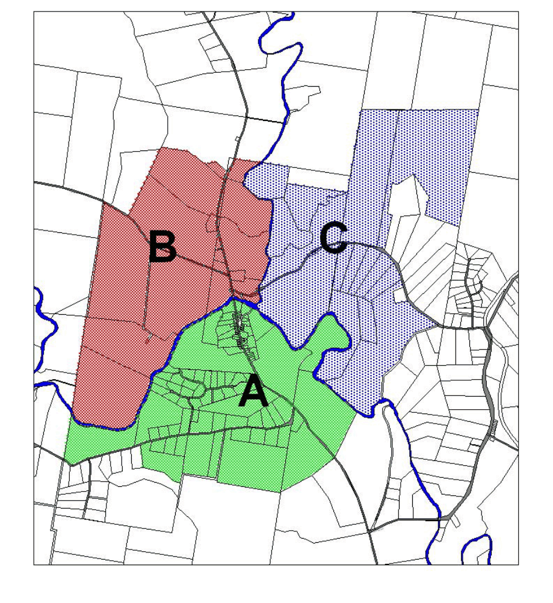
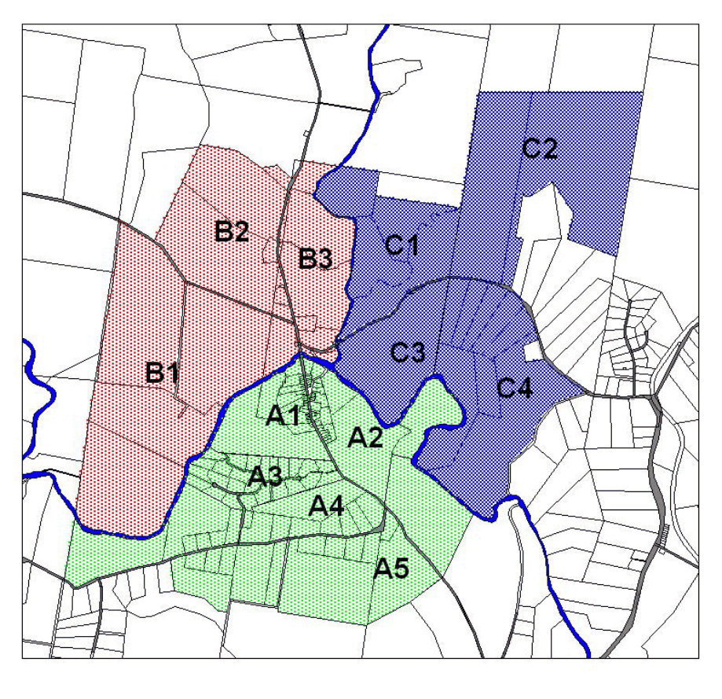

### 2.3 PLANNING PRECINCTS

The Vacy LAP divides the Investigation Zone into 3 planning precincts.  These precincts are shown on Map 7.

Precinct A Vacy South Precinct B Vacy North Precinct C Vacy East - Horn Crossing Road

Each Precinct is divided into planning areas.  These areas are shown on Map 8.

### VACY LOCAL AREA PLAN 2004

### MAP 7 – PLANNING PRECINCTS

> [Picture on page 22: a picture, saved as a picture (images/part-d3-vacy-local-area-plan-page-22-10.gif, 150 dpi).]

### VACY LOCAL AREA PLAN 2004

### MAP 8 – PLANNING AREAS

> [Picture on page 23: a picture, saved as a picture (images/part-d3-vacy-local-area-plan-page-23-3.gif, 150 dpi).]
