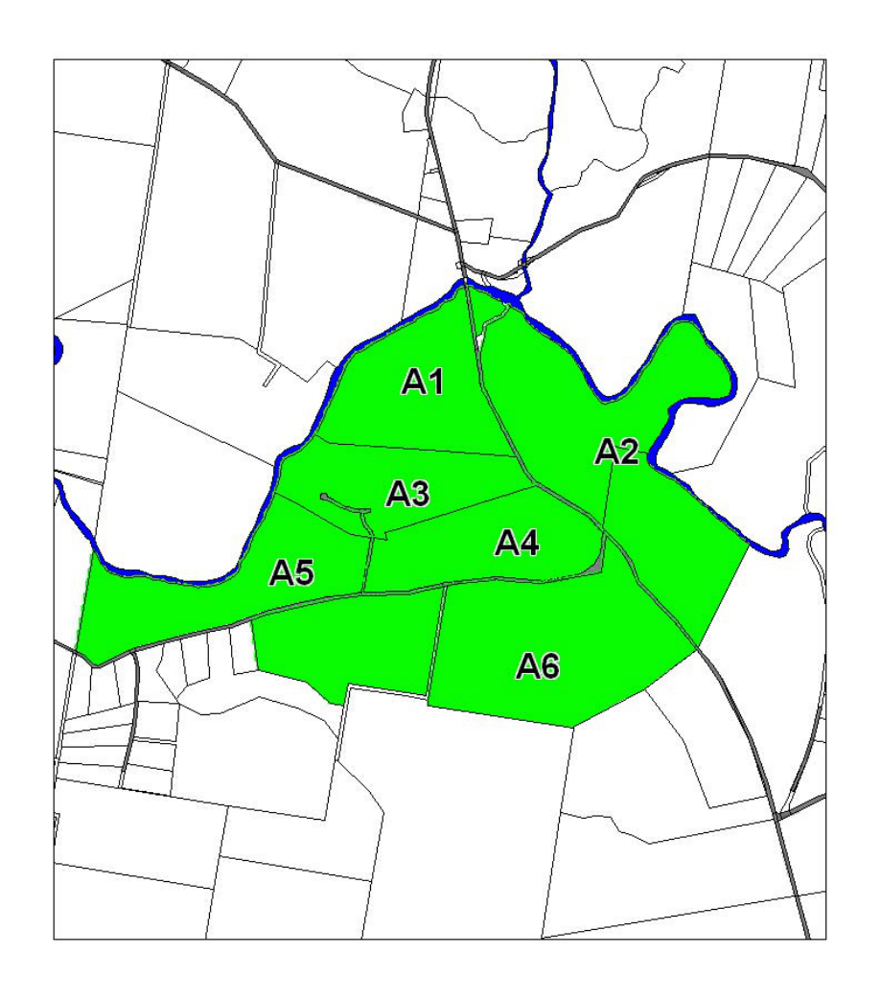

## 3. PRECINCT A – VACY SOUTH

Precinct A incorporates all land south of the Allyn River and west of the Paterson River that is zoned 9(a) Investigation Zone and 1(l) Rural Lifestyle.  The Precinct is divided into six (6) Planning Areas, numbered A1 to A6.

> [Picture on page 26: a picture, saved as a picture (images/part-d3-vacy-local-area-plan-page-26-5.gif, 150 dpi).]
