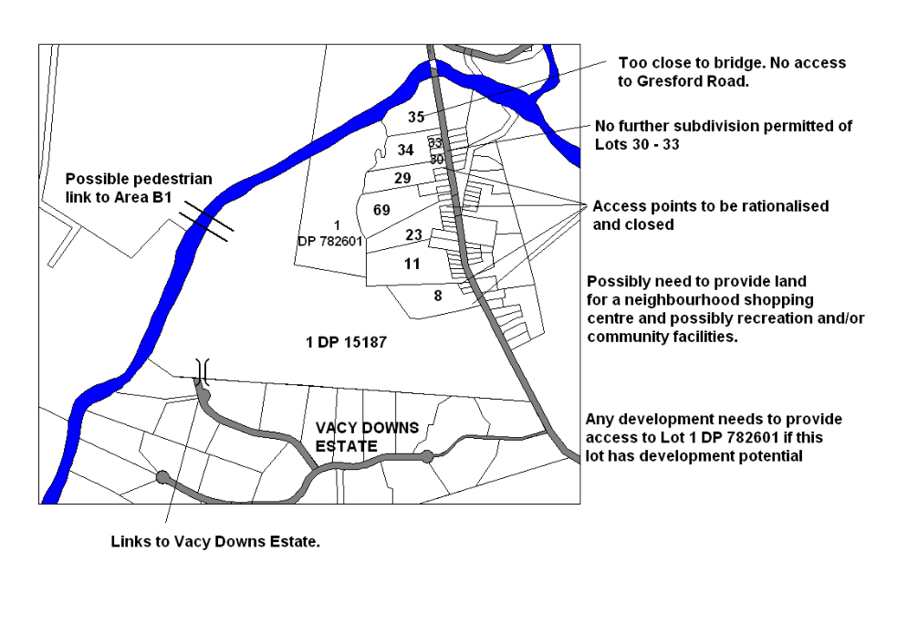

### 3.1   PLANNING AREA A1

#### The Area

Planning Area A1 abuts the western edge of Vacy Village and is defined as the area bounded by Gresford Road to the east, the Paterson River to the north and west and the Vacy Downs subdivision to the south.  There are 12 lots within Area A1.

Lots 30, 31, 32, 33 DP 15187 Lots 1, 8, 11,23, 29, 34, 35 DP 15187 Lot 69 DP716196 Lot 1 DP 782601

Lots 30, 31, 32, 33 DP 15187 are small residential size lots that are zoned Rural Lifestyle.

Lots 8, 11,23, 28, 35 DP 15187 and Lot 69 DP716196 are zoned 1(l) for Rural Lifestyle. Each of these lots has frontage to Gresford Road, with all lots except Lot 35 being battle-axe shaped lots.

Part of Lot 1 DP15187 has been zoned 2(v) Village.

#### Development Potential

Lots 30, 31, 32 and 33 DP 15187 are residential size lots and no further subdivision is permissible.

Lots 8, 11, 23, 29, 34, 35 DP 15187 and Lot 69 DP716196 - Subject to availability of sewer and reticulated water and no environmental or flooding constraints, these existing Rural Lifestyle lots within the Vacy Village may be rezoned and subdivided for residential or village uses in accordance with the Masterplan to be prepared for Area A1.  No lot will be able to be subdivided and developed on a stand-alone basis.

Lot 1 DP782601 and Lot 1 DP 15187 - Further investigation of Lot 1 DP782601 and Lot 1 DP 15187 is required to determine whether these lots are suitable for future village uses and/or for smaller lot sizes (eg 2000 sqm) than permissible in the Rural Lifestyle zone.  In particular, it needs to be determined whether these lots can be connected to the town water supply and sewered via an on-site package treatment plant.

In developing this area, access will be a major consideration.   Existing access points to Gresford Road will need to be rationalised with 1 or 2 properly formed roads providing access to Area A1. No lots created by subdivision will be able to have to driveway or right-of-way access from Gresford Road to service a private dwelling.  In addition, the internal road network within Area A1 must link with Sanctuary Way within the Vacy Downs subdivision.  A road link must be provided to Lot 1 DP78260 if this property if this property is assessed as having land suitable for Rural Lifestyle or Rural Enterprise development.

While community title development is Council's preferred form of development, it may be necessary for the key access road/s to be dedicated as a public road and/or for infrastructure such as the package sewage treatment plant and water supply to be dedicated to Council.  Alternatively, there may be opportunity for Council and the proponents of Area 1 to undertake a joint venture in relation to sewering the Village and Area A, and augmenting the water supply.

#### Masterplan

A masterplan is required to assess land capability and determine the most appropriate pattern of subdivision for Area A1.   As part of the Masterplanning process, the following issues are to be addressed and resolved:

Future village needs - With the population growth expected in the area, there is likely to be demand for a small neighbourhood shopping centre in the future and possibly additional community and recreation facilities.

Provision of sewer and water. Access to / from Gresford Road. Flooding - parts of the area are flood liable and areas below the 1:100 year flood level cannot be developed for Rural Lifestyle or Rural Enterprise uses.  In addition development of the area cannot result in increased runoff and flooding in adjoining properties or downstream. Pedestrian - cycle access across the Paterson River.  At the Vacy Community meeting it was suggested that a pedestrian bridge be provided across the Paterson River to provide a direct link between Area B1 and the village centre.  The feasibility of this link needs to be assessed and if a feasible location is identified, then an access corridor is to be provided between this location and the village centre.

The masterplan is to show the subdivision layout, road network, pedestrian and cycle access routes, open space and interface with the Paterson River.  The Masterplan should demonstrate how development of the area can be staged.   It is likely that only part of the area will be needed for residential development in the near future, with the remainder of the site developed as Rural Lifestyle and/or Rural Enterprise.  In designing the Rural Lifestyle / Rural Enterprise areas, consideration should be given to road and lot layouts that will enable subdivision for residential in the future.

### PLANNING AREA  A1

> [Picture on page 28: a picture, saved as a picture (images/part-d3-vacy-local-area-plan-page-28-20.gif, 150 dpi).]

#### Issues & Performance Criteria

In addition to the planning controls setout in the LEP, DCP and Rural Strategy, the planning and assessment process for Area A1 must address:

| Issue | Planning Considerations / Performance Criteria |
|---|---|
| Need for co-ordinated development | Masterplan to be prepared for Area A1. No subdivision of individual lots on a stand- alone basis. |
| Future expansion of Vacy Village in relation to providing land for residential, retail-commercial, recreation and community needs. | As part of the Masterplanning process - identification of future needs of the village and allocation of land to meet these needs. |
| Gresford Road is an entry point to Vacy. The visual Impact of development along Gresford Road needs to be minimised. | Visual assessment to be undertaken to determine set-back requirements. These may vary from the DCP, with the Visual Assessment requirements having precedence. Landscape buffer / corridor tree planting along the Gresford Road frontage to create a village entry statement in accordance with any Landscape Policy for the Gresford Road Corridor. No backyards to have direct frontage to Gresford Road. |
| Access to Gresford Road | Need for an appropriately designed and sited access road/s to service Area A1. The location and design will need to be determined in conjunction with the RTA and Council. No lots created by subdivision are permitted to have private driveway or right-of-way access of Gresford Road. |
| Internal access roads | Must link with Sanctuary Way in the Vacy Downs subdivision. Must provide access to Lot 1 DP782601 if this lot is assessed to have development potential. |
| Shared access ways - pedestrian and cycle ways. | To link with the existing Village, in particular to the school and recreation area. To link with a future neighbourhood shopping centre and other recreation - community facilities. To provide a pedestrian bridge link with Area |

|  | B1 (if feasible). |
|---|---|
| Paterson River foreshore | Riparian vegetation corridor to be defined and protected. No additional riverfront lots or riparian rights to be created, other than for recreation - open space uses. The need for public access to the river foreshore to be assessed and addressed. |
| Flooding | Rural Lifestyle and Rural Enterprise development is not permissible on land located below the 1:100 year floodlevel. |
