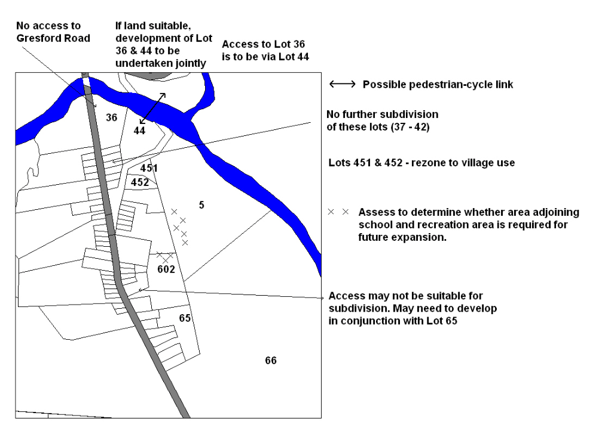
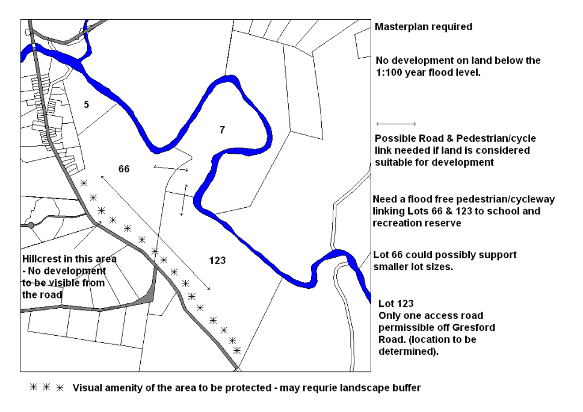

### 3.2 PLANNING AREA A2

Area A2 incorporates the land south of Vacy Bridge, bounded by the Paterson River to the east and Gresford Road to the west.  The area incorporates 13 parcels of land:

Lots 5, 7, 36, 37, 38, 39, 40, 41, 42, 44 DP15187 Lots 451 DP865524 Part Lot 452 DP865524 Lot 602 DP597663 Lot 66 DP835183 Lot 123 DP 1063557 (eastern part)

The western part of Lot 452 DP865524 has been zoned for 2(v) for Village Use, while the eastern part has been zoned Rural Lifestyle.  There is a motel developed on this site.

Lot 65 DP835183 which adjoins the Investigation Zone is zoned 2(v) Village.  Lot 65 is a large parcel of undeveloped land that should be assessed and planned in conjunction with the surrounding land within the Investigation Zone.

Lots 36, 37, 38, 39, 40 and 44 DP15187, Lot 451 and Part Lot 452 DP865524 and Lot 602

DP597663 have already been zoned for Rural Lifestyle.   Lots 37 - 40 are residential size lots.

#### Development Potential

Large tracts of Area A2 are reported to be flood prone and not suitable for development. Development for Rural Lifestyle or Rural Enterprise use is not permissible on land lying below the 1:100 year flood-level.

Lots 37, 38, 39 and 40 DP 15187 are residential size lots and no further subdivision is permitted.

Lots 36 and 44 DP15187 - parts of these lots appear to be flood-prone.  If, after assessment, these lots are considered suitable for development then they will need to be planned and developed jointly.  Subject to detailed assessment and ability to provide sewer and water, smaller lot sizes may be permissible.  Access is to be via the road reserve adjoining Lot 44.  Given the proximity of Lot 36 to Vacy Bridge, no access from Gresford Road is permitted.

A small arboretum has been established on Lot 44 and part of the road reserve area. The Vacy community has suggested that this area be retained and further developed as a park for the community.  It was also suggested that a pedestrian bridge be provided across the Paterson River to provide a safe route for pedestrians and cyclists from Precincts B and C. to access the village, as the Vacy Bridge is very narrow and considered unsafe for pedestrian and cyclists.   These suggestions need to be addressed as part of any proposed development of this area.

Lots 451 and 452 are in the same ownership, with a residence on Lot 451 and a motel on Lot 452.  The residence provides the reception area and manager's accommodation for the motel.  Access to both lots is provided from the Road Reserve.  The adjoining lot (Lot 101 DP 1009577) is zoned 2(v) Village.  Flood-free land in Lots 451 and 452 should be rezoned Village to facilitate future residential and/or commercial development.

Lot 602 DP597663 is located behind the Vacy public school.  It abuts the Vacy recreation area to the north and the Village area to the south and west.  Given that this site adjoins the school and recreation reserve, consideration should be given as to whether all or part of this land may be required for future expansion of the school and recreation facilities to meet the needs of the growing population of the area.  Land not required for school and/or recreation use should be rezoned for Village use subject to the land being flood-free and suitable access being available.

The site has driveway access from Gresford Road.  The frontage along Gresford Road is relatively narrow and located just south of a slight bend. If Council / RTA deem that this is not a suitable location for a road access point, consideration must be given to developing Lot 602 in conjunction with the adjoining land, Lot 65 DP835183.  Lot 65 is already zoned 'Village'.  Alternatively, road access to both Lot 65 and Lot 602 could be via Lot 66 to the south.  In developing Lots 65 and 602, provision needs to be made for a pedestrian-cycle link from Lot 66 though this area to the school and recreation reserve.

Flooding is a major issue for Lots 5 and 7 DP15187 and the northern part of Lot 66

DP835183 with this land lying within the 1:100 year flood zone. As part of Lot 5 DP15187 adjoins the recreation reserve, this area should be assessed to determine its suitability for recreational use and whether it is required to meet future needs.

Lot 66 DP835183  - A large part of this Lot appears suitable for development.  As this lot abuts the existing village boundary, parts of the property may be suitable for smaller lot subdivision, subject to availability of sewer and reticulated water and no environmental or flooding constraints.

Lot 66 has frontage to Gresford Road.  Given the road alignment and topography of the area, the location of the access road for any development on Lot 66 will need to be determined in consultation with the RTA and Council.  No lots created by subdivision are permitted to have private driveway or right-of-way access of Gresford Road. Provision is to be made for a flood-free pedestrian-cycle way to link through to the school and recreation reserve.  Planning for this Lot needs to be undertaken in conjunction with Lots 65 and 602.  A link is to be provided through Lot 66 to Lot 123 and possibly to Lot 7

DP15187 (if land is suitable for Rural Lifestyle use is identified on this Lot).

Were possible, development is to be setback and not visible from Gresford Road, with no backyards to have direct frontage to Gresford Road.  Depending on the subdivision layout and potential visual impact, Council may require a landscaped buffer along the Gresford Road frontage.

Lot 123 DP1063557 - The non-floodprone area of Lot 123 also appears to be suitable for Rural Lifestyle development.   Access to this area from Gresford Road will be via one properly formed access road.  The internal road network must link with Lot 66 and may need to link to Lot 7 DP15187 (if land suitable for development is available).  New lots created cannot have private driveway or right of way access to Gresford Road.   A pedestrian-cycleway is to be provided, with this linking to the school and village via Lot 66.

To protect the visual amenity of the entry into Gresford, dwellings are to be well set-back from Gresford Road.  No backyards are to have direct frontage to Gresford Road.  Council

may require a landscaped buffer to be provided along Gresford Road.

Lot 7 DP15187 appears to be floodprone.  If suitable land is available for Rural Lifestyle development then it needs to be developed in conjunction with the adjoining land, namely Lot 66 and Lot 123.  Road access to Lot 7 is to be provided from Lot 66 and/or Lot 123.

#### Masterplan

Area North of the Road Reserve - A Masterplan is not required provided that any subdivision plan identifies all land suitable for development and ensures that access is available to this land.

Lots 451 and 452 (Motel land) - no Masterplan required.  This area should be incorporated in the village zone.

Lots 602 and 65 - The need for a Masterplan will be determined by access requirements to/from Gresford Road.

Provided that acceptable access from Gresford Road is available to both lots these lots could be developed independently.  Council and the RTA will need to sign-off that suitable access can be provided to both lots before any development on either lot will be considered by Council.  A Masterplan will not be required, however the subdivision plans must demonstrate a flood-free pedestrian-cycle way linking Lots 66, 65 and 602 to the school and recreation reserve.

If acceptable access cannot be provided to one lot, however the other lot has acceptable access, then the subdivision plan needs to apply to both lots.  The subdivision plan must provide a flood-free pedestrian-cycle way linking Lots 66, 65 and 602 to the school and recreation reserve.

If acceptable access cannot be provided to both Lots, then these Lots will need to be considered in conjunction with Lot 66 and other land to the south.  A Masterplan is required.

Lots 5 and 7 DP 15187, Lot 66 DP835183 and Lot 123 DP1063557 - A Masterplan is required for this area.  The Masterplan must address:

Flooding / floodprone land. Access from Gresford Road. Internal road layout, with access provided between Lots 66 and 123.  Road access is to be provided to Lot 7 DP151787. Potential to service land (sewerage and water systems). Subdivision layout, with the possibility of small lot subdivision on part of Lot 66 close to village. Internal pedestrian-cycle way link/s.

Visual assessment - the plan must demonstrate how the existing visual amenity along Gresford Road will be protected and/or enhanced. River frontage - protection of the riparian zone.

### PLANNING AREA A2 – NORTH

> [Picture on page 33: a picture, saved as a picture (images/part-d3-vacy-local-area-plan-page-33-5.gif, 150 dpi).]

### PLANNING AREA A2 – SOUTH

> [Picture on page 34: a picture, saved as a picture (images/part-d3-vacy-local-area-plan-page-34-2.gif, 150 dpi).]

#### Issues & Performance Criteria

In addition to the planning controls setout in the LEP, DCP and Rural Strategy, the planning and assessment process for Area A2 must address:

| Issue | Planning Considerations / Performance Criteria |
|---|---|
| Need for co-ordinated development | Need for co-ordinated development of the northern corner of Area A2, north of the road reserve. Masterplan to be prepared for the central and southern part of Area A2. |
| Future expansion of Vacy Village in relation to providing land for residential, retail-commercial, recreation and community needs. | As part of the planning process - identification of future village needs and allocation of land to meet these needs. |
| Access to Gresford Road | No access to Gresford Road from Lot 36. Need for appropriately designed and sited access roads to service Lots 65, 66, 123 and 602. The location and design is to be |

|  | determined in conjunction with the RTA and Council. No lots created by subdivision can have private driveway or right-of-way access to Gresford Road. |
|---|---|
| Internal access roads | Internal road access for Lot 66 must link to Lot 123. Road access to be provided to Lot 7 DP15187 via Lot 66 and/or Lot 123. |
| Shared access ways - pedestrian and cycle ways. | Flood-free route/s to link Lots 602, 65, 66, 123 and possibly Lot 7, to the school and recreation reserve. |
| Gresford Road is an entry point to Vacy. The visual Impact of development along Gresford Road is to be minimised. | Visual assessment to be undertaken to determine set-back requirements for development. These may vary from the Shire- wide DCP, with Visual Assessment requirements having precedence. No backyards to have direct frontage to Gresford Road. Council may require a landscape buffer / corridor tree planting along the Gresford Road frontage to create a village entry statement |
| Paterson River foreshore | Riparian vegetation corridor to be defined and protected. No additional riverfront lots or riparian rights to be created. The need for public access to the river foreshore to be assessed and addressed. |
| Flooding | Rural Lifestyle and Rural Enterprise development is not permissible on land located below the 1:100 year flood level. |
