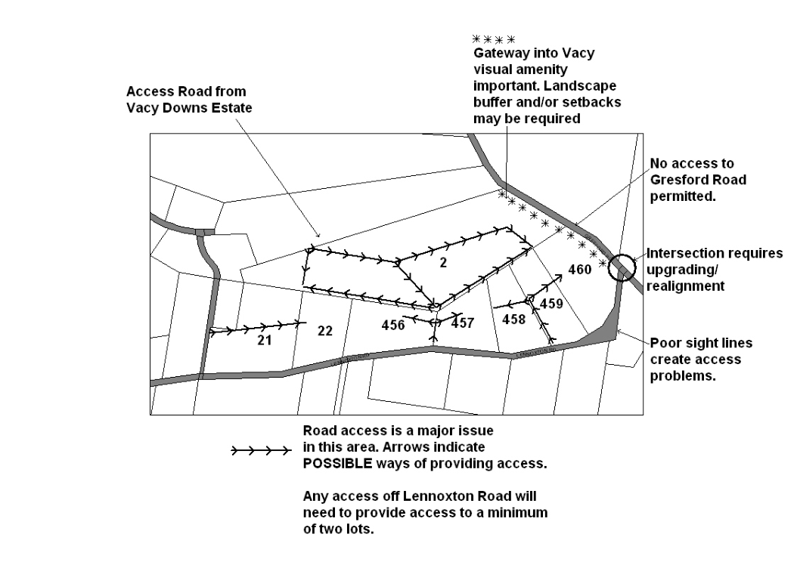

### 3.4 PLANNING AREA A4

#### The Area

Planning Area A4 incorporates all lots within the area bounded by Gresford Road to the east, Lennoxton Road to the south, the Vacy Downs subdivision to the north and Serenity Way to the west.

Area A4 incorporates 8 lots:

Lot 2 DP665018 Lots 456, 457, 458, 459, 460 DP749158 Lots 21, 22 DP 776533

#### Development Potential

Further subdivision of Area A4 is constrained by the existing pattern of subdivision and the frontage of the lots to collector roads - Gresford Road and Lennoxton Road.  The Lennoxton - Gresford Road intersection needs to be re-aligned and there is a bend in Lennoxton Road just west of the intersection which creates visibility problems for access and egress in this area.  Lennoxton Road and verges are narrow and in some areas, sight lines are limited.

There are also two stands of forest on Lot 2 as well as other native vegetation in the area that may need to be retained.  The creek lines through Lots 21, 22 and 2 need to be protected.

Most of Area A4 is bushfire prone.

Lot 2 DP665018 - Lot 2 is a large parcel of land that adjoins the southern boundary of the Vacy Downs subdivision.  A 20 metre wide road reserve has been provided in the Vacy Downs development to provide access to Lot 2.  Although this Lot has frontage to Gresford Road, access to Gresford Road (other than for emergency purposes) is not permitted.  An access road through Lot 2 could potentially provide access to the remainder of the Lots within Area A4.  The two stands of forest vegetation on this land are to be assessed to determine their habitat value.

Lot 21 DP776533 - Lot 21 has access off Serenity Drive and has the potential to be subdivided further.   Any subdivision should provide access to Lot 22, if access to this lot is not available from Lot 2.

Lot 460 DP 749158 - This lot has access constraints as it has frontage to two collector roads - Lennoxton and Gresford Road.  Subdivision will only be possible if access can be gained from Lot 2 or from the adjoining Lot 459.

Lot 459 DP 749158 - The width to depth ratio of this lot is not sufficient to allow subdivision of this lot on an individual basis.  Any subdivision is to be undertaken in conjunction with an adjoining lot or lots.

Lots 456, 457 and 458 DP749158 and Lot 22 DP776533 - subdivision of these Lots can only proceed if access can be resolved so that no additional drive-way or right-of way access is provided to Lennoxton Road.

For the Lots with frontage to Lennoxton Road, cul-de-sac road access, with properly formed intersections will be considered if the cul-de-sac enables subdivision of two or more properties.  For example a 'T' shaped cul-de-sac could be developed along the property boundary between Lots 458 and 459 with the cross-road extending across the Lots 458 and 459 to provide access to Lots 457 and 460.

### PLANNING AREA A4

> [Picture on page 37: a picture, saved as a picture (images/part-d3-vacy-local-area-plan-page-37-7.gif, 150 dpi).]

#### Masterplan

A basic Masterplan is required for the total area to identify an appropriate road network and subdivision layout.

#### Issues & Performance Criteria

In addition to the planning controls setout in the LEP, DCP and Rural Strategy, the planning and assessment process for Area A4 must address:

| Issue | Planning Considerations / Performance Criteria |
|---|---|
| Existing pattern of subdivision and | For subdivision to occur, Area 4 will require a |

| access constraints are not conducive to subdivision of individual lots. Land- owners will need to work together to achieve subdivision | masterplan that details the road and lot layouts. |
|---|---|
| Access to Gresford Road | For new lots created, no private driveway or right-of-way access to Gresford Road is permitted. An emergency access road (as per the Vacy Downs subdivision) may be approved. |
| Access to Lennoxton Road | For new lots created, no private driveway or right-of-way access to Lennoxton Road is permissible. Cul-de-sac access from Lennoxton Road may be permitted if the cul-de-sac provides access to at least 2 lots and the intersection with Lennoxton Road is properly formed and appropriately sited. |
| Pedestrian and Cycle Access | Provision needs to be made to link with access ways in Area A3. |
| Gresford Road is an entry point to Vacy. The visual Impact of development visible from Gresford Road needs to be minimised. | Visual assessment is to be undertaken to determine set-back requirements. These may vary from the DCP, with the Visual Assessment requirements having precedence. No backyards to have direct frontage to Gresford Road. Council may require a landscape buffer / corridor tree planting along the Gresford Road frontage to create a village entry statement. |
