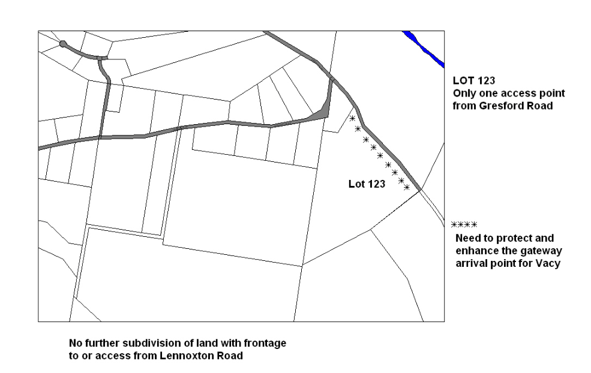

### 3.6 PLANNING AREA A6

#### The Area

Planning Area A6 lies to the south of Lennoxton Road.  It incorporates 13 lots:

Lot 11 DP773693 Lot 123 DP1063557 (western part) Lots 451, 452, 453 DP718765 Lots 461, 462 DP749158 Lots 30, 31 DP570356 Lots 32, 33, 34 DP634949 Lot 301 DP747479

#### Development Potential

The development potential of Area A6 is extremely limited, with the area having the following constraints:

Hilly to steep slopes - the area occupies the lower sideslopes of Mount Johnstone. Mount Johnstone is an important landmark that is highly visible within the Vacy area. The mountain and surrounding slopes and ridges have been identified by the Vacy community as having high scenic value. Much of the area is forested, with dense forest on the steeper slopes. The forest slopes are an important part of the 'backdrop' to Vacy. The area has high habitat value and is part of a wildlife corridor. The area has a high bushfire risk. The existing pattern of subdivision is not conducive to further subdivision.

Additional driveway or right-of-way access off Lennoxton Road is not permitted.  With the topography of the area it is difficult to provide an internal road network.

Given the constraints in this area and the availability of far more suitable land for Rural Lifestyle/ rural enterprise development in the Vacy area, no further subdivision of the following lots with frontage to or access from Lennoxton Road will be permitted:

- Lot 11 DP773693

- Lots 451, 452, 453 DP718765

- Lots 461, 462 DP749158

- Lots 30, 31 DP570356

- Lots 32, 33, 34 DP634949

- Lot 301 DP747479

Lot 123 DP1063557 (western part) - This is a large parcel of land on the eastern side of Area A6.  Lot 123 is accessed off and orientated to Gresford Road.  This lot has been largely cleared and is under pasture.  This lot is suitable for Rural Lifestyle / Rural Enterprise development.  Any development of this site must meet the following criteria.

One access point only to Gresford Road.  This access point will be a properly formed and sited road.  The location and design of the intersection is to be determined in consultation with Council and the RTA.

For new lots created, no private driveway or right-of-way access to Gresford Road is permitted.

Dwellings are to be located on the 'flat' areas not on the side slopes of Mount Johnstone.

Clearing of trees on the site is not permissible.

This site forms part of the entrance to Gresford.  A visual analysis is required as part of the development application process.  Any development needs to protect and/or enhance the visual amenity of the town entry.  Development will need to be well set-back from Gresford Road, with no backyards visible from the road.  Council may require a landscape buffer and/or corridor tree planting along the Gresford Road frontage to create a village entry statement.

### PLANNING AREA A6

> [Picture on page 41: a picture, saved as a picture (images/part-d3-vacy-local-area-plan-page-41-2.gif, 150 dpi).]
