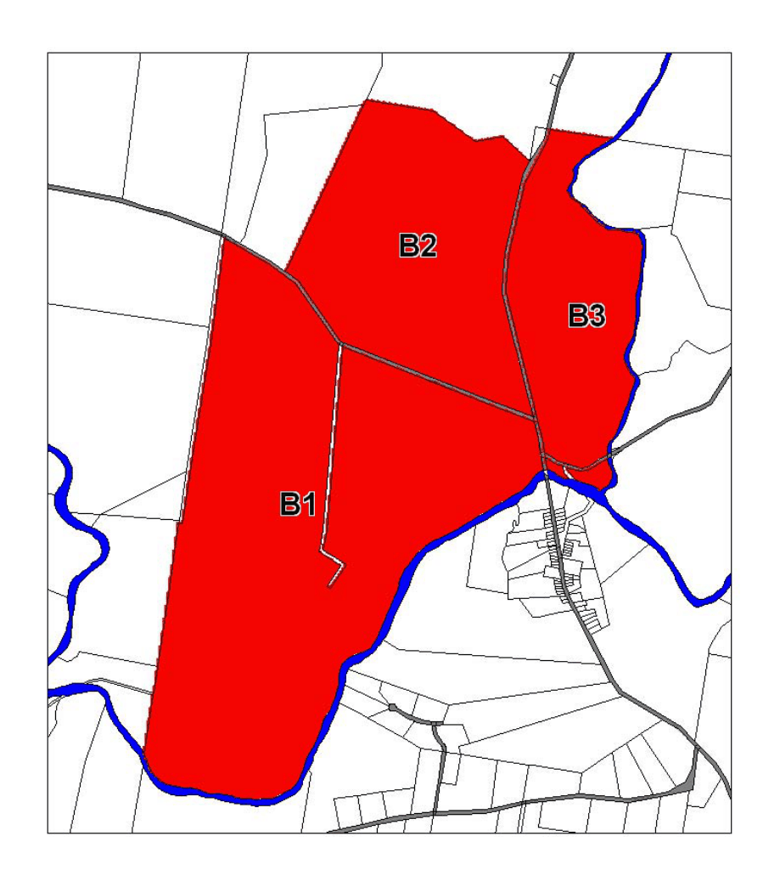

## 4. PRECINCT B – VACY NORTH

Precinct B incorporates the area to the north of the Paterson River and to the west of the Allyn River.

This Precinct is divided into three planning areas, numbered Planning Areas B1, B2 and B3.

> [Picture on page 42: a picture, saved as a picture (images/part-d3-vacy-local-area-plan-page-42-6.gif, 150 dpi).]
