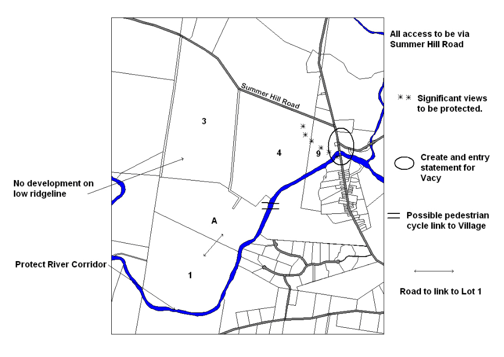

### 4.1 PLANNING AREA B1

#### The Area

Planning Area B1 is located to the west of Vacy.  The area is bounded by the Paterson River to the south, Summer Hill Road to the north and Gresford Road to the east.  Area B1 incorporates six parcels of land:

Lot 8 DP 37244 Lot 9 DP37244 Lot 3, 4 DP321121 Lot A DP384638 Lot 1 DP131554

Lot 8 is a residential size lot and no further subdivision is permitted.

The remainder of the lots within this area are rural holdings.  Lots 3, 4 and 9 have direct access from Summer Hill Road.  There is a road reserve (unformed road) that provides access to Lot A.  Lot 1 is land-locked.

#### Development Potential

Area B1 is ideal for subdivision for Rural Lifestyle or Rural Enterprise uses.  Most of the area is flat to undulating with a row of small hills along the western boundary of the Investigation Zone.

This area has been identified by the Vacy community as having high scenic value with the view being rich river flats extending to the small row of hills.  Both the river flats and the hills are considered important.  Many of the houses in and around Vacy have views of this

area.   The land adjoining the Paterson River appears to be flood prone.

Summer Hill Road is also the access road to Eaglereach Resort.  This is large, up-market resort that is located on the ridge overlooking the Vacy area.  The rural scenery along Summer Hill Road forms part of the attraction base of the area.

#### Masterplan

Due to the size and importance of this area, a masterplan is required. The plan will set the framework for co-ordinated and integrated development of this area.

The Masterplan is to address:

Access - all access is to come off Summer Hill Road, with no access available from Gresford Road. Pedestrian and cycle access between the site and the Village.  At the Vacy community meeting it was suggested that a pedestrian bridge be constructed over the Paterson River.  This bridge would link Area B1 to the village centre via Area A1. Protection of the Riparian corridor along the Paterson River and other creeks within the area. The visual amenity and character of the area - The Masterplan will identify areas of high scenic value and include provisions for protection of these areas. Floodprone land.  Rural Lifestyle and Rural Enterprise development is not permissible on land below the 1:100 year flood level.

### PLANNING AREA B1

> [Picture on page 44: a picture, saved as a picture (images/part-d3-vacy-local-area-plan-page-44-2.gif, 150 dpi).]

#### Issues & Performance Criteria

In addition to the planning controls setout in the LEP, DCP and Rural Strategy, the planning and assessment process for Area B1 must address:

| Issue | Planning Considerations / Performance Criteria |
|---|---|
| Achieving co-ordinated development | Masterplan required to provide the framework and direction for development of this area. |
| Lot 8 DP 37244 | No further subdivision of this lot. |
| Access to Collector Roads - Gresford Road and Summer Hill Road. | No vehicle access to/from Gresford Road, all access via Summer Hill Road. New lots created cannot have private driveway or right of way access to Summer Hill Road. Access into Area B1 must be via sealed |

|  | access roads. It needs to be demonstrated that access can be achieved safely and is supported by Traffic Committee and Council. |
|---|---|
| Linked internal road network | Road network must provide access to Lot 1 DP131554 which is landlocked. Lot 9 to be integrated with adjoining lot. Internal roads to be sealed to minimise impact on river. |
| Gresford Road is an entry point to Vacy. The visual Impact of development along Gresford Road needs to be minimised. | Visual assessment to be undertaken to determine set-back requirements. These may vary from the Shire-wide DCP, with the Visual Assessment requirements having precedence. Council may require a landscape buffer / corridor tree planting along the Gresford Road frontage to create a village entry statement. No backyards to have direct frontage to Gresford Road. |
| Summer Hill Road - retain the rural character of the road corridor. | Development to be set-back and screened where possible from Summer Hill Road. No backyards to have direct frontage to Summer Hill Road. |
| Visual impact - The view over this area from Gresford and Summer Hill Roads has been identified by the local community as having high scenic value. The small hills along the western boundary of this area are also considered visually important. | Detailed view-shed analysis - visual assessment to be undertaken prior to development, with provisions determined to protect the visual amenity of the area. No development along ridgelines or on hill crests. |
| Provision of pedestrian and cycle access through Area B1 to Vacy Villge | Explore feasibility of a pedestrian-cycle bridge over the Paterson River to link Area B1 with Vacy Village via Area A1. Provide pedestrian -cycle link through Lot 9 to connect with Vacy Bridge. Ideally the access / egress point to Gresford Road, needs to be located as close as possible to the Vacy Bridge. A link needs to be provided through Lots 4 and/or 9 to Area B2. If access is to be provided via a shared pathway along Summer Hill and Gresford Road rather than through Lot 9, then the pathway has to be well set-back from the road in order to minimise risk from traffic. |

| Paterson River Foreshore | Riparian vegetation corridor to be defined and protected. No additional riverfront lots or riparian rights to be created. The need for public access to the river foreshore to be assessed and addressed. |
|---|---|
| Flooding | Assessment required to determine the 1:100 year flood level. No Rural Lifestyle or Rural Enterprise development is permissible below the 1:100 year flood level. |
