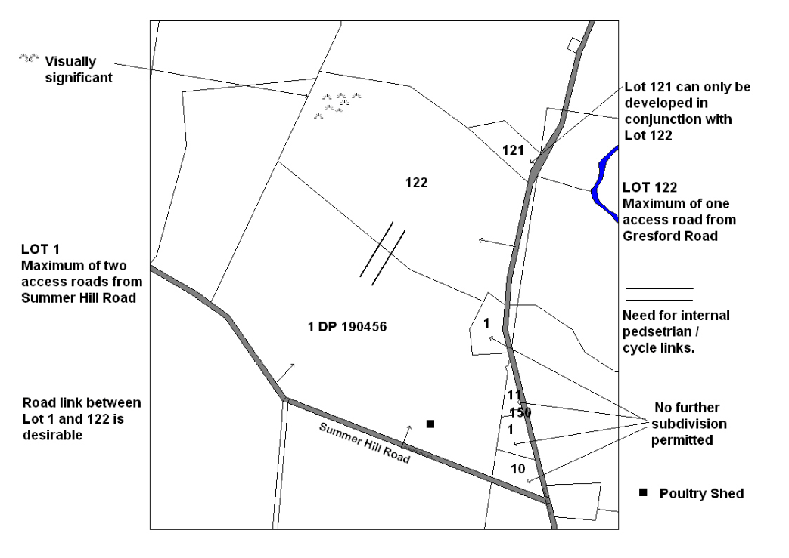

### 4.2 PLANNING AREA B2

#### The Area

Planning Area B2 is located to the north-west of Vacy.  Th area is bounded by Gresford Road to the east, Summer Hill Road to the south and the Mount Breckin Range to the

west.  Planning Area B2 incorporates 8 lots:

Lot 121, 122 DP706044 Lot 1 DP190456 Lot 1 DP996167 Lot 11 DP137145 Lot 150 DP538176 Lot 1 DP745198

Lot 1 DP996167, Lot 11 DP137145, Lot 150 DP538176 are zoned Rural Lifestyle.

Lot 1 DP190456 is accessed off Summer Hill Road.  All other lots are accessed from Gresford Road.

#### Development Potential

#### Lot 1 DP996167, Lot 11 DP137145, Lot 150 DP538176, Lot 1 DP745198 and Lot 10

DP37244 are zoned Rural Lifestyle and no further subdivision is permissible.

Lot 1 DP190456 appears highly suitable for development.  There are poultry sheds on this Lot.  If the sheds are operational then an appropriate a buffer, as per the Shire-wide DCP requirements, is to be provided.  Access to Lot 1 is to be from Summer Hill Road.

Lots 121 and 122 DP706044 - Lot 122 appears suitable for development.  Lot 121 is a small, narrow lot.  Further subdivision of Lot 121 can only be undertaken in conjunction with development of Lot 122.  Lot 121 cannot be divided lengthways to create long narrow

lots.  The north-west corner of Lot 122 forms part of the sideslopes of the Mount Breckin Ridge. The Mountain Breckin Hills and ridgeline area is visually significant within the Vacy area and is to be protected.

#### Masterplan

A masterplan will not be required if the subdivision planning makes provision for pedestrian and cycle links between Lot 1 DP190456 and Lot 122 DP706044.

It would also be desirable to have an internal road link between the two lots however this may not be feasible due to Bucks Creek.

Any planning of Lot 122 needs to take into consideration Lot 121.

### PLANNING AREA B2

> [Picture on page 47: a picture, saved as a picture (images/part-d3-vacy-local-area-plan-page-47-7.gif, 150 dpi).]

#### Issues & Performance Criteria

In addition to the planning controls setout in the LEP, DCP and Rural Strategy, the planning and assessment process for Area B2 must address.

| Issue | Planning Considerations / Performance Criteria |
|---|---|
| Land that can be subdivided. | Lot 1 DP190456 and Lot 122 DP706044 are suitable for subdivision. These lots can be developed individually provided that there is a pedestrian-cycle links between the two areas. |

|  | No further subdivision of lots already zoned Rural Lifestyle. Further subdivision of Lot 121 can only occur in conjunction with development of Lot 122. |
|---|---|
| Access to Collector Roads - Gresford Road and Summer Hill Road. | New lots created cannot have private driveway or right of way access to Gresford Road or Summer Hill Road. Lot 122 can have a maximum of one access road from Gresford Road. Lot 1 DP190456 can have a maximum of 2 access roads from Summer Hill Road. Access roads must be sealed. It needs to be demonstrated that access can be achieved safely and is supported by Traffic Committee and Council. |
| Internal Road network | Desirable to have an internal road link between Lot 1 DP 190456 and Lot 122 DP706044. |
| Pedestrian - cycle links | Need for internal link pedestrian/cycle links between Lot 1 DP 190456 and Lot 122 DP706044. The route to integrate with the pedestrian- cycle route in Area B1 that provides access to Vacy Bridge. |
| Gresford Road is an entry point to Vacy. The visual Impact of development along Gresford Road needs to be minimised. | Visual assessment to be undertaken to determine set-back requirements. These may vary from the Shire-wide DCP, with the Visual Assessment requirements having precedence. Council may require a landscape buffer / corridor tree planting along the Gresford Road frontage to create a village entry statement. No backyards to have direct frontage to Gresford Road. |
| Summer Hill Road - retain the rural character of the road corridor. | Development to be set-back and screened where possible from Summer Hill Road. No backyards to have direct frontage to Summer Hill Road. |
| Breckin Range - minimise visual impact of development | Visual assessment to be undertaken and development sited to minimise visual impact. |

Poultry Shed

If operational, appropriate buffers to be provided as per Shire-wide DCP provisions.
