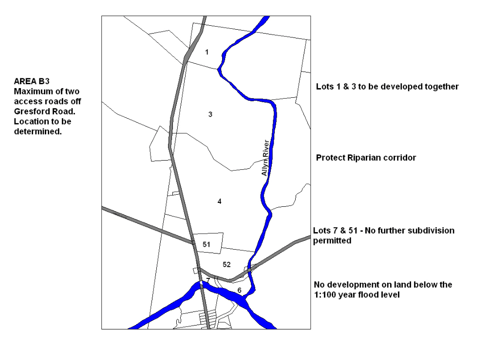

### 4.3 PLANNING AREA B3

#### The Area

Planning Area B3 is bounded by the Allyn River to the east, Paterson River to the south and the Gresford Road to the west.    Planning Area B3 incorporates 7 lots.

Lot 1 DP34831 Lots 3, 4 DP37244 Lot 51 DP809914 Lot 52 DP647054 Lots 6, 7 DP37244

There are also two very long narrow lots, fronting Gresford Road that appear to have been created by adjustments to the road reserve.

Lot 51 DP809914 and Lot 7 DP37244 are zoned for Rural Lifestyle.  Lot 6 DP37244 is located at the confluence of the Allyn and Paterson Rivers and is zoned 7(a) Environment.

#### Development Potential

Lot 51 DP809914 and Lot 7 DP37244 are zoned for Rural Lifestyle and no further subdivision is permitted.

Lot 6 DP37244 is zoned 7(a) Environment and no further subdivision or development is permitted.

Lot 1 DP34831 is a smaller lot.  Lot 1 can only be subdivided if this can be achieved without creating any additional lots with river frontage or lots that require driveway or right-of-way access from Gresford Road.  It may be possible to achieve this if Lot 1 is developed in conjunction with Lot 3 (adjoining land).

Lots 3 and 4 DP37244 maybe suitable for development subject to land capability assessment.  Parts of the area are subject to flooding along the Allyn River and Bucks Creek.  Rural Lifestyle and Rural Enterprise development is not permissible on land below the 1:100 year floodlevel.

Lot 52 DP647054 is also a smaller lot.   Subdivision potential will be determined by access. The site has frontage to two collector roads - Gresford Road and Horn Crossing Road.  No additional driveway or right-of way access can be provided from these roads. The Lot also has river frontage and no additional riverfront lots can be created.  It may be possible to subdivide this Lot in conjunction with development of Lot 4 (adjoining land).

Any development of Lots 3 and 4 will need to consider the feasibility of providing access to adjoining smaller lots.

#### Masterplan

A Masterplan will be required for Area B3.  The masterplan will need to address:

Land capability. Access and internal road network. Subdivision layout.  The feasibility of further subdivision of Lot 1 DP34831 and Lot 52

DP647054 needs to be considered as part of the subdivision planning. Flooding. Protection of the riparian corridors. Minimising the visual impact of development along Gresford Road. Pedestrian and cycle links.

At the Vacy community meeting it was suggested that a pedestrian bridge be provided across the Paterson River, just upstream of the confluence with the Allyn River.  The nominated route was the road reserve located between Lots 6 and 7 DP37244 that runs from Horn Crossing Road to the River.  There is another road reserve which links to this on the other side of the River (adjacent to the Motel).  It was also suggested that this route would link back across Gresford Road (possibly under the Vacy Bridge) into Area B1 and through to Area B2.

### PLANNING AREA B3

> [Picture on page 50: a picture, saved as a picture (images/part-d3-vacy-local-area-plan-page-50-17.gif, 150 dpi).]

#### Issues & Performance Criteria

In addition to the planning controls setout in the LEP, DCP and Rural Strategy, the planning and assessment process for Area B3 must address.

| Issue | Planning Considerations / Performance Criteria |
|---|---|
| Existing Rural Lifestyle Lots | No further subdivision permitted. |
| Inclusion of smaller lots. | Master-planning process to consider the feasibility of further subdivision of Lots 1 and 52 in conjunction with development of adjoining land. |
| Access to Collector Roads - Gresford and Horn Crossing Road | Maximum of two access roads from Gresford Road to service all of Area B3. These roads must be sealed and it needs to be demonstrated that access can be achieved safely and is supported by Traffic Committee and Council. No additional private driveway access or right- of-ways to Gresford or Horn Crossing Road can be created. |
| Internal Roads | While it would be desirable to have an internal road network that links through Area B3, this may not be possible given the creek systems and topography of the area. |
| Pedestrian and cycle access | Pedestrian and cycle links through the area must be provided. Consideration to be given to provide a pedestrian bridge across the Paterson River as proposed at the Vacy community meeting. |
| Gresford Road is an entry point to Vacy. The visual Impact of development along Gresford Road needs to be minimised. | Visual assessment to be undertaken to determine set-back requirements. These may vary from the Shire-wide DCP, with the Visual Assessment requirements having precedence. Council may require a landscape buffer / corridor tree planting along the Gresford Road frontage to create a village entry statement. No backyards to have direct frontage to Gresford Road. |
| Allyn River | No further riverfront lots or riparian rights to be created. |

|  | Riparian vegetation to be protected. Integrity of feeder creeks (eg Bucks Creek) to be protected. |
|---|---|
| Flooding | - Assessment required to determine the 1:100 year flood level. No Rural Lifestyle or Rural Enterprise development is permissible below the 1:100 year flood level. |
