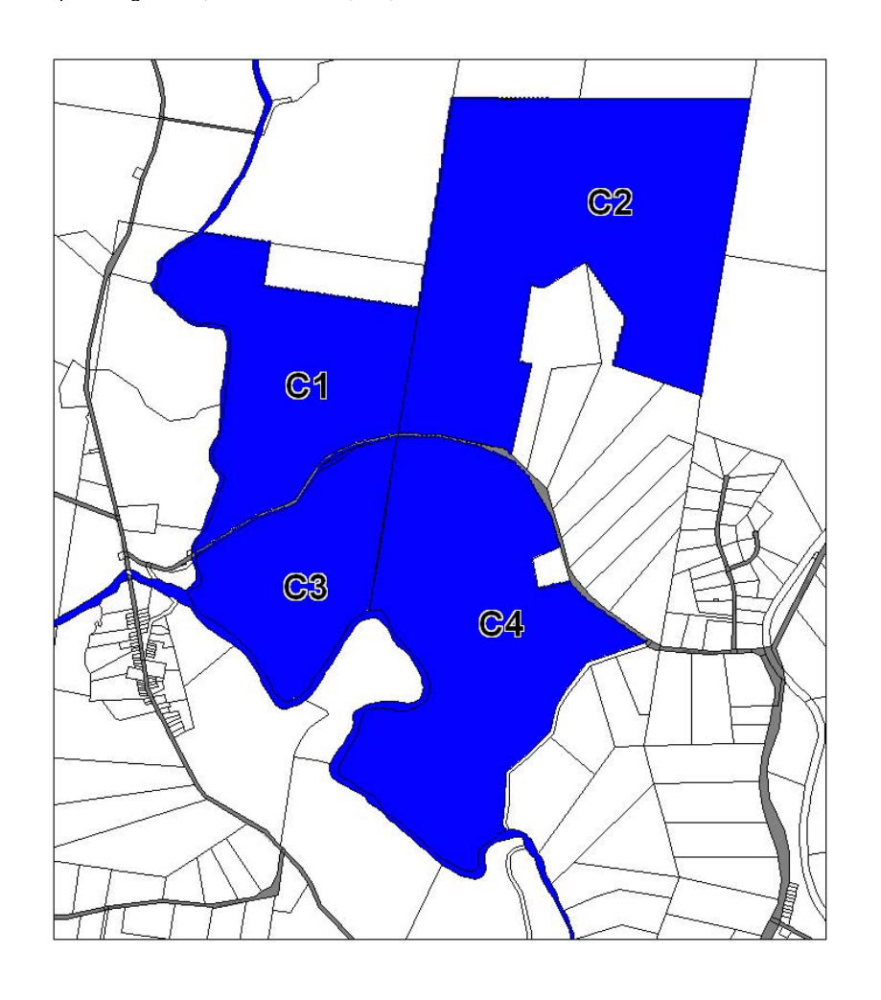

## 5. PRECINCT C - VACY EAST - HORNS CROSSING  RD

Precinct C incorporates the area within the investigation Zone to the east of the Paterson River.  This area extends along both sides of Horns Crossing Road.  Precinct C is divided into 4 planning areas, numbered C1, C2, C3 and C4.

> [Picture on page 53: a picture, saved as a picture (images/part-d3-vacy-local-area-plan-page-53-5.gif, 150 dpi).]
