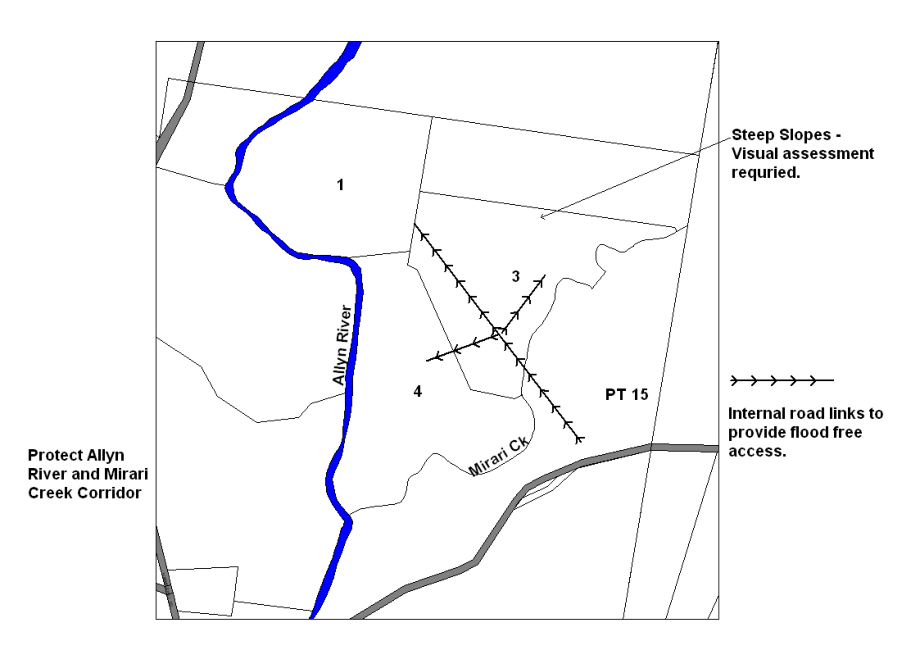

### 5.1  PLANNING AREA C1

#### The Area

Planning Area C1 is bounded by the Allyn River to the west and Horns Crossing Road to the south.  Area C1 incorporates 4 lots.

Lots 1, 3, 4 DP 195218 PT 15 DP753464

PT 15 has frontage to Horns Crossing Road.  Lots 1,3 and 4 do not have road access and are 'land-locked'.  PT 15, Lots 1 and 4 have frontage to the Allyn River.

#### Development Potential

Area C1 is dissected by Mirari Creek and an un-named creek system that feeds into the Allyn River.  Mirari Creek is a significant creek system which drains the area from Hilldale south to Martins Creek and west to the Allyn River.  Parts of Area C1 may lie below the 1:100 year flood level.  Part of the area adjacent to Mirari Creek is relatively steep rising to a hill-crest which is located just north of Area C1.

The development potential of this area will be determined by the land capability assessment.   Key issues in this area will be flooding, protection of the watercourses and access.   Horns Crossing is a collector road and no additional private driveway or right-of-way access from this road is permitted.

#### Masterplan

Not required, provided that a detailed land capability assessment is undertaken and applies to the total area.  This assessment will need to identify areas suitable for development, subdivision pattern, dwelling sites and the access and internal road network.

### PLANNING AREA C1

> [Picture on page 54: a picture, saved as a picture (images/part-d3-vacy-local-area-plan-page-54-18.gif, 150 dpi).]

#### Issues & Performance Criteria

In addition to the planning controls setout in the LEP, DCP and Rural Strategy, the planning and assessment process for Area C1 must address.

| Issue | Planning Considerations / Performance Criteria |
|---|---|
| Site topography, flooding and drainage constraints | Detailed land capability assessment to be undertaken. Assessment required to determine the 1:100 year flood level. No Rural Lifestyle or Rural Enterprise development is permissible below the 1:100 year flood level. |
| Access to Collector Roads - Horns Crossing Road | No additional private driveway access or right- of-way access to Horns Crossing Road to be created. |
| Internal Roads | Internal road network must provide access to Lots 1, 3 and 4 if these lots are assessed as suitable for development. |
| Pedestrian and cycle access | Pedestrian and cycle link through the area to provide access to Horns Crossing Bridge. Provision needs to be made for a link through to Area C2 which abuts the eastern boundary of area C1. |
| Visual Impact | The visual impact of any development along Horns Crossing Road needs to be minimised. No back yards to have direct frontage to Horns Crossing Road. Need to minimise the visual impact of development on the slopes and ridgeline along the northern boundary of Lot 3. |
| Vacy Entry Gateway | The area near the Horns Crossing Bridge is an entry point to Vacy. This area needs to be appropriately landscaped with a tree corridor, to create a sense of arrival. This gateway landscaping is to be planned in conjunction with the land across the road in Area C3. |
| Allyn River | No further riverfront lots or riparian rights to be created. Riparian vegetation to be protected. |

Integrity of feeder creeks (eg Mirari Creek) to be protected.
